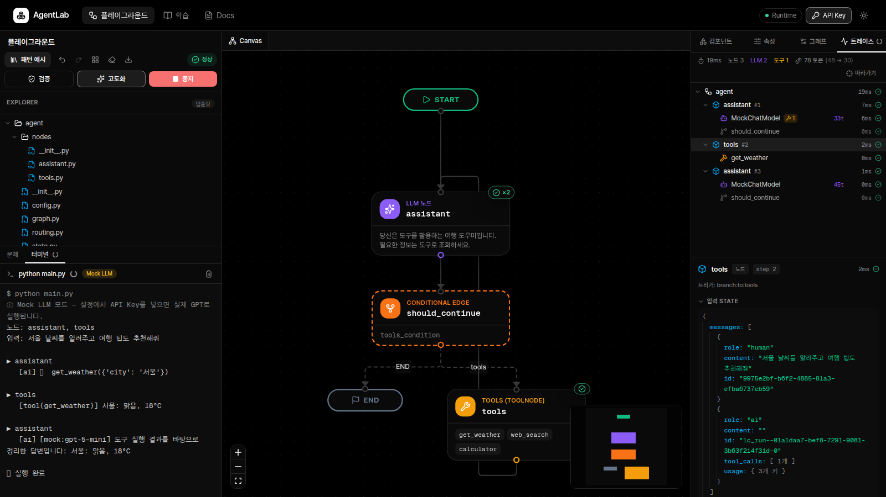
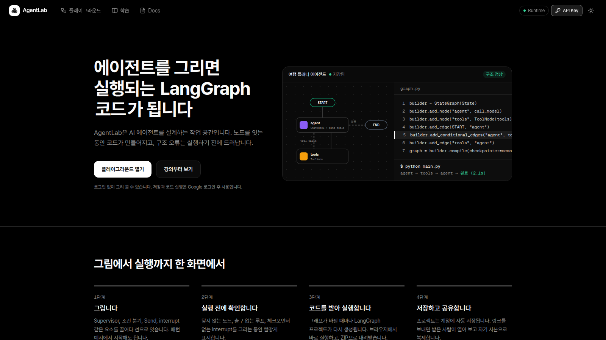
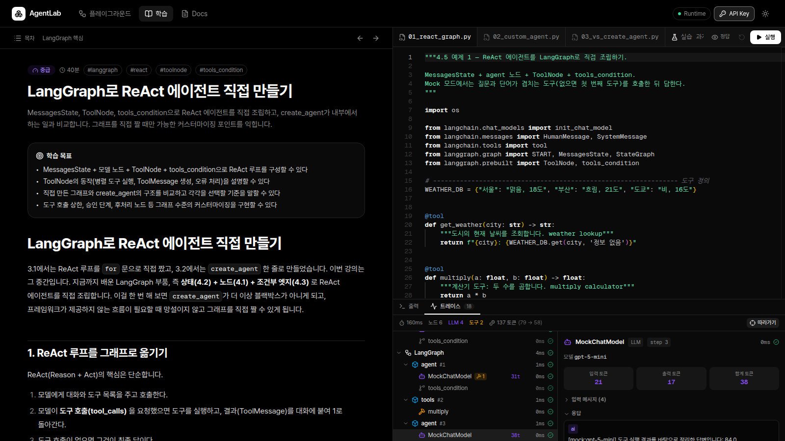
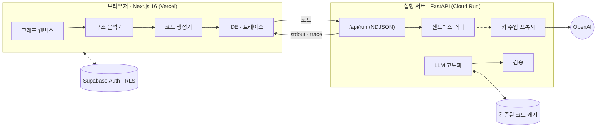

# AgentLab

[](https://github.com/flashattention/agent-lab/actions/workflows/ci.yml)
[](https://agentlab-ai.vercel.app)

**AI 에이전트를 그리면 실행되는 LangGraph 코드가 되는 작업 공간이자 학습 플랫폼입니다.**
그래프를 그리는 동안 구조 결함을 실행 전에 잡고, 생성된 코드를 격리된 샌드박스에서 돌리고, 노드마다 State, 메시지, tool_calls, 토큰이 실시간 트레이스로 보입니다.

**배포 주소: <https://agentlab-ai.vercel.app>** · LangChain 1.4 · LangGraph 1.2



## 무엇을 하나

| | |
|---|---|
| **그래프 → 코드** | 노드를 끌어다 잇는 동안 LangGraph 프로젝트(파일 트리)가 실시간으로 생성됩니다. 패턴 13종(ReAct, 라우터, 병렬, Map-Reduce, Reflection, Plan-Execute, Supervisor, 계층형 팀, Agentic RAG, Human-in-the-loop 등)을 제공하고, LLM 호출 없는 구조 테스트(pytest)가 든 ZIP으로 내려받습니다. |
| **Sub-agent · 프리셋** | Sub-agent 노드를 더블클릭해 안쪽 그래프를 편집합니다(중첩 가능, 묶기/펼치기, 격리·상태 공유 모드). 서브 에이전트마다 독립 패키지가 생성됩니다. 만든 에이전트는 프리셋으로 계정에 저장해 다른 그래프에 끌어다 넣고, JSON으로 팀원과 주고받습니다. |
| **에이전트 마켓** `/agents` | 프리셋을 링크로 공유하거나 공개 갤러리에 올리고, 다른 사람이 만든 에이전트를 검색해 내 그래프에 Sub-agent로 붙이거나 복제합니다. 공개는 직접 작성한 코드가 없는 에이전트만 가능하고(DB 제약으로 강제), 신뢰 배지는 보는 사람의 브라우저에서 직접 계산합니다. |
| **현업용 편집** | 노드별 모델 지정, 커스텀 `@tool`, 서브그래프·프로젝트를 넘나드는 복사/붙여넣기, ⌘K 노드 검색, `agentlab.json` 가져오기/내보내기. |
| **실행 전 구조 분석** | 끝나지 않는 루프, 출구 없는 노드, 도달할 수 없는 노드, 잘못된 식별자, 라우터·평가자 규칙 위반을 실행 전에 빨간색으로, 병목과 위험을 노란색으로 표시합니다. |
| **샌드박스 실행 + 실시간 트레이스** | 서버의 격리된 프로세스에서 코드를 실행하고, 그래프 → 노드 → LLM·도구 실행 트리와 입력 State, 반환값, 토큰을 실시간으로 보여 줍니다. 캔버스에서는 실행 중인 노드가 강조됩니다. |
| **검증된 LLM 고도화** | 원하면 고성능 LLM이 코드를 다듬습니다. 정적 검사와 실제 실행을 통과한 결과만 받아들이고, 구조별로 캐시해 이후 모든 사용자에게 LLM 호출 없이 제공합니다. |
| **학습** | 8개 모듈, 43개 강의입니다. 이론 옆의 IDE에서 예제를 실행하고 트레이스를 보며, 자동 채점 과제와 퀴즈를 풉니다. 한국어 API 레퍼런스 57편도 있습니다. |
| **프로젝트** | Google 로그인 후 자동 저장되고, 링크로 공유하면 받는 사람은 보기 전용으로 엽니다. |

| 첫 화면 (다크 / 라이트) | 강의 IDE와 트레이스 |
|---|---|
|  |  |

## 수치로 보는 품질

| 항목 | 결과 | 근거 |
|---|---|---|
| 생성된 패턴 코드 실행 성공률 (Mock LLM) | **36/36 (100%)** (패턴 12종 × 3회) | [EVAL.md §1](docs/EVAL.md#1-패턴-실행-12종--3회) |
| 실제 모델(gpt-5-mini) 실행 | **10/12** (실패 2건은 90초 실행 상한 초과, 코드 오류 아님) | [EVAL.md §4](docs/EVAL.md#4-실제-모델-gpt-5-mini-패턴-12종--1회) |
| 구조 분석기 결함 검출률 | **97/97**, 정상 변경 오탐 **0/48** | [EVAL.md §2](docs/EVAL.md#2-구조-분석기-결함-주입-실험) |
| 분석기가 없을 때 결함의 결과 | 예외 57% · 무한 루프 11% · **아무 증상 없음 32%** | [EVAL.md §3](docs/EVAL.md#3-분석기가-막지-않았다면) |
| 자동 테스트 | 백엔드 71 · 프론트엔드 89 · DB 권한 22 · 강의 코드 162 | [CI](.github/workflows/ci.yml) |
| 정적 검사 | ruff · ESLint · tsc 경고 0 | CI |

## 아키텍처



자세한 구조는 [docs/ARCHITECTURE.md](docs/ARCHITECTURE.md)에, 설계 결정과 대안은 [docs/DECISIONS.md](docs/DECISIONS.md)에 있습니다.

## 기술적으로 어려웠던 문제

### 1. 공개 서버에서 임의의 Python 실행하기
누구나 코드를 실행할 수 있는 서버라서 여러 겹으로 방어했습니다.
- 실행마다 새 임시 디렉터리를 만들고, 경로 탈출을 차단합니다.
- 최소한의 환경변수만 넘깁니다.
- `rlimit`으로 CPU, 메모리, 파일 크기, 프로세스 수를 제한합니다.
- 타임아웃이 나면 프로세스 그룹 전체를 kill합니다. 출력량에도 상한을 둡니다.

CI에서 강의 코드 162개를 모두 실행하게 만들자, **가상 메모리 상한(1GB) 때문에 멀티 에이전트 예제가 스레드를 만들지 못하던 운영 버그**가 드러났습니다. `RLIMIT_AS`는 실제 사용량이 아니라 스레드 스택 예약까지 센다는 점이 원인이었습니다. → [ARCHITECTURE §2](docs/ARCHITECTURE.md#2-샌드박스-실행-서버)

### 2. 사용자 API 키를 사용자 코드로부터 숨기기
공유 프로젝트 코드가 `os.environ`에서 방문자의 OpenAI 키를 읽어 외부로 보낼 수 있는 구멍을 찾았습니다. 이렇게 막았습니다.
- 샌드박스에는 **가짜 키와 로컬 프록시 주소**만 넘깁니다.
- 실행별 토큰을 받은 프록시가 진짜 키를 붙여 **허용된 추론 엔드포인트로만** 전달합니다.
- 가짜 OpenAI 서버로 키 비노출, 403/401 차단, 토큰 폐기를 테스트합니다. → [ARCHITECTURE §3](docs/ARCHITECTURE.md#3-api-키-보호-키-주입-프록시)

### 3. 코드를 고치지 않고 에이전트 실행 관찰하기
- 샌드박스 시작 시 LangChain 전역 콜백 훅에 트레이서를 등록합니다. 그래서 강의 코드든 생성 코드든 사용자가 붙여 넣은 코드든 **수정 없이** 노드별 State, tool_calls, 토큰이 수집됩니다.
- 이벤트는 stdout과 섞이지 않게 별도 파이프로 스트리밍합니다.
- LangGraph 내부 실행 단위는 숨기고, 서브그래프는 부모 노드 아래에 둡니다. → [ARCHITECTURE §4](docs/ARCHITECTURE.md#4-실행-트레이스)

### 4. 실행하기 전에 결함 잡기
결함을 일부러 넣은 그래프를 실행해 보면 **32%는 아무 오류 없이 지나갑니다.** 예를 들어 연결되지 않은 노드는 등록만 되고 실행되지 않고, 끊긴 END는 그냥 멈춥니다. 테스트로도 잡기 어려운 결함이라 그래프 단계의 정적 분석을 만들고, 결함 주입 실험으로 검출률과 오탐률을 측정했습니다. → [EVAL.md](docs/EVAL.md)

### 5. LLM 출력을 믿지 않는 코드 고도화
- LLM이 고친 코드는 ruff 검사와 Mock 모드 실제 실행을 둘 다 통과해야 채택합니다. 실패하면 오류 보고서를 붙여 최대 3회 다시 요청합니다.
- 통과한 결과는 그래프 구조 해시로 캐시합니다. 그래서 비용이 사용자 수가 아니라 서로 다른 구조의 수에 비례합니다. → [DECISIONS D2](docs/DECISIONS.md#d2-llm-출력은-실행해서-검증한-뒤에만-쓰고-구조-해시로-캐시)

## 기술 스택

| 영역 | 사용 |
|---|---|
| 프론트엔드 | Next.js 16 (App Router), React 19, TypeScript, Tailwind 4, React Flow, Monaco, Zustand |
| 백엔드 | FastAPI, Python 3.13, uv, LangChain 1.4, LangGraph 1.2, httpx |
| 데이터·인증 | Supabase (Google OAuth, Postgres RLS), GCS (캐시) |
| 인프라 | Vercel, Google Cloud Run (서울), Cloud Build, GitHub Actions |
| 품질 | pytest, vitest, ruff, ESLint, tsc |

## 프로젝트 구조

```
frontend/
  src/lib/playground/      그래프 모델 · 구조 분석기(analyze.ts) · 코드 생성기(codegen/) · 패턴
  src/lib/playground/subgraph.ts  서브그래프 순회 · 묶기/펼치기
  src/lib/presets.ts       에이전트 프리셋 · 마켓 (Supabase agent_presets · 브라우저 저장)
  src/components/market/   에이전트 마켓 (갤러리 · 상세 · 신뢰 배지)
  src/lib/trace.ts         실행 트레이스 → 트리 모델
  src/components/playground/  캔버스 · 툴바 · 패널 · 공유 실행 확인
  src/components/ide/      Monaco 에디터 · 콘솔 · 트레이스 패널
  content/learn/           강의 43개 (lesson.md, examples/, exercise.py, solution.py, quiz.json)
  content/docs/            한국어 API 레퍼런스
backend/
  app/runner.py            샌드박스 실행 (rlimit, 타임아웃, 출력 상한, 트레이스 파이프)
  app/keyproxy.py          API 키 주입 프록시
  app/validate.py          ruff + Mock 실행 검증
  app/refine.py            LLM 고도화 → 검증 → 보안 정책 → 구조 해시 캐시
  app/policy.py            고도화 코드 보안 정책 (AST 허용 목록)
  app/auth.py              Supabase 토큰 확인 · 하루 한도
  sandbox/                 Mock LLM, 실행 트레이서, 보안 정책 agentlab_guard (샌드박스 안에서 자동 로드)
  tests/                   pytest (fixtures/patterns.json: 프론트 생성 코드)
  scripts/                 강의 코드 검증 · eval
docs/                      아키텍처 · 설계 결정 · eval · 현업 준비(PRODUCTION_READINESS) · 스크린샷
supabase/schema.sql        projects · agent_presets(마켓) 테이블 · RLS 정책
supabase/tests/            스키마 · RLS · 권한 테스트 (Postgres 에서 실행)
```

## 로컬에서 실행

```bash
./start-local.sh            # 백엔드(:8000) + 프론트엔드(:3000)
```

또는 따로 실행합니다.

```bash
cd backend && uv sync && uv run uvicorn app.main:app --reload --port 8000
cd frontend && npm install && npm run dev
```

- **OpenAI 키:** 사이트 우상단 **API Key**에서 입력합니다. 키가 없으면 모든 코드가 Mock LLM 모드로 실행됩니다.
- **로그인과 프로젝트 저장 (선택):** `frontend/.env.example`을 `.env.local`로 복사해 Supabase 값을 채우고, 백엔드에 `SUPABASE_URL`, `SUPABASE_ANON_KEY`를 줍니다. 값이 없으면 로그인 없이 동작합니다. 설정 방법은 [DEPLOY.md](DEPLOY.md)의 0-1단계에 있습니다.

## 테스트와 검증

```bash
cd backend && uv run pytest -q                       # 샌드박스 · 보안 정책 · 키 프록시 · 트레이서 · API · 패턴 13종 실행
cd backend && uv run ruff check . && uv run ruff format --check .
cd backend && uv run python scripts/check_content.py # 강의 예제·정답 162개 실행

cd frontend && npm test                              # 구조 분석기 · 코드 생성기 스냅샷 · 서브그래프 · 트레이스 모델
cd frontend && npm run lint && npm run typecheck
cd frontend && npm run export:patterns               # 생성기를 바꾼 뒤 백엔드 fixture 갱신

psql -f supabase/tests/stub.sql -f supabase/schema.sql -f supabase/tests/rls_test.sql   # 빈 Postgres 에서 RLS·권한 검증
```

> 스레드가 많은 개발 PC에서는 `AGENTLAB_NPROC_LIMIT=0`이 필요할 수 있습니다. 테스트에서는 자동으로 설정됩니다.

eval 재현 방법은 [docs/EVAL.md](docs/EVAL.md)에 있습니다.

## 배포

현재 구성은 **Vercel(프론트엔드) + Cloud Run(백엔드) + Supabase**입니다. 단계별 절차와 비용, 다른 배포 방식은 [DEPLOY.md](DEPLOY.md)에 있습니다.

### 백엔드 환경변수

| 변수 | 기본값 | 설명 |
| --- | --- | --- |
| `SUPABASE_URL` / `SUPABASE_ANON_KEY` | (없음) | 지정하면 실행·검증·고도화에 로그인이 필요하고 사용자별 하루 한도가 적용됩니다 |
| `AGENTLAB_CORS_ORIGINS` | `*` | 허용할 프론트엔드 Origin (쉼표로 구분) |
| `AGENTLAB_CORS_ORIGIN_REGEX` | (없음) | 정규식 CORS 허용 (Vercel 프리뷰 주소 등) |
| `AGENTLAB_MAX_CONCURRENCY` | 8 | 인스턴스당 동시에 실행할 수 있는 코드 수 |
| `AGENTLAB_MAX_TIMEOUT` | 90 | 실행 1회의 최대 시간(초) |
| `AGENTLAB_MEM_LIMIT_MB` | 3072 | 실행 1회의 가상 메모리 상한 (`RLIMIT_AS`). 스레드 스택 예약까지 세므로 너무 낮으면 멀티 에이전트 코드가 실패합니다 |
| `AGENTLAB_NPROC_LIMIT` | 256 | 프로세스·스레드 수 상한 (`RLIMIT_NPROC`). 0이면 적용하지 않습니다 |
| `AGENTLAB_RATE_RUN` / `_VALIDATE` / `_REFINE` | 30 / 15 / 6 | IP별 분당 요청 수 |
| `AGENTLAB_DAILY_RUN` / `_VALIDATE` / `_REFINE` | 200 / 100 / 20 | 사용자별 하루 한도 |
| `AGENTLAB_REFINE_MODEL` | `gpt-5` | 모델을 지정하지 않았을 때 쓰는 고도화 모델 |
| `AGENTLAB_CACHE_BUCKET` | (없음) | 지정하면 GCS 버킷을 고도화 캐시로 사용 (Cloud Run) |
| `AGENTLAB_CACHE_DB` | `data/refine_cache.sqlite` | 로컬·VPS용 고도화 캐시 |
| `AGENTLAB_EGRESS_ALLOW` | (없음) | 샌드박스가 직접 접속할 수 있는 추가 호스트. OpenAI 는 키 프록시를 거치므로 넣지 않습니다 |
| `AGENTLAB_TRUSTED_PROXY_HOPS` | 1 | 앞단 프록시 수. `X-Forwarded-For` 오른쪽에서 이만큼 떨어진 값을 클라이언트 IP로 씁니다. 직접 노출이면 0 |
| `AGENTLAB_MAX_BODY_MB` | 4 | 요청 본문 상한 |
| `AGENTLAB_MAX_FILES` / `AGENTLAB_MAX_TOTAL_BYTES` | 256 / 2000000 | 실행·검증 요청의 파일 수와 총 크기 상한 |

## 보안

공개 서버에서 임의의 Python을 실행하고, 방문자의 API 키를 다룹니다.

- **샌드박스:** 실행마다 새 임시 디렉터리를 쓰고, 경로 탈출을 차단하고, 최소 환경변수만 넘깁니다. rlimit(CPU, 메모리, 파일, 프로세스)과 프로세스 그룹 단위 타임아웃 kill, 출력 상한을 적용하고, non-root 컨테이너에서 돕니다.
- **샌드박스 네트워크·프로세스:** PEP 578 audit hook 이 키 프록시 주소 외의 모든 연결(클라우드 메타데이터 서버 포함)과 외부 프로그램 실행을 막습니다. `python -I`, `env={}` 로 띄운 자식 프로세스에도 같은 정책이 걸립니다.
- **고도화 캐시:** LLM 이 다듬은 코드는 AST 허용 목록 검사(네트워크·파일·프로세스·비밀 환경 변수 접근 금지)를 통과해야 공유 캐시에 저장되고, 캐시 결과는 자동 적용하지 않습니다.
- **API 키:** 기본은 이 탭(sessionStorage)에만 보관되고 설정에서 "계속 기억"을 켜야 localStorage 에 남습니다. 실행 요청 헤더로만 전달됩니다. 서버는 키를 저장하거나 기록하지 않습니다. **실행 코드에는 가짜 키만 넘기고**, 키 주입 프록시가 허용된 OpenAI 추론 엔드포인트에만 진짜 키를 붙입니다.
- **공유 코드:** 다른 사람이 작성한 코드(수정한 파일, 서브 에이전트 안쪽까지의 Function 노드 코드, 커스텀 도구)가 있는 공유 프로젝트를 내 키로 실행하기 전에 확인을 받습니다. Mock 모드로 실행하는 선택지도 있습니다.
- **요청 한도:** 요청 본문·파일 크기 상한, IP별 분당 한도(`X-Forwarded-For`는 신뢰하는 프록시가 덧붙인 오른쪽 값을 사용)와 사용자별 하루 한도, Cloud Run 최대 인스턴스로 비용 상한을 둡니다.
- **에이전트 마켓:** 공개 갤러리는 Function 노드·커스텀 도구가 없는 선언형 에이전트만 받습니다(DB 제약). 링크 공유는 id 를 아는 사람만 RPC 로 열 수 있어 목록 조회로 훑을 수 없고, 작성자 이름·설치 수·숨김 여부는 열 단위 권한으로 클라이언트가 바꿀 수 없습니다. 신고 5건이면 자동으로 숨깁니다.
- **데이터:** 프로젝트 접근은 Postgres RLS가 정합니다. 사이트에는 보안 헤더(`X-Frame-Options`, `nosniff`, `Referrer-Policy`, `Permissions-Policy`)를 붙입니다.

## 알려진 한계

솔직하게 적어 둡니다. 다음 단계의 후보이기도 합니다.

- **샌드박스 격리 수준:** 사용자 코드는 서버와 같은 컨테이너, 같은 계정(uid)에서 subprocess로 돕니다. 커널을 공유하므로 VM 수준의 격리는 아닙니다. 규모가 커지면 gVisor·Firecracker나 실행별 컨테이너로 옮겨야 합니다.
- **아웃바운드 네트워크:** 프로세스 안의 audit hook 으로 키 프록시 외 연결을 막지만, `ctypes` 로 libc 를 직접 호출하면 우회할 수 있습니다. 인프라 수준 이그레스 제한(무권한 실행 서비스 + VPC 방화벽)은 아직입니다. → [PRODUCTION_READINESS §6](docs/PRODUCTION_READINESS.md)
- **한도 저장소:** 분당·하루 한도를 인스턴스 메모리에 기록합니다. 인스턴스가 여러 개가 되거나 재시작되면 실제 허용량이 커질 수 있습니다. 지금은 최대 인스턴스 1로 비용 상한을 보장합니다.
- **분석기 범위:** 구조 규칙 기반이라, 프롬프트 품질 같은 의미 수준의 오류는 잡지 못합니다.
- **트레이스 범위:** LangChain/LangGraph를 거치지 않는 호출(OpenAI SDK 직접 호출 등)은 트레이스에 나오지 않습니다.
- **실행 시간 상한:** 실행 1회는 최대 90초입니다. 직렬 LLM 호출이 많은 멀티 에이전트 패턴(Plan-Execute, Supervisor)은 실제 모델에서 이 상한을 넘깁니다([EVAL.md §4](docs/EVAL.md#4-실제-모델-gpt-5-mini-패턴-12종--1회)).

## 문서

| 문서 | 내용 |
|---|---|
| [docs/ARCHITECTURE.md](docs/ARCHITECTURE.md) | 요청 흐름, 샌드박스, 키 프록시, 트레이스, 코드 생성, 캐시, 품질 체계 |
| [docs/DECISIONS.md](docs/DECISIONS.md) | 설계 결정, 버린 대안, 대가 |
| [docs/EVAL.md](docs/EVAL.md) | 패턴 실행, 결함 주입, 런타임 영향 측정 |
| [docs/PRODUCTION_READINESS.md](docs/PRODUCTION_READINESS.md) | 현업 사용을 위한 기능·보안 점검, 구현 내역, 후속 과제 |
| [DEPLOY.md](DEPLOY.md) | Vercel + Cloud Run + Supabase 배포 절차와 비용 |
| [CURRICULUM.md](CURRICULUM.md) · [CONTENT_GUIDE.md](CONTENT_GUIDE.md) | 강의 구성과 작성 규칙 |

## 라이선스

[MIT](LICENSE)
