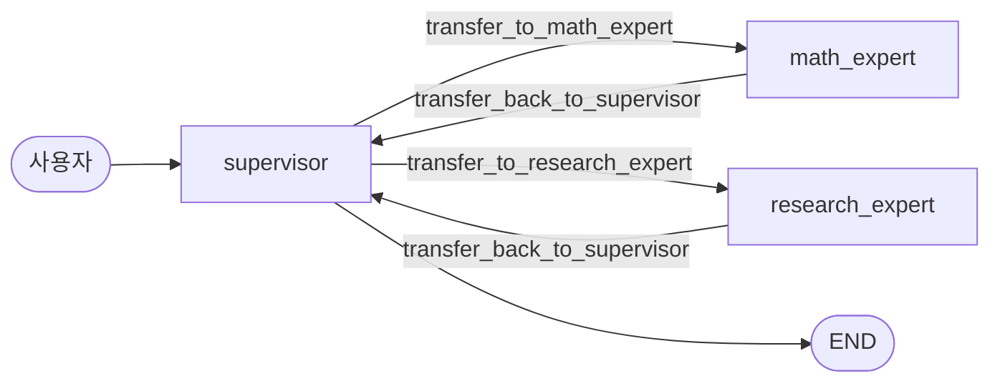

`create_supervisor`는 감독자(Supervisor) 에이전트 1개와 작업자(Worker) 에이전트 여러 개로 이루어진 멀티 에이전트 그래프를 만듭니다. 감독자는 작업자마다 자동 생성된 `transfer_to_<이름>` 도구로 제어를 넘기고, 작업자가 끝나면 제어가 감독자에게 돌아옵니다. 반환값은 **컴파일 전 `StateGraph`**입니다. 설치 버전: `langgraph-supervisor` 0.0.31.



## Import

```python
from langgraph_supervisor import create_supervisor, create_handoff_tool, create_forward_message_tool
```

## 시그니처

```python
def create_supervisor(
    agents: list[Pregel],
    *,
    model: LanguageModelLike,
    tools: list[BaseTool | Callable] | ToolNode | None = None,
    prompt: str | SystemMessage | Callable | Runnable | None = None,
    response_format: dict | type[BaseModel] | tuple[str, dict | type[BaseModel]] | None = None,
    pre_model_hook: RunnableLike | None = None,
    post_model_hook: RunnableLike | None = None,
    parallel_tool_calls: bool = False,
    state_schema: type[StateSchema] | None = None,
    context_schema: type[Any] | None = None,
    output_mode: Literal["full_history", "last_message"] = "last_message",
    add_handoff_messages: bool = True,
    handoff_tool_prefix: str | None = None,
    add_handoff_back_messages: bool | None = None,
    supervisor_name: str = "supervisor",
    include_agent_name: Literal["inline"] | None = None,
) -> StateGraph

def create_handoff_tool(*, agent_name: str, name: str | None = None,
                        description: str | None = None, add_handoff_messages: bool = True) -> BaseTool

def create_forward_message_tool(supervisor_name: str = "supervisor") -> BaseTool
```

## 파라미터

| 파라미터 | 타입 | 기본값 | 설명 |
|---|---|---|---|
| `agents` | `list[Pregel]` | (필수) | 작업자 그래프 목록. **각각 `name`이 있어야 함**(`create_agent(..., name="math_expert")`). `RemoteGraph`도 가능 |
| `model` | `LanguageModelLike` | (필수) | 감독자 모델. 문자열이 아닌 **모델 객체**(`init_chat_model(...)`)를 넘김 |
| `tools` | `list \| ToolNode \| None` | `None` | handoff 도구 외에 감독자가 쓸 추가 도구 |
| `prompt` | `str \| SystemMessage \| Callable \| Runnable` | `None` | 감독자 시스템 프롬프트 |
| `response_format` | 스키마 | `None` | 감독자 최종 구조화 출력(`structured_response` 키) |
| `parallel_tool_calls` | `bool` | `False` | 감독자가 여러 작업자에게 동시에 넘길 수 있는지(OpenAI·Anthropic만) |
| `state_schema` / `context_schema` | `type` | `None` | 상태·런타임 컨텍스트 스키마 |
| `output_mode` | `"full_history" \| "last_message"` | `"last_message"` | 작업자 결과 중 전체 대화를 남길지, 마지막 메시지만 남길지 |
| `add_handoff_messages` | `bool` | `True` | handoff 시 (AIMessage, ToolMessage) 쌍을 기록 |
| `handoff_tool_prefix` | `str \| None` | `None` | handoff 도구 이름 접두사. 기본 `transfer_to_` |
| `add_handoff_back_messages` | `bool \| None` | `None` | 작업자 → 감독자 복귀 시 메시지 쌍 기록 |
| `supervisor_name` | `str` | `"supervisor"` | 감독자 노드 이름 |
| `include_agent_name` | `"inline" \| None` | `None` | `"inline"`이면 AIMessage 본문에 `<name>` 태그로 에이전트 이름을 넣음(이름 필드를 지원하지 않는 모델용) |

## 메서드와 반환값

- `create_supervisor(...)` → `StateGraph`. `.compile(checkpointer=..., store=...)`를 호출해야 실행할 수 있습니다.
- 컴파일된 그래프 상태는 `messages`(+ `response_format` 사용 시 `structured_response`)를 가집니다. 각 AIMessage의 `name`으로 어느 에이전트가 말했는지 구분합니다.
- `create_handoff_tool(agent_name=...)`: 이름·설명을 바꾼 handoff 도구를 직접 만들어 `tools`에 넣으면 자동 생성 도구 대신 사용됩니다.
- `create_forward_message_tool()`: 작업자의 마지막 메시지를 감독자가 다시 쓰지 않고 그대로 최종 답으로 전달하는 도구(토큰 절약, 왜곡 방지).
- 감독자 그래프를 다시 `agents`에 넣어 계층형(hierarchical) 구조를 만들 수 있습니다.

## 예제

```python
import os

from langchain.agents import create_agent
from langchain.chat_models import init_chat_model
from langchain.tools import tool
from langgraph.checkpoint.memory import InMemorySaver
from langgraph_supervisor import create_supervisor

MODEL = os.getenv("LAB_MODEL", "openai:gpt-5-mini")
llm = init_chat_model(MODEL)


@tool
def add(a: float, b: float) -> float:
    """두 수를 더한다."""
    return a + b


@tool
def web_search(query: str) -> str:
    """웹에서 정보를 검색한다."""
    return f"'{query}'에 대한 검색 결과 (예시)"


math_agent = create_agent(llm, tools=[add], name="math_expert",
                          system_prompt="너는 계산 전문가다.")
research_agent = create_agent(llm, tools=[web_search], name="research_expert",
                              system_prompt="너는 리서치 전문가다.")

workflow = create_supervisor(
    [math_agent, research_agent],
    model=llm,
    prompt="계산은 math_expert, 조사는 research_expert에게 맡겨라.",
    output_mode="last_message",
)
app = workflow.compile(checkpointer=InMemorySaver())  # StateGraph를 반환하므로 compile 필요

result = app.invoke(
    {"messages": [{"role": "user", "content": "3과 4를 더해 줘"}]},
    {"configurable": {"thread_id": "s1"}, "recursion_limit": 30},
)
for m in result["messages"]:
    print(f"{type(m).__name__:<12} {getattr(m, 'name', None)!s:<16} {str(m.content)[:60]}")
```

```python
from langgraph_supervisor import create_forward_message_tool, create_supervisor

# (위 예제의 llm, math_agent, research_agent 재사용)
# 작업자의 답을 감독자가 요약·재작성하지 않고 그대로 전달
workflow = create_supervisor(
    [math_agent, research_agent],
    model=llm,
    tools=[create_forward_message_tool("supervisor")],
)
```

## 주의사항

> [!WARNING]
> langgraph-supervisor 0.0.31은 내부적으로 deprecated된 `langgraph.prebuilt.create_react_agent`로 감독자를 만들고, 공식 docstring 예제도 `create_react_agent`를 씁니다. 작업자는 위처럼 `langchain.agents.create_agent(..., name=...)`로 만들어도 정상 동작합니다(실측). 새 프로젝트에서는 LangChain 공식 문서가 권장하는 **서브에이전트를 도구로 감싸는 방식**(`create_agent`의 도구 안에서 하위 에이전트를 `invoke`)도 함께 검토하세요.

> [!WARNING]
> 작업자 에이전트에 `name`이 없으면 `ValueError`가 납니다. 이름은 handoff 도구 이름(`transfer_to_<name>`)에 쓰이므로 영문·숫자·밑줄만 쓰세요.

> [!TIP]
> 감독자는 매 턴 LLM을 한 번 더 호출하므로 지연·비용이 늘어납니다. 라우팅만 필요하면 [조건부 엣지](/docs/langgraph/05-edges)나 `Command(goto=...)`로 직접 그래프를 짜는 편이 더 싸고 예측 가능합니다. 루프 상한으로 `recursion_limit`을 꼭 지정하세요.

## 관련 문서

- [langgraph-swarm](/docs/integrations/08-swarm)
- [create_agent](/docs/langchain/06-create-agent)
- [Command](/docs/langgraph/06-command)
- [서브그래프](/docs/langgraph/14-subgraphs)
- [공식 문서: Multi-agent](https://docs.langchain.com/oss/python/langchain/multi-agent)
- [GitHub: langgraph-supervisor-py](https://github.com/langchain-ai/langgraph-supervisor-py)
