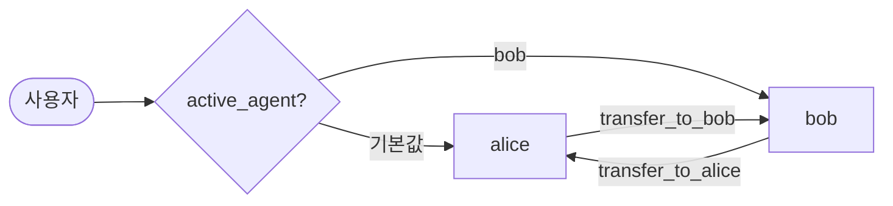

`create_swarm`은 감독자 없이 **에이전트끼리 직접** 제어를 넘기는(handoff) 멀티 에이전트 그래프를 만듭니다. 상태의 `active_agent` 필드가 마지막으로 응답한 에이전트를 기억하므로, 체크포인터와 함께 쓰면 다음 사용자 메시지는 그 에이전트가 이어 받습니다. 반환값은 **컴파일 전 `StateGraph`**입니다. 설치 버전: `langgraph-swarm` 0.1.0.



## Import

```python
from langgraph_swarm import create_swarm, create_handoff_tool, add_active_agent_router, SwarmState
```

## 시그니처

```python
def create_swarm(
    agents: list[Pregel],
    *,
    default_active_agent: str,
    state_schema: type[StateSchema] = SwarmState,
    context_schema: type[Any] | None = None,
) -> StateGraph

def create_handoff_tool(*, agent_name: str, name: str | None = None,
                        description: str | None = None) -> BaseTool

def add_active_agent_router(builder: StateGraph, *, route_to: list[str],
                            default_active_agent: str) -> StateGraph

class SwarmState(MessagesState):
    active_agent: str | None
```

## 파라미터

| 파라미터 | 타입 | 기본값 | 설명 |
|---|---|---|---|
| `agents` | `list[Pregel]` | (필수) | 스웜 참여 에이전트. 각각 `name` 필수 |
| `default_active_agent` | `str` | (필수) | `active_agent`가 없을 때(첫 턴) 시작할 에이전트 이름 |
| `state_schema` | `type` | `SwarmState` | 커스텀 상태. `SwarmState`를 상속해야 함 |
| `context_schema` | `type \| None` | `None` | 런타임 컨텍스트 스키마 |

### create_handoff_tool

| 파라미터 | 타입 | 기본값 | 설명 |
|---|---|---|---|
| `agent_name` | `str` | (필수) | 넘겨받을 에이전트 이름 |
| `name` | `str \| None` | `None` → `transfer_to_<agent_name>` | 도구 이름 |
| `description` | `str \| None` | `None` | 모델이 언제 넘길지 판단하는 설명. 구체적으로 쓰세요 |

## 메서드와 반환값

- `create_swarm(...)` → `StateGraph`. `.compile(checkpointer=...)` 후 실행합니다.
- handoff 도구는 `Command(goto=<agent>, graph=Command.PARENT, update={"messages": [...], "active_agent": <agent>})`를 반환해 부모(스웜) 그래프에서 다른 에이전트 노드로 이동합니다.
- `add_active_agent_router`: 직접 `StateGraph`를 조립할 때 `START`에서 `active_agent`로 분기하는 조건부 엣지를 추가합니다.
- 결과 상태: `messages`, `active_agent`.

## 예제

```python
import os

from langchain.agents import create_agent
from langchain.chat_models import init_chat_model
from langgraph.checkpoint.memory import InMemorySaver
from langgraph_swarm import create_handoff_tool, create_swarm

MODEL = os.getenv("LAB_MODEL", "openai:gpt-5-mini")
llm = init_chat_model(MODEL)

alice = create_agent(
    llm,
    tools=[create_handoff_tool(agent_name="bob", description="해적 말투가 필요하면 bob에게 넘긴다")],
    system_prompt="너는 수학 전문가 Alice다.",
    name="alice",
)
bob = create_agent(
    llm,
    tools=[create_handoff_tool(agent_name="alice", description="수학 질문이면 alice에게 넘긴다")],
    system_prompt="너는 해적 말투의 Bob이다.",
    name="bob",
)

app = create_swarm([alice, bob], default_active_agent="alice").compile(
    checkpointer=InMemorySaver()
)
config = {"configurable": {"thread_id": "w1"}, "recursion_limit": 20}
out = app.invoke({"messages": [{"role": "user", "content": "bob과 이야기하고 싶어"}]}, config)
print("active_agent:", out["active_agent"])  # 다음 턴은 bob이 바로 받는다
```

## 주의사항

> [!WARNING]
> 체크포인터 없이 실행하면 `active_agent`가 턴 사이에 유지되지 않아 매번 `default_active_agent`부터 시작합니다. 대화형 서비스에는 체크포인터와 `thread_id`를 꼭 쓰세요.

> [!WARNING]
> 두 에이전트가 서로에게 계속 넘기는 핑퐁(ping-pong) 루프가 생길 수 있습니다. handoff 도구 설명을 배타적으로 쓰고, `recursion_limit`으로 상한을 두세요.

> [!TIP]
> 모든 에이전트가 같은 `messages`를 공유하므로 대화가 길어지면 각 에이전트에 `SummarizationMiddleware`를 붙이거나, 에이전트별 상태를 분리하려면 [서브그래프](/docs/langgraph/14-subgraphs)로 감싸세요.

## 관련 문서

- [langgraph-supervisor](/docs/integrations/07-supervisor)
- [Command (graph=Command.PARENT)](/docs/langgraph/06-command)
- [MessagesState](/docs/langgraph/03-messages-state)
- [체크포인터](/docs/langgraph/09-checkpointers)
- [공식 문서: Multi-agent handoffs](https://docs.langchain.com/oss/python/langchain/multi-agent)
- [GitHub: langgraph-swarm-py](https://github.com/langchain-ai/langgraph-swarm-py)
