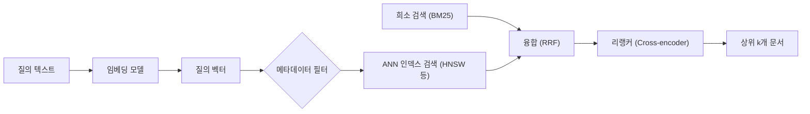

# 벡터 검색 핵심 개념

벡터 DB(Vector Database)는 텍스트·이미지를 임베딩(Embedding)한 고차원 벡터를 저장하고, 질의 벡터와 **가까운** 벡터를 빠르게 찾아 줍니다. 어떤 DB를 고르든 아래 개념이 동일하게 등장하므로, 개별 DB 페이지를 보기 전에 여기서 용어를 맞춰 두세요.



## 거리 함수 (Distance Metric)

| 메트릭 | 정의 | 값의 의미 | 쓰는 경우 |
|---|---|---|---|
| 코사인 (Cosine) | `1 - cos(a, b)` 또는 `cos(a, b)` | 방향만 비교, 크기 무시 | 텍스트 임베딩의 기본값 |
| 내적 (Dot product / IP) | `a · b` | 클수록 유사 | 벡터가 정규화(normalize)되어 있거나, 크기에 의미가 있는 추천 모델 |
| 유클리드 (L2) | `‖a - b‖` | 작을수록 유사 | 이미지 특징 벡터, 일부 전통 모델 |

- 벡터를 **L2 정규화**하면(길이 1) 코사인 유사도 = 내적이 되고, L2 거리 순위도 동일해집니다. OpenAI `text-embedding-3-*` 임베딩은 정규화되어 나오므로 세 메트릭 중 어느 것을 써도 순위는 같습니다.
- DB마다 **점수 방향이 다릅니다.** Chroma `similarity_search_with_score`는 거리(작을수록 유사), Qdrant는 유사도(클수록 유사)를 돌려줍니다. 0~1로 맞춘 값이 필요하면 `similarity_search_with_relevance_scores`를 쓰세요.

> [!WARNING]
> 컬렉션의 메트릭은 대개 **생성 시점에 고정**됩니다. 임베딩 모델을 바꾸면 차원(dimension)과 분포가 달라지므로 컬렉션을 새로 만들고 전체를 다시 임베딩해야 합니다.

## 인덱스 유형 (Index Types)

정확한 최근접 탐색(Exact kNN)은 모든 벡터와 거리를 계산하므로 O(N)입니다. 대부분의 DB는 정확도를 약간 포기하고 속도를 얻는 **근사 최근접 이웃(ANN, Approximate Nearest Neighbor)** 인덱스를 씁니다. 정확도는 보통 재현율(recall@k)로 측정합니다.

| 인덱스 | 원리 | 장점 | 단점 | 주요 튜닝 파라미터 |
|---|---|---|---|---|
| Flat (Brute-force) | 전수 비교 | 100% 정확, 구축 비용 0 | 데이터가 커지면 느림 | 없음 |
| HNSW | 다층 근접 그래프(Hierarchical Navigable Small World)를 탐색 | 높은 recall과 낮은 지연, 증분 삽입 쉬움 | 메모리 사용량 큼(그래프 엣지 저장) | `M`(이웃 수), `ef_construction`, `ef`/`ef_search` |
| IVF (Inverted File) | k-means로 공간을 `nlist`개 셀로 나누고 가까운 `nprobe`개 셀만 탐색 | 메모리 효율, 대용량에 적합 | 학습(training) 필요, 데이터 분포 변하면 재학습 | `nlist`, `nprobe` |
| PQ (Product Quantization) | 벡터를 부분 벡터로 쪼개 코드북으로 압축 | 메모리를 크게 절감 | 압축 손실로 recall 하락 → 보통 원본으로 재점수(rescoring) | `m`(부분 공간 수), `nbits` |
| IVF-PQ | IVF + PQ 조합 | 수억 건 규모에서 메모리·속도 균형 | 튜닝이 복잡 | `nlist`, `nprobe`, `m` |
| DiskANN (Vamana) | 디스크 상주 그래프 인덱스 | RAM보다 큰 데이터셋 | SSD 성능에 의존 | DB별 상이 |

- 스칼라 양자화(SQ, int8)와 이진 양자화(BQ, binary)는 PQ보다 단순한 압축 방식으로, Qdrant·Weaviate·Milvus·Elasticsearch 등이 지원합니다.
- 수만 건 이하라면 Flat이나 기본 HNSW로 충분합니다. 인덱스 튜닝은 **측정한 recall과 지연이 목표에 못 미칠 때** 시작하세요.

## 메타데이터 필터링 (Filtering)

| 방식 | 동작 | 문제 |
|---|---|---|
| 사후 필터 (Post-filtering) | ANN으로 k개를 찾은 뒤 조건으로 거름 | 조건이 까다로우면 결과가 k개보다 적어짐 |
| 사전 필터 (Pre-filtering) | 조건에 맞는 후보만 대상으로 검색 | 그래프 인덱스에서 연결성이 깨질 수 있음 |
| 필터 인지 검색 (Filtered HNSW 등) | 탐색 중에 조건을 함께 적용 | DB 구현에 의존 (Qdrant, Weaviate, Milvus 등이 지원) |

- 필터 문법은 DB마다 완전히 다릅니다: Qdrant `models.Filter`, Chroma `{"$and": [...]}`, Pinecone `{"genre": {"$eq": "x"}}`, InMemoryVectorStore는 `Document -> bool` 함수.
- 자주 거는 필드에는 **페이로드 인덱스(payload index)** 를 만드세요(Qdrant `create_payload_index`, Milvus 스칼라 인덱스 등).
- 멀티테넌시(Multi-tenancy)는 `tenant_id` 필터, 네임스페이스(Pinecone), 컬렉션 분리 중 하나로 구현합니다. 필터를 빠뜨리면 **다른 고객 데이터가 섞이는 보안 사고**가 됩니다.

## 하이브리드 검색 (Hybrid Search)

밀집 벡터(Dense vector)는 의미 유사성에 강하지만 고유명사·에러 코드·SKU 같은 **정확한 토큰 일치**에 약합니다. 희소 벡터(Sparse vector, BM25/SPLADE)는 그 반대입니다. 둘을 함께 검색해 결과를 합치는 것이 하이브리드 검색입니다.

- **RRF (Reciprocal Rank Fusion)**: 각 결과 리스트의 순위 r에 대해 `1 / (k + r)`을 더해 합산합니다(`k`는 보통 60). 점수 스케일이 달라도 순위만 쓰므로 안정적입니다.
- **가중 합 (Weighted / Relative score fusion)**: 점수를 정규화한 뒤 `alpha * dense + (1 - alpha) * sparse`. Weaviate의 `alpha` 파라미터가 대표적입니다.
- LangChain에서는 Qdrant `RetrievalMode.HYBRID`, Weaviate `alpha`, Milvus 다중 벡터 필드, Elasticsearch/OpenSearch 하이브리드 전략 등으로 지원됩니다.

## 리랭킹 (Reranking)

1단계 검색(Retriever)은 빠르지만 거칩니다. 상위 20~100개를 가져온 뒤 **크로스 인코더(Cross-encoder)** 나 리랭크 API(Cohere Rerank, Voyage, Jina 등)로 질의–문서 쌍을 다시 점수 매겨 상위 k개만 LLM에 넘기는 2단계 구조가 일반적입니다.

- 바이 인코더(Bi-encoder, 임베딩) = 질의와 문서를 따로 인코딩 → 빠름, 인덱싱 가능
- 크로스 인코더 = 질의와 문서를 함께 인코딩 → 정확, 후보 수에 비례해 느림
- LLM 자체에 "관련도 0~10 점수"를 매기게 하는 방식도 가능하지만 비용과 지연이 큽니다.

## MMR (Maximal Marginal Relevance)

상위 결과가 거의 같은 문장(중복 청크)으로 채워지는 것을 막기 위해, **질의와의 관련성**과 **이미 뽑은 문서와의 비유사성**을 함께 고려해 고르는 방법입니다.

```python
retriever = vector_store.as_retriever(
    search_type="mmr",
    search_kwargs={"k": 4, "fetch_k": 20, "lambda_mult": 0.5},
)
```

| 파라미터 | 기본값 | 설명 |
|---|---|---|
| `k` | `4` | 최종 반환 문서 수 |
| `fetch_k` | `20` | MMR을 적용할 후보 수 (`k`보다 커야 의미 있음) |
| `lambda_mult` | `0.5` | 1에 가까울수록 관련성, 0에 가까울수록 다양성 우선 |

## 주의사항

> [!WARNING]
> 인덱싱과 질의에 **같은 임베딩 모델**을 써야 합니다. 모델이 다르면 벡터 공간이 달라 검색 결과가 무의미해집니다.

> [!TIP]
> 검색 품질 문제의 상당수는 인덱스가 아니라 **청킹(Chunking)** 에서 옵니다. 청크 크기·오버랩·메타데이터(출처, 섹션 제목)를 먼저 점검하세요. → [텍스트 분할기](/docs/langchain/12-text-splitters)

> [!TIP]
> 평가 셋(질의–정답 문서 쌍 수십 개)을 먼저 만들고 recall@k / MRR로 변경 전후를 비교하세요. 감으로 튜닝하면 회귀(regression)를 놓칩니다.

## 관련 문서

- [벡터 DB 비교](/docs/vector-db/02-comparison)
- [벡터 스토어 인터페이스](/docs/langchain/14-vector-store-interface)
- [리트리버](/docs/langchain/15-retrievers)
- [임베딩](/docs/langchain/13-embeddings)
- [LangChain 벡터 스토어 통합 목록](https://docs.langchain.com/oss/python/integrations/vectorstores)
