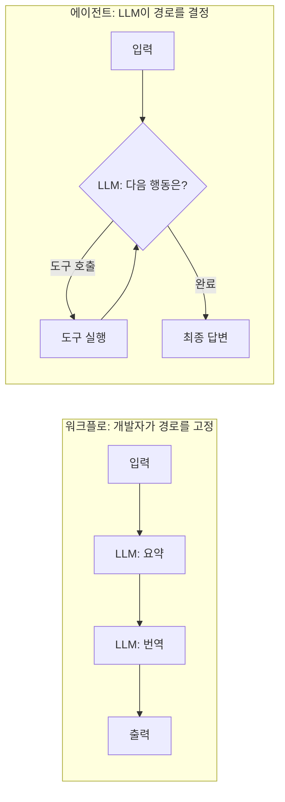
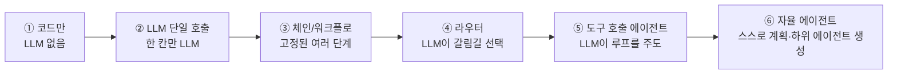
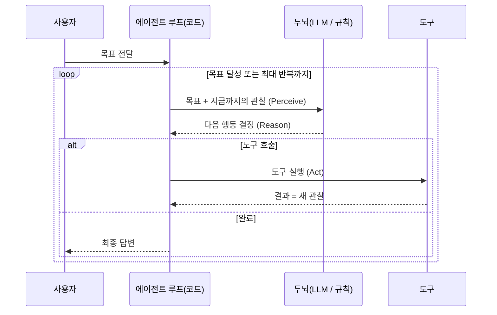

# AI Agent란 무엇인가

## 왜 이걸 배워야 할까?

ChatGPT에 "다음 주 부산 출장 일정 잡아줘"라고 말하면, 그럴듯한 **문장**은 돌아오지만 실제로 기차표가 예매되지는 않습니다.
대형 언어 모델(LLM, Large Language Model)은 본질적으로 **"텍스트를 받아 다음 텍스트를 예측하는 함수"**이기 때문입니다.
LLM은 스스로 인터넷을 검색하지도, 캘린더를 열지도, 결제 버튼을 누르지도 못합니다.

그런데 요즘 현업에서 말하는 "AI Agent"는 이런 일을 실제로 해냅니다. 코드를 읽고 고친 뒤 테스트를 돌리고,
고객 문의를 받아 주문 DB를 조회한 다음 환불 요청서를 만들고, 수십 개의 웹 문서를 찾아 읽은 뒤 보고서를 씁니다.
차이는 무엇일까요? 답은 의외로 단순합니다.

> [!IMPORTANT]
> **에이전트 = LLM + 도구(Tools) + 루프(Loop)**
> LLM이 "다음에 무엇을 할지"를 결정하고, 프로그램이 그 결정을 실제 행동(도구 호출)으로 옮기고,
> 그 결과를 다시 LLM에게 보여 주는 과정을 **목표를 이룰 때까지 반복**하는 시스템이 에이전트입니다.

이 강의에서는 LLM 없이 **순수 Python만으로** 이 루프를 직접 만들어 봅니다. 이 루프 구조만 손에 익히면
앞으로 배울 LangChain의 `create_agent`(→ 3.2), LangGraph의 그래프(→ 4.1), 멀티 에이전트(→ 7.1)가 모두
"같은 루프를 더 안전하고 강력하게 만드는 방법"으로 보이게 됩니다.

## 핵심 개념 1: LLM vs 워크플로 vs 에이전트

세 가지를 식당에 비유해 보겠습니다.

| 구분 | 비유 | 흐름을 정하는 주체 | 예 |
|---|---|---|---|
| **LLM 단독 호출** | 질문하면 대답만 해 주는 요리 상담사 | 없음(한 번 묻고 한 번 답함) | "이 이메일 요약해 줘" |
| **워크플로(Workflow)** | 정해진 레시피대로 움직이는 주방 | **개발자**가 코드로 미리 정함 | 문서 요약 → 번역 → 슬랙 전송 |
| **에이전트(Agent)** | 냉장고를 열어 보고 메뉴를 스스로 정하는 셰프 | **LLM**이 실행 중에 결정 | "고객 문의 해결해 줘" |

Anthropic의 글 *Building effective agents*(2024)는 이 구분을 명확하게 정리했습니다.
**워크플로**는 "LLM과 도구가 **미리 정의된 코드 경로**를 따라 조율되는 시스템"이고,
**에이전트**는 "LLM이 **자신의 프로세스와 도구 사용을 동적으로 지시**하며 작업 방식을 스스로 통제하는 시스템"입니다.
LangChain/LangGraph 문서도 같은 구분을 씁니다.

핵심은 **"다음 단계를 누가 정하느냐"**입니다.

- 워크플로에서는 `if`문과 함수 호출 순서를 **개발자**가 씁니다. LLM은 그 안에서 한 칸을 담당하는 부품입니다.
- 에이전트에서는 "검색을 한 번 더 할까, 계산기를 쓸까, 이제 답할까?"를 **LLM**이 고릅니다.



> [!TIP]
> "에이전트가 무조건 더 좋다"는 생각은 오해입니다. 워크플로는 예측 가능하고, 싸고, 빠르고, 테스트하기 쉽습니다.
> **경로를 미리 알 수 있는 문제라면 워크플로가 정답**입니다. 에이전트는 경로를 미리 알 수 없을 때 쓰는 도구입니다.

## 핵심 개념 2: 자율성 스펙트럼(Autonomy Spectrum)

현실의 시스템은 "워크플로냐 에이전트냐" 둘 중 하나가 아니라 **스펙트럼** 위 어딘가에 있습니다.
LangChain 팀은 이를 "얼마나 많은 결정을 LLM에게 맡기는가"로 설명합니다.



오른쪽으로 갈수록 **유연성**은 커지지만, 대가로 다음이 함께 커집니다.

- **비용과 지연**: LLM을 여러 번 호출합니다. 루프가 10번 돌면 비용도 대략 10배입니다.
- **예측 불가능성**: 같은 입력에도 매번 다른 경로를 탈 수 있어 테스트가 어렵습니다.
- **오류 누적**: 1단계에서 틀린 판단이 이후 모든 단계에 전파됩니다.
- **보안 위험**: 도구를 많이 쥘수록 사고의 반경(blast radius)이 커집니다(→ 8.3).

그래서 좋은 엔지니어는 **"문제를 풀 수 있는 가장 왼쪽 지점"**을 고릅니다.
이것이 이 커리큘럼 전체를 관통하는 설계 원칙입니다.

## 핵심 개념 3: 인지 아키텍처 — Perceive, Reason, Act

에이전트의 한 바퀴는 사람이 일하는 방식과 닮았습니다.

1. **인지(Perceive)**: 현재 상황을 파악합니다. 사용자의 목표, 지금까지의 대화, 이전 도구 결과(관찰, Observation)를 모읍니다.
2. **추론(Reason)**: "목표까지 무엇이 부족한가? 다음에 무엇을 해야 하나?"를 판단합니다. 실제 에이전트에서는 **LLM**이 이 역할을 합니다.
3. **행동(Act)**: 판단한 행동을 실행합니다. 도구를 호출하거나 최종 답변을 냅니다.
4. 행동의 결과가 다시 **관찰**이 되어 1번으로 돌아갑니다.

"인지 아키텍처(Cognitive Architecture)"는 이 순환을 **어떤 구조로 짜느냐**를 가리키는 말입니다.
단순 루프인지, 먼저 계획을 세우고 실행하는지(Plan-and-Execute, → 7.4), 스스로 결과를 비평하는지(Reflection, → 7.5)에 따라
인지 아키텍처가 달라집니다. 다음 강의(1.3)에서 이 다양한 형태를 지도처럼 펼쳐 봅니다.



## 에이전트 루프의 다섯 가지 부품

어떤 프레임워크를 쓰든 에이전트 루프는 다음 다섯 부품으로 나눌 수 있습니다. 앞으로 LangGraph 코드를 볼 때
"이 부분이 다섯 개 중 어디에 해당하지?"라고 질문하면 이해가 훨씬 빨라집니다.

| 부품 | 역할 | LangChain/LangGraph에서는 |
|---|---|---|
| **상태(State)/메모리** | 목표와 지금까지의 관찰을 기록 | `messages` 리스트, `StateGraph`의 State (→ 4.2) |
| **정책(Policy)/두뇌** | 다음 행동을 결정 | 채팅 모델(LLM) + 시스템 프롬프트 |
| **도구(Tools)** | 실제 세상과 상호작용 | `@tool` 함수 (→ 2.4) |
| **실행기(Executor)** | 결정된 도구를 호출하고 결과를 상태에 기록 | `ToolNode`, `create_agent` 내부 |
| **종료 조건(Stop condition)** | 언제 멈출지 판단 | "도구 호출이 없으면 종료" + `recursion_limit` |

> [!WARNING]
> 종료 조건이 "LLM이 끝났다고 말할 때"뿐이라면, LLM이 같은 도구를 끝없이 부르는 순간 **무한 루프와 요금 폭탄**이 됩니다.
> 그래서 실무 에이전트는 반드시 **반복 상한(max iterations)**을 함께 둡니다. LangGraph는 이를 `recursion_limit`로 강제합니다.

## 코드로 체득하기: 규칙 기반 "가짜 에이전트"

LLM을 아직 쓰지 않는 이유가 있습니다. LLM이 들어가면 "모델이 똑똑해서 되는 것"과 "루프 구조 덕분에 되는 것"이
뒤섞여 보입니다. 두뇌를 **if문으로 만든 가짜 정책**으로 바꾸면, 순수하게 **루프의 뼈대**만 볼 수 있습니다.

▶ 오른쪽 IDE의 `examples/01_fake_agent_loop.py`를 실행해 보세요.

핵심 부분만 보겠습니다.

```python
def run_agent(goal: str, max_steps: int = 6) -> str:
    memory: dict[str, object] = {"goal": goal}        # 상태(State)
    for step in range(1, max_steps + 1):               # 반복 상한
        decision = rule_based_policy(memory)           # Reason: 다음 행동 결정
        if decision["type"] == "finish":               # 종료 조건
            return decision["answer"]
        tool = TOOLS[decision["tool"]]                 # Act: 도구 선택
        observation = tool(**decision["args"])         #      도구 실행
        memory.update(observation)                     # Perceive: 관찰을 상태에 기록
    return "최대 반복 횟수에 도달해 중단했습니다."
```

이 10줄이 에이전트의 본질입니다. 실제 에이전트와 다른 점은 `rule_based_policy`가 if문이라는 것뿐입니다.
이 함수를 LLM 호출로 바꾸면, 즉 "지금까지의 메모리를 프롬프트로 보여 주고 다음 행동을 JSON으로 고르게" 하면
진짜 에이전트가 됩니다. 실제로 1.4와 3.1에서 그렇게 바꿉니다.

실행 결과에서 주목할 점은 다음과 같습니다.

- 같은 루프 코드인데 **목표가 다르면 도구 호출 순서와 횟수가 달라집니다.** 이것이 "경로를 실행 중에 결정한다"는 뜻입니다.
- 정책에 버그가 있어 같은 도구만 계속 부르는 경우에도, `max_steps` 덕분에 프로그램이 안전하게 멈춥니다.

### 워크플로와 비교하기

▶ `examples/02_workflow_vs_agent.py`를 실행해 보세요. 같은 문제를 **고정 워크플로**와 **에이전트 루프**로 풀어 봅니다.

워크플로는 "날씨 조회 → 우산 판단"처럼 순서가 고정되어 있어서, 질문이 "환율 계산"으로 바뀌면 대응하지 못합니다.
에이전트는 정책이 매 단계 상황을 보고 도구를 고르므로 처음 보는 조합의 질문에도 대응합니다.
대신 워크플로는 몇 번 실행해도 **항상 같은 단계 수**로 끝나지만, 에이전트는 질문에 따라 단계 수가 달라집니다.
이 차이가 곧 비용 예측성과 테스트 난이도의 차이입니다.

### 미리 보기: 진짜 LLM을 두뇌로 쓰면

▶ `examples/03_llm_brain_preview.py`는 같은 루프에서 두뇌만 LangChain 채팅 모델로 바꾼 버전입니다.
`bind_tools`, `tool_calls`, `ToolMessage` 같은 처음 보는 이름이 나오지만 지금은 구조만 보세요.
API 키가 없으면 Mock 모델이 대신 응답하므로 내용은 단순하지만, **"LLM이 도구를 고르고 → 코드가 실행하고 → 결과를 돌려준다"**는
흐름이 그대로 동작하는 것을 확인할 수 있습니다. 자세한 내용은 2.4(도구 호출)와 3.1(ReAct 루프 직접 구현)에서 다룹니다.

## 현업에서는

**1. "에이전트를 만들자"보다 "가장 단순한 해법"부터.**
현업 팀이 가장 흔히 하는 실수는 모든 문제를 자율 에이전트로 풀려는 것입니다. 실제 프로덕션 시스템의 상당수는
워크플로 + 일부 구간의 LLM 판단(라우터) 조합입니다. 먼저 단일 LLM 호출 + 좋은 프롬프트 + 검색(RAG)으로 시도하고,
그것으로 부족하다는 **증거**가 있을 때 자율성을 한 단계씩 올립니다.

**2. 비용과 지연은 루프 횟수에 비례합니다.**
에이전트는 한 번의 요청에 LLM을 여러 번 호출합니다. 매 호출마다 지금까지의 대화 전체를 다시 보내므로
입력 토큰은 루프가 돌수록 **누적해서** 늘어납니다(→ 1.2에서 계산해 봅니다). 반복 상한, 도구 결과 요약,
작은 모델 라우팅(→ 8.6)이 모두 이 비용을 다루는 기법입니다.

**3. 관측성(Observability)이 없으면 디버깅이 불가능합니다.**
에이전트가 틀린 답을 냈을 때 "어느 단계에서 어떤 관찰을 보고 어떤 판단을 했는가"를 추적할 수 있어야 합니다.
예제에서 `trace`를 출력한 것이 바로 그 원형입니다. 현업에서는 LangSmith 같은 트레이싱 도구로 모든 LLM 호출과
도구 호출을 기록합니다(→ 8.2).

**4. 실패를 전제로 설계합니다.**
도구는 타임아웃이 나고, API는 429(Rate limit)를 돌려주고, LLM은 존재하지 않는 도구 이름을 지어내기도 합니다.
루프는 이런 실패를 **관찰로 바꿔서** LLM에게 다시 보여 주거나(자기 수정), 안전하게 중단해야 합니다.

**5. 위험한 행동 앞에는 사람을.**
결제, 메일 발송, 데이터 삭제처럼 되돌릴 수 없는 행동 앞에는 사람의 승인(Human-in-the-loop)을 둡니다(→ 5.3).
자율성은 "얼마나 똑똑한가"가 아니라 "얼마나 믿고 맡길 수 있는가"의 문제입니다.

> [!CAUTION]
> 안티패턴: 종료 조건 없이 `while True:` 로 LLM을 부르는 루프, 모든 도구를 한 에이전트에 몰아주기,
> 트레이스 없이 운영하기. 셋 다 "언젠가 반드시" 사고로 이어집니다.

## 정리

- **LLM**은 텍스트를 예측하는 함수일 뿐이며, 스스로 행동하지 못합니다.
- **워크플로**는 개발자가 경로를 고정하고, **에이전트**는 LLM이 실행 중에 경로를 결정합니다.
- 자율성은 스펙트럼이며, **문제를 풀 수 있는 가장 단순한 지점**을 고르는 것이 좋은 설계입니다.
- 에이전트 루프 = **상태 + 정책(두뇌) + 도구 + 실행기 + 종료 조건**. 종료 조건에는 반드시 **반복 상한**을 포함합니다.
- 두뇌를 if문에서 LLM으로 바꾸는 순간 진짜 에이전트가 됩니다. 이 강의의 실습이 앞으로 모든 강의의 토대입니다.

## 실습 과제

`exercise.py`에서 `run_agent` 함수의 빈칸(TODO)을 채워 "커피 3잔 가격 계산" 에이전트 루프를 완성하세요.
정상 정책에서는 3단계 만에 답을 내고, 고장 난 정책(같은 도구만 반복)에서는 `max_steps`에서 멈춰야 합니다.
막히면 `examples/01_fake_agent_loop.py`의 루프 구조를 참고하세요.
