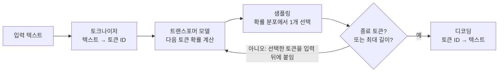
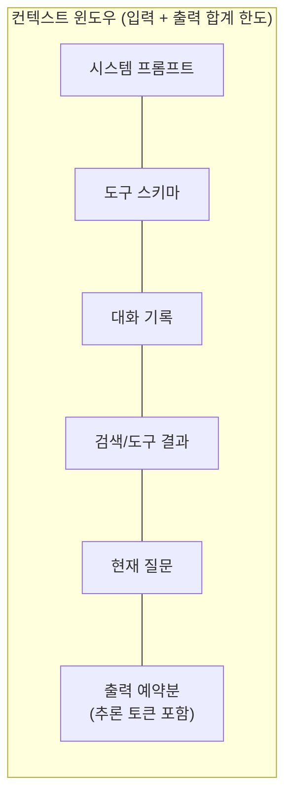
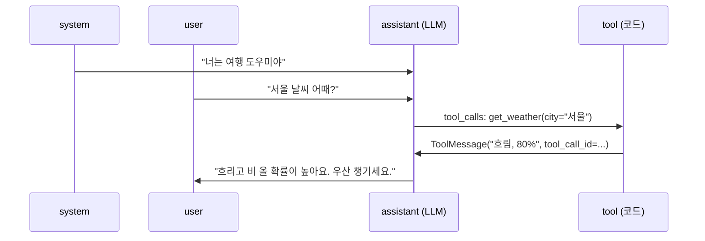

# LLM 핵심 원리: 토큰, 컨텍스트, 샘플링, 비용

## 왜 이걸 알아야 할까?

1.1에서 에이전트의 두뇌 자리에 if문을 넣었습니다. 이제 그 자리에 LLM을 넣을 차례인데, LLM을 "말 잘하는 마법 상자"로만 이해하면
현업에서 곧바로 벽에 부딪힙니다.

- "대화가 길어지니 갑자기 에러가 나요" → **컨텍스트 윈도우** 초과
- "같은 질문인데 매번 답이 달라요" → **샘플링**
- "테스트할 땐 몇 백 원이었는데 운영 한 달에 수백만 원이 나왔어요" → **토큰 비용의 누적**
- "temperature를 0으로 줬더니 에러가 나요" → **추론 모델**의 파라미터 제약
- "도구 결과를 어디에 넣어야 하죠?" → **메시지 역할**

이 강의는 이 다섯 가지 질문에 답할 수 있게 만드는 것이 목표입니다. 수학은 최소한으로, 엔지니어가 결정을 내리는 데 필요한 감각을 중심으로 다룹니다.

## 1. LLM은 "다음 토큰 예측기"다

LLM이 하는 일은 한 문장으로 요약됩니다. **"지금까지의 토큰 열을 보고, 다음에 올 토큰의 확률 분포를 계산한다."**
답변 한 문단은 이 예측을 수백 번 반복해 한 토큰씩 이어 붙인 결과입니다. 이것을 **자기회귀(autoregressive) 생성**이라고 합니다.



이 그림에서 엔지니어에게 중요한 사실 세 가지가 나옵니다.

1. **출력 토큰은 한 개씩 순서대로 만들어집니다.** 그래서 출력이 길수록 응답 시간이 길고, 스트리밍(→ 1.4, 2.5)으로 첫 토큰을 빨리 보여 주는 것이 UX에 중요합니다.
2. **모델은 상태가 없습니다(stateless).** 모델은 이전 대화를 "기억"하지 않습니다. 대화가 이어지는 것처럼 보이는 건 **매번 지금까지의 대화 전체를 다시 보내기 때문**입니다. 메모리(→ 3.4, 5.4)는 결국 "무엇을 다시 보낼지"를 관리하는 기술입니다.
3. **확률 분포에서 "고르는" 단계가 있습니다.** 그래서 같은 입력에도 다른 출력이 나올 수 있습니다.

## 2. 토큰(Token): 모든 것의 단위

토큰은 모델이 텍스트를 다루는 최소 단위입니다. 단어도 아니고 글자도 아닌, **자주 등장하는 글자 조각**입니다.
"unbelievable"은 여러 조각으로, 흔한 단어 "the"는 한 조각으로 처리됩니다. OpenAI 모델은 BPE(Byte Pair Encoding) 계열 토크나이저를 쓰고,
GPT-4o와 GPT-5 계열은 `o200k_base` 인코딩을 사용합니다. OpenAI의 `tiktoken` 라이브러리로 직접 확인할 수 있습니다.

▶ 오른쪽 IDE의 `examples/01_tokens.py`를 실행해 보세요.

```python
import tiktoken

enc = tiktoken.get_encoding("o200k_base")
ids = enc.encode("에이전트가 날씨 도구를 호출했습니다.")
print(len(ids), [enc.decode([i]) for i in ids])
```

실행해 보면 다음을 관찰할 수 있습니다.

- **같은 의미라도 언어에 따라 토큰 수가 다릅니다.** 최신 토크나이저는 한국어 효율이 많이 좋아졌지만, 일반적으로 영어보다 같은 의미에 더 많은 토큰이 드는 경향이 있습니다.
- **JSON, 코드, 공백도 모두 토큰입니다.** 도구 스키마나 장황한 JSON 결과는 생각보다 많은 토큰을 씁니다.

> [!NOTE]
> 토큰이 중요한 이유는 **세 가지가 모두 토큰으로 측정되기 때문**입니다: ① 비용(토큰당 과금), ② 지연(출력 토큰 수에 비례),
> ③ 컨텍스트 한도(토큰 수로 제한). 엔지니어는 "글자 수"가 아니라 "토큰 수"로 생각하는 습관을 들여야 합니다.

정확한 수가 필요 없을 때는 LangChain의 `count_tokens_approximately`로 빠르게 근사할 수 있습니다. 메시지 리스트를 받아 대략적인 토큰 수를 돌려주며,
메시지 트리밍(→ 3.4)에서 자주 씁니다.

## 3. 컨텍스트 윈도우(Context Window)

컨텍스트 윈도우는 **모델이 한 번에 처리할 수 있는 최대 토큰 수**이며, **입력과 출력을 합친** 한도입니다.
최신 모델들은 수십만 토큰 이상을 지원하지만, 그렇다고 "다 넣으면 된다"는 뜻은 아닙니다.



- **비용**: 넣은 만큼 돈을 냅니다. 에이전트는 매 턴 전체를 다시 보냅니다.
- **품질**: 긴 컨텍스트 중간에 묻힌 정보는 잘 활용되지 않는 경향이 연구로 보고되었습니다("Lost in the Middle", Liu et al., 2023). 관련 없는 정보가 많을수록 모델이 헷갈립니다.
- **지연**: 입력이 길면 첫 토큰까지의 시간(TTFT, Time To First Token)이 늘어납니다.

그래서 현업의 화두는 "더 큰 윈도우"가 아니라 **"컨텍스트 엔지니어링(Context Engineering)"**, 즉 **필요한 정보만 골라 넣는 기술**입니다.
이 주제는 3.4에서 깊게 다룹니다.

## 4. 샘플링(Sampling): temperature와 top-p

모델이 계산한 확률 분포에서 실제 토큰을 고르는 방법이 샘플링입니다. 대표 파라미터는 둘입니다.

- **temperature**: 분포를 얼마나 "뾰족하게/평평하게" 만들지. 낮으면 가장 확률 높은 토큰만 거의 항상 고르고(일관적), 높으면 다양한 토큰을 고릅니다(창의적이지만 엉뚱함).
- **top-p (nucleus sampling)**: 누적 확률 p까지의 상위 후보만 남기고 그 안에서 고릅니다. 꼬리의 이상한 후보를 잘라냅니다.

▶ `examples/02_sampling.py`를 실행해 보세요. numpy로 softmax와 temperature, top-p를 직접 구현해 분포가 어떻게 바뀌는지 막대그래프로 보여 줍니다.
temperature 2.0에서는 "오늘 날씨가 정말 **바나나**" 같은 결과가 나오기 시작합니다.

> [!WARNING]
> **GPT-5 계열 같은 추론 모델은 `temperature` 설정을 지원하지 않아** 값을 지정하면 API가 에러를 돌려줄 수 있습니다.
> 그래서 이 과정의 모든 예제는 `temperature`를 설정하지 않습니다. 출력 일관성은 샘플링 파라미터가 아니라 **명확한 프롬프트, 구조화 출력(→ 2.3),
> 평가(→ 8.2)**로 확보하는 것이 현대적인 접근입니다.

또 하나 기억할 점: temperature를 0에 가깝게 해도 **LLM 출력은 완전히 결정적이지 않을 수 있습니다**(서버 측 배치, 부동소수점 연산 등).
테스트를 "정확한 문자열 일치"로 짜면 안 되는 이유입니다. 이 과정의 실습 assert가 텍스트 내용이 아니라 **구조와 흐름**을 검증하는 것도 같은 이유입니다.

## 5. 추론(Reasoning) 모델

OpenAI의 o-시리즈와 GPT-5 계열 같은 **추론 모델**은 답을 내기 전에 내부적으로 "생각하는" 토큰을 생성합니다.
이를 **추론 토큰(reasoning tokens)**이라고 합니다.

| | 일반(비추론) 모델 | 추론 모델 |
|---|---|---|
| 동작 | 곧바로 답변 토큰 생성 | 숨겨진 추론 토큰 생성 → 답변 |
| 강점 | 빠르고 쌈, 단순 작업 | 다단계 논리, 수학, 코딩, 계획 수립 |
| 비용 | 출력 = 보이는 답변 | **추론 토큰도 출력 토큰으로 과금** |
| 조절 | temperature 등 | `reasoning_effort`(예: minimal/low/medium/high) |

LangChain에서는 응답의 `usage_metadata["output_token_details"]["reasoning"]`에 추론 토큰 수가 담깁니다(제공자가 알려 줄 때).
화면에 보이는 답은 짧은데 출력 토큰이 많이 찍혀 있다면 대부분 추론 토큰입니다. `ChatOpenAI`에는 `reasoning_effort` 파라미터가 있어
추론의 깊이(= 비용과 지연)를 조절할 수 있습니다.

```python
from langchain.chat_models import init_chat_model

# 간단한 분류 작업이라면 추론을 얕게 → 더 빠르고 싸다
llm = init_chat_model("openai:gpt-5-mini", reasoning_effort="low")
```

> [!TIP]
> 에이전트 설계 팁: 모든 단계에 가장 강한 추론 모델을 쓸 필요는 없습니다. **계획 수립처럼 어려운 단계에는 강한 모델**,
> **분류나 요약처럼 쉬운 단계에는 작고 빠른 모델**을 쓰는 "모델 라우팅"이 비용 최적화의 핵심입니다(→ 8.6).

## 6. 메시지 역할(Message Roles)

채팅 모델은 문자열 하나가 아니라 **역할이 붙은 메시지의 리스트**를 입력받습니다. 에이전트를 만들려면 네 가지 역할을 정확히 알아야 합니다.

| 역할 | LangChain 클래스 | 누가 쓰나 | 용도 |
|---|---|---|---|
| **system** | `SystemMessage` | 개발자 | 페르소나, 규칙, 출력 형식, 도구 사용 지침 |
| **user** (human) | `HumanMessage` | 사용자 | 질문과 요청 |
| **assistant** (ai) | `AIMessage` | 모델 | 답변, 또는 **도구 호출 요청(tool_calls)** |
| **tool** | `ToolMessage` | 실행기(코드) | 도구 실행 결과. `tool_call_id`로 요청과 짝지음 |



1.1의 에이전트 루프를 메시지로 다시 보면, **Reason = AIMessage 생성**, **Act = 도구 실행**, **Perceive = ToolMessage 추가**입니다.
LangChain과 LangGraph의 에이전트 상태가 기본적으로 `messages` 리스트인 이유가 여기에 있습니다.

> [!IMPORTANT]
> `AIMessage`에 `tool_calls`가 있으면, 다음 요청에는 **각 tool_call의 id에 대응하는 `ToolMessage`가 반드시 뒤따라야** 합니다.
> 짝이 맞지 않으면 OpenAI API가 요청을 거부합니다. 메시지를 트리밍할 때 흔히 터지는 버그입니다.

## 7. 비용 계산

비용 공식은 단순합니다.

```text
비용 = 입력 토큰 × 입력 단가 + 출력 토큰 × 출력 단가     (단가는 보통 USD / 1M 토큰)
```

일반적으로 **출력 단가가 입력 단가보다 몇 배 비쌉니다.** 그리고 추론 토큰은 출력으로 과금됩니다.

▶ `examples/03_messages_and_cost.py`를 실행해 보세요. 네 가지 역할의 메시지를 만들고, 모델을 호출해 `usage_metadata`를 읽고,
예시 단가로 비용을 계산한 다음, **에이전트 루프에서 입력 토큰이 턴마다 누적되는 모습**을 보여 줍니다.

에이전트 비용의 핵심은 이 누적입니다. 턴마다 지금까지의 대화 전체를 다시 보내므로, 긴 도구 결과가 하나 붙으면 이후 **모든** 턴의 입력에 그 비용이 더해집니다.
턴이 늘어날수록 총 입력 토큰은 대략 턴 수의 제곱에 가깝게 늘어날 수 있습니다.

> [!CAUTION]
> 예제의 단가는 계산 연습용 **예시 값**입니다. 실제 단가는 모델과 시기에 따라 바뀌므로 반드시 OpenAI 공식 가격 페이지에서 확인하세요.
> 반복되는 앞부분 프롬프트에 할인 단가가 적용되는 **프롬프트 캐싱**도 있습니다(→ 8.6).

## 현업에서는

**비용 관측은 첫날부터.** 모든 LLM 호출의 `usage_metadata`를 로깅하고, 요청 단위·사용자 단위·기능 단위로 집계하세요.
LangSmith 같은 트레이싱 도구는 호출별 토큰과 비용을 자동으로 보여 줍니다(→ 8.2). "어느 기능이 돈을 쓰는지 모르는 상태"가 가장 위험합니다.

**토큰 예산을 설계합니다.** 시스템 프롬프트 몇 토큰, 도구 스키마 몇 토큰, 대화 기록 최대 몇 토큰, 검색 결과 최대 몇 토큰처럼
**영역별 상한**을 정해 두면 컨텍스트 초과와 비용 폭증을 동시에 막을 수 있습니다. 도구가 거대한 JSON을 그대로 돌려주게 두지 말고,
필요한 필드만 추려서 돌려주도록 도구를 설계하세요(→ 2.4).

**지연은 출력 토큰이 지배합니다.** 사용자 체감 속도를 높이려면 ① 스트리밍으로 TTFT를 줄이고, ② 출력 길이를 지시하고,
③ 쉬운 단계에는 작은 모델이나 낮은 `reasoning_effort`를 씁니다.

**테스트는 비결정성을 전제로.** 같은 입력에도 출력이 달라질 수 있으므로 단위 테스트는 Mock 모델로 **흐름**을 검증하고(이 사이트의 Mock 모드가 바로 그 방식입니다),
품질은 평가 데이터셋과 LLM-as-judge로 **통계적으로** 측정합니다(→ 8.2).

**보안: 컨텍스트에 들어간 것은 모두 모델의 입력입니다.** 웹 페이지, 이메일, 도구 결과에 숨겨진 지시문은 시스템 프롬프트를 무시하게 만들 수 있습니다(프롬프트 인젝션, → 8.3).
system 역할이 있다고 해서 안전이 보장되지는 않습니다.

## 정리

- LLM은 **다음 토큰을 확률적으로 예측**하는 상태 없는 함수입니다. 대화가 이어지는 것은 매번 전체를 다시 보내기 때문입니다.
- **토큰**은 비용, 지연, 컨텍스트 한도의 공통 단위입니다. `tiktoken`과 `count_tokens_approximately`로 셀 수 있습니다.
- **컨텍스트 윈도우**는 입력+출력 합계 한도이며, 많이 넣을수록 비싸고 느리고 오히려 품질이 떨어질 수 있습니다.
- **temperature/top-p**는 샘플링을 조절하지만, 추론 모델에서는 쓰지 않습니다. 일관성은 프롬프트·구조화 출력·평가로 확보합니다.
- **추론 모델**은 보이지 않는 추론 토큰도 출력으로 과금합니다. `reasoning_effort`로 깊이를 조절합니다.
- **system / user(human) / assistant(ai) / tool** 네 역할이 에이전트 루프의 언어입니다.

## 실습 과제

`exercise.py`에서 세 함수를 완성하세요.
1. `build_messages`: 시스템 프롬프트, 이전 대화, 새 질문으로 올바른 순서의 메시지 리스트를 만든다.
2. `estimate_cost`: `usage_metadata`와 단가로 USD 비용을 계산한다.
3. `fits_in_context`: 메시지 토큰 수 + 출력 예약분이 윈도우 안에 들어오는지 판단한다.
