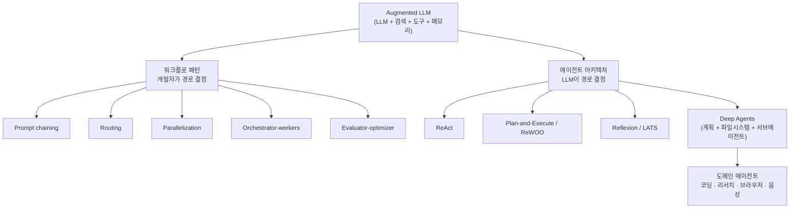
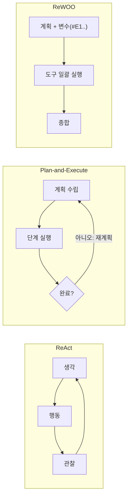

# 에이전트의 다양한 형태: 패턴과 업계 지형

## 왜 지도가 필요할까?

"에이전트"라는 단어는 너무 넓게 쓰입니다. 어떤 팀은 LLM 세 번 연달아 부르는 파이프라인을 에이전트라 부르고,
어떤 팀은 몇 시간 동안 스스로 코드를 고치는 시스템을 에이전트라 부릅니다. 이름이 같으니 회의에서 대화가 엇갈리고,
설계를 잘못 고르면 "간단한 분류 문제에 자율 에이전트를 붙여 비용 10배, 정확도는 더 낮은" 결과가 나옵니다.

이 강의는 **패턴의 지도**를 줍니다. 앞으로 배울 모든 기법은 이 지도의 어느 한 칸에 속합니다.
지도를 먼저 머릿속에 넣어 두면, 새 논문이나 새 프레임워크가 나와도 "아, 이건 Evaluator-optimizer의 변형이구나"처럼 빠르게 자리를 찾을 수 있습니다.



## 1. 기본 블록: Augmented LLM

Anthropic의 *Building effective agents*는 모든 시스템의 출발점을 **Augmented LLM**이라고 부릅니다.
**검색(Retrieval)**, **도구(Tools)**, **메모리(Memory)**로 능력이 확장된 LLM입니다. 요즘 모델은 이 능력을 스스로 활용할 줄 압니다.
검색 쿼리를 만들고, 도구를 고르고, 무엇을 기억할지 정합니다.

이후의 모든 패턴은 이 블록을 **어떻게 배치하고 연결하느냐**의 차이입니다. 그래서 2장(LangChain 핵심)에서 메시지, 구조화 출력, 도구 호출로
이 블록을 단단하게 만드는 법부터 배웁니다.

## 2. 워크플로 패턴 5가지 — "개발자가 경로를 정한다"

### ① Prompt chaining (프롬프트 체이닝)
작업을 **고정된 순서의 단계**로 쪼개고, 각 단계의 출력을 다음 단계의 입력으로 씁니다. 단계 사이에 코드로 된 **게이트(Gate)**를 두어 중간 결과를 검사할 수 있습니다.
- 예: 개요 작성 → (개요가 기준을 만족하는지 검사) → 본문 작성 → 번역
- 언제: 작업을 깔끔한 하위 단계로 나눌 수 있을 때. 각 호출이 쉬워져 정확도가 오르는 대신 지연이 늘어납니다.

### ② Routing (라우팅)
입력을 **분류**하고, 분류 결과에 따라 **전문화된 후속 처리**로 보냅니다.
- 예: 고객 문의 → 결제/기술/일반으로 분류 → 각기 다른 프롬프트와 도구. 쉬운 질문은 작은 모델, 어려운 질문은 큰 모델로 보내는 **모델 라우팅**도 같은 패턴입니다.
- 언제: 입력 유형이 뚜렷이 나뉘고 유형별 최적 처리가 다를 때.

### ③ Parallelization (병렬화)
독립적인 작업을 **동시에** 실행하고 결과를 코드로 합칩니다. 두 변형이 있습니다.
- **Sectioning(분할)**: 서로 다른 관점을 병렬로. 예: 코드를 보안/성능/가독성 관점에서 동시에 리뷰. 또는 본 답변 생성과 **가드레일 검사**를 병렬로.
- **Voting(투표)**: 같은 작업을 여러 번 시켜 다수결. 예: 스팸 판정을 3번 받아 다수결 → 단일 판정보다 안정적.

### ④ Orchestrator-workers (오케스트레이터-워커)
중앙의 **오케스트레이터 LLM**이 작업을 **동적으로** 쪼개 워커들에게 맡기고 결과를 종합합니다.
Parallelization과 비슷해 보이지만 결정적 차이가 있습니다. **하위 작업의 개수와 내용을 실행 전에 알 수 없다**는 점입니다.
- 예: "이 기능 추가해 줘" → 수정할 파일 목록을 LLM이 정함 → 파일마다 워커. 리서치 보고서 작성.
- LangGraph에서는 `Send`로 동적 fan-out을 구현합니다(→ 4.4).

### ⑤ Evaluator-optimizer (평가자-최적화자)
한 LLM이 결과를 만들고, 다른 LLM(또는 같은 LLM의 다른 프롬프트)이 **평가와 피드백**을 주는 과정을 반복합니다.
- 예: 번역 → 뉘앙스 평가 → 재번역. 코드 생성 → 테스트/리뷰 → 수정.
- 언제: **명확한 평가 기준**이 있고 반복으로 품질이 측정 가능하게 좋아질 때. 반복 상한은 필수입니다(→ 7.5).

▶ 오른쪽 IDE의 `examples/01_workflow_patterns.py`(①②③)와 `examples/02_orchestrator_evaluator.py`(④⑤)를 실행해 보세요.

```python
# Routing의 핵심: 구조화 출력으로 분류 → 딕셔너리로 분기
class Route(BaseModel):
    category: Literal["billing", "tech", "general"]

router = llm.with_structured_output(Route)
category = router.invoke([SystemMessage("문의를 분류해."), HumanMessage(question)]).category
answer = HANDLERS[category](question)   # 경로 선택은 LLM, 경로 자체는 개발자가 정의
```

> [!TIP]
> 분류 지침은 `SystemMessage`, 사용자 원문은 `HumanMessage`로 **분리**하세요. 지침과 데이터를 섞으면 사용자 입력 속 문장이 지침처럼 해석될 위험(프롬프트 인젝션)이 커지고,
> 모델이 무엇이 명령이고 무엇이 데이터인지 헷갈립니다.

## 3. 에이전트 아키텍처 — "LLM이 경로를 정한다"

### ReAct (Reason + Act)
Yao et al.(2022)의 논문에서 이름이 나왔습니다. **생각(Thought) → 행동(Action) → 관찰(Observation)**을 한 단계씩 반복합니다.
1.1에서 만든 루프가 정확히 이것입니다. 오늘날 "도구 호출 에이전트"의 기본형이며, LangChain의 `create_agent`가 만드는 것도 ReAct 스타일 루프입니다(→ 3.1, 3.2).
- 장점: 매 단계 관찰을 보고 적응합니다. 구현이 단순합니다.
- 단점: 도구를 부를 때마다 LLM 호출이 필요하고, 긴 작업에서는 큰 그림을 잃고 헤매기 쉽습니다.

### Plan-and-Execute
먼저 **전체 계획**을 세우고, 각 단계를 실행기가 처리하며, 필요하면 **재계획(replan)**합니다.
Plan-and-Solve 프롬프팅(Wang et al., 2023)과 BabyAGI 같은 초기 프로젝트에서 영향을 받았습니다(→ 7.4).
- 장점: 긴 작업에서 방향을 유지합니다. 실행 단계에는 작은 모델을 써서 비용을 줄일 수 있습니다.
- 단점: 초기 계획이 틀리면 재계획 비용이 듭니다.

### ReWOO (Reasoning WithOut Observation)
Xu et al.(2023). 계획 단계에서 도구 호출을 `#E1 = search(...)`, `#E2 = calc(#E1)`처럼 **변수로 미리 모두 적어 두고**,
도구만 실행한 뒤 마지막에 한 번에 종합합니다. 중간 관찰을 LLM에게 보여 주지 않으므로 **LLM 호출 수가 최소**입니다.
대신 중간 결과에 따라 방향을 바꾸는 적응력은 약합니다.

### Reflexion
Shinn et al.(2023). 시도가 실패하면 **"왜 실패했는지"를 언어로 반성(self-reflection)**해 메모리에 남기고, 다음 시도에서 참고합니다.
가중치를 바꾸지 않고 "말로 된 경험"으로 학습하는 셈입니다. Evaluator-optimizer를 에이전트 수준으로 확장한 것으로 볼 수 있습니다(→ 7.5).

### LATS (Language Agent Tree Search)
Zhou et al.(2023). 몬테카를로 트리 탐색(MCTS)처럼 **여러 행동 경로를 트리로 펼쳐 탐색**하고, 평가와 반성을 결합해 가장 좋은 경로를 고릅니다.
품질은 높지만 LLM 호출이 매우 많아 비용과 지연이 큽니다. 정답 검증이 가능한 문제(코드 생성, 퍼즐)에서 주로 연구됩니다.

▶ `examples/03_agent_architectures.py`는 같은 과제를 ReAct, Plan-and-Execute, ReWOO로 풀며 **LLM 호출 횟수**를 비교합니다.



| 아키텍처 | 적응력 | LLM 호출 수 | 잘 맞는 문제 |
|---|---|---|---|
| ReAct | 높음 | 도구 호출 수에 비례 | 범용 도구 사용, 짧은~중간 작업 |
| Plan-and-Execute | 중간(재계획) | 계획 + 단계 수 | 긴 다단계 작업 |
| ReWOO | 낮음 | 최소(대략 2회) | 의존 관계가 명확한 정보 수집 |
| Reflexion | 높음(시도 간 학습) | 시도 수 × 단계 | 검증 가능한 반복 과제 |
| LATS | 매우 높음 | 매우 많음 | 정답 검증 가능한 고난도 탐색 |

## 4. 도메인별 에이전트와 Deep Agents

실제 제품으로 자리 잡은 에이전트들은 위 패턴을 조합한 결과물입니다.

- **코딩 에이전트**: 저장소를 읽고, 파일을 편집하고, 테스트를 실행하고, 실패 로그를 보고 다시 고칩니다. 테스트라는 **명확한 평가자**가 있어 에이전트가 특히 잘 작동하는 분야입니다. Claude Code, OpenAI Codex, Cursor 등이 대표적입니다.
- **리서치 에이전트**: 질문을 하위 질문으로 쪼개 여러 검색을 병렬로 수행하고(Orchestrator-workers), 출처를 모아 보고서를 씁니다. 여러 AI 서비스의 "Deep Research" 기능이 이 형태입니다.
- **브라우저/컴퓨터 사용 에이전트**: 스크린샷이나 DOM을 관찰하고 클릭·입력으로 행동합니다. 관찰 공간이 넓고 행동이 되돌리기 어려워 안전장치가 특히 중요합니다.
- **음성 에이전트**: 음성 인식 → LLM → 음성 합성, 또는 음성을 직접 다루는 실시간 모델을 씁니다. **지연(수백 ms 단위)**이 가장 큰 제약이라 작은 모델과 스트리밍이 핵심입니다.

**Deep Agents**는 몇 시간짜리 장기 과제를 다루는 에이전트들의 공통 구조를 일컫는 말입니다. LangChain 팀이 Claude Code, Deep Research 등을 분석해 정리했으며
네 가지 요소가 핵심입니다. ① 자세한 **시스템 프롬프트**, ② **계획 도구**(Todo 리스트), ③ 중간 결과를 저장하는 **파일시스템**, ④ 컨텍스트를 격리하는 **서브에이전트**.
`deepagents` 라이브러리의 `create_deep_agent`로 이 구조를 바로 만들 수 있으며, 7.6에서 다룹니다.

## 5. 2026년 프레임워크 지형

에이전트 프레임워크는 빠르게 변하고 있습니다. 세부 기능보다 **각 도구가 어떤 철학을 가졌는지**를 잡아 두는 것이 오래가는 지식입니다.

| 프레임워크 | 성격 | 강점 | 고려할 점 |
|---|---|---|---|
| **LangGraph** (+ LangChain) | 저수준 오케스트레이션: 상태 그래프 | 세밀한 제어, 체크포인트·HITL·스트리밍·장기 실행, 모델 중립 | 개념(상태, 리듀서, 그래프)을 익혀야 함 |
| **OpenAI Agents SDK** | 경량 에이전트 + 핸드오프 + 가드레일 | 단순한 API, OpenAI 기능과 긴밀한 통합 | OpenAI 생태계 중심 |
| **Claude Agent SDK** | Claude Code의 에이전트 하네스를 라이브러리로 | 파일·셸 도구, 컨텍스트 관리 등 코딩 에이전트급 기능 | Claude 모델 중심 |
| **CrewAI** | 역할(Role) 기반 멀티 에이전트 | 빠른 프로토타이핑, 직관적 추상화 | 세밀한 흐름 제어는 별도 기능 필요 |
| **AutoGen → Microsoft Agent Framework** | 대화형 멀티 에이전트 | 연구 생태계, Microsoft 스택 통합 | Microsoft는 AutoGen과 Semantic Kernel을 통합한 후속 프레임워크로 이행 중 |
| 기타: Google ADK, LlamaIndex, Pydantic AI, smolagents 등 | 다양 | 각자 특화 영역 | 생태계 성숙도 확인 필요 |

이 과정이 **LangChain v1 + LangGraph v1**을 택한 이유는 세 가지입니다.
1. **추상화 수준을 오갈 수 있습니다.** `create_agent` 한 줄로 시작하고(3장), 필요하면 같은 개념(State, 노드, 엣지)으로 직접 그래프를 짤 수 있습니다(4장). `create_agent` 자체가 LangGraph 위에서 동작합니다.
2. **프로덕션 기능이 기본 내장입니다.** 체크포인트, 타임트래블, Human-in-the-loop, 내구성 있는 실행, 스트리밍(5장, 8장).
3. **모델 중립적입니다.** 제공자를 바꿔도 코드 구조가 유지됩니다.

> [!NOTE]
> 어떤 프레임워크를 쓰든 이 강의의 패턴은 그대로 통합니다. 프레임워크는 바뀌어도 **루프, 상태, 도구, 종료 조건, 평가**라는 원리는 바뀌지 않습니다.

## 현업에서는

**단순함에서 출발해 증거로 올라갑니다.** Anthropic과 LangChain 모두 같은 조언을 합니다. 단일 LLM 호출 → 워크플로 → 에이전트 순으로,
**평가 지표가 개선을 증명할 때만** 복잡도를 올리세요. 실제 프로덕션의 상당수는 Routing + Prompt chaining 조합이며, 자율 에이전트는 그 일부 구간에만 들어갑니다.

**패턴마다 비용 구조가 다릅니다.** Parallelization은 비용은 그대로인데 지연을 줄이고, Voting은 비용을 N배로 늘려 안정성을 삽니다.
Evaluator-optimizer는 반복 횟수만큼 비용이 늘고, LATS는 수십 배가 될 수 있습니다. 설계 문서에 **요청당 예상 LLM 호출 수**를 꼭 적으세요.

**관측성과 평가가 패턴 선택을 결정합니다.** 같은 문제를 두 패턴으로 구현해 평가 데이터셋으로 비교하는 것이 가장 확실한 선택 방법입니다(→ 8.2).
LangSmith 트레이스에서 단계별 지연과 토큰을 보면 병목이 어느 패턴 구간인지 바로 보입니다.

**장애 반경을 줄이세요.** 자율성이 높은 패턴일수록 실패 방식도 다양합니다. 도구 권한 최소화, 반복 상한, 위험 작업 전 사람 승인(→ 5.3, 8.3)을 패턴과 함께 설계합니다.

> [!CAUTION]
> 안티패턴: "요즘 멀티 에이전트가 대세라서" 단일 에이전트로 충분한 문제를 여러 에이전트로 쪼개기.
> 에이전트 간 통신은 컨텍스트 손실과 비용을 동반합니다. 멀티 에이전트가 필요한 조건은 7.1에서 다룹니다.

## 정리

- 모든 시스템의 기본 블록은 **Augmented LLM**(LLM + 검색 + 도구 + 메모리)입니다.
- 워크플로 5패턴: **Prompt chaining, Routing, Parallelization(Sectioning/Voting), Orchestrator-workers, Evaluator-optimizer**.
- 에이전트 아키텍처: **ReAct**(단계별 적응), **Plan-and-Execute**(계획 우선), **ReWOO**(호출 최소화), **Reflexion**(언어적 반성), **LATS**(트리 탐색).
- 코딩·리서치·브라우저·음성 에이전트와 **Deep Agents**는 이 패턴들의 조합입니다.
- 프레임워크는 바뀌어도 원리는 같습니다. 이 과정은 제어력과 프로덕션 기능 때문에 **LangGraph v1**을 씁니다.

## 실습 과제

`exercise.py`에서 **Routing**과 **Evaluator-optimizer**를 직접 구현하세요.
`classify`는 구조화 출력으로 문의를 분류하고, `handle`은 분류별 시스템 프롬프트로 답하며, `refine`은 평가 점수가 기준을 넘거나 반복 상한에 닿을 때까지 개선합니다.
