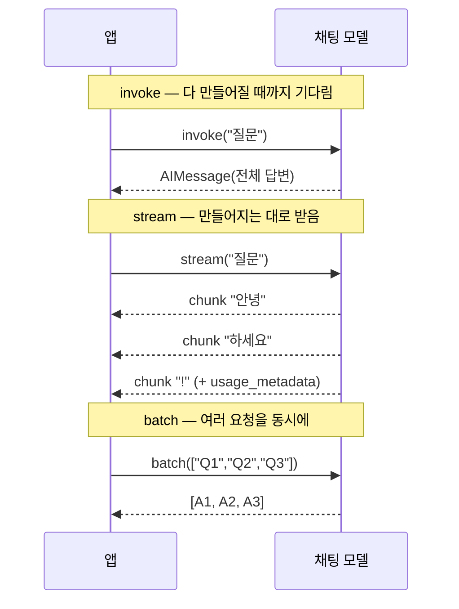
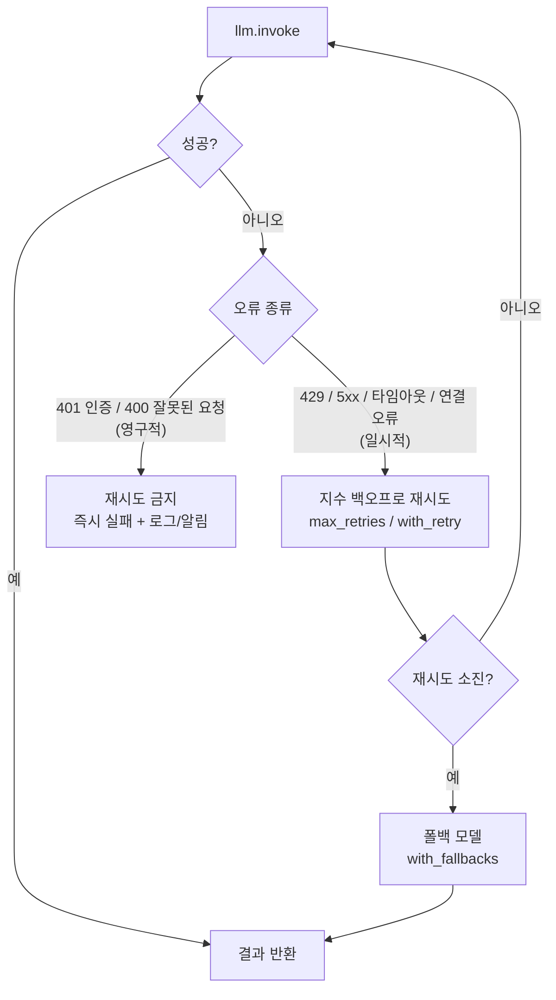

# LangChain으로 첫 LLM 호출하기

## 왜 SDK를 직접 쓰지 않고 LangChain을 쓸까?

OpenAI 파이썬 SDK로도 LLM을 호출할 수 있습니다.

```python
# 참고용 (이 사이트의 실행 예제에서는 쓰지 않습니다)
from openai import OpenAI

client = OpenAI()
resp = client.responses.create(model="gpt-5-mini", input="안녕?")
print(resp.output_text)
```

한 번 부르는 데는 이것으로 충분합니다. 하지만 에이전트를 만들기 시작하면 금방 다음이 필요해집니다.

- 모델 제공자나 모델을 바꿔도 **나머지 코드가 그대로** 동작할 것
- 메시지, 도구 호출, 구조화 출력, 스트리밍, 토큰 사용량이 **표준화된 형식**으로 나올 것
- 재시도, 폴백, 배치, 비동기, 트레이싱이 **모든 호출에 같은 방식으로** 붙을 것
- 이 모든 것이 LangGraph 에이전트에 **그대로 꽂힐 것**

LangChain의 채팅 모델은 이 공통 인터페이스입니다. 1.1의 에이전트 루프에서 "두뇌" 자리에 꽂을 부품을 오늘 처음 만들어 봅니다.

## 1. 모델 만들기: `init_chat_model`

```python
import os
from langchain.chat_models import init_chat_model

MODEL = os.getenv("LAB_MODEL", "openai:gpt-5-mini")   # "제공자:모델명"
llm = init_chat_model(MODEL, timeout=30, max_retries=2)
```

- `init_chat_model`은 문자열의 **제공자 접두사**(`openai:`)를 보고 알맞은 통합 클래스(`ChatOpenAI`)를 만들어 줍니다.
  `"gpt-5-mini"`처럼 접두사를 빼도 이름으로 제공자를 추론하지만, 명시하는 편이 안전합니다.
- 키워드 인자는 그 클래스로 그대로 전달됩니다. `timeout`(요청 타임아웃, 초)과 `max_retries`(일시 오류 자동 재시도 횟수)는 현업에서 **반드시 명시**하세요.
- API 키는 코드에 쓰지 않고 `OPENAI_API_KEY` 환경변수로 전달합니다. 이 사이트에서는 설정 패널에 키를 넣으면 실행 환경에 주입되고, 키가 없으면 Mock 모델이 대신 응답합니다.
- 모델 ID를 환경변수에서 읽는 이유는 **코드 수정 없이 모델을 교체**하기 위해서입니다. 현업에서도 모델 버전 교체는 설정 변경으로 해야 롤백이 쉽습니다.

> [!WARNING]
> `temperature=0`을 습관적으로 넣지 마세요. GPT-5 계열 같은 추론 모델은 이 파라미터를 지원하지 않아 에러가 날 수 있습니다(→ 1.2).
> 추론 깊이를 조절하고 싶다면 `reasoning_effort="low"`처럼 추론 모델용 파라미터를 씁니다.

## 2. 세 가지 호출 방식: invoke · stream · batch

LangChain의 모든 구성 요소(모델, 프롬프트, 체인, 그래프)는 **Runnable**이라는 같은 인터페이스를 따릅니다(→ 2.2).
그래서 아래 메서드는 채팅 모델뿐 아니라 나중에 만들 에이전트와 그래프에서도 똑같이 쓰입니다.

| 메서드 | 입력 → 출력 | 언제 |
|---|---|---|
| `invoke(x)` | 1개 → 완성된 `AIMessage` | 기본. 결과 전체가 필요할 때 |
| `stream(x)` | 1개 → `AIMessageChunk` 반복자 | 사용자에게 실시간으로 보여 줄 때 |
| `batch([x1, x2, ...])` | N개 → N개 결과(입력 순서 유지) | 대량 처리, 병렬 호출 |
| `ainvoke` / `astream` / `abatch` | 위의 async 버전 | 웹 서버(FastAPI 등)에서 동시 요청 처리 |



### invoke와 입력 형식

▶ 오른쪽 IDE의 `examples/01_invoke.py`를 실행해 보세요.

`invoke`는 다양한 입력을 받습니다. 문자열 하나는 `HumanMessage`로 바뀌고, 메시지 리스트, `("system", "...")` 같은 튜플, `{"role": "user", "content": "..."}` 같은 딕셔너리도 받습니다.
에이전트 코드에서는 **메시지 객체 리스트**를 주로 씁니다(→ 2.1).

### 응답 객체(AIMessage) 해부

| 속성 | 의미 | 어디에 쓰나 |
|---|---|---|
| `.text` | 응답의 텍스트 부분 | 화면 출력, 다음 단계 입력 |
| `.content` | 원본 콘텐츠: 문자열이거나 콘텐츠 블록 리스트 | 이미지·추론 요약 등 멀티모달 처리(→ 2.1) |
| `.usage_metadata` | `input_tokens`, `output_tokens`, `total_tokens`(+ 세부 내역) | 비용 계산, 예산 관리(→ 1.2) |
| `.response_metadata` | 모델명, 종료 사유 등 제공자 고유 정보 | 디버깅, 로깅 |
| `.tool_calls` | 모델이 요청한 도구 호출 목록 | 에이전트 루프(→ 2.4, 3.1) |
| `.id` | 메시지 ID | 트레이싱, 메시지 갱신/삭제 |

> [!TIP]
> `.content`는 모델과 설정에 따라 문자열이 아니라 **블록 리스트**일 수 있습니다. 텍스트만 필요하면 항상 `.text`를 쓰는 습관을 들이세요.

### stream: 체감 속도를 바꾸는 한 줄

▶ `examples/02_stream_and_batch.py`를 실행해 보세요.

```python
full = None
for chunk in llm.stream("스트리밍이 왜 필요해?"):
    print(chunk.text, end="", flush=True)          # 받는 즉시 출력
    full = chunk if full is None else full + chunk  # 청크는 + 로 합친다
print(full.usage_metadata)                          # 합친 결과에 사용량이 담긴다
```

1.2에서 봤듯 LLM은 토큰을 하나씩 만듭니다. `invoke`는 마지막 토큰까지 기다리지만 `stream`은 **첫 토큰이 나오자마자** 보여 줍니다.
전체 시간은 같아도 사용자는 훨씬 빠르다고 느낍니다. `AIMessageChunk`는 `+` 연산으로 합칠 수 있고, 합친 결과는 텍스트뿐 아니라
도구 호출 조각과 `usage_metadata`까지 올바르게 병합됩니다. OpenAI 통합은 기본 엔드포인트를 쓸 때 스트리밍에서도 사용량을 마지막 청크에 담아 줍니다(`stream_usage`).
에이전트 전체를 스트리밍하는 방법은 2.5와 8.1에서 다룹니다.

### batch: 처리량을 높이는 방법

`batch`는 여러 입력을 **스레드 풀로 동시에** 처리하고, 결과를 입력 순서대로 돌려줍니다. `config={"max_concurrency": N}`으로 동시 요청 수를 제한하세요.
제한 없이 수백 개를 한꺼번에 보내면 곧바로 **Rate limit(429)**에 걸립니다. 끝나는 순서대로 받고 싶다면 `batch_as_completed`를 씁니다.
웹 서버처럼 이벤트 루프 안에서 동작하는 코드에서는 `ainvoke`, `astream`, `abatch`와 `asyncio.gather`를 씁니다(→ 8.5).

## 3. 실패에 대비하기

LLM API는 **반드시 실패합니다.** 네트워크가 끊기고, 요청이 몰리면 429가 오고, 제공자 서버가 5xx를 돌려주고, 응답이 수십 초씩 지연됩니다.
현업 코드와 데모 코드의 가장 큰 차이가 여기 있습니다.



▶ `examples/03_errors_and_retry.py`를 실행해 보세요. 실제 장애를 일으킬 수는 없으므로, 정해진 횟수만큼 실패하는 가짜 모델로 재시도와 폴백을 관찰합니다.

**① 클라이언트 레벨: `timeout`, `max_retries`** — `ChatOpenAI`는 내부 OpenAI 클라이언트를 통해 일시 오류를 자동으로 재시도합니다. 가장 먼저 설정할 안전장치입니다.

**② Runnable 레벨: `with_retry`** — 어떤 Runnable이든 재시도를 붙일 수 있습니다. 재시도할 예외 종류와 최대 시도 횟수를 지정하며, 기본적으로 지터가 있는 지수 백오프를 씁니다.

```python
robust = llm.with_retry(
    retry_if_exception_type=(openai.RateLimitError, openai.APITimeoutError),
    stop_after_attempt=3,
)
```

**③ 폴백: `with_fallbacks`** — 기본 모델이 끝내 실패하면 대체 모델로 넘깁니다. 다른 제공자나 다른 리전, 더 작은 모델을 폴백으로 둡니다.

```python
primary = init_chat_model("openai:gpt-5")
backup = init_chat_model("openai:gpt-5-mini")
llm = primary.with_fallbacks([backup])
```

**④ 부분 실패 허용: `batch(..., return_exceptions=True)`** — 100건 중 3건이 실패해도 97건의 결과를 지킵니다. 실패 항목에는 예외 객체가 들어갑니다.

**⑤ 오류 종류별 대응** — 인증 오류(`openai.AuthenticationError`)나 잘못된 요청(`openai.BadRequestError`: 컨텍스트 초과, 지원하지 않는 파라미터 등)은 **재시도해도 소용없습니다.**
재시도 대상은 `RateLimitError`, `APITimeoutError`, `APIConnectionError`, `InternalServerError` 같은 일시 오류로 한정하세요.

> [!CAUTION]
> 재시도를 여러 계층에 중첩하면(클라이언트 2회 × with_retry 3회 × 상위 재시도 3회) 한 요청이 18번까지 나갈 수 있습니다.
> 장애 상황에서 재시도 폭풍이 장애를 키웁니다. **재시도는 한 계층에서 책임지고**, 전체 시도 횟수를 계산해 두세요.

에이전트 단위의 재시도와 폴백은 미들웨어(`ModelRetryMiddleware`, `ModelFallbackMiddleware` 등, → 3.3)와 LangGraph의 `RetryPolicy`(→ 5.5)로 더 체계적으로 다룹니다.

## 초보자가 자주 하는 실수 다섯 가지

1. **`print(reply)`로 응답 전체를 찍고 당황하기.** `AIMessage`는 텍스트 외에도 메타데이터를 많이 담고 있습니다. 텍스트만 보려면 `reply.text`, 사람이 읽기 좋게 보려면 `reply.pretty_print()`를 쓰세요.
2. **루프 안에서 매번 `init_chat_model`을 호출하기.** 모델 객체는 한 번 만들어 재사용합니다. 매번 만들면 HTTP 연결을 재사용하지 못해 느려집니다.
3. **stream으로 받은 청크를 버리기.** 화면에 출력만 하고 합치지 않으면 대화 기록에 남길 최종 메시지와 토큰 사용량을 잃습니다. 출력과 동시에 `+`로 누적하세요.
4. **batch에 동시성 제한을 두지 않기.** 수백 건을 한꺼번에 보내면 Rate limit에 걸려 결국 더 느려집니다. `max_concurrency`는 계정의 분당 요청 한도를 보고 정합니다.
5. **모든 예외를 `except Exception: pass`로 삼키기.** 실패가 조용히 사라지면 디버깅이 불가능합니다. 예외 종류별로 대응하고, 처리하지 못하는 예외는 로그를 남긴 뒤 다시 올리세요.

## 현업에서는

**관측성: config로 꼬리표를 답니다.** `invoke(x, config={"run_name": ..., "tags": [...], "metadata": {...}})`로 실행 이름, 태그, 사용자 ID 같은 메타데이터를 붙이면
LangSmith 트레이스에서 기능별·사용자별로 검색하고 비용을 집계할 수 있습니다. `LANGSMITH_TRACING=true`와 API 키만 설정하면 코드 변경 없이 모든 호출이 기록됩니다(→ 8.2).

**비용: 모든 응답의 `usage_metadata`를 기록합니다.** 1.2에서 만든 비용 계산을 호출 래퍼에 넣어 두면, 요금 청구서를 보고 놀라는 일을 막을 수 있습니다.

**지연: 타임아웃은 사용자 경험에서 역산합니다.** 채팅 UI에서 30초 동안 아무것도 안 보이면 사용자는 떠납니다. 스트리밍으로 TTFT를 줄이고,
전체 타임아웃은 작업 성격(실시간 채팅 vs 백그라운드 리포트)에 맞게 따로 설정합니다.

**보안: 키는 코드와 로그에서 멀리.** API 키를 소스에 하드코딩하거나 로그에 출력하지 마세요. 환경변수나 시크릿 매니저를 쓰고, 프론트엔드에서 직접 LLM API를 호출하지 마세요(키 노출).

**테스트: 진짜 API를 부르지 않는 테스트를 먼저.** 이 사이트의 Mock 모드처럼 가짜 모델을 주입하면 네트워크 없이, 비용 없이, 결정적으로 **흐름**을 테스트할 수 있습니다.
LangChain은 `langchain_core.language_models.fake_chat_models`에 `GenericFakeChatModel` 같은 테스트용 가짜 모델을 제공합니다(→ 8.2).

## 정리

- `init_chat_model("openai:gpt-5-mini", timeout=..., max_retries=...)`로 제공자 중립적인 채팅 모델을 만듭니다. 모델 ID는 환경변수로 관리합니다.
- **invoke**는 완성된 결과, **stream**은 실시간 청크(`+`로 합침), **batch**는 병렬 처리(`max_concurrency`로 제한), **a-** 접두사는 비동기 버전입니다.
- 응답 `AIMessage`에서 `.text`, `.usage_metadata`, `.response_metadata`, `.tool_calls`를 읽습니다.
- 실패 대비: **클라이언트 재시도 → with_retry → with_fallbacks**, 그리고 `return_exceptions=True`. 영구 오류는 재시도하지 않습니다.
- 다음 모듈(2장)에서는 메시지와 콘텐츠 블록, 프롬프트와 Runnable, 구조화 출력, 도구 호출을 깊이 다루며 이 "두뇌"를 에이전트에 꽂을 준비를 합니다.

## 실습 과제

`exercise.py`에서 현업에서 바로 재사용할 수 있는 호출 유틸리티 네 개를 완성하세요.
`make_llm`(타임아웃·재시도 설정), `ask`(텍스트와 토큰 수 반환), `stream_answer`(청크 합치기), `ask_many`(부분 실패를 허용하는 배치)입니다.
