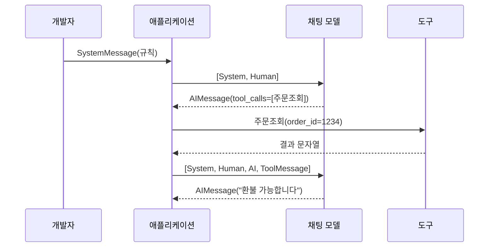
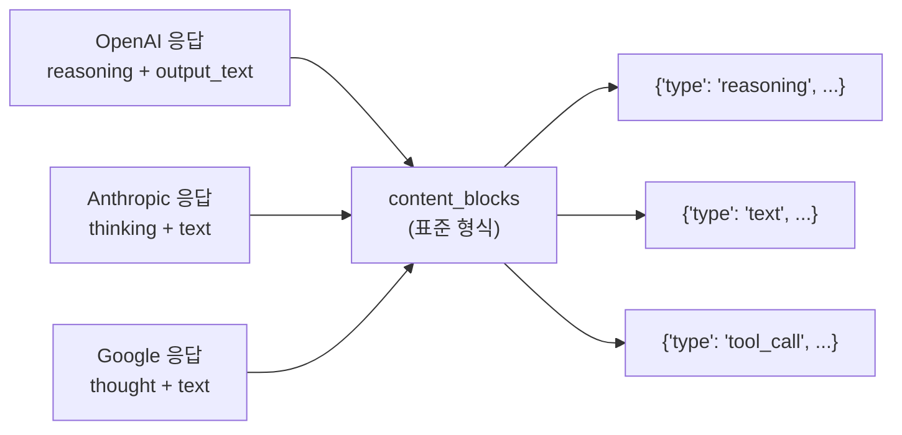

## 왜 "메시지"부터 배우나요?

01-foundations에서 우리는 `llm.invoke("안녕")`처럼 문자열 하나를 모델에 넘겼습니다(→ 1.4). 편리하지만, 실제 에이전트는 문자열 하나로 돌아가지 않습니다. 에이전트가 하는 일을 떠올려 보세요.

1. 개발자가 "너는 환불 담당 상담원이야"라는 **규칙**을 줍니다.
2. 사용자가 "주문 1234 환불해 주세요"라고 **질문**합니다.
3. 모델이 "주문 조회 도구를 호출할게"라고 **결정**합니다.
4. 프로그램이 도구를 실행하고 **결과**를 돌려줍니다.
5. 모델이 결과를 보고 최종 **답변**을 만듭니다.

이 다섯 가지는 말하는 주체도, 담긴 정보도 다릅니다. 이걸 문자열 하나에 섞어 넣으면 모델은 누가 무슨 말을 했는지 헷갈리고, 프로그램은 "도구 호출 결정"을 안정적으로 읽어낼 수 없습니다. 그래서 모든 채팅 모델 API는 **역할(role)이 붙은 메시지의 리스트**를 입력으로 받습니다. LangChain은 이 메시지를 파이썬 객체로 표현하고, OpenAI·Anthropic·Google 등 제공자마다 다른 형식을 하나로 통일해 줍니다.

> [!NOTE]
> 비유하자면 메시지 리스트는 **연극 대본**입니다. 대사마다 "누가 말했는지"가 붙어 있어야 배우(모델)가 맥락을 이해합니다. LLM은 기억력이 없기 때문에(stateless), 매번 대본 전체를 처음부터 다시 읽고 다음 대사 하나를 씁니다.

## 핵심 개념 1: 네 가지 메시지 타입

| 클래스 | 역할(role) | 누가 만드나 | 용도 |
|---|---|---|---|
| `SystemMessage` | system | 개발자 | 모델의 성격·규칙·출력 형식 지시 |
| `HumanMessage` | user | 사용자 | 질문, 업로드한 이미지/파일 |
| `AIMessage` | assistant | 모델 | 답변 텍스트, 도구 호출 요청, 토큰 사용량 |
| `ToolMessage` | tool | 프로그램 | 도구 실행 결과 (`tool_call_id`로 호출과 짝지음) |

LangChain v1에서는 `from langchain.messages import ...`로 가져옵니다. 내부적으로는 `langchain_core.messages`와 같은 클래스입니다.

```python
from langchain.messages import SystemMessage, HumanMessage, AIMessage, ToolMessage

messages = [
    SystemMessage("너는 친절한 환불 상담원이다. 한국어로 짧게 답한다."),
    HumanMessage("주문 1234 환불 가능한가요?"),
]
```

딕셔너리 형식도 그대로 받습니다. OpenAI 문서를 보던 분에게 익숙한 형태입니다.

```python
messages = [
    {"role": "system", "content": "너는 친절한 환불 상담원이다."},
    {"role": "user", "content": "주문 1234 환불 가능한가요?"},
]
```

두 방식은 결과가 같습니다. 다만 객체 방식은 IDE 자동완성이 되고, `pretty_print()`로 예쁘게 출력할 수 있으며, `tool_calls` 같은 필드를 타입 안전하게 다룰 수 있어 현업 코드에서는 객체 방식을 주로 씁니다.

### 대화의 흐름



여기서 중요한 사실 두 가지가 보입니다.

- 모델을 다시 부를 때는 **이전 메시지를 모두 포함한 리스트**를 보냅니다. "기억"은 우리가 리스트를 들고 다니는 것입니다. 이것이 나중에 배울 체크포인터(→ 5.1)와 메모리 관리(→ 3.4)의 출발점입니다.
- `ToolMessage`는 반드시 자신을 요청한 `AIMessage`의 tool call `id`를 `tool_call_id`로 가지고 있어야 합니다. 짝이 맞지 않으면 OpenAI API는 400 에러를 냅니다. 도구 호출은 → 2.4에서 자세히 다룹니다.

## 핵심 개념 2: AIMessage 해부

모델이 돌려주는 `AIMessage`에는 텍스트 말고도 운영에 필요한 정보가 많습니다.

```python
ai = llm.invoke(messages)
ai.content            # 원본 콘텐츠 (str 또는 블록 리스트, 제공자마다 다를 수 있음)
ai.text               # 텍스트만 이어 붙인 문자열 (가장 안전한 텍스트 접근)
ai.tool_calls         # [{"name", "args", "id", "type": "tool_call"}, ...]
ai.usage_metadata     # {"input_tokens", "output_tokens", "total_tokens", ...}
ai.response_metadata  # 모델명, 종료 사유(finish_reason) 등 제공자별 정보
ai.id                 # 메시지 고유 ID (트레이싱·중복 제거에 사용)
```

> [!TIP]
> 텍스트가 필요할 때는 `ai.content`보다 `ai.text`를 쓰세요. 추론 모델이나 멀티모달 모델은 `content`가 문자열이 아니라 **블록의 리스트**로 오는 경우가 있습니다. `ai.text`는 어떤 경우에도 텍스트 부분만 모아 줍니다.

`usage_metadata`는 비용 계산의 기본 재료입니다. 01-foundations에서 토큰과 비용을 계산해 봤죠(→ 1.2). 현업에서는 이 값을 요청마다 로그로 남겨 "사용자당 하루 비용", "기능별 토큰 소비" 같은 지표를 만듭니다.

▶ 오른쪽 IDE의 `examples/01_message_types.py`를 실행해 보세요. 메시지를 만들고, 모델을 호출하고, 답변을 대화 기록에 붙여 두 번째 턴을 이어가는 과정을 보여 줍니다.

## 핵심 개념 3: 표준 콘텐츠 블록(content_blocks)

### 문제: 제공자마다 다른 응답 형식

모델이 텍스트만 내놓던 시절에는 `content: str` 하나로 충분했습니다. 지금은 다릅니다.

- **추론(reasoning) 모델**은 답변 전에 "생각 요약"을 따로 내보냅니다.
- **멀티모달 모델**은 이미지·오디오·PDF를 입력으로 받습니다.
- **서버 측 도구**(웹 검색 등)는 인용(citation) 정보를 붙입니다.

문제는 제공자마다 이걸 표현하는 JSON 모양이 제각각이라는 점입니다. OpenAI Responses API의 reasoning 항목, Anthropic의 `thinking` 블록, Google의 `thought` 파트는 같은 개념인데 키 이름이 전부 다릅니다. 제공자별 분기문을 코드 곳곳에 쓰면, 모델을 바꿀 때마다 코드를 고쳐야 합니다.

### 해결: `message.content_blocks`

LangChain v1은 모든 메시지에 `content_blocks` 속성을 제공합니다. 원본 `content`가 어떤 제공자 형식이든, 이 속성은 **표준 타입의 블록 리스트**로 변환해 돌려줍니다.



주요 블록 타입은 다음과 같습니다.

| type | 주요 키 | 의미 |
|---|---|---|
| `text` | `text`, `annotations` | 일반 텍스트, 인용 정보 |
| `reasoning` | `reasoning` | 모델의 추론 요약 |
| `tool_call` | `name`, `args`, `id` | 도구 호출 요청 (`tool_calls`와 같은 정보) |
| `image` | `url` / `base64` / `file_id`, `mime_type` | 이미지 |
| `file` | `url` / `base64` / `file_id`, `mime_type` | PDF 등 파일 |
| `audio`, `video` | 위와 동일 | 오디오, 비디오 |
| `non_standard` | `value` | 표준화되지 않은 제공자 전용 데이터 |

이제 코드는 제공자와 무관하게 이렇게 씁니다.

```python
for block in ai.content_blocks:
    if block["type"] == "reasoning":
        log_reasoning(block.get("reasoning", ""))
    elif block["type"] == "text":
        render(block["text"])
    elif block["type"] == "tool_call":
        schedule_tool(block["name"], block["args"])
```

> [!IMPORTANT]
> `content_blocks`는 **읽기용 표준 뷰**입니다. 원본 `content`는 그대로 보존되므로, 제공자 전용 정보가 꼭 필요하면 `content`나 `response_metadata`를 보면 됩니다. 반대로 "어떤 모델이든 동작해야 하는" 공통 로직은 `content_blocks`를 기준으로 작성하세요.

### 멀티모달 입력: 블록으로 질문하기

사용자가 이미지를 올리고 질문하는 경우, `HumanMessage`의 `content`에 블록 리스트를 넣습니다.

```python
from langchain.messages import HumanMessage

msg = HumanMessage(content=[
    {"type": "text", "text": "이 영수증의 합계 금액은?"},
    {"type": "image", "url": "https://example.com/receipt.png"},
])

# base64 데이터로 보낼 때는 mime_type을 반드시 함께
msg = HumanMessage(content=[
    {"type": "text", "text": "이 계약서를 요약해 줘"},
    {"type": "file", "base64": pdf_b64, "mime_type": "application/pdf"},
])
```

블록 딕셔너리를 직접 쓰는 대신 `langchain_core.messages.content`의 팩토리 함수(`create_text_block`, `create_image_block`, `create_file_block` 등)를 쓰면 필수 키 누락 같은 실수를 줄일 수 있습니다.

> [!WARNING]
> 모든 모델이 모든 입력 형식을 지원하지는 않습니다. 예를 들어 이미지 URL은 받지만 오디오는 받지 않는 모델이 있습니다. 지원하지 않는 블록을 보내면 제공자 API가 에러를 냅니다. 모델을 선택할 때 지원 모달리티를 먼저 확인하세요.

▶ 오른쪽 IDE의 `examples/02_content_blocks.py`를 실행해 보세요. 추론·텍스트·도구 호출이 섞인 AIMessage를 표준 블록으로 분해하고, 이미지·PDF 입력 메시지를 만들어 모델에 보냅니다.

## 코드 해설: 대화 기록 관리의 기본형

여러 턴의 대화는 다음 패턴이 기본입니다.

```python
history: list = [SystemMessage("너는 여행 플래너다.")]

def chat(user_text: str) -> str:
    history.append(HumanMessage(user_text))
    ai = llm.invoke(history)       # 전체 기록을 보낸다
    history.append(ai)             # 모델 답변도 기록에 남긴다
    return ai.text
```

이 코드에는 현업에서 반드시 마주칠 문제가 숨어 있습니다.

1. **기록이 무한히 길어집니다.** 대화가 길어질수록 입력 토큰(=비용과 지연)이 선형으로 늘고, 결국 컨텍스트 윈도우를 넘습니다. 해결책(트리밍·요약)은 → 3.4에서 배웁니다.
2. **동시 사용자가 섞입니다.** 전역 리스트 하나를 쓰면 사용자 A와 B의 대화가 섞입니다. 사용자별 thread로 분리하는 체크포인터는 → 5.1에서 배웁니다.
3. **시스템 메시지는 맨 앞에 하나**만 두는 것이 원칙입니다. 중간에 여러 개를 끼워 넣으면 제공자마다 처리 방식이 달라 예측하기 어렵습니다.

## 현업에서는

**관측성(Observability).** LangSmith 트레이스는 결국 메시지 리스트의 기록입니다. 메시지마다 `id`가 있고, AIMessage에 `usage_metadata`가 붙어 있으니 "어느 턴에서 토큰이 폭증했는가"를 바로 찾을 수 있습니다. 메시지를 직접 문자열로 이어 붙이는 코드는 이 정보를 잃어버리므로 피하세요.

**비용.** 이미지 한 장은 해상도에 따라 수백~수천 토큰으로 계산됩니다. 사용자가 올린 원본 이미지를 그대로 보내지 말고, 필요한 해상도로 줄이거나 OpenAI의 경우 `detail` 옵션을 조정하는 식으로 비용을 관리합니다. 큰 파일을 반복해서 보낸다면 base64 대신 업로드한 파일의 `file_id`를 참조하는 방식이 네트워크 비용과 지연을 줄입니다.

**보안.** `HumanMessage`에 들어가는 내용은 전부 **신뢰할 수 없는 입력**입니다. 사용자가 "이전 지시를 무시하고…" 같은 문장을 넣거나, 이미지 안에 그런 문구를 숨길 수도 있습니다(프롬프트 인젝션, → 8.3). 시스템 규칙은 반드시 `SystemMessage`에 두고, 사용자 입력을 시스템 메시지 문자열에 끼워 넣는 실수를 하지 마세요. 마찬가지로 도구 결과(`ToolMessage`)도 외부 웹페이지 내용 같은 비신뢰 데이터일 수 있습니다.

**저장과 직렬화.** 대화 기록을 DB에 저장할 때는 `message.model_dump()`나 LangChain의 `messages_to_dict`/`messages_from_dict`를 쓰면 타입 정보가 보존됩니다. 문자열만 저장하면 나중에 도구 호출 기록을 복원할 수 없습니다.

**테스트.** 메시지는 평범한 파이썬 객체라서, 실제 모델 없이도 `AIMessage(content="", tool_calls=[...])`를 손으로 만들어 도구 실행 로직을 단위 테스트할 수 있습니다. 이 강의의 예제도 그렇게 "가짜 추론 모델 응답"을 만들어 블록 파싱 로직을 검증합니다.

> [!CAUTION]
> 추론 모델의 `reasoning` 블록은 내부 사고의 **요약**이며, 최종 사용자에게 그대로 보여 줄지 여부는 제품 정책으로 결정해야 합니다. 디버깅 로그에는 남기되, UI 노출은 신중하게 하세요.

## 안티패턴 정리

- ❌ `llm.invoke(f"시스템: {rule}\n사용자: {q}")` 처럼 역할을 문자열로 흉내 내기 → ✅ 메시지 객체 리스트 사용
- ❌ `ai.content`가 항상 문자열이라고 가정 → ✅ `ai.text` 또는 `content_blocks` 사용
- ❌ 제공자별 응답 JSON을 직접 파싱 → ✅ `content_blocks`의 표준 `type`으로 분기
- ❌ ToolMessage의 `tool_call_id`를 임의로 지정 → ✅ AIMessage의 tool call `id`를 그대로 사용

## 정리

- 채팅 모델의 입력과 출력은 **역할이 붙은 메시지의 리스트**입니다. System(규칙), Human(질문), AI(답변·도구 호출), Tool(도구 결과) 네 가지를 기억하세요.
- LLM은 기억이 없으므로 **대화 기록을 리스트로 들고 다니며** 매번 전체를 보냅니다.
- `AIMessage`의 `text`, `tool_calls`, `usage_metadata`, `response_metadata`는 각각 렌더링, 행동, 비용, 디버깅에 쓰입니다.
- `content_blocks`는 제공자마다 다른 형식을 **표준 블록**(text/reasoning/image/file/tool_call…)으로 통일해, 모델을 바꿔도 코드가 그대로 동작하게 해 줍니다.
- 다음 강의(→ 2.2)에서는 이 메시지들을 템플릿으로 찍어 내고, 모델·파서와 파이프(`|`)로 연결하는 Runnable 인터페이스를 배웁니다.
