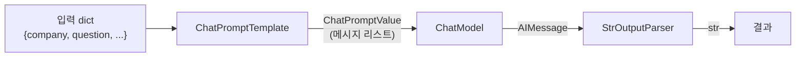
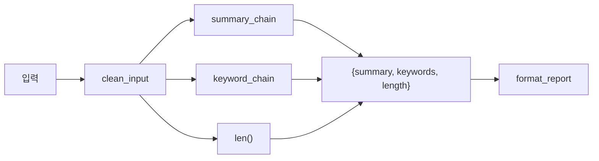
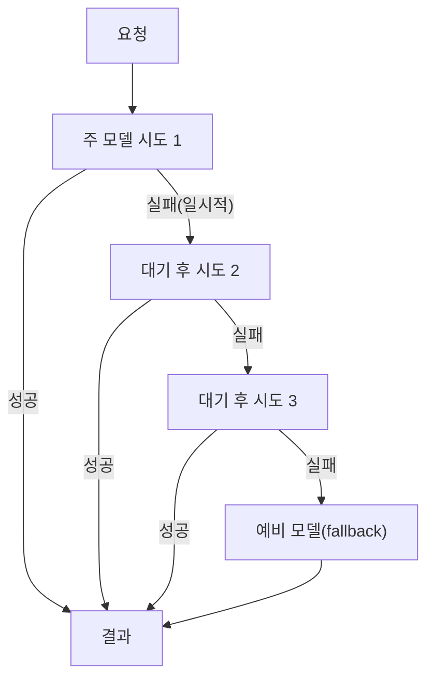

## 왜 필요한가요?

지난 강의(→ 2.1)에서 메시지 리스트를 손으로 만들었습니다. 그런데 실제 서비스에서는 같은 모양의 프롬프트를 수천 번, 매번 다른 값으로 채워서 보냅니다.

```python
# 이렇게 f-string으로 매번 만들면…
messages = [
    SystemMessage(f"너는 {company}의 상담원이다. {tone} 말투를 쓴다."),
    HumanMessage(f"{user_question}"),
]
```

처음엔 괜찮지만 곧 문제가 생깁니다.

- 프롬프트가 코드 곳곳에 흩어져 **버전 관리와 A/B 테스트가 어렵습니다.**
- 어떤 변수가 필요한지 코드만 봐서는 알기 어렵고, 하나 빠뜨려도 **조용히 이상한 프롬프트**가 나갑니다.
- 모델 호출 앞뒤로 "입력 전처리 → 모델 → 출력 파싱 → 후처리"가 붙으면서 **함수 호출이 양파처럼 중첩**됩니다.
- 스트리밍, 배치, 비동기, 재시도를 각 단계마다 따로 구현해야 합니다.

LangChain은 이 문제를 두 가지 도구로 풉니다. **프롬프트 템플릿**은 프롬프트를 "빈칸이 있는 양식"으로 만들고, **Runnable**은 모든 부품(템플릿, 모델, 파서, 내 함수)이 **똑같은 인터페이스**를 갖게 해서 레고처럼 이어 붙이게 합니다.

## 핵심 개념 1: 프롬프트 템플릿

`ChatPromptTemplate`은 메시지 리스트의 양식입니다. `{변수}` 자리에 값을 넣으면 완성된 메시지 리스트(`ChatPromptValue`)가 나옵니다.

```python
from langchain_core.prompts import ChatPromptTemplate, MessagesPlaceholder

prompt = ChatPromptTemplate.from_messages([
    ("system", "너는 {company}의 상담원이다. {tone} 말투로 답한다."),
    MessagesPlaceholder("history"),          # 대화 기록(메시지 리스트)이 통째로 들어갈 자리
    ("human", "{question}"),
])

prompt.input_variables          # ['company', 'history', 'question', 'tone']
value = prompt.invoke({"company": "AgentMall", "tone": "공손한",
                       "history": [], "question": "배송 언제 와요?"})
value.to_messages()             # [SystemMessage(...), HumanMessage(...)]
```

알아 둘 점:

- `("system", "...")` 튜플은 `SystemMessage` 템플릿의 줄임말입니다. `"human"`, `"ai"`도 같습니다.
- `MessagesPlaceholder`는 **메시지 리스트 전체**를 끼워 넣는 자리입니다. 대화 기록이나 few-shot 예시를 넣을 때 씁니다.
- `prompt.partial(company="AgentMall")`로 일부 변수를 미리 고정할 수 있습니다. 회사명처럼 배포 시점에 정해지는 값에 유용합니다.
- 필요한 변수가 빠지면 **즉시 `KeyError`** 가 납니다. f-string보다 안전한 이유입니다.

> [!TIP]
> 템플릿 안에서 중괄호를 글자 그대로 쓰고 싶으면 `{{`와 `}}`로 이스케이프합니다. JSON 예시를 프롬프트에 넣을 때 자주 실수하는 부분입니다.

## 핵심 개념 2: Runnable 인터페이스

LangChain의 거의 모든 부품은 `Runnable`입니다. 채팅 모델도, 프롬프트 템플릿도, 출력 파서도, LangGraph로 컴파일한 그래프도, `create_agent`가 만든 에이전트도 전부 Runnable입니다. 그래서 다음 메서드를 **공통으로** 가집니다.

| 메서드 | 입력 → 출력 | 언제 쓰나 |
|---|---|---|
| `invoke(x)` | 하나 → 하나 | 가장 기본. 결과 전체를 기다림 |
| `batch([x1, x2, ...])` | 여러 개 → 여러 개 | 대량 처리. 내부적으로 스레드 병렬 실행 |
| `stream(x)` | 하나 → 조각들(iterator) | 사용자에게 글자가 흘러나오는 UX |
| `ainvoke` / `abatch` / `astream` | 위의 비동기 버전 | FastAPI 같은 비동기 서버 |

이 균일함이 핵심입니다. 오늘 배우는 체인을 내일 LangGraph 노드 안에 넣어도, 에이전트로 바꿔도 호출 방식은 그대로입니다.

> [!NOTE]
> `batch`의 기본 동시성은 제한이 없습니다(스레드 풀 크기까지). 제공자의 분당 요청 한도(rate limit)에 걸리지 않도록 `config={"max_concurrency": 5}`처럼 상한을 거는 습관을 들이세요.

## 핵심 개념 3: LCEL — 파이프로 잇기

LCEL(LangChain Expression Language)은 Runnable을 `|` 연산자로 잇는 문법입니다. 리눅스 파이프처럼 **앞 단계의 출력이 다음 단계의 입력**이 됩니다.

```python
from langchain_core.output_parsers import StrOutputParser

chain = prompt | llm | StrOutputParser()
answer: str = chain.invoke({...})
```



`chain` 자체도 Runnable(`RunnableSequence`)이므로 `chain.batch(...)`, `chain.stream(...)`, `await chain.ainvoke(...)`가 공짜로 생깁니다. 특히 `stream`은 영리하게 동작합니다. 모델이 토큰을 내보내는 즉시 파서가 받아서 흘려보내므로 체인 끝에서도 토큰 단위 스트리밍이 됩니다(→ 2.5).

▶ 오른쪽 IDE의 `examples/01_prompt_and_lcel.py`를 실행해 보세요. 템플릿 렌더링 결과, invoke/batch/stream/ainvoke 네 가지 호출을 차례로 보여 줍니다.

## 핵심 개념 4: 흐름 조립 — Parallel, Lambda, Passthrough

직선 파이프만으로는 부족한 경우가 많습니다. 세 가지 부품으로 데이터 흐름을 설계합니다.

**`RunnableLambda`** — 평범한 파이썬 함수를 Runnable로 감쌉니다. 입력 정제, 후처리, 로깅 등에 씁니다. 파이프 안에 함수를 그냥 넣어도 자동으로 감싸집니다.

**`RunnableParallel`** — 같은 입력을 여러 Runnable에 **동시에** 보내고 결과를 dict로 모읍니다. 파이프 안에 dict 리터럴을 쓰면 자동으로 RunnableParallel이 됩니다.

**`RunnablePassthrough`** — 입력을 그대로 통과시킵니다. `RunnablePassthrough.assign(key=runnable)`은 **입력 dict를 유지하면서 새 키를 추가**합니다. 단계가 진행될수록 정보를 누적할 때 매우 유용합니다.

```python
from langchain_core.runnables import RunnableLambda, RunnableParallel, RunnablePassthrough

analyze = RunnableParallel(
    summary=summary_chain,                    # LLM 호출 1
    keywords=keyword_chain,                   # LLM 호출 2 (동시에 실행)
    length=RunnableLambda(lambda x: len(x["text"])),
)

pipeline = (
    RunnableLambda(clean_input)                       # 전처리
    | RunnablePassthrough.assign(analysis=analyze)    # 원래 입력 + analysis 키
    | RunnableLambda(format_report)                   # 후처리
)
```



병렬 실행의 효과는 큽니다. 각 LLM 호출이 2초 걸린다면 순차 실행은 4초, 병렬 실행은 약 2초입니다. 이것이 01-foundations에서 본 **Parallelization 패턴**(→ 1.3)의 가장 간단한 구현입니다.

▶ 오른쪽 IDE의 `examples/02_parallel_and_lambda.py`를 실행해 보세요. 리뷰 한 건을 요약·감정 분석·통계로 동시에 분석하고 리포트로 합칩니다.

## 핵심 개념 5: 장애 대비 — with_retry, with_fallbacks

LLM API는 생각보다 자주 실패합니다. 순간적인 네트워크 오류, 429(rate limit), 500/503(제공자 장애), 타임아웃이 대표적입니다. 모든 Runnable에는 두 가지 방어 수단이 붙어 있습니다.

```python
robust_llm = (
    llm.with_retry(
        retry_if_exception_type=(TimeoutError, ConnectionError),  # 재시도할 예외만
        stop_after_attempt=3,                                      # 최대 3번 시도
        wait_exponential_jitter=True,                              # 지수 백오프 + 지터
    )
    .with_fallbacks([backup_llm])                                  # 그래도 실패하면 예비 모델
)
```



- **재시도(retry)** 는 "잠깐 기다리면 해결될" 오류용입니다. 지수 백오프(1초, 2초, 4초…)에 **지터(무작위 흔들림)** 를 섞어, 수천 개 클라이언트가 동시에 재시도하며 서버를 다시 넘어뜨리는 현상(thundering herd)을 막습니다.
- **폴백(fallback)** 은 "이 경로는 지금 안 된다"일 때 다른 경로로 우회합니다. 다른 모델, 더 작은 모델, 캐시된 답변, 정중한 사과 메시지까지 무엇이든 Runnable이면 됩니다.

> [!WARNING]
> 모든 예외를 재시도하면 안 됩니다. 400(잘못된 요청)이나 인증 오류(401)는 몇 번을 다시 보내도 실패하며, 비용과 지연만 늘어납니다. `retry_if_exception_type`으로 **일시적 오류만** 골라 재시도하세요.

> [!TIP]
> 설치된 langchain-core 1.7에는 제공자와 무관한 표준 예외 클래스가 있습니다(`langchain_core.exceptions`의 `ModelRateLimitError`, `ModelTimeoutError`, `ModelConnectionError`, `ModelAPIError`, `ModelAuthenticationError` 등). langchain-openai의 오류는 이 클래스들을 상속하므로, `retry_if_exception_type=(ModelRateLimitError, ModelTimeoutError, ModelConnectionError)`처럼 제공자 독립적으로 재시도 대상을 지정할 수 있습니다.

> [!NOTE]
> `ChatOpenAI` 같은 제공자 클라이언트에도 자체 `max_retries`가 있습니다. 두 겹으로 재시도하면 시도 횟수가 곱해지니(3 × 3 = 9번) 한 곳에서만 관리하는 편이 좋습니다.

▶ 오른쪽 IDE의 `examples/03_retry_and_fallback.py`를 실행해 보세요. 두 번 실패 후 성공하는 가짜 API와, 완전히 죽은 주 모델이 예비 모델로 넘어가는 과정을 볼 수 있습니다.

## LCEL은 언제 쓰고 언제 그만두나요?

LCEL은 **짧고 직선적인 파이프라인**에 탁월합니다: 프롬프트 → 모델 → 파서, 몇 개의 병렬 분기, 재시도와 폴백. 하지만 다음이 필요해지면 LangGraph로 넘어가는 것이 맞습니다(→ 4.1).

- 조건에 따라 다른 단계로 **분기하고 되돌아가는 루프** (에이전트의 본질)
- 단계 사이에 공유되는 **상태(state)** 와 그 영속화
- 사람의 승인을 기다리는 **중단과 재개**(→ 5.3)

LangChain v1에서 레거시 `LLMChain`, `langchain.chains` 같은 클래스는 정리되었고, 단순 조합은 LCEL로, 에이전트와 복잡한 흐름은 `create_agent`와 LangGraph로 하는 것이 표준입니다.

## 현업에서는

**관측성.** 체인의 각 단계는 LangSmith 트레이스에서 별도의 span으로 보입니다. `.with_config(run_name="review_summary", tags=["review", "v2"])`로 이름과 태그를 붙여 두면 수백 개의 트레이스 사이에서 원하는 단계를 바로 찾고, 버전별 성능을 비교할 수 있습니다. 호출 시 `config={"metadata": {"user_id": ...}}`를 넘겨 사용자 단위 필터링도 합니다.

**프롬프트 관리.** 프롬프트는 코드와 수명 주기가 다릅니다. 기획자나 PM이 고치기도 하고, 실험으로 자주 바뀝니다. 규모가 커지면 프롬프트를 별도 파일이나 LangSmith Prompt Hub 같은 저장소로 분리하고, 버전 태그를 달아 배포합니다. 템플릿의 `input_variables`를 테스트에서 검증하면 "변수 이름 바뀜" 사고를 막을 수 있습니다.

**비용과 지연.** `batch`와 `RunnableParallel`은 지연을 줄이지만 동시 요청 수를 늘립니다. 제공자의 rate limit(분당 요청/토큰 수)을 고려해 `max_concurrency`를 설정하세요. 대량 오프라인 작업(수만 건 분류 등)은 제공자의 Batch API가 더 저렴한 경우가 많습니다.

**장애.** 폴백 모델은 주 모델과 **다른 제공자나 다른 리전**으로 두어야 진짜 의미가 있습니다. 같은 제공자의 다른 모델은 제공자 전체 장애 때 함께 죽습니다. 또 폴백 모델은 출력 품질과 형식이 다를 수 있으니, 폴백 경로도 평가 데이터셋으로 테스트해야 합니다(→ 8.2).

**테스트.** `RunnableLambda`로 만든 전처리·후처리 함수는 순수 함수라서 단위 테스트가 쉽습니다. LLM 부분만 가짜 모델로 바꾸면 체인 전체를 결정적으로 테스트할 수 있습니다. 이 사이트의 Mock 모드가 정확히 그 방식입니다.

## 정리

- **프롬프트 템플릿**은 프롬프트를 변수가 있는 양식으로 만들어, 누락을 즉시 잡고 재사용과 버전 관리를 쉽게 합니다. 대화 기록은 `MessagesPlaceholder`로 넣습니다.
- **Runnable**은 LangChain의 공통 인터페이스입니다. 모델, 템플릿, 파서, 그래프, 에이전트 모두 `invoke/batch/stream`과 비동기 버전을 가집니다.
- **LCEL** `|`은 앞 출력을 뒤 입력으로 잇습니다. `RunnableParallel`(동시 실행), `RunnableLambda`(함수 감싸기), `RunnablePassthrough.assign`(키 추가)으로 흐름을 조립합니다.
- **with_retry**는 일시적 오류를, **with_fallbacks**는 경로 자체의 장애를 처리합니다. 재시도 대상은 반드시 좁히세요.
- 다음 강의(→ 2.3)에서는 `StrOutputParser` 대신 모델이 **정해진 스키마의 데이터**를 돌려주게 만드는 구조화 출력을 배웁니다.
