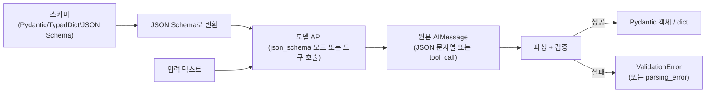
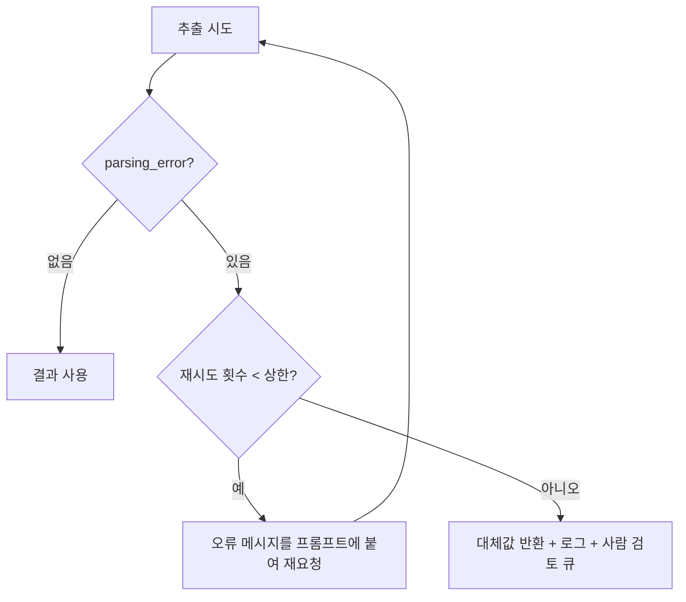

## 왜 필요한가요?

지금까지 모델의 출력은 사람이 읽는 **문장**이었습니다. 그런데 프로그램은 문장을 읽지 못합니다. 다음 상황을 생각해 보세요.

> 고객 이메일: "안녕하세요, 지난주 화요일에 주문한 무선 이어폰(주문번호 A-3391)이 아직 안 왔어요. 너무 화나네요. 빨리 확인 부탁드립니다. — 김민지 드림"

우리 시스템이 원하는 것은 이것입니다.

```json
{"customer": "김민지", "order_id": "A-3391", "category": "delivery", "sentiment": "negative", "urgent": true}
```

이 데이터가 있어야 티켓 시스템에 등록하고, 긴급 건을 상담원에게 바로 배정하고, 대시보드에 통계를 쌓을 수 있습니다. 모델에게 "JSON으로 답해"라고 부탁만 하면 어떻게 될까요? 대부분 잘 되지만, 가끔 앞에 "물론입니다! 다음은 JSON입니다:"를 붙이거나, 키 이름을 `orderId`로 바꾸거나, 따옴표를 빠뜨립니다. 하루 10만 건을 처리하면 그 "가끔"이 수백 건의 장애가 됩니다.

**구조화 출력(Structured Output)** 은 모델 출력을 **스키마에 맞는 데이터**로 강제하고, 파싱과 검증까지 자동으로 해 주는 기능입니다. 이건 단순한 편의 기능이 아니라 에이전트 시스템의 뼈대입니다.

- 라우터가 "다음에 어느 에이전트로 갈지"를 고를 때 (→ 7.2 Supervisor)
- 평가자가 "점수와 이유"를 매길 때 (→ 7.5 Evaluator)
- 플래너가 "단계 목록"을 만들 때 (→ 7.4 Plan-and-Execute)
- 에이전트가 최종 결과를 정해진 형식으로 낼 때 (→ 3.2 `response_format`)

모두 내부적으로 구조화 출력을 씁니다.

## 핵심 개념 1: 동작 원리



`llm.with_structured_output(Schema)`는 내부적으로 세 가지 일을 합니다.

1. 스키마를 **JSON Schema**로 바꿔 모델 API에 전달합니다. 필드 이름, 타입, 필수 여부, 그리고 **설명(description)** 이 모두 들어갑니다.
2. 모델이 그 스키마에 맞춰 출력하도록 **강제**합니다. 방법은 `method` 인자로 고릅니다.
   - `"json_schema"`: 제공자의 네이티브 구조화 출력 기능 사용(OpenAI Structured Outputs). 설치된 langchain-openai의 `ChatOpenAI` 기본값입니다.
   - `"function_calling"`: 스키마를 "도구"로 위장해 모델이 그 도구를 호출하게 만듭니다. 가장 많은 모델이 지원합니다.
   - `"json_mode"`: "유효한 JSON"만 보장하고 스키마는 프롬프트로 알려 줘야 합니다. 가장 약한 보장입니다.
3. 응답을 파싱하고, Pydantic 스키마라면 **검증**까지 해서 객체로 돌려줍니다.

결과적으로 `with_structured_output`이 돌려주는 것도 Runnable이므로 `invoke`, `batch`, 그리고 프롬프트와의 LCEL 조합(→ 2.2)이 그대로 됩니다.

> [!NOTE]
> 모델은 스키마의 **필드 설명**을 읽고 무엇을 채울지 판단합니다. 설명은 사실상 프롬프트의 일부입니다. `Field(description="...")`를 꼼꼼히 쓰는 것이 추출 품질을 높이는 가장 값싼 방법입니다.

## 핵심 개념 2: 스키마를 정의하는 세 가지 방법

### 1) Pydantic — 기본 선택

```python
from typing import Literal
from pydantic import BaseModel, Field

class Ticket(BaseModel):
    """고객 문의에서 추출한 지원 티켓."""          # 클래스 docstring도 모델에게 전달된다
    customer: str | None = Field(None, description="고객 이름. 없으면 null")
    order_id: str | None = Field(None, description="주문번호, 예: A-1234")
    category: Literal["delivery", "refund", "product", "other"] = Field(description="문의 유형")
    sentiment: Literal["positive", "neutral", "negative"]
    urgent: bool = Field(description="즉시 처리가 필요하면 true")

extractor = llm.with_structured_output(Ticket)
ticket: Ticket = extractor.invoke(email_text)
ticket.category      # 자동완성, 타입 검사, 검증이 모두 된다
```

장점은 **검증**입니다. 타입이 틀리거나 `Literal`에 없는 값이 오면 예외가 납니다. `field_validator`로 "이메일에는 @가 있어야 한다" 같은 비즈니스 규칙도 넣을 수 있습니다.

### 2) TypedDict — 가볍게, dict로

```python
from typing_extensions import Annotated, TypedDict

class Movie(TypedDict):
    """영화 정보."""
    title: Annotated[str, ..., "영화 제목"]          # (타입, 필수(...), 설명)
    year: Annotated[int, ..., "개봉 연도"]
    genre: Annotated[str | None, None, "장르"]        # 기본값 None → 선택
```

결과는 평범한 `dict`입니다. **런타임 검증은 하지 않습니다.** LangGraph 상태가 TypedDict라서 그대로 상태에 넣기 편하다는 장점이 있습니다(→ 4.2).

### 3) JSON Schema — 언어 독립적으로

```python
schema = {
    "title": "Weather", "description": "날씨 질의 파라미터",
    "type": "object",
    "properties": {"city": {"type": "string"}, "days": {"type": "integer"}},
    "required": ["city"],
}
```

스키마를 DB나 설정 파일에서 동적으로 불러오거나, 프론트엔드(TypeScript)와 공유할 때 유용합니다. 결과는 `dict`이며 검증은 하지 않습니다.

| 방식 | 결과 타입 | 런타임 검증 | 주 용도 |
|---|---|---|---|
| Pydantic | 모델 객체 | ✅ | 기본 선택, 비즈니스 규칙 검증 |
| TypedDict | dict | ❌ | LangGraph 상태와 연동, 가벼운 구조 |
| JSON Schema | dict | ❌ | 동적 스키마, 다른 언어와 공유 |

▶ 오른쪽 IDE의 `examples/01_pydantic_extraction.py`와 `examples/02_typeddict_and_jsonschema.py`를 실행해 보세요.

## 핵심 개념 3: 추출(Extraction) 실무

정보 추출은 구조화 출력의 대표 용도입니다. 계약서에서 조항을, 이력서에서 경력을, 영수증에서 금액을 뽑아냅니다. 좋은 추출 스키마의 원칙은 다음과 같습니다.

1. **없을 수 있는 정보는 `Optional`(`| None`)로.** 필수 필드로 두면 모델은 정보가 없어도 무언가를 **지어냅니다**(환각). "없으면 null"이라고 설명에 명시하세요.
2. **범주형 값은 `Literal`로.** 자유 문자열 대신 허용 값을 고정하면 후속 코드의 분기가 안전해집니다.
3. **여러 개는 `list[하위모델]`로.** 한 이메일에 주문이 여러 건일 수 있습니다. 중첩 모델로 표현하세요.
4. **필드 순서도 의미가 있습니다.** 모델은 앞에서부터 생성하므로 `reasoning` 같은 근거 필드를 결론 필드보다 **앞에** 두면 판단 품질이 좋아지는 경우가 많습니다.
5. **단위와 형식을 설명에 명시합니다.** "금액(원, 정수)", "날짜(YYYY-MM-DD)"처럼요.

```python
class LineItem(BaseModel):
    product: str = Field(description="상품명")
    quantity: int = Field(description="수량(개)")

class Order(BaseModel):
    customer: str | None = Field(None, description="주문자 이름, 없으면 null")
    items: list[LineItem] = Field(description="주문한 상품 목록")
```

대량 추출은 프롬프트와 조합해 `batch`로 돌립니다.

```python
prompt = ChatPromptTemplate.from_messages([
    ("system", "너는 정확한 정보 추출기다. 텍스트에 없는 정보는 절대 지어내지 말고 null로 둔다."),
    ("human", "{text}"),
])
pipeline = prompt | llm.with_structured_output(Order)
orders = pipeline.batch([{"text": t} for t in emails], config={"max_concurrency": 5})
```

## 핵심 개념 4: 검증 실패 처리

네이티브 구조화 출력을 써도 실패는 일어납니다. JSON 문법은 맞아도 `field_validator`의 비즈니스 규칙을 어기거나, 모델이 안전 정책 때문에 거절(refusal)하거나, 출력이 토큰 한도에서 잘릴 수 있습니다. 기본 동작에서는 예외가 그대로 터져 파이프라인 전체가 멈춥니다.

**`include_raw=True`** 를 주면 예외 대신 세 가지를 담은 dict가 옵니다.

```python
safe = llm.with_structured_output(Contact, include_raw=True)
result = safe.invoke(text)
result["raw"]            # 원본 AIMessage (디버깅·로깅용)
result["parsed"]         # 성공하면 객체, 실패하면 None
result["parsing_error"]  # 실패 원인(예외 객체) 또는 None
```



현업의 표준 처리 흐름입니다.

1. **오류를 모델에게 알려 주고 재시도** — 이전 출력과 `ValidationError` 메시지를 대화에 붙여 "이 오류를 고쳐서 다시"라고 요청하면 대부분 한 번에 고쳐집니다.
2. **재시도 상한** — 반드시 횟수를 제한합니다. 무한 루프는 비용 폭탄입니다.
3. **우아한 실패(graceful degradation)** — 끝내 실패하면 안전한 기본값을 돌려주고, 원본과 오류를 로그로 남겨 **사람 검토 큐**로 보냅니다.

▶ 오른쪽 IDE의 `examples/03_validation_errors.py`를 실행해 보세요. 이메일 형식 검증기가 있는 스키마로 추출을 시도하고, 실패를 감지해 재시도한 뒤, 상한에 도달하면 대체값으로 처리합니다. Mock 모델은 `(mock) email` 같은 더미 값을 넣기 때문에 실제로 검증이 실패하는 상황을 그대로 관찰할 수 있습니다.

> [!WARNING]
> `with_structured_output(..., include_raw=True)`가 잡아 주는 것은 **파싱/검증 단계의 오류**입니다. 네트워크 오류나 rate limit 같은 API 호출 오류는 여전히 예외로 올라옵니다. 이런 오류는 앞 강의의 `with_retry`/`with_fallbacks`(→ 2.2)로 처리하세요.

## 현업에서는

**스키마는 API 계약입니다.** 추출 결과는 DB, 대시보드, 다른 서비스로 흘러갑니다. 스키마 필드를 바꾸면 하위 시스템이 깨질 수 있으니 버전을 관리하고, 필드 추가는 Optional로 해서 하위 호환을 지키세요.

**평가 없이 배포하지 않습니다.** 추출은 정답이 명확해서 평가하기 좋은 작업입니다. 실제 문서 50~100개에 사람이 정답을 달아 두고, 필드별 정확도(order_id 일치율, category 정확도 등)를 측정하세요. 프롬프트나 모델을 바꿀 때마다 같은 세트로 회귀 테스트를 돌립니다(→ 8.2).

**환각 감시.** 가장 위험한 실패는 예외가 아니라 **그럴듯한 가짜 값**입니다. 주문번호가 원문에 실제로 있는지 정규식으로 교차 검증하는 식의 **사후 검증(grounding check)** 을 붙이면 안전합니다.

**비용과 지연.** 스키마 자체도 입력 토큰입니다. 필드가 수십 개인 거대한 스키마는 비용을 늘리고 정확도도 떨어뜨립니다. 문서 유형별로 작은 스키마를 나누거나, 1차로 분류한 뒤 유형별 스키마로 추출하는 2단계 구조를 고려하세요. OpenAI의 네이티브 json_schema 모드는 처음 보는 스키마에 대해 첫 요청 처리 지연이 생길 수 있으니 스키마를 자주 바꾸지 않는 것이 좋습니다.

**보안과 개인정보.** 추출 대상에는 이름, 연락처, 주소 같은 개인정보(PII)가 많습니다. 로그에 `raw`를 그대로 남기기 전에 마스킹 정책을 확인하세요(→ 8.3).

**거절(refusal) 처리.** 안전 정책상 모델이 답을 거부하면 OpenAI는 스키마 대신 거절 메시지를 돌려줄 수 있습니다. 이 경우도 `include_raw=True`로 원본을 확인해 분기하세요.

## 정리

- 구조화 출력은 모델 출력을 **스키마에 맞는 데이터**로 만들어, 프로그램이 LLM 결과를 안정적으로 쓰게 해 줍니다. 라우팅, 평가, 계획, 추출 모두 이 위에 서 있습니다.
- `llm.with_structured_output(Schema)`는 스키마를 JSON Schema로 바꿔 모델에 강제하고, 결과를 파싱·검증해 돌려줍니다. 방식은 `json_schema`/`function_calling`/`json_mode` 중 고릅니다.
- **Pydantic**(객체+검증), **TypedDict**(dict, 가벼움), **JSON Schema**(동적·언어 독립) 중 상황에 맞게 고르세요. 기본은 Pydantic입니다.
- 좋은 추출 스키마: 필드 설명, Optional로 환각 방지, Literal로 범주 고정, 중첩 리스트, 근거 필드를 앞에.
- `include_raw=True`로 실패를 감지하고 **오류 피드백 재시도 → 상한 → 대체값 + 사람 검토** 흐름으로 처리합니다.
- 다음 강의(→ 2.4)에서는 같은 원리(JSON Schema)를 이용해 모델이 **우리 함수를 호출**하게 만드는 도구 호출을 배웁니다.
