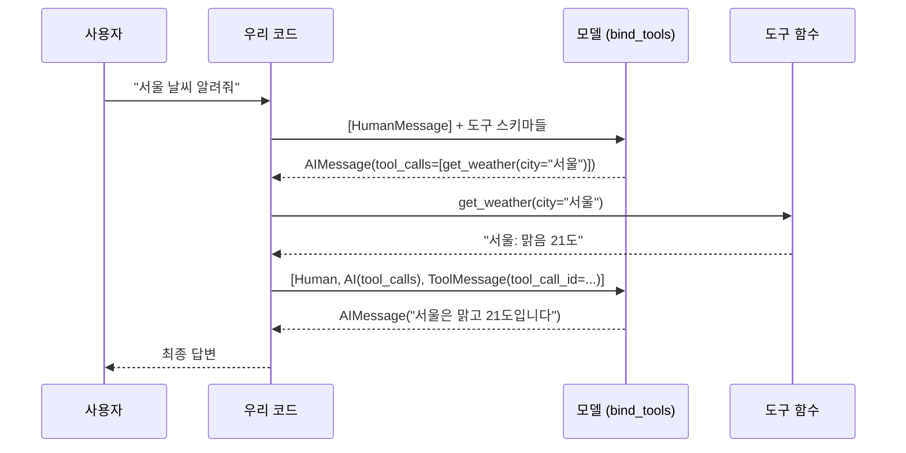
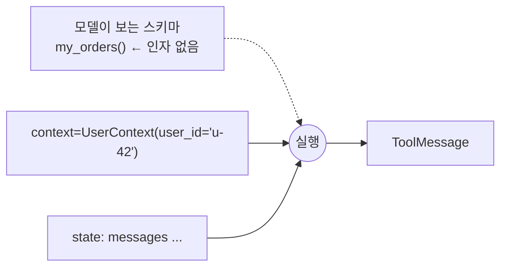

## 왜 필요한가요?

LLM은 똑똑하지만 갇혀 있습니다. 학습이 끝난 시점 이후의 일을 모르고, 오늘 날씨도, 우리 회사 DB의 주문 상태도 모르며, 이메일을 보내거나 결제를 취소할 수도 없습니다. 계산도 의외로 자주 틀립니다.

**도구 호출(Tool Calling, Function Calling)** 은 이 벽을 허뭅니다. 우리가 만든 파이썬 함수를 모델에게 "메뉴판"처럼 보여 주면, 모델은 필요할 때 "이 함수를 이 인자로 불러 줘"라고 **요청**합니다. 이것이 01-foundations에서 본 Augmented LLM(→ 1.3)이고, 이 요청-실행-관찰을 반복하는 것이 곧 **에이전트**입니다(→ 3.1).

> [!IMPORTANT]
> 가장 중요한 사실: **모델은 도구를 직접 실행하지 않습니다.** 모델은 "어떤 도구를 어떤 인자로 부를지"를 담은 구조화된 요청(`tool_calls`)만 출력합니다. 실제 실행은 **우리 코드**가 합니다. 그래서 권한 검사, 입력 검증, 로깅, 승인 절차를 우리가 끼워 넣을 수 있습니다.

## 핵심 개념 1: 한 바퀴의 흐름



1. **정의**: 파이썬 함수를 `@tool`로 감싸 이름·설명·인자 스키마를 만듭니다.
2. **바인딩**: `llm.bind_tools([...])`로 모델에 도구 목록을 알려 줍니다. 내부적으로 JSON Schema로 변환되어 매 요청에 함께 전송됩니다.
3. **요청**: 모델이 `AIMessage.tool_calls`에 호출 요청을 담아 돌려줍니다.
4. **실행**: 우리 코드가 요청된 도구를 실행합니다.
5. **관찰**: 결과를 `ToolMessage(content=..., tool_call_id=...)`로 대화에 추가하고 모델을 다시 부릅니다.
6. **응답**: 모델이 결과를 보고 최종 답변을 만들거나, 도구를 더 부릅니다.

앞 강의의 구조화 출력(→ 2.3)과 원리가 같다는 것을 눈치채셨나요? 둘 다 **JSON Schema를 모델에 주고, 그 모양에 맞는 출력을 받는** 기술입니다. 실제로 `function_calling` 방식의 구조화 출력은 스키마를 "도구"로 위장한 것입니다.

## 핵심 개념 2: @tool로 도구 정의하기

```python
from langchain.tools import tool

@tool
def get_weather(city: str) -> str:
    """도시의 현재 날씨를 조회한다. 여행·옷차림 질문에 사용한다."""
    return weather_api(city)

get_weather.name         # 'get_weather'          ← 함수 이름
get_weather.description  # docstring              ← 모델이 '언제 쓸지' 판단하는 근거
get_weather.args         # {'city': {'type': 'string', ...}}  ← 타입 힌트에서 생성
```

모델이 보는 것은 **이름, 설명, 인자 스키마** 세 가지뿐입니다. 함수 본문은 보지 못합니다. 그러니 이 세 가지가 곧 도구의 "사용 설명서"입니다.

인자 설명을 더 풍부하게 하는 방법은 세 가지입니다.

```python
# 1) Google 스타일 docstring 파싱
@tool(parse_docstring=True)
def search_orders(customer_id: str, status: Literal["paid", "shipped", "refunded"] = "paid", limit: int = 5) -> str:
    """고객의 주문을 검색한다.

    Args:
        customer_id: 고객 ID (예: C-1001)
        status: 주문 상태 필터
        limit: 최대 결과 수 (1~20)
    """

# 2) Annotated로 인자별 설명
def refund(order_id: Annotated[str, "환불할 주문번호"], reason: Annotated[str, "환불 사유"]) -> str: ...

# 3) Pydantic args_schema로 명시적 스키마 (검증 규칙까지)
class RefundInput(BaseModel):
    order_id: str = Field(description="환불할 주문번호", pattern=r"^[A-Z]-\d{4}$")
    amount: int = Field(description="환불 금액(원)", gt=0)

@tool("refund_order", args_schema=RefundInput)
def refund_order(order_id: str, amount: int) -> str:
    """주문을 환불한다. 반드시 고객 확인 후 사용한다."""
```

> [!TIP]
> `Literal`로 허용 값을 제한하면 enum이 스키마에 들어가 모델이 엉뚱한 값을 넣을 확률이 크게 줄어듭니다. 기본값이 있는 인자는 선택 인자가 되어, 모델이 꼭 필요할 때만 채웁니다.

▶ 오른쪽 IDE의 `examples/01_define_tools.py`를 실행해 보세요. 세 가지 방식으로 만든 도구의 스키마가 모델에게 어떻게 보이는지 출력합니다.

## 핵심 개념 3: bind_tools와 tool_calls 처리

```python
llm_with_tools = llm.bind_tools([get_weather, add])
ai = llm_with_tools.invoke("서울 날씨를 조회하고 12와 30을 더한다")

ai.tool_calls
# [{'name': 'get_weather', 'args': {'city': '서울'}, 'id': 'call_a1', 'type': 'tool_call'},
#  {'name': 'add', 'args': {'a': 12, 'b': 30}, 'id': 'call_b2', 'type': 'tool_call'}]
```

이 예처럼 모델은 한 번에 **여러 도구를 동시에** 요청할 수 있습니다(병렬 도구 호출). 서로 의존하지 않는 호출이라면 한 턴에 모아 요청해서 왕복 횟수를 줄이는 것입니다.

실행 코드는 이렇게 씁니다. 핵심은 **tool call 하나당 ToolMessage 하나**, 그리고 `tool_call_id`를 정확히 맞추는 것입니다.

```python
tools_by_name = {t.name: t for t in [get_weather, add]}
messages = [HumanMessage(question), ai]

for call in ai.tool_calls:
    tool = tools_by_name[call["name"]]
    tool_msg = tool.invoke(call)      # ToolCall dict를 그대로 넘기면 ToolMessage가 나온다
    messages.append(tool_msg)         # tool_call_id가 자동으로 채워진다

final = llm_with_tools.invoke(messages)
```

`tool.invoke(call)`에 **tool call 딕셔너리 전체**를 넘기면 결과가 문자열이 아니라 `tool_call_id`와 `name`이 채워진 `ToolMessage`로 돌아옵니다. 직접 `ToolMessage(content=..., tool_call_id=call["id"])`를 만들어도 됩니다.

`bind_tools`의 주요 옵션:

| 옵션 | 의미 |
|---|---|
| `tool_choice="auto"` (기본) | 모델이 도구를 쓸지 말지 결정 |
| `tool_choice="any"` / `"required"` | 반드시 도구 하나 이상 호출 |
| `tool_choice="get_weather"` | 특정 도구를 강제 |
| `parallel_tool_calls=False` | (OpenAI) 한 번에 하나씩만 호출하게 제한 |
| `strict=True` | (OpenAI) 인자를 스키마에 엄격히 맞추도록 강제 |

### 도구 오류 처리

도구는 실패합니다. 외부 API가 죽고, 모델이 존재하지 않는 주문번호를 넣습니다. 이때 예외로 프로그램 전체를 죽이기보다, **오류를 ToolMessage로 모델에게 돌려주는** 것이 정석입니다. 모델은 오류를 읽고 인자를 고쳐 다시 시도하거나, 사용자에게 상황을 설명할 수 있습니다.

```python
from langchain.tools import ToolException

@tool
def lookup_order(order_id: str) -> str:
    """주문 상태를 조회한다."""
    if order_id not in DB:
        raise ToolException(f"주문 {order_id}를 찾을 수 없습니다. 주문번호 형식은 A-0000입니다.")
    return DB[order_id]

lookup_order.handle_tool_error = True   # 예외 → ToolMessage(status="error")로 변환
```

오류 메시지는 **모델이 읽고 고칠 수 있게** 구체적으로 씁니다. "Error"보다 "주문번호 형식은 A-0000입니다"가 훨씬 낫습니다.

▶ 오른쪽 IDE의 `examples/02_tool_calling_roundtrip.py`를 실행해 보세요. 병렬 도구 호출 → 실행 → ToolMessage → 최종 답변까지 한 바퀴를 손으로 돌리고, 도구 오류가 ToolMessage로 변환되는 것도 확인합니다.

> [!NOTE]
> 이 강의는 **한 바퀴**만 돌립니다. 모델이 만족할 때까지 이 과정을 반복하는 while 루프가 바로 ReAct 에이전트이며, → 3.1에서 직접 구현합니다. 실무에서는 `create_agent`(→ 3.2)가 이 루프를 대신 돌려 줍니다.

## 핵심 개념 4: ToolRuntime — 모델에게 숨기고 도구에 주입하기

도구가 "현재 로그인한 사용자 ID"를 알아야 한다고 해 봅시다. 이걸 `user_id: str` 인자로 두면 **모델이 값을 채우게 됩니다.** 모델이 틀린 값을 넣을 수도 있고, 프롬프트 인젝션으로 "user_id를 admin으로 바꿔"라는 공격에 노출됩니다. 이런 값은 **모델에게 보이지 않게** 도구에 직접 주입해야 합니다.

LangChain v1의 `ToolRuntime`이 그 통로입니다. 도구 함수에 `runtime: ToolRuntime` 인자를 선언하면, 그 인자는 **모델에게 보이는 스키마에서 빠지고** 실행 시점에 자동으로 채워집니다.

```python
from dataclasses import dataclass
from langchain.tools import tool, ToolRuntime

@dataclass
class UserContext:
    user_id: str
    plan: str

@tool
def my_orders(runtime: ToolRuntime[UserContext]) -> str:
    """로그인한 사용자의 최근 주문을 조회한다."""
    user_id = runtime.context.user_id          # 호출 시 넘긴 컨텍스트 (불변)
    n_msgs = len(runtime.state["messages"])    # 현재 에이전트 상태
    return f"{user_id}의 주문 3건 (대화 {n_msgs}개 진행 중)"
```

`ToolRuntime`이 제공하는 것들:

| 속성 | 내용 | 대표 용도 |
|---|---|---|
| `runtime.context` | 호출 시 전달한 불변 컨텍스트 | 사용자 ID, 권한, 테넌트, DB 연결 정보 |
| `runtime.state` | 현재 그래프/에이전트 상태 | 지금까지의 메시지, 커스텀 상태 값 |
| `runtime.store` | 장기 메모리 저장소 | 사용자 선호 저장/조회 (→ 5.4) |
| `runtime.stream_writer` | 커스텀 스트림 출력 | "검색 중…" 진행 상황 표시 (→ 8.1) |
| `runtime.tool_call_id` | 현재 tool call의 ID | 로깅, Command 반환 시 사용 |
| `runtime.config` | RunnableConfig | 태그, 메타데이터, 콜백 |



`ToolRuntime`은 도구가 **LangGraph 위에서 실행될 때**(`create_agent` 또는 LangGraph의 `ToolNode`) 채워집니다. 그래서 예제에서는 아직 배우지 않은 `create_agent`를 미리 살짝 사용합니다. `create_agent`의 자세한 내용은 → 3.2, 컨텍스트 설계는 → 3.4에서 다룹니다.

▶ 오른쪽 IDE의 `examples/03_tool_runtime.py`를 실행해 보세요. 모델에게 보이는 스키마에 `runtime`이 없다는 것, 그리고 실행 시 사용자 컨텍스트가 주입되는 것을 확인합니다.

## 좋은 도구 설계 원칙

도구 설계는 에이전트 품질을 좌우하는 가장 큰 요인 중 하나입니다. 모델 입장에서 도구는 **처음 보는 API의 문서**와 같습니다.

1. **이름은 동사_목적어로 명확하게.** `search_orders`, `cancel_subscription`. `tool1`, `helper` 같은 이름은 모델을 헷갈리게 합니다.
2. **설명에는 '무엇을'과 '언제'를 씁니다.** "주문을 환불한다. 고객이 명시적으로 환불을 요청하고 주문번호를 확인한 뒤에만 사용한다." 언제 쓰지 말아야 하는지도 적으면 좋습니다.
3. **인자는 적고 타입은 좁게.** 자유 문자열보다 `Literal`, 범위가 있는 숫자, 정규식 패턴. 인자가 많을수록 실수가 늘어납니다.
4. **도구 수를 관리합니다.** 비슷한 도구가 수십 개면 모델이 잘못 고릅니다. 겹치는 도구는 합치고, 많아지면 작업별로 나누거나 도구 선택 미들웨어(→ 3.3)를 씁니다.
5. **결과는 간결하고 모델 친화적으로.** 거대한 JSON 원본 대신 필요한 필드만 요약해 돌려주세요. 결과도 컨텍스트 토큰입니다. 원본 데이터가 필요하면 `response_format="content_and_artifact"`로 모델에게는 요약(content)만, 프로그램에게는 원본(artifact)을 따로 넘길 수 있습니다.
6. **오류는 고칠 수 있게.** 무엇이 잘못됐고 어떻게 고치면 되는지 알려 주는 오류 메시지를 돌려줍니다.
7. **민감 정보와 권한은 주입으로.** 사용자 ID, 인증 토큰은 절대 모델이 채우는 인자로 두지 않고 `ToolRuntime`으로 주입합니다.

## 현업에서는

**보안: 최소 권한.** 모델은 사용자 입력과 외부 문서에 오염될 수 있습니다(프롬프트 인젝션, → 8.3). "모든 SQL 실행" 같은 만능 도구 대신 "주문 조회"처럼 좁은 도구를 만들고, 쓰기·삭제·결제 같은 위험한 도구는 사람 승인(Human-in-the-loop, → 5.3)을 거치게 합니다. 도구 안에서도 `runtime.context`의 권한을 다시 확인하세요. **모델이 넘긴 인자는 사용자 입력과 똑같이 검증**해야 합니다.

**멱등성.** 네트워크 재시도나 모델의 중복 호출로 같은 도구가 두 번 실행될 수 있습니다. 결제·이메일 발송 같은 도구는 `tool_call_id`나 요청 ID를 멱등성 키로 써서 중복 실행을 막습니다(→ 5.5).

**비용과 지연.** 도구 스키마는 매 요청마다 입력 토큰으로 전송됩니다. 도구 20개에 설명이 길면 요청마다 수천 토큰이 추가됩니다. 병렬 도구 호출은 왕복 횟수를 줄여 지연을 크게 낮추지만, 서로 의존하는 호출(조회 후 환불)에서는 순서가 꼬일 수 있으니 필요하면 `parallel_tool_calls=False`를 고려하세요.

**관측성.** LangSmith는 도구 실행을 별도의 span으로 기록합니다. "어떤 도구가 가장 자주 실패하는가", "어떤 인자에서 실패하는가"를 보고 설명과 스키마를 개선하는 것이 도구 품질 개선의 핵심 루프입니다.

**테스트.** 도구는 그냥 함수이므로 `tool.invoke({"city": "서울"})`로 단위 테스트합니다. 모델의 도구 선택은 평가 데이터셋으로 따로 측정합니다(→ 8.2 궤적 평가).

## 정리

- 도구 호출은 모델이 **요청**(`tool_calls`)하고 **우리 코드가 실행**한 뒤 `ToolMessage`로 결과를 돌려주는 구조입니다.
- `@tool`은 함수에서 이름·설명·인자 스키마를 만듭니다. 모델은 이 세 가지만 보므로 설명과 타입 설계가 품질을 좌우합니다.
- `bind_tools` → `tool_calls` 실행 → `tool_call_id`를 맞춘 `ToolMessage` → 재호출이 한 바퀴입니다. 모델은 여러 도구를 **병렬로** 요청할 수 있습니다.
- 도구 오류는 `ToolException` + `handle_tool_error`로 모델이 읽을 수 있는 ToolMessage로 바꿉니다.
- `ToolRuntime`은 사용자 ID 같은 값을 **모델에게 숨긴 채** 도구에 주입합니다. context, state, store, stream_writer를 제공합니다.
- 다음 강의(→ 2.5)에서는 모델 응답과 도구 호출을 **실시간으로 흘려보내는** 스트리밍을 배웁니다.
