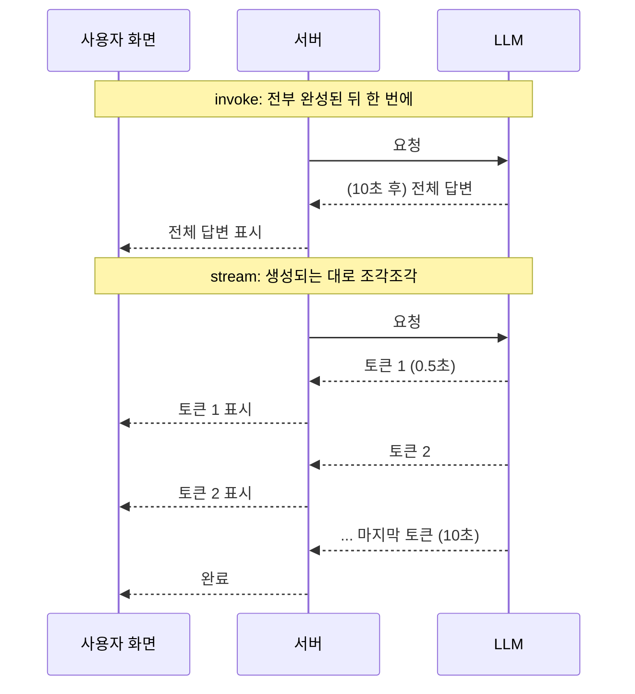
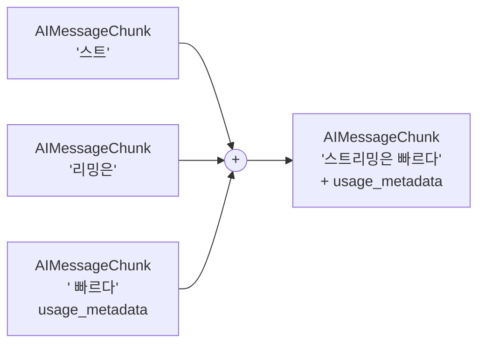

## 왜 필요한가요?

GPT-5 계열 같은 추론 모델에게 긴 보고서를 부탁하면 답이 완성되기까지 10~30초가 걸리기도 합니다. `invoke`로 호출하면 사용자는 그동안 **빈 화면**을 봅니다. 3초만 지나도 "고장났나?" 싶어 새로고침을 누르죠.

스트리밍은 모델이 토큰을 만들어 내는 **즉시** 화면에 흘려보냅니다. 전체 생성 시간은 똑같아도, 첫 글자가 0.5초 만에 나타나면 사용자는 "빠르다"고 느낍니다. ChatGPT, Claude 같은 서비스가 글자를 타자 치듯 보여 주는 이유가 이것입니다.



여기서 두 지표를 구분해야 합니다.

- **TTFT(Time To First Token)**: 요청부터 첫 토큰까지의 시간. 사용자 체감 속도를 결정합니다.
- **전체 지연(Total latency)**: 마지막 토큰까지의 시간. 스트리밍으로 줄지 않습니다.

스트리밍은 TTFT를 사용자 경험의 기준으로 만들어 줍니다. 또한 에이전트에서는 "지금 검색 중…", "도구 실행 중…" 같은 **중간 진행 상황**을 보여 주는 통로가 됩니다(→ 8.1).

## 핵심 개념 1: stream과 청크(Chunk)

모든 Runnable은 `stream()`을 가집니다(→ 2.2). 채팅 모델의 `stream()`은 `AIMessageChunk` 객체를 하나씩 내놓습니다.

```python
for chunk in llm.stream("스트리밍을 한 문단으로 설명해 줘"):
    print(chunk.text, end="", flush=True)   # flush=True: 버퍼에 쌓지 말고 즉시 출력
```

`AIMessageChunk`는 `AIMessage`의 조각 버전입니다. 그리고 결정적인 특징이 하나 있습니다. **`+` 연산자로 합칠 수 있습니다.**

```python
full = None
for chunk in llm.stream(question):
    full = chunk if full is None else full + chunk   # 청크 누적

full.text            # 완성된 전체 텍스트
full.usage_metadata  # 토큰 사용량 (보통 마지막 청크에 담겨 온다)
```



합칠 때 텍스트는 이어 붙이고, `usage_metadata`는 더하고, 도구 호출 조각은 인덱스별로 조립합니다. 이렇게 누적한 결과는 `invoke`의 결과와 같은 정보를 가지므로, **화면에는 흘려보내면서 동시에 완성본을 대화 기록에 저장**할 수 있습니다.

> [!TIP]
> 스트리밍 중에도 비용 집계를 놓치지 마세요. 누적한 메시지의 `usage_metadata`를 로그로 남기면 됩니다. OpenAI 기본 엔드포인트를 쓰는 `ChatOpenAI`는 스트리밍 사용량 보고(`stream_usage`)가 기본으로 켜집니다.

### 도구 호출도 조각으로 온다

모델이 도구를 호출할 때는 텍스트 대신 `tool_call_chunks`가 흘러옵니다. 인자 JSON이 `'{"ci'`, `'ty": "서'`, `'울"}'`처럼 **문자열 조각**으로 나뉘어 오기 때문에, 중간 청크의 인자는 아직 유효한 JSON이 아닙니다. 청크를 `+`로 다 합치면 완성된 `tool_calls`(파싱된 dict)가 됩니다.

```python
full = None
for chunk in llm_with_tools.stream("서울 날씨 알려줘"):
    full = chunk if full is None else full + chunk
    for tc in chunk.tool_call_chunks:
        print(tc["name"], tc["args"])   # 조각: 인자가 부분 문자열일 수 있음

full.tool_calls   # [{'name': 'get_weather', 'args': {'city': '서울'}, ...}]  ← 완성본
```

▶ 오른쪽 IDE의 `examples/01_stream_basics.py`를 실행해 보세요. 토큰 스트리밍, 청크 누적, TTFT 측정, 체인 스트리밍, 도구 호출 청크 조립을 차례로 보여 줍니다.

## 핵심 개념 2: 체인의 스트리밍

`prompt | llm | StrOutputParser()` 체인도 스트리밍됩니다. 파서가 **스트리밍을 지원하는 변환기**이기 때문에, 모델이 토큰을 내면 파서가 바로 문자열로 바꿔 흘려보냅니다.

```python
for piece in chain.stream({"topic": "벡터 DB"}):
    print(piece, end="", flush=True)    # piece는 str
```

주의할 점은 **중간에 스트리밍을 지원하지 않는 단계**가 있으면 그 지점에서 스트림이 막힌다는 것입니다. 예를 들어 `RunnableLambda(lambda text: text.upper())`는 입력 전체가 모일 때까지 기다린 뒤 한 번에 출력합니다. 마지막 단계에서 스트리밍이 필요하면 "입력 iterator → 출력 iterator" 제너레이터 함수를 `RunnableGenerator`로 감쌉니다.

```python
from collections.abc import Iterator
from langchain_core.runnables import RunnableGenerator

def upper_stream(chunks: Iterator[str]) -> Iterator[str]:   # 입력을 iterator로 받아
    for c in chunks:
        yield c.upper()                                      # 조각마다 바로 내보낸다

chain = prompt | llm | StrOutputParser() | RunnableGenerator(upper_stream)   # 끝까지 스트리밍
```

## 핵심 개념 3: astream — 비동기 스트리밍

웹 서버(FastAPI 등)는 하나의 프로세스가 수백 개의 요청을 동시에 처리합니다. 동기 `stream()`은 토큰을 기다리는 동안 스레드를 붙잡고 있어서 동시 처리량이 떨어집니다. 비동기 `astream()`은 기다리는 동안 다른 요청을 처리할 수 있습니다.

```python
async for chunk in llm.astream(question):
    await send_to_client(chunk.text)     # 예: SSE(Server-Sent Events)로 브라우저에 전송
```

FastAPI에서 SSE로 스트리밍하는 프로덕션 구성은 → 8.5에서 다룹니다.

## 핵심 개념 4: astream_events — 내부 이벤트 골라 받기

체인이 길어지면 문제가 생깁니다. `chain.stream()`은 **마지막 단계의 출력**만 흘려보냅니다. 그런데 사용자에게 보여 주고 싶은 것이 체인 **중간에 있는 모델의 토큰**이라면? 예를 들어 "답변 생성 → 구조화 후처리" 체인에서 답변 생성 토큰을 보여 주고 싶다면요?

`astream_events`는 체인 내부의 모든 단계에서 일어나는 **이벤트**를 시간 순서대로 흘려보냅니다.

| 이벤트 | 의미 |
|---|---|
| `on_chain_start` / `on_chain_end` | 체인(또는 Lambda)의 시작/끝 |
| `on_prompt_start` / `on_prompt_end` | 프롬프트 템플릿 렌더링 |
| `on_chat_model_start` | 모델 호출 시작 (입력 메시지 포함) |
| `on_chat_model_stream` | **모델 토큰 청크** (`data["chunk"]`) |
| `on_chat_model_end` | 모델 호출 끝 (완성 메시지 포함) |
| `on_parser_stream` | 파서 출력 조각 |
| `on_tool_start` / `on_tool_end` | 도구 실행 시작/끝 |

```python
async for event in chain.astream_events({"topic": "RAG"}, version="v2"):
    if event["event"] == "on_chat_model_stream":
        print(event["data"]["chunk"].text, end="")
    elif event["event"] == "on_chat_model_end":
        print("\n[모델 완료]", event["name"])
```

각 이벤트에는 `name`, `tags`, `metadata`, `run_id`가 붙어 있습니다. 모델이 여러 개인 체인이라면 `.with_config(tags=["answer"])`로 태그를 달고 `include_tags=["answer"]`로 **특정 단계의 이벤트만** 받을 수 있습니다.

> [!NOTE]
> `version="v2"`를 명시하는 것이 관례입니다. 이벤트 스키마 버전이 바뀌어도 코드가 깨지지 않게 하기 위해서입니다. LangGraph 그래프와 `create_agent`에서는 보통 `astream_events`보다 더 가볍고 구조화된 `stream_mode="messages"`/`"updates"`/`"custom"`을 씁니다(→ 8.1).

▶ 오른쪽 IDE의 `examples/02_astream_and_events.py`를 실행해 보세요. 두 요청을 비동기로 동시에 스트리밍하고, astream_events에서 태그로 특정 모델의 토큰만 골라냅니다.

## UX 관점: 스트리밍을 잘 쓰는 법

스트리밍은 기술이면서 **제품 디자인**입니다.

1. **첫 반응을 최대한 빨리.** 모델 호출 전 검색·전처리에 2초가 걸린다면, 그동안 "관련 문서를 찾는 중…" 같은 진행 상태를 먼저 보내세요. TTFT만큼 "첫 피드백까지의 시간"이 중요합니다.
2. **마크다운은 깨진 상태로 옵니다.** `**굵게` 처럼 닫히지 않은 토큰이 중간에 렌더링되면 화면이 깜빡입니다. 프론트엔드에서 불완전한 마크다운을 견디는 렌더러를 쓰거나, 문장 단위로 버퍼링해서 그립니다.
3. **구조화 출력은 스트리밍과 궁합이 나쁩니다.** 반쯤 온 JSON은 쓸 수 없습니다. 사용자에게 보이는 자연어 답변만 스트리밍하고, 구조화 데이터는 완성 후 처리하세요.
4. **취소(Cancel)를 지원하세요.** 사용자가 "생성 중지"를 누르면 서버도 모델 호출을 멈춰야 비용이 절약됩니다. 비동기에서는 태스크 취소로 구현합니다.
5. **중간 오류에 대비하세요.** 스트리밍은 응답이 이미 절반 나간 상태에서 실패할 수 있습니다. 이때는 HTTP 상태 코드를 바꿀 수 없으므로, 스트림 안에 오류 이벤트를 보내고 화면에 "답변이 중단되었습니다. 다시 시도"를 표시하는 프로토콜이 필요합니다.

## 현업에서는

**관측성.** LangSmith는 스트리밍 호출도 하나의 run으로 기록하며 첫 토큰 시점도 남깁니다. 서비스 대시보드에는 평균이 아니라 **p50/p95 TTFT**를 올리세요. 꼬리 지연이 사용자 이탈을 결정합니다.

**비용.** 스트리밍 자체는 비용을 바꾸지 않습니다. 하지만 사용자가 중간에 이탈해도 서버가 끝까지 생성하면 그만큼 비용이 나갑니다. 클라이언트 연결이 끊기면 생성을 취소하는 처리를 넣으세요.

**인프라.** 스트리밍 응답은 연결이 오래 유지됩니다. 로드밸런서와 프록시(Nginx 등)의 응답 버퍼링을 끄고, 유휴 타임아웃을 충분히 늘려야 합니다. 버퍼링이 켜져 있으면 서버는 스트리밍하는데 사용자에게는 한 번에 도착하는 흔한 장애가 생깁니다.

**테스트.** 스트리밍 코드도 결정적으로 테스트할 수 있습니다. 이 사이트의 Mock 모델은 응답을 단어 단위 청크로 나눠 보내고 마지막 청크에 `usage_metadata`를 담으므로, "청크를 합치면 완성본과 같다", "사용량이 집계된다" 같은 성질을 검증할 수 있습니다. 실습 과제가 바로 그런 테스트입니다.

> [!WARNING]
> `print(chunk.text, end="")`만 하고 청크를 누적하지 않으면, 스트리밍이 끝난 뒤 대화 기록에 저장할 완성 메시지가 없습니다. **보여 주기와 모으기를 항상 같이** 하세요.

## 정리

- 스트리밍은 전체 지연이 아니라 **체감 지연(TTFT)** 을 줄입니다. 긴 답변과 추론 모델에서 필수입니다.
- `stream()`/`astream()`은 `AIMessageChunk`를 내놓고, 청크는 `+`로 합쳐 텍스트·사용량·도구 호출이 모두 담긴 완성본이 됩니다.
- 도구 호출은 `tool_call_chunks`(부분 JSON 문자열)로 흘러오며, 합치면 파싱된 `tool_calls`가 됩니다.
- 체인은 끝까지 스트리밍되지만, 스트리밍을 지원하지 않는 단계가 있으면 그 지점에서 막힙니다. 제너레이터로 해결합니다.
- `astream_events(version="v2")`는 체인 내부의 모든 이벤트를 흘려보내며, 이벤트 종류·이름·태그로 원하는 것만 골라 받습니다.
- UX는 진행 상태 표시, 불완전한 마크다운, 취소, 중간 오류 처리까지 설계해야 완성됩니다.
- 이것으로 LangChain v1의 핵심 부품(메시지, Runnable, 구조화 출력, 도구, 스트리밍)을 모두 익혔습니다. 다음 모듈(→ 3.1)에서는 이 부품들을 조합해 **ReAct 에이전트 루프**를 직접 만듭니다.
