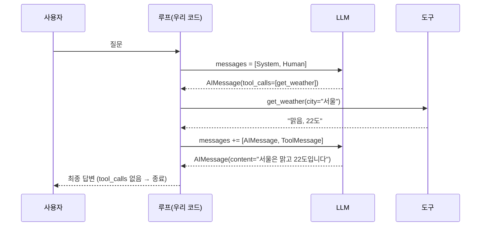
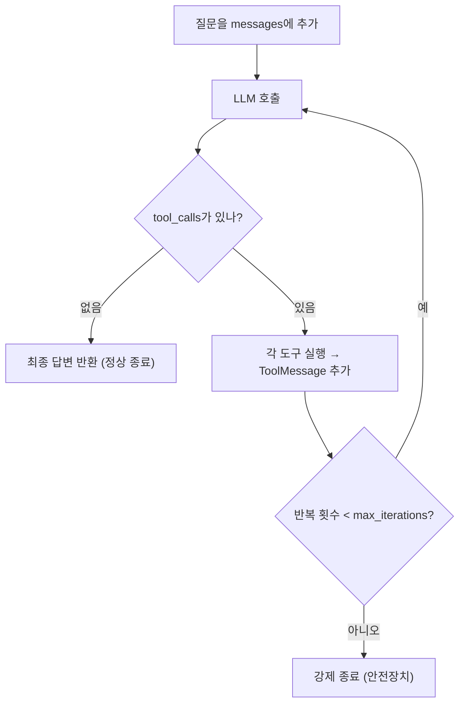

# ReAct 루프 직접 구현하기

다음 강의(→ 3.2)에서 `create_agent` 한 줄로 에이전트를 만들게 됩니다. 그런데 그 한 줄이 내부에서 **무엇을 반복하는지** 모르면, 에이전트가 이상하게 동작할 때 손쓸 방법이 없습니다. 그래서 이번 강의에서는 일부러 프레임워크의 도움 없이, 순수 Python `while` 루프와 LangChain 채팅 모델만으로 에이전트를 직접 만들어 봅니다.

비유를 하나 들겠습니다. 자동차 운전을 배울 때 자동 변속기로 바로 시작해도 되지만, 수동 변속기를 한 번 몰아 보면 "기어가 왜 바뀌는지"를 몸으로 이해하게 됩니다. 이번 강의는 수동 변속기 시간입니다.

## 왜 필요한가: LLM은 혼자서는 '행동'하지 못한다

LLM은 텍스트를 입력받아 텍스트를 내보내는 함수입니다. 오늘 서울 날씨를 물어보면 LLM은 날씨를 **조회할 수 없습니다**. 학습 데이터에 오늘 날씨는 없으니까요. 그래서 우리는 LLM에게 도구(Tool) 목록을 보여 주고, LLM은 "이 도구를 이 인자로 불러 줘"라는 **요청서**를 돌려줍니다(→ 2.4 도구 호출). 실제로 함수를 실행하는 쪽은 언제나 **우리 코드**입니다.

문제는 한 번의 도구 호출로 끝나지 않는 질문이 많다는 점입니다.

- "서울과 부산 중 어디가 더 따뜻해?" → 날씨 도구를 두 번 불러야 합니다.
- "지난달 매출을 조회해서 전월 대비 증감률을 계산해 줘" → 조회 도구 결과를 보고 계산 도구를 불러야 합니다.

다음에 무엇을 할지가 **이전 도구의 결과에 따라 달라집니다**. 미리 순서를 정해 둘 수 없으니, "모델에게 묻고 → 도구를 실행하고 → 결과를 다시 모델에게 보여 주는" 과정을 모델이 "이제 답할게"라고 할 때까지 반복해야 합니다. 이 반복 구조가 바로 에이전트 루프이고, 그 대표 형태가 **ReAct**입니다.

## 핵심 개념: ReAct = Reason + Act

ReAct는 2022년 논문 *"ReAct: Synergizing Reasoning and Acting in Language Models"*(Yao et al.)에서 제안된 패턴입니다. 이름 그대로 **추론(Reasoning)** 과 **행동(Acting)** 을 번갈아 수행합니다.

| 단계 | 의미 | 코드에서의 모습 |
| --- | --- | --- |
| Thought (생각) | 지금까지의 정보로 다음 행동을 결정 | `llm.invoke(messages)` |
| Action (행동) | 도구를 이름과 인자로 호출 | `AIMessage.tool_calls` |
| Observation (관찰) | 도구 실행 결과를 확인 | `ToolMessage(content=결과)` |
| Final Answer (최종 답) | 더 할 일이 없으면 답변 | `tool_calls`가 빈 `AIMessage` |

원 논문은 "Thought: … Action: … Observation: …" 같은 텍스트 형식을 프롬프트로 강제하고 정규식으로 파싱했습니다. 지금은 OpenAI 등 모델 제공자가 **네이티브 도구 호출(native tool calling)** 을 지원하기 때문에, 모델이 구조화된 `tool_calls` 필드를 돌려주고 우리는 파싱 걱정 없이 그 필드만 읽으면 됩니다. 개념은 같고 구현이 훨씬 견고해진 것입니다.

> [!NOTE]
> GPT-5 계열 같은 추론(reasoning) 모델은 "Thought"를 모델 내부에서 처리합니다. 그래서 코드에서는 생각 단계가 눈에 보이지 않고, 바로 `tool_calls`나 최종 답이 나옵니다. 그래도 루프의 구조는 똑같습니다.

## 동작 원리: 메시지 리스트가 곧 에이전트의 기억

ReAct 루프에서 가장 중요한 자료구조는 **메시지 리스트**입니다. 모델은 상태를 기억하지 않기(stateless) 때문에, 매번 지금까지의 모든 대화와 도구 결과를 통째로 다시 보내야 합니다.



루프를 순서도로 보면 다음과 같습니다. **종료 경로가 두 개**라는 점에 주목하세요.



1. **정상 종료**: 모델이 도구를 더 부르지 않고 텍스트로 답할 때.
2. **강제 종료**: 반복 횟수가 상한에 닿았을 때. 모델이 같은 도구를 끝없이 부르는 "무한 루프"는 실제로 꽤 자주 일어나고, 그 대가는 고스란히 API 비용으로 돌아옵니다.

> [!IMPORTANT]
> 모든 에이전트 루프에는 **반드시 상한**이 있어야 합니다. LangGraph의 `recursion_limit`, 미들웨어의 `ModelCallLimitMiddleware`(→ 3.3)가 모두 같은 목적의 장치입니다.

## 코드 해설 1: 도구 호출 한 번 왕복하기

먼저 루프 없이 한 번의 왕복만 손으로 처리해 봅니다.

```python
import os
from langchain.chat_models import init_chat_model
from langchain.tools import tool
from langchain.messages import HumanMessage, ToolMessage

MODEL = os.getenv("LAB_MODEL", "openai:gpt-5-mini")

@tool
def get_weather(city: str) -> str:
    """도시의 현재 날씨를 조회합니다."""
    return f"{city}: 맑음, 22도"

llm = init_chat_model(MODEL)
llm_with_tools = llm.bind_tools([get_weather])   # 모델에게 도구 '메뉴판'을 보여줌

messages = [HumanMessage("서울 날씨 어때?")]
ai = llm_with_tools.invoke(messages)             # ① 모델이 행동을 결정
messages.append(ai)

for call in ai.tool_calls:                       # ② 우리가 실제로 실행
    result = get_weather.invoke(call["args"])
    messages.append(ToolMessage(content=result, tool_call_id=call["id"]))

final = llm_with_tools.invoke(messages)          # ③ 관찰을 보고 최종 답변
print(final.content)
```

핵심 포인트 세 가지입니다.

- `bind_tools`는 모델을 바꾸지 않고, **도구 스키마가 붙은 새 Runnable**을 돌려줍니다.
- `ai.tool_calls`는 `{"name", "args", "id"}` 딕셔너리의 리스트입니다. 모델은 한 번에 **여러 도구를 병렬로** 요청할 수 있으므로 반드시 리스트 전체를 처리합니다.
- `ToolMessage`의 `tool_call_id`는 어떤 요청에 대한 응답인지 연결하는 **영수증 번호**입니다. 이 값이 빠지거나 틀리면 OpenAI API가 요청을 거부합니다. AIMessage의 모든 tool_call에 대응하는 ToolMessage가 있어야 한다는 규칙도 기억하세요.

▶ 오른쪽 IDE의 `examples/01_single_round_trip.py`를 실행해 메시지가 쌓이는 과정을 확인해 보세요.

## 코드 해설 2: 진짜 ReAct 루프

이제 위 과정을 `while` 루프로 감쌉니다. 실전에서 필요한 방어 코드도 함께 넣습니다.

```python
def run_agent(question: str, max_iterations: int = 5) -> dict:
    messages = [SystemMessage(SYSTEM_PROMPT), HumanMessage(question)]
    for step in range(1, max_iterations + 1):
        ai = llm_with_tools.invoke(messages)
        messages.append(ai)

        if not ai.tool_calls:                      # 종료 조건 ①
            return {"answer": ai.content, "steps": step, "stopped": "final_answer"}

        for call in ai.tool_calls:
            tool_fn = TOOLS_BY_NAME.get(call["name"])
            if tool_fn is None:                    # 모델이 없는 도구를 지어낸 경우
                content = f"Error: '{call['name']}' 도구는 없습니다."
            else:
                try:
                    content = str(tool_fn.invoke(call["args"]))
                except Exception as e:             # 도구 실패도 '관찰'로 돌려준다
                    content = f"Error: {type(e).__name__}: {e}"
            messages.append(ToolMessage(content=content, tool_call_id=call["id"]))

    return {"answer": None, "steps": max_iterations, "stopped": "max_iterations"}  # 종료 조건 ②
```

여기서 꼭 짚고 넘어갈 설계 결정이 있습니다.

**도구 예외를 루프 밖으로 던지지 않고 ToolMessage로 돌려줍니다.** 사람도 "파일이 없습니다"라는 오류 메시지를 보면 경로를 고쳐 다시 시도합니다. LLM도 마찬가지입니다. 오류를 관찰로 보여 주면 모델이 인자를 고쳐 **스스로 복구(self-correction)** 할 기회가 생깁니다. 반대로 예외를 그대로 터뜨리면 사용자 요청 전체가 실패합니다.

**존재하지 않는 도구 이름도 처리합니다.** 모델은 가끔 비슷한 이름의 도구를 지어냅니다(hallucination). 딕셔너리 조회로 안전하게 막고, 무엇이 가능한지 알려 주는 메시지를 돌려줍니다.

**`for step in range(...)`로 상한을 구조적으로 강제합니다.** `while True` + `break`보다 실수할 여지가 적습니다.

▶ 오른쪽 IDE의 `examples/02_react_loop.py`를 실행해 보세요. 단계별로 어떤 도구가 어떤 인자로 호출되는지 추적(trace) 로그가 출력됩니다. `max_iterations=1`로 바꿔 강제 종료 경로도 확인해 보세요.

> [!TIP]
> API 키 없이 실행하면 Mock 모델이 대답합니다. Mock은 질문 단어와 겹치는 도구를 고르고, 도구 결과가 생기면 바로 답을 냅니다. 답의 "지능"보다 **루프가 어떤 경로로 흘러가는지**에 집중해서 보세요.

## 직접 만든 루프 vs create_agent

우리가 만든 루프는 50줄 남짓이지만, 현업에서 필요한 것들이 많이 빠져 있습니다.

| 필요한 기능 | 직접 구현 루프 | `create_agent` (→ 3.2) |
| --- | --- | --- |
| 도구 실행/에러 처리 | 직접 작성 | 내장(ToolNode) |
| 병렬 도구 실행 | 순차 실행 | 병렬 실행 지원 |
| 대화 기억(멀티턴) | 리스트를 직접 관리 | checkpointer + thread_id (→ 3.4) |
| 사람 승인(HITL) | 매우 어려움 | 미들웨어 한 줄 (→ 3.3) |
| 스트리밍 | 직접 구현 | `stream_mode` 지원 |
| 관측성(LangSmith) | 수동 계측 | 노드 단위 자동 추적 |

그럼에도 직접 구현을 해 보는 이유는, `create_agent`가 만들어 내는 그래프가 **정확히 이 루프**이기 때문입니다. `model` 노드가 `llm_with_tools.invoke`이고, `tools` 노드가 도구 실행 `for` 문이며, 조건부 엣지가 `if not ai.tool_calls`입니다. 이 대응 관계를 알면 다음 강의부터 나오는 모든 개념이 자연스럽게 연결됩니다.

## 현업에서는

**비용과 지연은 반복 횟수에 비례합니다.** 루프가 한 번 돌 때마다 지금까지의 **전체** 메시지가 다시 입력 토큰으로 청구됩니다. 5단계 루프라면 첫 질문은 5번 청구되는 셈입니다. 그래서 현업에서는 (1) 반복 상한을 작게 잡고, (2) 도구 결과를 짧게 요약해서 돌려주고, (3) 불필요한 도구를 줄입니다. `usage_metadata`로 단계별 토큰을 기록하는 습관을 들이세요.

**종료 이유를 반드시 기록합니다.** 우리 함수가 `stopped` 필드를 돌려주는 것처럼, "정상 종료인지, 상한에 걸렸는지"를 로그와 메트릭으로 남겨야 합니다. 상한 도달 비율이 갑자기 오르면 프롬프트나 도구 설명에 문제가 생긴 것입니다.

**관측성(Observability).** 직접 만든 루프도 `LANGSMITH_TRACING=true` 환경변수만 설정하면 각 `invoke` 호출이 LangSmith에 기록됩니다. 다만 "이 호출들이 하나의 에이전트 실행"이라는 묶음 정보는 직접 넣어야 합니다(→ 8.2). `create_agent`는 이걸 자동으로 해 줍니다.

**보안.** 모델이 요청한 인자를 그대로 실행하는 것은 위험합니다. 특히 셸 명령, SQL, 파일 경로를 받는 도구라면 **허용 목록(allowlist) 검증**을 도구 안에 넣어야 합니다. 모델의 출력은 사용자 입력과 같은 수준으로 "신뢰할 수 없는 입력"입니다(→ 8.3).

**테스트.** 루프 로직은 LLM 없이도 테스트할 수 있어야 합니다. 이 사이트의 Mock 모델처럼 결정적(deterministic)인 가짜 모델을 주입하면 "도구 호출 → 결과 → 종료" 흐름을 단위 테스트로 검증할 수 있습니다.

> [!WARNING]
> 흔한 안티패턴: `while True:` 루프에 상한 없이 "모델이 알아서 멈추겠지"라고 기대하는 코드. 데모에서는 멀쩡하다가, 도구가 계속 에러를 내는 날 수백 번 호출되며 요금 폭탄을 맞습니다.

## 정리

- 에이전트 = **LLM + 도구 + 루프**. LLM은 요청서(`tool_calls`)만 쓰고, 실행은 우리 코드가 합니다.
- ReAct는 "생각 → 행동 → 관찰"을 반복하며, 관찰 결과에 따라 다음 행동을 바꿉니다.
- 메시지 리스트가 에이전트의 작업 기억이며, `ToolMessage.tool_call_id`로 요청과 응답을 짝지어야 합니다.
- 종료 조건은 두 가지: **도구 호출이 없을 때(정상)**, **반복 상한에 닿았을 때(안전장치)**.
- 도구 오류는 예외로 터뜨리지 말고 관찰로 돌려줘 모델이 스스로 복구하게 합니다.

실습에서는 빈칸을 채워 직접 ReAct 루프를 완성합니다. 다음 강의에서는 이 루프를 `create_agent`로 대체하고, 그 내부 그래프를 들여다봅니다.
