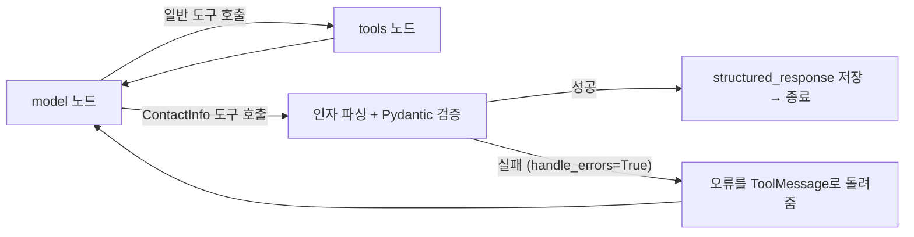
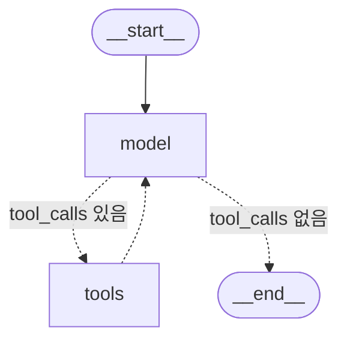

# create_agent 완전 정복

지난 강의(→ 3.1)에서 50줄짜리 ReAct 루프를 직접 만들었습니다. 이번에는 그 루프를 **한 줄**로 바꿉니다.

```python
from langchain.agents import create_agent

agent = create_agent("openai:gpt-5-mini", tools=[get_weather], system_prompt="너는 날씨 비서다.")
result = agent.invoke({"messages": [{"role": "user", "content": "서울 날씨 어때?"}]})
```

`create_agent`는 LangChain v1에서 에이전트를 만드는 **표준 진입점**입니다. 예전 자료에서 보이는 `AgentExecutor`, `initialize_agent`, `langgraph.prebuilt.create_react_agent`는 모두 이 함수로 대체되었습니다. 인터넷에서 찾은 예제가 이런 이름을 쓰고 있다면 구버전 코드라고 보면 됩니다.

## 왜 필요한가: 직접 만든 루프의 한계

직접 만든 루프는 원리를 배우기에 좋지만, 서비스에 올리려면 금방 이런 요구사항이 쏟아집니다.

- "대화를 이어서 하고 싶어요" → 메시지 저장/복원 로직이 필요합니다.
- "결제 도구는 사람이 승인한 다음에 실행해 주세요" → 루프를 중간에 멈췄다가 재개해야 합니다.
- "답변이 생성되는 대로 화면에 보여 주세요" → 스트리밍이 필요합니다.
- "최종 답을 JSON으로 주세요. 프론트엔드에서 파싱해야 해요" → 구조화 출력이 필요합니다.

`create_agent`는 이 루프를 **LangGraph 그래프**로 만들어 줍니다. 그래프로 만들어 두면 저장(checkpointer), 중단/재개(interrupt), 스트리밍, 추적(tracing)을 LangGraph 런타임이 공짜로 제공합니다. 우리는 "어떤 모델에, 어떤 도구를, 어떤 지시로" 줄지만 결정하면 됩니다.

## 핵심 개념: 주요 인자 한눈에 보기

설치된 langchain 1.4.7 기준 시그니처의 핵심 부분은 다음과 같습니다(모든 인자는 `tools` 뒤부터 키워드 전용입니다).

```python
create_agent(
    model,                      # "openai:gpt-5-mini" 같은 문자열 또는 BaseChatModel 인스턴스
    tools=None,                 # @tool 함수, 일반 함수, 또는 provider 내장 도구 dict
    *,
    system_prompt=None,         # str 또는 SystemMessage
    middleware=(),              # → 3.3
    response_format=None,       # 구조화 최종 응답 스키마
    state_schema=None,          # AgentState를 확장한 커스텀 상태
    context_schema=None,        # 실행 시 주입할 런타임 컨텍스트 타입 → 3.4
    checkpointer=None,          # 대화 기억 → 3.4, 5.1
    store=None,                 # 장기 메모리 → 5.4
    name=None,                  # 에이전트 이름 (멀티 에이전트에서 중요)
    debug=False,
)
```

하나씩 살펴봅시다.

### model: 문자열 또는 인스턴스

`"openai:gpt-5-mini"`처럼 `제공자:모델명` 문자열을 넘기면 내부에서 `init_chat_model`로 모델을 만듭니다. 세부 설정(타임아웃, 재시도 횟수 등)이 필요하면 인스턴스를 직접 만들어 넘깁니다.

```python
from langchain.chat_models import init_chat_model

llm = init_chat_model(MODEL, timeout=30, max_retries=2)
agent = create_agent(llm, tools=[...])
```

> [!WARNING]
> GPT-5 계열 추론 모델은 `temperature`를 지원하지 않습니다. 습관적으로 `temperature=0`을 넣으면 API 오류가 납니다. 이 사이트의 모든 예제는 모델 ID를 `LAB_MODEL` 환경변수에서 읽으니 설정 패널에서 모델을 바꿔 가며 실험해 보세요.

### tools: 에이전트의 손과 발

`@tool`로 만든 도구(→ 2.4)를 리스트로 넘깁니다. 일반 Python 함수를 넘겨도 docstring과 타입 힌트로 자동 변환됩니다. **도구가 없거나 빈 리스트면** 그래프에 `tools` 노드가 생기지 않고, 모델을 한 번 호출하고 끝나는 단순 체인이 됩니다.

도구 설계의 품질이 곧 에이전트의 품질입니다. 모델은 도구의 **이름, 설명, 인자 스키마**만 보고 언제 무엇을 부를지 결정합니다. 사람 동료에게 업무 매뉴얼을 건네듯 설명을 쓰세요.

### system_prompt: 역할과 규칙

문자열이나 `SystemMessage`를 넘기면 **매 모델 호출 때 메시지 맨 앞에** 붙습니다. 상태(state)의 메시지 리스트에는 저장되지 않는다는 점이 중요합니다. 그래서 대화 기록을 열어 봐도 시스템 프롬프트는 보이지 않고, 나중에 프롬프트를 바꾸면 기존 대화에도 즉시 적용됩니다. 사용자별로 프롬프트를 바꾸고 싶다면 `@dynamic_prompt` 미들웨어를 씁니다(→ 3.4).

### name: 누가 말했는가

`name="weather_agent"`를 주면 이 에이전트가 생성한 `AIMessage.name`에 그 이름이 찍히고, 그래프를 다른 그래프의 서브그래프로 넣을 때 노드 이름으로도 쓰입니다. 에이전트 하나일 때는 사소해 보이지만, 여러 에이전트가 같은 메시지 기록을 공유하는 멀티 에이전트 시스템(→ 7장)에서는 "이 말을 누가 했는지"를 구분하는 핵심 정보가 됩니다.

## 입력과 출력: 상태(State) 딕셔너리

에이전트는 LangGraph 그래프이므로 **상태 딕셔너리**를 받고 상태 딕셔너리를 돌려줍니다.

```python
result = agent.invoke({"messages": [{"role": "user", "content": "부산 날씨?"}]})

result["messages"]          # Human → AI(tool_calls) → Tool → AI(최종 답) 전체 기록
result["messages"][-1]      # 마지막 메시지 = 최종 답변
```

입력 메시지는 `{"role": ..., "content": ...}` 딕셔너리, `HumanMessage` 객체, `("user", "...")` 튜플 모두 됩니다. 출력의 `messages`에는 **중간 과정 전체**가 들어 있습니다. 최종 답만 필요하면 `result["messages"][-1].content`를 쓰고, 디버깅할 때는 전체를 `pretty_print()`로 훑어보세요.

▶ 오른쪽 IDE의 `examples/01_first_agent.py`를 실행해 보세요. 3.1에서 직접 만든 루프와 똑같은 메시지 흐름이 나오는 것을 확인할 수 있습니다.

## 구조화 응답: response_format

프론트엔드나 다른 시스템이 에이전트의 답을 받아 써야 한다면, 자유 텍스트보다 **정해진 스키마의 객체**가 훨씬 다루기 쉽습니다. `response_format`에 Pydantic 모델을 넘기면, 에이전트가 루프를 마칠 때 그 스키마에 맞는 객체를 `result["structured_response"]`에 담아 줍니다.

```python
from pydantic import BaseModel, Field
from langchain.agents.structured_output import ToolStrategy

class ContactInfo(BaseModel):
    """대화에서 추출한 연락처 정보."""
    name: str = Field(description="사람 이름")
    email: str = Field(description="이메일 주소")

agent = create_agent(MODEL, tools=[], response_format=ToolStrategy(ContactInfo))
result = agent.invoke({"messages": [{"role": "user", "content": "홍길동, hong@example.com"}]})
result["structured_response"]   # ContactInfo(name='홍길동', email='hong@example.com')
```

구조화 응답을 만드는 전략은 세 가지입니다.

| 전략 | 동작 방식 | 특징 |
| --- | --- | --- |
| `ToolStrategy(schema)` | 스키마를 **가짜 도구**로 등록하고 `tool_choice="any"`로 도구 호출을 강제. 모델이 그 도구를 부르면 인자를 파싱해 응답으로 사용 | 도구 호출을 지원하는 거의 모든 모델에서 동작. `handle_errors`로 검증 실패 시 자동 재시도 |
| `ProviderStrategy(schema)` | OpenAI의 `response_format: json_schema` 같은 **제공자 네이티브 구조화 출력** 사용 | 제공자가 스키마를 강제하므로 신뢰도가 높음. 지원 모델에서만 가능 |
| 스키마 그대로 전달 | 내부적으로 `AutoStrategy`가 되어, 모델이 네이티브 구조화 출력을 지원하면 Provider, 아니면 Tool 전략 선택 | 가장 간편 |

> [!NOTE]
> 이 사이트의 예제는 `ToolStrategy`를 명시적으로 씁니다. 실제 OpenAI 모델과 Mock 모델 모두에서 같은 경로로 동작하기 때문입니다. 실제 서비스에서 OpenAI 모델만 쓴다면 스키마를 그대로 넘기거나 `ProviderStrategy`를 써도 좋습니다.

`ToolStrategy`의 흐름을 그림으로 보면 이렇습니다.



`handle_errors`의 기본값은 `True`이므로, 모델이 스키마에 맞지 않는 인자를 만들면 오류 내용을 알려 주고 다시 시도하게 합니다. 실패를 즉시 예외로 받고 싶다면 `handle_errors=False`로 둡니다.

▶ 오른쪽 IDE의 `examples/02_structured_response.py`를 실행해 보세요. 마지막 메시지가 `ToolMessage`로 끝나고, 구조화 객체는 `structured_response` 키에 들어 있는 것을 확인할 수 있습니다.

> [!TIP]
> Mock 모델은 강제된 도구 호출(`tool_choice="any"`)에서 질문과 가장 많이 겹치는 도구 하나를 계속 고릅니다. 그래서 Mock 모드에서는 "일반 도구 → 구조화 응답" 순서를 흉내 내지 못합니다. 예제에서 구조화 응답 에이전트를 도구 없는 **추출(extraction) 에이전트**로 만든 이유입니다. 실제 모델에서는 도구와 response_format을 함께 써도 자연스럽게 동작합니다.

## 내부 구조: create_agent가 만드는 그래프

`create_agent`의 반환값은 LangGraph의 `CompiledStateGraph`입니다. 그래프를 그려 보면 3.1의 루프와 정확히 같은 모양입니다.



- **model 노드**: 상태의 `messages` 앞에 system_prompt를 붙여 모델을 호출하고, 결과 AIMessage를 상태에 추가합니다.
- **tools 노드**: 마지막 AIMessage의 `tool_calls`를 실행하고 ToolMessage를 추가합니다. 여러 도구 호출은 병렬로 실행됩니다.
- **조건부 엣지**: tool_calls가 있으면 tools로, 없으면 종료로 갑니다. 3.1의 `if not ai.tool_calls`입니다.

미들웨어를 추가하면 `before_model`, `after_model` 같은 노드가 이 그래프 사이에 끼어듭니다(→ 3.3). 그래프를 직접 조립하는 방법은 4.5에서 `ToolNode`와 함께 배웁니다.

실행 흐름을 노드 단위로 보고 싶다면 `stream_mode="updates"`로 스트리밍합니다. 각 노드가 끝날 때마다 `{노드이름: 상태변경분}`이 하나씩 나옵니다.

```python
for chunk in agent.stream({"messages": [...]}, stream_mode="updates"):
    for node_name, update in chunk.items():
        print(node_name, "→", update["messages"][-1].type)
```

반복 상한은 `recursion_limit` 설정으로 겁니다. 그래프의 한 단계(super-step)마다 1씩 세며, 상한에 닿으면 `GraphRecursionError`가 발생합니다.

```python
from langgraph.errors import GraphRecursionError

try:
    agent.invoke(inputs, {"recursion_limit": 10})
except GraphRecursionError:
    ...  # 사용자에게 "요청이 너무 복잡합니다" 안내 + 로그
```

▶ 오른쪽 IDE의 `examples/03_inside_the_graph.py`를 실행해 그래프 구조(mermaid), 노드별 업데이트, recursion_limit 동작을 확인해 보세요.

## 현업에서는

**모델 인스턴스를 직접 만들어 넘기세요.** 문자열은 편하지만 타임아웃이 없으면 제공자 장애 때 요청이 오래 매달립니다. `timeout`, `max_retries`를 명시한 인스턴스를 쓰고, 장애 대비 폴백은 `ModelFallbackMiddleware`로 겁니다(→ 3.3).

**recursion_limit은 항상 명시합니다.** LangGraph 기본값은 꽤 넉넉해서, 루프가 꼬이면 그만큼 모델 호출이 쌓입니다. 업무 특성에 맞춰 작게 잡고, `GraphRecursionError`를 잡아 사용자 친화적인 메시지로 바꾸세요. 모델 호출 횟수 자체를 제한하고 싶다면 `ModelCallLimitMiddleware`가 더 정밀합니다.

**구조화 응답은 계약(contract)입니다.** `response_format` 스키마는 프론트엔드·다른 서비스와의 API 계약이므로 버전 관리하고, 필드에 `description`을 꼼꼼히 씁니다. 모델이 그 설명을 보고 값을 채우기 때문입니다. 선택 필드는 `Optional`로 두어 모델이 억지로 값을 지어내지 않게 합니다.

**관측성.** `LANGSMITH_TRACING=true`와 API 키만 설정하면 model/tools 노드 단위로 트레이스가 남습니다. `name`을 의미 있게 지어 두면 트레이스와 로그에서 어떤 에이전트인지 바로 구분됩니다. 요청별로 `config={"tags": [...], "metadata": {...}}`를 넘기면 사용자·기능별 필터링이 쉬워집니다(→ 8.2).

**테스트.** 에이전트는 그래프이므로 모델만 가짜로 바꾸면 결정적으로 테스트할 수 있습니다. "이 질문이면 이 도구가 호출되고 structured_response가 이 타입이다" 같은 **구조 검증**을 CI에 넣으세요. 이 사이트의 실습 채점 방식이 바로 그 예입니다.

> [!CAUTION]
> 안티패턴: 최종 답 텍스트를 정규식으로 파싱해 JSON을 뽑아내는 코드. 모델 업데이트 한 번에 깨집니다. 기계가 읽을 출력이면 처음부터 `response_format`을 쓰세요.

## 정리

- `create_agent(model, tools, system_prompt=..., response_format=..., name=...)`는 LangChain v1의 표준 에이전트 생성 함수입니다.
- 결과물은 model ↔ tools를 오가는 LangGraph 그래프이며, 입출력은 `{"messages": [...]}` 상태 딕셔너리입니다.
- `system_prompt`는 매 호출마다 앞에 붙지만 상태에는 저장되지 않습니다.
- `response_format`으로 구조화 최종 응답을 받으며, `ToolStrategy`(범용)와 `ProviderStrategy`(네이티브) 중 선택할 수 있습니다.
- `stream_mode="updates"`로 노드별 흐름을 관찰하고, `recursion_limit`으로 상한을 겁니다.

다음 강의에서는 이 그래프의 각 단계에 끼어들어 동작을 바꾸는 **미들웨어**를 배웁니다.
