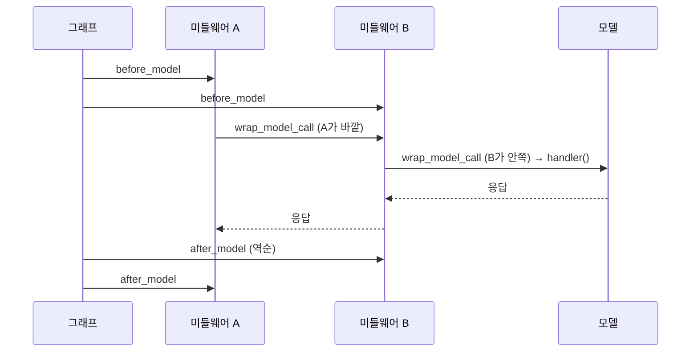
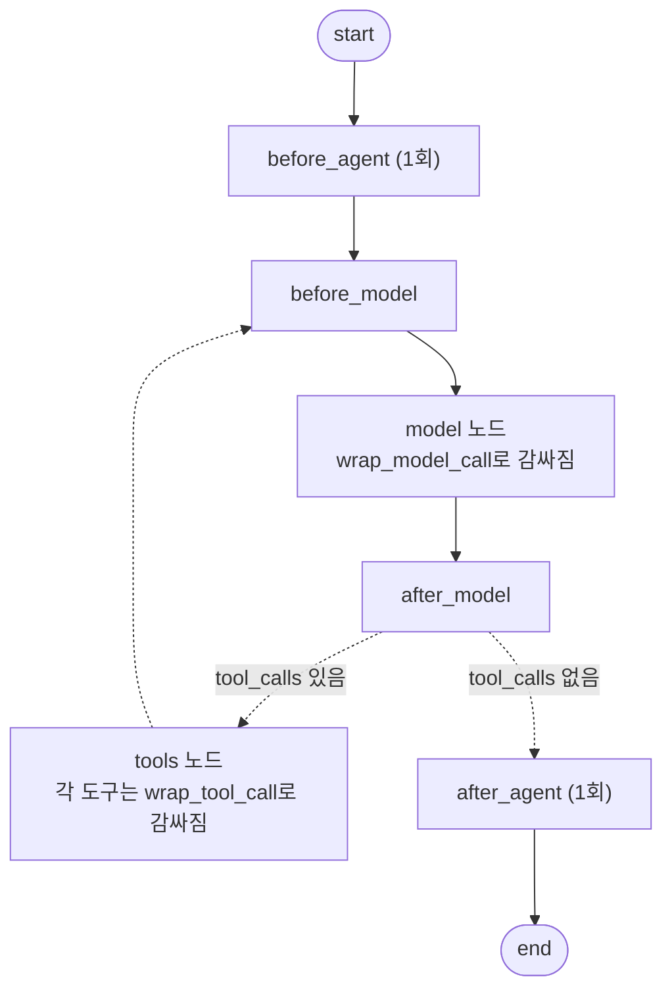

# 미들웨어: 에이전트 루프에 끼어들기

`create_agent`로 만든 에이전트(→ 3.2)는 model ↔ tools를 오가는 단순한 루프입니다. 그런데 서비스를 운영하다 보면 이 루프 **사이사이에** 해야 할 일이 계속 생깁니다.

- 모델을 부르기 전에 너무 긴 대화를 요약하고 싶다.
- 모델 호출이 실패하면 다른 모델로 바꿔 다시 시도하고 싶다.
- `delete_user` 같은 위험한 도구는 사람이 승인한 다음에만 실행하고 싶다.
- 사용자가 입력한 이메일·카드번호는 모델에 보내기 전에 가리고 싶다.
- 한 요청에서 모델을 10번 넘게 부르면 강제로 멈추고 싶다.

이걸 매번 그래프를 직접 뜯어고쳐서 해결한다면 코드가 금방 엉망이 됩니다. LangChain v1의 해법이 **미들웨어(Middleware)** 입니다. 웹 프레임워크(Express, FastAPI, Django)의 미들웨어를 써 봤다면 같은 개념입니다. 요청이 처리되는 길목에 "검문소"를 세워 두고, 각 검문소는 자기 할 일만 합니다.

## 왜 필요한가: 관심사의 분리

미들웨어의 핵심 가치는 **관심사의 분리(Separation of Concerns)** 입니다. 에이전트의 "무엇을 하는가"(도구, 프롬프트)와 "어떻게 안전하고 효율적으로 하는가"(제한, 재시도, 로깅, 보안)를 분리합니다.

```python
agent = create_agent(
    MODEL,
    tools=[search, refund],
    middleware=[
        PIIMiddleware("email", strategy="redact"),          # 보안
        ModelFallbackMiddleware("openai:gpt-5-nano"),       # 장애 대응
        ToolRetryMiddleware(max_retries=2),                 # 일시 오류 대응
        HumanInTheLoopMiddleware(interrupt_on={"refund": True}),  # 승인
        ModelCallLimitMiddleware(run_limit=10),             # 비용 상한
    ],
)
```

리스트 한 줄을 넣고 빼는 것만으로 기능이 붙고 떨어집니다. 각 미들웨어는 독립적으로 테스트할 수 있고, 팀 공용 미들웨어를 패키지로 만들어 여러 에이전트에 재사용할 수도 있습니다.

## 핵심 개념: 6가지 훅

미들웨어는 아래 훅(hook) 중 필요한 것만 구현합니다. 크게 **노드형 훅**과 **래핑형 훅** 두 종류입니다.

| 훅 | 종류 | 실행 시점 | 대표 용도 |
| --- | --- | --- | --- |
| `before_agent` | 노드형 | 에이전트 실행 시작 시 **1회** | 입력 검증, 초기 상태 세팅 |
| `before_model` | 노드형 | **매** 모델 호출 직전 | 메시지 트리밍/요약, 호출 횟수 검사 |
| `wrap_model_call` | 래핑형 | 모델 호출을 감싸서 | 재시도, 폴백, 모델 교체, 캐싱, 동적 프롬프트 |
| `after_model` | 노드형 | **매** 모델 응답 직후 | 출력 검사, 사람 승인 요청 |
| `wrap_tool_call` | 래핑형 | **각** 도구 실행을 감싸서 | 도구 재시도, 권한 검사, 결과 가공 |
| `after_agent` | 노드형 | 에이전트 실행 종료 시 **1회** | 결과 후처리, 감사 로그 |

**노드형 훅**은 `(state, runtime)`을 받아 **상태 업데이트 딕셔너리**(또는 `None`)를 돌려줍니다. 그래프에 실제 노드로 추가되므로 `stream_mode="updates"`에서도 `"이름.before_model"` 같은 노드로 보입니다.

**래핑형 훅**은 `(request, handler)`를 받습니다. `handler(request)`를 부르면 실제 모델(또는 도구)이 실행됩니다. 즉, 부르기 전에 요청을 바꿀 수도 있고, 여러 번 부를 수도 있고(재시도), 아예 안 부를 수도 있습니다(캐시, 차단). 파이썬 데코레이터나 `try/except`로 함수를 감싸는 것과 같은 모양입니다.

## 동작 원리: 실행 순서

미들웨어 두 개 `[A, B]`를 등록했을 때 한 번의 모델 호출은 다음 순서로 흐릅니다(설치된 버전에서 직접 확인한 순서입니다).



규칙을 정리하면 이렇습니다.

- `before_*` 훅은 **등록 순서대로** (A → B)
- `wrap_*` 훅은 **양파 껍질**처럼, 먼저 등록된 것이 바깥 (A가 B를 감쌈)
- `after_*` 훅은 **역순** (B → A)

웹 미들웨어 스택과 똑같은 규칙입니다. 그래서 **순서가 의미를 가집니다.** 예를 들어 재시도(Retry)를 폴백(Fallback)보다 안쪽에 두면 "같은 모델로 몇 번 재시도한 뒤, 그래도 안 되면 다른 모델로" 동작하고, 반대로 두면 "다른 모델로 바꾼 것까지 포함해 통째로 재시도"가 됩니다.

전체 에이전트 그래프 안에서 훅의 위치는 다음과 같습니다.



▶ 오른쪽 IDE의 `examples/01_hook_order.py`를 실행해 보세요. 6개 훅이 모두 로그를 남기며, 위 그림과 같은 순서로 찍히는 것을 확인할 수 있습니다.

## 코드 해설 1: 데코레이터로 만드는 미들웨어

간단한 미들웨어는 데코레이터로 만듭니다.

```python
from langchain.agents.middleware import before_model, wrap_model_call, wrap_tool_call, ModelRequest
from langchain.messages import AIMessage, ToolMessage

@before_model(can_jump_to=["end"])
def stop_if_too_long(state, runtime):
    """대화가 너무 길면 모델을 부르지 않고 종료한다."""
    if len(state["messages"]) > 30:
        return {"messages": [AIMessage("대화가 너무 길어요. 새 대화를 시작해 주세요.")],
                "jump_to": "end"}
    return None                                   # None = 아무것도 바꾸지 않음

@wrap_model_call
def route_model(request: ModelRequest, handler):
    """짧은 대화는 저렴한 모델로 보낸다."""
    if len(request.messages) <= 2:
        request = request.override(model=cheap_llm)  # 원본을 바꾸지 않고 복사본 생성
    return handler(request)

@wrap_tool_call
def block_dangerous(request, handler):
    """delete_로 시작하는 도구는 실행하지 않는다."""
    if request.tool_call["name"].startswith("delete_"):
        return ToolMessage("이 도구는 사용할 수 없습니다.",
                           tool_call_id=request.tool_call["id"], status="error")
    return handler(request)
```

알아 둘 점입니다.

- **`jump_to`**: 노드형 훅은 상태 업데이트에 `"jump_to": "end" | "model" | "tools"`를 넣어 흐름을 바꿀 수 있습니다. 단, 데코레이터에 `can_jump_to=[...]`로 **미리 선언**해야 그래프에 해당 엣지가 생깁니다.
- **`request.override(...)`**: `ModelRequest`는 `model`, `messages`, `system_message`, `tools`, `tool_choice`, `response_format`, `model_settings` 등을 담고 있습니다. 직접 속성을 바꾸지 말고 `override()`로 **새 요청**을 만드세요(직접 대입은 deprecated 경고가 납니다).
- **훅의 인자 이름은 `state`, `runtime`** 으로 통일하세요. 특히 클래스형 미들웨어(아래)에서는 LangGraph가 **매개변수 이름을 보고** `runtime`을 주입하기 때문에, `def before_model(self, s, r)`처럼 이름을 바꾸면 실행 시점에 `missing 1 required positional argument` 오류가 납니다.
- **`wrap_tool_call`에서 `request.tool_call`** 은 `{"name", "args", "id"}` 딕셔너리입니다. `handler`를 부르지 않고 ToolMessage를 직접 돌려주면 도구는 실행되지 않습니다.

## 코드 해설 2: 클래스로 만드는 미들웨어

여러 훅을 함께 쓰거나, 설정값과 **자체 상태 필드**가 필요하면 `AgentMiddleware`를 상속합니다.

```python
from typing import NotRequired
from langchain.agents import AgentState
from langchain.agents.middleware import AgentMiddleware

class UsageState(AgentState):
    model_calls: NotRequired[int]          # 미들웨어가 추가하는 상태 필드

class UsageTracker(AgentMiddleware):
    state_schema = UsageState              # 에이전트 상태에 필드가 합쳐진다

    def __init__(self, budget: int):
        super().__init__()
        self.budget = budget

    def before_model(self, state, runtime):
        return {"model_calls": state.get("model_calls", 0) + 1}

    def wrap_model_call(self, request, handler):
        response = handler(request)        # ModelResponse
        # response.result[0]이 AIMessage — 여기서 usage_metadata를 집계할 수 있다
        return response
```

`state_schema`로 선언한 필드는 에이전트 상태에 합쳐지고, `invoke` 결과에도 나타납니다. 상태에 넣었으니 checkpointer를 쓰면 대화가 이어져도 값이 유지됩니다(→ 3.4). 클래스 메서드에서 `jump_to`를 쓰려면 `@hook_config(can_jump_to=["end"])` 데코레이터를 붙입니다.

▶ 오른쪽 IDE의 `examples/03_custom_middleware.py`를 실행해 보세요. 모델 라우팅, 도구 차단, 사용량 집계, 조기 종료가 한 에이전트에서 함께 동작합니다.

## 내장 미들웨어 둘러보기

직접 만들기 전에 이미 있는 것을 확인하세요. 모두 `langchain.agents.middleware`에서 import합니다.

| 미들웨어 | 하는 일 | 주요 인자 |
| --- | --- | --- |
| `SummarizationMiddleware` | 대화가 길어지면 오래된 메시지를 요약으로 교체 | `model`, `trigger=("messages", 50)` 또는 `("tokens", N)`, `keep=("messages", 20)` |
| `HumanInTheLoopMiddleware` | 지정한 도구 실행 전에 interrupt로 멈추고 사람의 승인/수정/거절을 받음 | `interrupt_on={"도구명": True}` (checkpointer 필요) |
| `PIIMiddleware` | 이메일·카드번호·IP 등 개인정보 탐지 후 차단/가림/마스킹/해시 | `pii_type`, `strategy`, `apply_to_input/output/tool_results` |
| `ModelCallLimitMiddleware` | 모델 호출 횟수 제한 | `run_limit`, `thread_limit`, `exit_behavior="end"/"error"` |
| `ToolCallLimitMiddleware` | 도구 호출 횟수 제한(전체 또는 특정 도구) | `tool_name`, `run_limit`, `exit_behavior` |
| `ModelFallbackMiddleware` | 모델 호출 실패 시 다음 모델로 | `first_model, *additional_models` |
| `ModelRetryMiddleware` / `ToolRetryMiddleware` | 지수 백오프 재시도 | `max_retries`, `initial_delay`, `backoff_factor`, `retry_on` |
| `TodoListMiddleware` | `write_todos` 도구와 계획 프롬프트 추가, `todos` 상태 관리 | `system_prompt`, `tool_description` |
| `LLMToolSelectorMiddleware` | 도구가 많을 때 작은 모델로 관련 도구만 골라 바인딩 | `model`, `max_tools`, `always_include` |
| `ContextEditingMiddleware` | 오래된 도구 결과를 `[cleared]`로 지워 컨텍스트 절약 | `edits=[ClearToolUsesEdit(trigger=..., keep=...)]` |

`run_limit`은 한 번의 `invoke` 안에서의 상한, `thread_limit`은 같은 thread_id(대화) 전체에 걸친 상한입니다. `thread_limit`은 상태가 이어져야 하므로 checkpointer와 함께 씁니다.

HITL은 이 모듈에서 맛보기만 하고, interrupt/resume의 원리는 5.3에서 깊이 다룹니다. 지금은 "도구 실행 직전에 그래프가 멈추고, `Command(resume={"decisions": [...]})`로 승인(approve)·수정(edit)·거절(reject)·직접응답(respond)을 넘기면 재개된다" 정도만 기억하세요.

▶ 오른쪽 IDE의 `examples/02_builtin_middleware.py`를 실행해 보세요. 호출 제한, 재시도, 폴백, PII 가림, 사람 승인(거절)이 차례로 시연됩니다. 폴백 데모는 일부러 항상 실패하는 가짜 모델을 주 모델로 씁니다.

> [!TIP]
> Mock 모드에서는 PII 가림 결과를 특히 잘 볼 수 있습니다. 모델 입력에 들어간 메시지 자체가 `[REDACTED_EMAIL]`로 바뀌어 상태에 저장되기 때문입니다.

## 현업에서는

**순서를 설계 문서에 적으세요.** 보안 계열(PII, 권한 검사)은 바깥쪽(앞쪽)에, 비용 상한은 모든 호출을 셀 수 있는 위치에, 재시도는 폴백보다 안쪽에 두는 식의 원칙을 팀에서 합의합니다. 순서가 바뀌면 동작이 조용히 달라집니다.

**제한(limit)은 기본으로 깝니다.** `ModelCallLimitMiddleware`와 `ToolCallLimitMiddleware`는 사실상 모든 프로덕션 에이전트에 들어갑니다. `exit_behavior="end"`는 사용자에게 부드러운 종료 메시지를 주고, `"error"`는 예외로 상위 시스템에 알립니다. 어느 쪽이든 발생 빈도를 메트릭으로 수집하세요.

**재시도는 멱등(idempotent)한 도구에만.** 조회 도구는 재시도해도 안전하지만, 결제·메일 발송 도구를 재시도하면 두 번 실행될 수 있습니다. `ToolRetryMiddleware(tools=["search"])`처럼 대상 도구를 한정하세요(→ 5.5).

**관측성.** 노드형 훅은 LangSmith 트레이스에 별도 노드로 보이므로, 어떤 미들웨어가 상태를 바꿨는지 추적하기 쉽습니다. 래핑형 훅 안에서 직접 로깅할 때는 요청 ID와 함께 남기세요.

**보안.** PII 미들웨어의 정규식 탐지는 완벽하지 않습니다. 이메일·카드번호처럼 형식이 정해진 것에는 효과적이지만, 이름·주소 같은 자유 형식 정보는 별도 탐지기(`detector` 인자에 함수 전달)를 붙여야 합니다. 그리고 가드레일은 여러 겹으로 겁니다(→ 8.3).

**테스트.** 미들웨어는 순수 함수에 가깝기 때문에 단위 테스트가 쉽습니다. `wrap_tool_call` 함수에 가짜 `request`와 `handler`를 넣어 차단 로직을 검증하고, 에이전트 수준에서는 Mock 모델로 "제한에 걸리면 종료 메시지가 나온다"를 검증합니다.

> [!CAUTION]
> 안티패턴: 한 미들웨어에 로깅·제한·재시도·보안을 몰아넣은 "만능 미들웨어". 테스트가 어렵고 순서 제어가 불가능해집니다. 하나의 미들웨어는 하나의 책임만 지게 하세요.

## 정리

- 미들웨어는 에이전트 루프의 길목에 세우는 검문소입니다. 노드형(`before_*`/`after_*`)은 상태 업데이트를, 래핑형(`wrap_*`)은 `handler` 호출을 감쌉니다.
- 실행 순서: before는 등록 순, wrap은 먼저 등록된 것이 바깥, after는 역순.
- 흐름 제어는 `jump_to`와 `can_jump_to` 선언으로, 모델 요청 변경은 `request.override()`로 합니다.
- 자체 상태가 필요하면 `AgentMiddleware` 클래스에 `state_schema`를 선언합니다.
- 제한·재시도·폴백·PII·HITL·요약 같은 기능은 내장 미들웨어로 먼저 해결하세요.

다음 강의에서는 미들웨어와 checkpointer, 런타임 컨텍스트를 활용해 에이전트에게 **기억**과 **맥락**을 주는 방법을 배웁니다.
