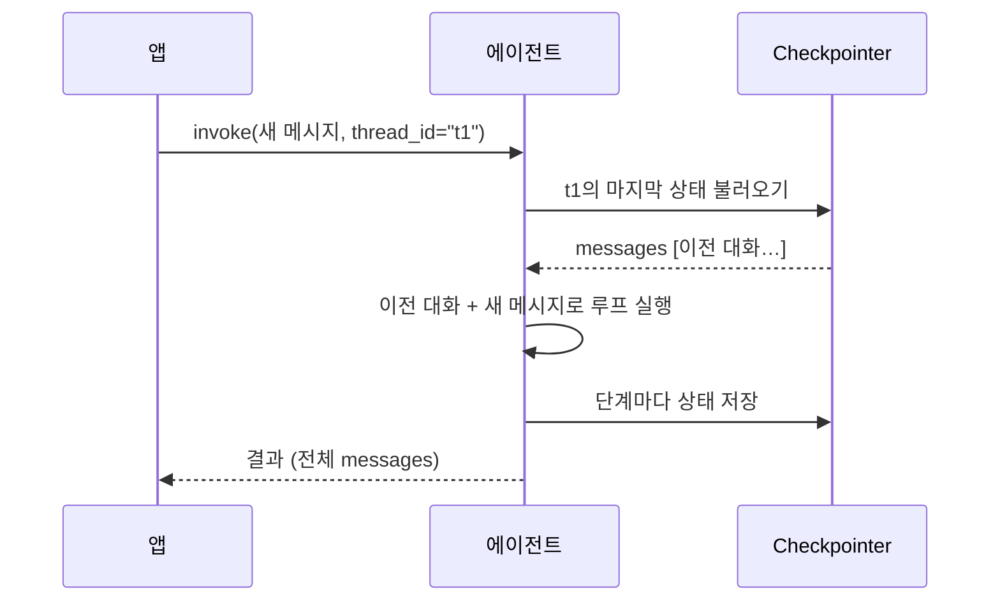
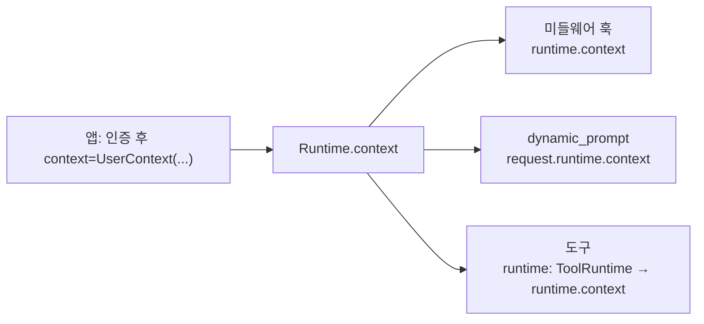
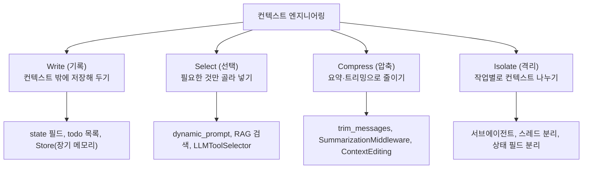

# 메모리와 컨텍스트 엔지니어링

지금까지 만든 에이전트에게 "내 이름은 민지야"라고 말한 뒤 다음 호출에서 "내 이름이 뭐지?"라고 물으면 대답하지 못합니다. LLM은 **상태가 없는(stateless)** 함수라서, 매 호출마다 보내 준 메시지만 알고 있기 때문입니다(→ 1.2). 에이전트가 "기억"하는 것처럼 보이려면 **우리가** 무엇을 다시 보여 줄지 관리해야 합니다.

그리고 무엇을 보여 줄지는 기억만의 문제가 아닙니다. 이 사용자는 누구인지, 어떤 권한이 있는지, 지금 몇 시인지, 대화가 너무 길어져 앞부분을 버려야 하는지… 모델의 입력 창(컨텍스트 윈도우)에 **무엇을, 얼마나, 어떤 형태로** 넣을지 설계하는 일을 요즘 업계에서는 **컨텍스트 엔지니어링(Context Engineering)** 이라고 부릅니다. 에이전트가 실패하는 원인의 상당수는 모델 능력보다 "필요한 정보가 컨텍스트에 없었거나, 쓸모없는 정보가 너무 많았던" 경우입니다.

이번 강의는 이 모듈의 마지막 퍼즐입니다. 3.1~3.3에서 만든 루프·에이전트·미들웨어 위에 **기억**과 **맥락**을 얹습니다.

## 1. 단기 메모리: checkpointer + thread_id

`create_agent`에 `checkpointer`를 넘기면, 그래프가 단계를 마칠 때마다 상태 전체를 저장합니다. 다음 호출 때 같은 `thread_id`를 주면 저장된 상태에서 이어서 시작합니다.

```python
from langgraph.checkpoint.memory import InMemorySaver

agent = create_agent(MODEL, tools=[...], checkpointer=InMemorySaver())

config = {"configurable": {"thread_id": "user-42-chat-1"}}
agent.invoke({"messages": [{"role": "user", "content": "내 이름은 민지야"}]}, config)
agent.invoke({"messages": [{"role": "user", "content": "내 이름이 뭐지?"}]}, config)  # 기억함
```

두 번째 호출에서 우리는 새 메시지 하나만 넘겼지만, 체크포인터가 이전 메시지를 복원하고 `messages` 리듀서(→ 4.2)가 새 메시지를 **이어 붙입니다**. 그래서 모델은 대화 전체를 보게 됩니다.



비유하자면 `thread_id`는 **카톡 채팅방 ID**입니다. 같은 방에서는 이전 대화가 보이고, 다른 방은 완전히 분리됩니다. 현업에서는 보통 `f"{user_id}:{conversation_id}"`처럼 사용자와 대화를 함께 식별하는 값을 씁니다.

저장된 상태는 `agent.get_state(config).values`로 언제든 꺼내 볼 수 있습니다. 대화 목록 화면, 디버깅, 감사 로그에 쓰입니다.

> [!WARNING]
> `InMemorySaver`는 프로세스 메모리에 저장하므로 서버가 재시작되면 사라지고, 서버를 여러 대 띄우면 공유되지 않습니다. 학습·테스트용입니다. 프로덕션에서는 `SqliteSaver`(단일 서버), `PostgresSaver`(다중 서버)를 씁니다(→ 5.1).

▶ 오른쪽 IDE의 `examples/01_short_term_memory.py`를 실행해 같은 스레드와 다른 스레드의 차이를 확인해 보세요.

## 2. 상태(State) vs 런타임 컨텍스트(Context)

에이전트에 정보를 넣는 통로는 두 가지입니다. 헷갈리기 쉬우니 표로 비교합니다.

| 구분 | 상태 (State) | 런타임 컨텍스트 (Context) |
| --- | --- | --- |
| 예시 | 대화 메시지, todo 목록, 집계값 | user_id, 권한 등급, 언어 설정, DB 커넥션 |
| 변경 | 노드·도구·미들웨어가 실행 중 **업데이트** | 실행 동안 **읽기 전용** |
| 저장 | checkpointer에 **저장**됨 | 저장되지 **않음** (매 호출마다 새로 전달) |
| 모델에게 보이나 | messages는 보임 | 직접 넣지 않으면 **안 보임** |
| 정의 | `state_schema` 또는 미들웨어 `state_schema` | `context_schema` |

**왜 구분하나요?** 예를 들어 사용자 ID를 메시지에 "나는 user-42야"라고 넣으면, 사용자가 "사실 나는 admin이야"라고 말하는 것만으로 **권한 탈취**가 가능해집니다. 신원과 권한처럼 **신뢰해야 하는 정보**는 애플리케이션이 인증을 거쳐 런타임 컨텍스트로 주입하고, 모델이 바꿀 수 없게 해야 합니다.

```python
from dataclasses import dataclass

@dataclass
class UserContext:
    user_id: str
    tier: str           # "free" | "pro"
    language: str = "ko"

agent = create_agent(MODEL, tools=[...], context_schema=UserContext)
agent.invoke({"messages": [...]}, config, context=UserContext(user_id="u-42", tier="pro"))
```

컨텍스트는 세 곳에서 꺼내 쓸 수 있습니다.



**도구에서**: 인자에 `runtime: ToolRuntime[UserContext]`를 선언하면 프레임워크가 자동 주입하고, 이 인자는 모델에게 보이는 도구 스키마에서 **빠집니다**. 그래서 모델은 user_id를 지어낼 수 없고, 도구는 항상 인증된 사용자 ID로 조회합니다(→ 2.4 ToolRuntime).

```python
@tool
def get_my_orders(runtime: ToolRuntime[UserContext]) -> str:
    """현재 로그인한 사용자의 주문 목록을 조회합니다."""
    return db.orders(user_id=runtime.context.user_id)
```

**프롬프트에서**: `@dynamic_prompt` 미들웨어는 매 모델 호출 직전에 시스템 프롬프트를 계산합니다. 사용자 등급, 언어, 현재 시각, 대화 길이에 따라 지시문을 바꿀 수 있습니다.

```python
@dynamic_prompt
def personalized_prompt(request: ModelRequest) -> str:
    ctx = request.runtime.context
    base = f"너는 쇼핑몰 상담원이다. 답변 언어: {ctx.language}."
    if ctx.tier == "pro":
        base += " 이 고객은 PRO 회원이므로 무료 반품을 안내해도 된다."
    return base
```

> [!NOTE]
> `@dynamic_prompt`가 반환한 문자열은 그 호출의 시스템 프롬프트로 **설정**됩니다. `create_agent(system_prompt=...)`와 함께 쓰면 동적 프롬프트 쪽이 최종값이 되므로, 고정 부분도 동적 함수 안에 함께 쓰는 편이 명확합니다.

▶ 오른쪽 IDE의 `examples/02_runtime_context.py`를 실행해 보세요. 같은 질문이라도 컨텍스트(사용자·등급)에 따라 시스템 프롬프트와 도구 결과가 달라집니다.

## 3. 컨텍스트 윈도우 관리: 트리밍과 요약

대화가 길어지면 세 가지 문제가 생깁니다. (1) 매 호출마다 전체 기록이 입력 토큰으로 청구되어 **비용**이 늘고, (2) 입력이 길수록 **지연**이 늘며, (3) 결국 모델의 **컨텍스트 윈도우 한도**를 넘습니다. 게다가 너무 긴 컨텍스트에서는 중간 정보를 놓치는 등 품질도 떨어지기 쉽습니다.

해결책은 크게 두 가지이고, 각각 "일시적" 방식과 "영구적" 방식이 있습니다.

| 방식 | 구현 위치 | 상태(저장된 기록)에 미치는 영향 |
| --- | --- | --- |
| 일시적 트리밍 | `wrap_model_call`에서 `request.override(messages=잘린목록)` | 없음. 모델에게만 짧게 보여 줌 |
| 영구적 삭제 | `before_model`에서 `RemoveMessage`로 상태 수정 | 오래된 메시지가 기록에서 사라짐 |
| 요약 | `SummarizationMiddleware` | 오래된 메시지를 요약 메시지 하나로 교체 |

**일시적 트리밍**은 전체 기록을 보존하면서(감사·UI 표시용) 모델에게는 최근 N개만 보여 줍니다. `trim_messages`가 메시지 쌍을 깨지 않게 잘라 줍니다.

```python
from langchain.messages import trim_messages

@wrap_model_call
def keep_recent(request: ModelRequest, handler):
    trimmed = trim_messages(
        request.messages,
        max_tokens=2000,
        token_counter="approximate",   # 빠른 근사 카운트
        strategy="last",               # 최근 것부터 남김
        start_on="human",              # 잘린 목록이 Human 메시지로 시작하도록
    )
    return handler(request.override(messages=trimmed))
```

> [!CAUTION]
> 직접 슬라이싱(`messages[-5:]`)으로 자르면 `AIMessage(tool_calls)`와 짝인 `ToolMessage`가 갈라질 수 있습니다. 짝이 깨진 목록을 보내면 OpenAI API가 오류를 냅니다. `start_on="human"`처럼 경계를 지정하는 이유입니다.

**요약**은 정보를 버리는 대신 압축합니다. `SummarizationMiddleware`는 설정한 조건(메시지 수, 토큰 수, 컨텍스트 비율)을 넘으면 오래된 메시지를 별도 모델로 요약하고, 최근 메시지는 그대로 둡니다. 요약 모델은 저렴한 모델을 쓰는 것이 일반적입니다.

```python
SummarizationMiddleware(
    model="openai:gpt-5-nano",      # 요약 전용 저렴한 모델
    trigger=("tokens", 4000),       # 4000 토큰을 넘으면 요약
    keep=("messages", 20),          # 최근 20개는 원문 유지
)
```

▶ 오른쪽 IDE의 `examples/03_trim_and_summarize.py`를 실행해 일시적 트리밍(저장 기록은 그대로)과 요약(저장 기록이 교체됨)의 차이를 비교해 보세요.

## 4. 컨텍스트 엔지니어링 4대 원칙

LangChain 팀이 정리한 컨텍스트 엔지니어링 전략은 네 가지 동사로 요약됩니다. 지금까지 배운 기능이 각각 어디에 해당하는지 연결해 보세요.



- **Write(기록)**: 모든 걸 메시지에 남기지 말고 상태 필드나 스크래치패드, 장기 메모리 Store(→ 5.4)에 적어 둡니다. `TodoListMiddleware`의 `todos`가 좋은 예입니다.
- **Select(선택)**: 필요한 순간에 필요한 것만 꺼내 넣습니다. 동적 프롬프트, 관련 문서 검색(RAG → 6장), 관련 도구만 고르기(`LLMToolSelectorMiddleware`)가 여기에 속합니다. 도구가 50개면 도구 설명만으로도 컨텍스트가 꽉 찹니다.
- **Compress(압축)**: 트리밍, 요약, 오래된 도구 결과 지우기(`ContextEditingMiddleware`)로 양을 줄입니다.
- **Isolate(격리)**: 큰 작업을 서브에이전트로 나눠 각자 깨끗한 컨텍스트에서 일하게 하고 결과만 받습니다(→ 7장).

## 현업에서는

**thread_id 설계는 보안 문제입니다.** 클라이언트가 보낸 thread_id를 그대로 쓰면 다른 사람의 대화를 열어볼 수 있습니다. 서버에서 인증된 user_id와 thread의 소유 관계를 반드시 검증하세요.

**컨텍스트로 비밀을 넘기되, 프롬프트에 넣지 마세요.** API 키나 DB 커넥션은 런타임 컨텍스트로 도구에 전달하면 모델에게 노출되지 않습니다. 반대로 dynamic_prompt에 민감한 값을 넣으면 그대로 모델 제공자와 트레이스(LangSmith)에 기록됩니다.

**비용 관측.** 대화가 길어질수록 입력 토큰이 선형으로 늘어나는지, 요약이 실제로 언제 트리거되는지를 `usage_metadata`와 LangSmith로 모니터링하세요. 요약 프롬프트와 트리거 기준은 실제 대화 로그로 튜닝해야 합니다.

**요약은 손실 압축입니다.** 주문번호, 금액, 날짜 같은 핵심 사실이 요약에서 빠지면 에이전트가 틀린 답을 합니다. 중요한 사실은 요약에만 맡기지 말고 상태 필드로 따로 **Write**하는 것이 안전합니다.

**테스트.** "같은 thread에서 2턴째에 이전 메시지가 포함된다", "다른 thread는 격리된다", "free 등급 컨텍스트에서는 프롬프트에 특정 문구가 없다" 같은 구조 검증을 단위 테스트로 만드세요. Mock 모델로 충분히 검증할 수 있습니다.

> [!TIP]
> 단기 메모리(thread 안)와 장기 메모리(thread를 넘어 사용자에 대한 지식)는 다른 문제입니다. "지난주 대화에서 말한 선호를 기억"하려면 Store가 필요하며, 5.4에서 다룹니다.

## 정리

- **단기 메모리** = checkpointer + thread_id. 같은 thread_id면 이어서, 다르면 격리.
- **상태**는 실행 중 바뀌고 저장되며, **런타임 컨텍스트**는 읽기 전용이고 저장되지 않습니다. 신원·권한은 컨텍스트로 주입합니다.
- 컨텍스트는 미들웨어(`runtime.context`), 동적 프롬프트(`request.runtime.context`), 도구(`ToolRuntime`)에서 꺼냅니다.
- 긴 대화는 일시적 트리밍(wrap_model_call), 영구 삭제(before_model + RemoveMessage), 요약(SummarizationMiddleware)으로 관리합니다.
- 컨텍스트 엔지니어링 = **Write, Select, Compress, Isolate**.

이제 여러분은 루프의 원리부터 미들웨어, 기억과 맥락까지, `create_agent` 기반 에이전트의 전체 그림을 갖게 되었습니다. 다음 모듈(→ 4장)에서는 그 밑바닥에 있는 LangGraph를 직접 다뤄, `create_agent`로는 표현하기 어려운 흐름을 설계합니다.
