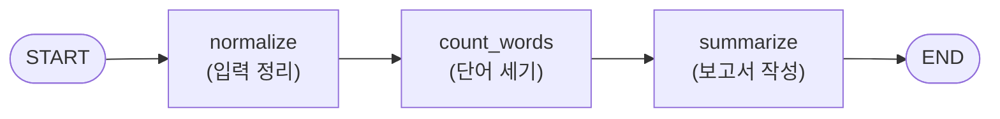
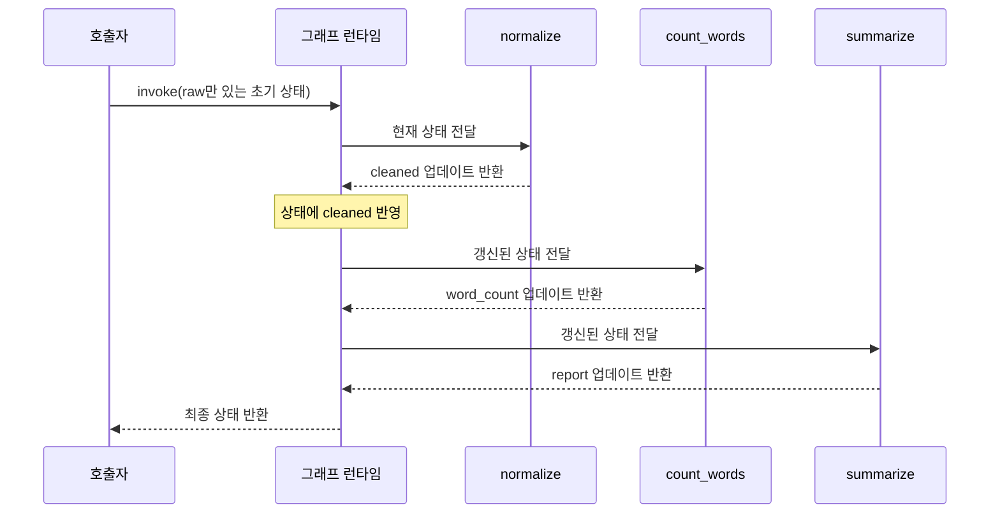
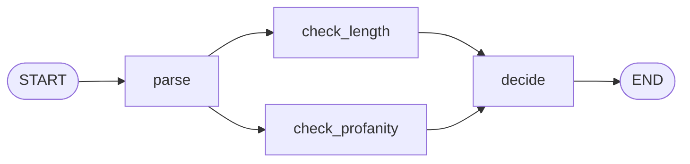

# 그래프 기초: StateGraph, 노드, 엣지

3장에서 우리는 `create_agent` 한 줄로 에이전트를 만들었습니다. 그런데 그 안을 들여다보면(→ 3.2) `model`과 `tools`라는 두 개의 **노드(Node)** 가 화살표로 이어진 **그래프(Graph)** 가 있었습니다. 이번 모듈에서는 그 그래프를 우리가 직접 그립니다. 이번 강의는 그 첫걸음으로, LLM 없이 순수 Python 함수만으로 그래프의 뼈대를 익힙니다.

## 1. 왜 그래프인가?

3.1에서 만든 ReAct 루프는 대략 이렇게 생겼습니다.

```python
for step in range(MAX_STEPS):
    ai = llm.invoke(messages)
    if not ai.tool_calls:
        break
    for call in ai.tool_calls:
        messages.append(run_tool(call))
```

간단하고 좋습니다. 하지만 현업 요구사항이 붙기 시작하면 이 `for` 루프는 금방 괴물이 됩니다.

- "환불 도구를 실행하기 **전에** 사람의 승인을 받고, 승인이 내일 오면 거기서 **이어서** 실행해 주세요." (→ 5.3)
- "서버가 중간에 죽어도 **마지막 단계부터** 다시 시작해야 합니다." (→ 5.1)
- "검색 세 개를 **병렬로** 돌리고 결과를 합쳐 주세요." (→ 4.4)
- "각 단계가 어떤 순서로 실행됐는지 **추적**하고, 토큰을 실시간 **스트리밍**해 주세요." (→ 8.1)

`for` 루프 안의 지역 변수는 프로세스가 죽으면 사라지고, "3번째 반복의 도구 실행 직전"이라는 지점을 이름으로 가리킬 방법도 없습니다. 그래프는 이 문제를 구조로 풉니다.

| 관점 | while/for 루프 | LangGraph 그래프 |
| --- | --- | --- |
| 흐름 | 코드 속에 숨어 있음 | 노드·엣지로 명시, 그림으로 볼 수 있음 |
| 상태 | 지역 변수 (휘발성) | 공유 상태(State) 객체, 체크포인트로 저장 가능 |
| 중단/재개 | 직접 구현해야 함 | 노드 경계에서 기본 지원 |
| 병렬 | 스레드 직접 관리 | 같은 단계의 노드가 자동 병렬 실행 |
| 관측 | print 디버깅 | 노드 단위 스트리밍·트레이싱 |

비유하자면 `for` 루프는 **머릿속에만 있는 레시피**, 그래프는 **주방 벽에 붙은 공정표**입니다. 공정표가 있으면 누가 어디까지 했는지, 어디서 멈췄는지, 어떤 공정을 동시에 할 수 있는지 모두가 볼 수 있습니다.

> [!NOTE]
> LangGraph는 내부적으로 구글의 Pregel 논문에서 온 **"슈퍼스텝(superstep)"** 실행 모델을 씁니다. 한 슈퍼스텝에서 실행 가능한 노드들을 모두 실행하고, 그 결과를 상태에 반영한 뒤 다음 슈퍼스텝으로 넘어갑니다. 지금은 "노드가 단계별로 실행된다" 정도만 기억하세요. 병렬 실행은 4.4에서 자세히 다룹니다.

## 2. 핵심 개념 다섯 가지

LangGraph 그래프는 다섯 가지 재료로 만들어집니다.

1. **상태(State)**: 그래프 전체가 공유하는 데이터 묶음입니다. 보통 `TypedDict`로 "어떤 키가 있는지"를 선언합니다.
2. **노드(Node)**: 상태를 받아서 **바꿀 부분만** 딕셔너리로 돌려주는 평범한 Python 함수입니다.
3. **엣지(Edge)**: "이 노드 다음엔 저 노드"라는 화살표입니다.
4. **START / END**: 그래프의 입구와 출구를 나타내는 특수 노드 이름입니다.
5. **compile()**: 설계도(`StateGraph`)를 실행 가능한 앱(`CompiledStateGraph`)으로 바꿉니다.



위 그림이 이번 강의 첫 예제의 구조입니다. 텍스트를 받아 정리하고, 단어를 세고, 보고서를 만드는 3단계 파이프라인입니다.

### 상태 선언

```python
from typing import TypedDict

class TextState(TypedDict):
    raw: str          # 사용자가 넣은 원문
    cleaned: str      # 정리된 텍스트
    word_count: int   # 단어 수
    report: str       # 최종 보고서
```

`TypedDict`는 실행 시점에 값을 검사하지 않는, 가벼운 "키 목록 선언"입니다. LangGraph는 이 선언을 보고 상태에 어떤 **채널(channel)** 이 있는지 압니다. 입력 검증이 필요하면 Pydantic 모델도 쓸 수 있습니다(→ 4.2).

### 노드: 바뀐 부분만 돌려준다

```python
def normalize(state: TextState) -> dict:
    """앞뒤 공백을 지우고 연속 공백을 하나로 줄인다."""
    cleaned = " ".join(state["raw"].split())
    return {"cleaned": cleaned}   # 상태 전체가 아니라 바뀐 키만!
```

이것이 LangGraph에서 가장 중요한 규칙입니다. **노드는 상태를 직접 수정(mutate)하지 않고, 업데이트할 키만 담은 딕셔너리를 반환**합니다. LangGraph가 그 딕셔너리를 받아 기존 상태와 합칩니다. 기본 동작은 "덮어쓰기"이고, 리스트에 이어 붙이는 등 다른 합치기 방식은 리듀서(Reducer)로 정합니다(→ 4.2).

왜 이렇게 할까요? 노드가 상태를 직접 바꾸면, 병렬로 도는 두 노드가 같은 객체를 동시에 건드려 결과가 뒤죽박죽이 됩니다. "변경 요청서"를 내고 프레임워크가 정해진 규칙으로 반영하게 하면, 순서와 충돌을 프레임워크가 책임질 수 있고, 각 단계의 변경 내역을 기록(체크포인트)하기도 쉽습니다.

> [!WARNING]
> `state["cleaned"] = ...`처럼 노드 안에서 상태를 직접 바꾸고 `return state`를 하는 코드는 우연히 동작하는 것처럼 보여도 나쁜 습관입니다. 반드시 **새 딕셔너리**로 업데이트를 반환하세요. 아무것도 바꿀 게 없다면 `return {}`도 괜찮습니다.

### 그래프 조립과 컴파일

```python
from langgraph.graph import StateGraph, START, END

builder = StateGraph(TextState)          # 1) 상태 스키마로 빌더 생성
builder.add_node("normalize", normalize) # 2) 노드 등록 (이름, 함수)
builder.add_node(count_words)            #    이름을 생략하면 함수 이름이 노드 이름
builder.add_node(summarize)
builder.add_edge(START, "normalize")     # 3) 엣지 연결
builder.add_edge("normalize", "count_words")
builder.add_edge("count_words", "summarize")
builder.add_edge("summarize", END)
graph = builder.compile()                # 4) 컴파일
```

`compile()`은 단순한 형식 절차가 아닙니다. 이 시점에 LangGraph는 구조를 **검증**합니다. 예를 들어 존재하지 않는 노드로 엣지를 걸었거나, START에서 출발하는 엣지가 없으면 여기서 바로 에러가 납니다. 실행 중에 터지는 것보다 조립 시점에 터지는 편이 훨씬 낫습니다. 또 체크포인터(→ 5.1), 스토어(→ 5.4), 캐시 같은 런타임 부품도 `compile(checkpointer=...)`처럼 이때 꽂습니다.

> [!TIP]
> 이 패턴을 **빌더 패턴**이라 부릅니다. 관례적으로 조립 중인 객체는 `builder`, 컴파일된 결과는 `graph` 또는 `app`이라고 이름 짓습니다. 컴파일된 그래프는 LangChain의 Runnable이라서 `invoke`, `stream`, `batch`, `ainvoke`를 모두 지원합니다(→ 2.2).

### 실행: invoke와 stream

```python
result = graph.invoke({"raw": "  LangGraph 는   그래프로   에이전트를 만든다  "})
print(result["report"])
```

`invoke`에 넣는 딕셔너리가 **초기 상태**이고, 반환값은 **모든 노드가 끝난 뒤의 최종 상태**입니다. 처음에 `raw`만 넣었지만 결과에는 `cleaned`, `word_count`, `report`까지 들어 있습니다. 각 노드가 채워 넣었기 때문입니다.

중간 과정을 보고 싶다면 `stream`을 씁니다.

```python
for chunk in graph.stream({"raw": "..."}, stream_mode="updates"):
    print(chunk)   # {'normalize': {'cleaned': '...'}} 처럼 노드별 업데이트
```

- `stream_mode="updates"`: 각 노드가 **반환한 업데이트**만 보여줍니다. 디버깅할 때 가장 유용합니다.
- `stream_mode="values"`: 각 단계가 끝난 뒤의 **전체 상태**를 보여줍니다.

다른 모드(`messages`, `custom`, `debug`)와 조합은 8.1에서 깊게 다룹니다.

## 3. 동작 원리: 상태가 흘러가는 모습

`invoke`를 호출하면 내부에서는 다음 일이 일어납니다.



핵심은 노드끼리 직접 대화하지 않는다는 점입니다. 모든 노드는 **런타임을 통해 상태만 주고받습니다.** 그래서 노드 하나를 바꾸거나 테스트할 때 다른 노드를 몰라도 됩니다. 노드는 "상태 in → 업데이트 out"인 순수 함수에 가깝기 때문에 단위 테스트도 쉽습니다.

```python
# 노드는 그냥 함수이므로 그래프 없이 바로 테스트할 수 있다
assert normalize({"raw": "  a   b "}) == {"cleaned": "a b"}
```

## 4. 그래프 시각화: draw_mermaid

그래프의 가장 큰 장점 중 하나는 **볼 수 있다**는 것입니다. 컴파일된 그래프에서 `get_graph()`를 호출하면 구조 객체가 나오고, `draw_mermaid()`는 이 강의 본문에서 쓰는 것과 같은 Mermaid 문법 문자열을 돌려줍니다.

```python
print(graph.get_graph().draw_mermaid())
```

출력은 대략 다음과 같습니다(스타일 줄은 생략).

```text
graph TD;
	__start__([<p>__start__</p>]):::first
	normalize(normalize)
	count_words(count_words)
	summarize(summarize)
	__end__([<p>__end__</p>]):::last
	__start__ --> normalize;
	normalize --> count_words;
	count_words --> summarize;
	summarize --> __end__;
```

`START`와 `END`의 실제 이름이 `__start__`, `__end__`라는 것도 여기서 확인할 수 있습니다. 실선(`-->`)은 항상 따라가는 일반 엣지이고, 다음 강의에서 배울 조건부 엣지는 점선(`-.->`)으로 그려집니다. 이 문자열을 [mermaid.live](https://mermaid.live)에 붙여 넣으면 그림으로 볼 수 있습니다. `draw_mermaid_png()`도 있지만 외부 렌더링 서비스에 네트워크 요청을 보내므로, 오프라인 환경이나 CI에서는 문자열 버전을 쓰는 편이 안전합니다.

▶ 오른쪽 IDE의 `examples/01_basic.py`를 실행해 보세요. 그래프 구조, 노드별 업데이트, 최종 상태가 차례로 출력됩니다.

## 5. 팬아웃과 팬인: 한 노드에서 여러 갈래로

엣지는 꼭 일렬일 필요가 없습니다. 한 노드에서 두 노드로 엣지를 걸면 두 노드는 **같은 슈퍼스텝에서 병렬로** 실행됩니다.



```python
builder.add_edge("parse", "check_length")
builder.add_edge("parse", "check_profanity")
builder.add_edge(["check_length", "check_profanity"], "decide")  # 둘 다 끝나야 decide 실행
```

`add_edge`의 첫 인자에 **리스트**를 주면 "나열된 노드가 **모두** 끝난 뒤에 실행"이라는 뜻의 합류(join) 엣지가 됩니다. 두 검사 노드는 서로 다른 키(`length_ok`, `clean_ok`)에 쓰므로 충돌하지 않습니다. 만약 병렬 노드가 **같은 키**에 값을 쓰면 LangGraph는 어느 값을 남길지 모르므로 `InvalidUpdateError`를 냅니다. 이것을 해결하는 것이 리듀서이며, 바로 다음 강의(4.2)의 주제입니다.

▶ `examples/02_parallel_checks.py`에서 병렬 검사 그래프를 실행하고, 두 검사 노드의 업데이트가 같은 단계에서 나오는 것을 확인해 보세요.

## 6. LLM 노드도 그냥 노드다

지금까지는 LLM이 없었습니다. 의도적입니다. LangGraph 자체는 LLM과 무관한 **범용 상태 머신 프레임워크**이고, LLM 호출은 "노드 안에서 하는 일" 중 하나일 뿐입니다.

```python
llm = init_chat_model(MODEL)

def summarize_with_llm(state: TextState) -> dict:
    msg = llm.invoke(f"다음 문장을 한 줄로 요약: {state['cleaned']}")
    return {"report": msg.content}
```

이 노드를 앞의 `summarize` 자리에 끼우기만 하면 됩니다. 그래프 구조도, 다른 노드도 바뀌지 않습니다. 결정적인 코드(파싱, 검증, DB 조회)와 비결정적인 LLM 호출을 **노드 단위로 분리**하는 것이 좋은 에이전트 설계의 출발점입니다. LLM이 해야 할 일만 LLM에게 맡기고, 나머지는 테스트 가능한 평범한 코드로 둡니다.

▶ `examples/03_llm_node.py`는 같은 파이프라인에 LLM 요약 노드를 끼운 버전입니다. API 키가 없으면 Mock 모델이 응답하지만, 그래프 흐름은 똑같이 동작합니다.

## 7. 현업에서는

- **노드는 작고 이름은 동사로.** `classify_intent`, `fetch_order`, `draft_reply`처럼 "무엇을 하는지" 드러나게 짓습니다. 노드 이름은 LangSmith 트레이스, 스트리밍 이벤트, 체크포인트에 그대로 찍히므로 운영 중 디버깅할 때 일종의 로그 키가 됩니다.
- **노드 하나에 LLM 호출 하나.** LLM 호출 두 번을 한 노드에 몰아넣으면 두 번째 호출이 실패했을 때 첫 번째 호출까지 다시 해야 합니다. 재시도(RetryPolicy, → 5.5)와 캐시도 노드 단위로 걸리기 때문에, 노드 경계가 곧 **장애 복구와 비용 절감의 단위**입니다.
- **그래프 그림을 코드 리뷰에 첨부.** `draw_mermaid()` 결과를 PR 설명에 붙이면 리뷰어가 흐름 변경을 한눈에 봅니다. 그래프 구조에 대한 스냅샷 테스트(문자열 비교)를 두는 팀도 있습니다.
- **노드는 그래프 없이 단위 테스트.** 노드는 함수이므로 `assert node(state) == {...}`로 테스트하고, 그래프 전체는 Mock 모델로 통합 테스트합니다(→ 8.2).
- **상태는 작게.** 상태는 체크포인트마다 직렬화되어 저장됩니다. 큰 PDF 원문이나 이미지 바이트를 상태에 넣으면 저장 비용과 지연이 커집니다. 큰 데이터는 외부 저장소에 두고 상태에는 ID나 경로만 넣으세요.

> [!CAUTION]
> 안티패턴: 노드 안에서 전역 변수나 모듈 레벨 리스트에 결과를 쌓는 코드. 단일 실행에서는 동작하지만, 서버에서 여러 사용자의 요청이 동시에 들어오면 결과가 섞이고, 체크포인트에도 남지 않아 재개가 불가능합니다. **공유해야 할 데이터는 모두 상태에** 넣으세요.

## 8. 정리

- LangGraph는 에이전트의 흐름을 **상태 + 노드 + 엣지**로 명시하는 프레임워크입니다. 덕분에 중단/재개, 병렬화, 스트리밍, 추적이 구조적으로 가능해집니다.
- 노드는 상태를 받아 **바뀐 키만 담은 딕셔너리**를 반환합니다.
- `StateGraph(State)` → `add_node` → `add_edge` → `compile()` → `invoke`/`stream` 순서를 기억하세요.
- `graph.get_graph().draw_mermaid()`로 구조를 눈으로 확인합니다.
- 한 노드에서 여러 노드로 엣지를 걸면 병렬 실행되고, `add_edge([a, b], c)`로 합류시킵니다.

다음 강의에서는 병렬 노드가 같은 키에 쓸 때 필요한 **리듀서**와, 상태 스키마를 설계하는 다양한 방법을 배웁니다.
