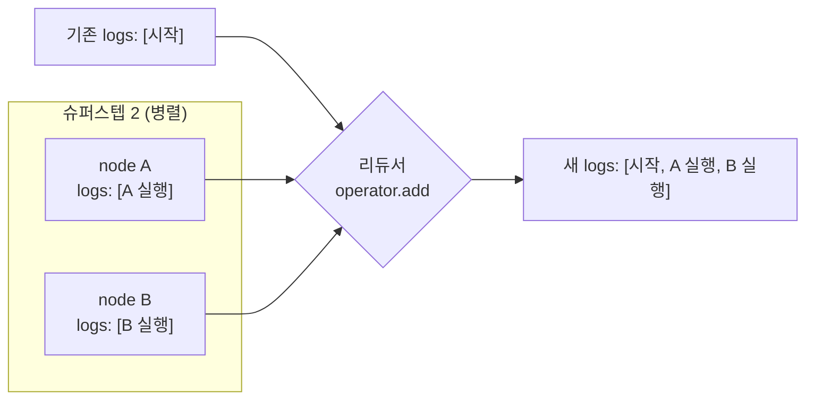
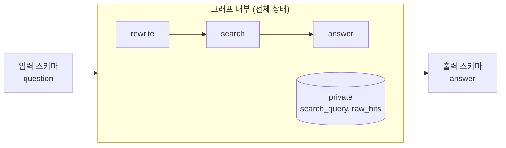

# State와 Reducer: 상태 설계의 모든 것

4.1에서 노드는 "바뀐 키만" 반환한다고 배웠습니다. 그러면 자연스럽게 질문이 생깁니다. **그 업데이트를 기존 값과 어떻게 합칠까요?** 덮어쓸까요, 이어 붙일까요, 더할까요? 이 규칙을 정하는 것이 **리듀서(Reducer)** 이고, 이번 강의의 주인공입니다. 상태 설계는 그래프 설계의 절반입니다. 상태를 잘못 잡으면 노드 코드가 아무리 깔끔해도 병렬 실행에서 값이 사라지거나, 대화 기록이 매 턴 지워지는 버그가 생깁니다.

## 1. 왜 리듀서가 필요한가

간단한 실험부터 해 봅시다. 상태에 `logs: list[str]`가 있고, 노드 A와 B가 각각 로그를 한 줄씩 남긴다고 합시다.

```python
class State(TypedDict):
    logs: list[str]

def a(state): return {"logs": ["A 실행"]}
def b(state): return {"logs": ["B 실행"]}
```

A → B 순서로 실행하면 최종 `logs`는 무엇일까요? 정답은 `["B 실행"]`입니다. 리듀서가 없는 키는 **마지막 값으로 덮어쓰기(last write wins)** 가 기본이기 때문입니다. A의 로그는 사라졌습니다.

더 심각한 경우는 A와 B가 **병렬로** 실행될 때입니다. 같은 슈퍼스텝에서 두 노드가 같은 키에 값을 쓰면, LangGraph는 어느 쪽을 남겨야 할지 판단할 근거가 없습니다. 그래서 조용히 하나를 버리는 대신 에러를 냅니다.

```text
InvalidUpdateError: At key 'logs': Can receive only one value per step.
Use an Annotated key to handle multiple values.
```

에러 메시지가 해법도 알려 줍니다. **Annotated 키**, 즉 리듀서를 쓰라는 것입니다.

## 2. 리듀서의 정체: (기존값, 새값) → 합친값

리듀서는 두 인자를 받아 하나를 돌려주는 함수일 뿐입니다.

```python
def reducer(current_value, update_value):
    return merged_value
```

`typing.Annotated`로 타입 옆에 리듀서를 붙여 선언합니다.

```python
import operator
from typing import Annotated, TypedDict

class State(TypedDict):
    logs: Annotated[list[str], operator.add]   # 리스트 이어 붙이기
    total: Annotated[int, operator.add]        # 숫자 더하기
    status: str                                # 리듀서 없음 → 덮어쓰기
```

`operator.add`는 `a + b`와 같으므로 리스트에는 이어 붙이기, 숫자에는 덧셈이 됩니다. 이제 A와 B가 병렬로 실행되어도 두 업데이트가 리듀서를 통해 차례로 합쳐집니다.



> [!NOTE]
> 리듀서는 **노드가 반환한 업데이트에만** 적용되는 것이 아니라 `invoke`에 넣은 **초기 입력**에도 적용됩니다. 체크포인터가 있어 이전 상태가 남아 있는 상태에서 `invoke({"logs": ["새 요청"]})`을 하면 기존 로그 뒤에 이어 붙습니다. 대화형 에이전트에서 메시지가 쌓이는 원리가 바로 이것입니다(→ 5.1).

▶ 오른쪽 IDE의 `examples/01_reducers.py`를 실행해 보세요. 리듀서 없는 키에서 병렬 쓰기가 실패하는 모습과, 리듀서를 붙였을 때 값이 합쳐지는 모습을 비교합니다.

## 3. add_messages: 대화 기록 전용 리듀서

채팅 에이전트의 상태에서 가장 중요한 키는 `messages`입니다. 여기에 `operator.add`를 써도 될 것 같지만, 실무에서는 부족합니다.

- 같은 메시지를 **수정**하고 싶을 때(예: 사람이 AI 답변을 편집) 단순 이어 붙이기는 중복을 만듭니다.
- 오래된 메시지를 **삭제**해 컨텍스트를 줄이고 싶을 때 방법이 없습니다.
- `("user", "안녕")` 같은 튜플이나 딕셔너리를 메시지 객체로 **변환**해 주지 않습니다.

`add_messages`는 이 세 가지를 모두 처리합니다.

```python
from langgraph.graph import add_messages
from langchain.messages import AnyMessage

class ChatState(TypedDict):
    messages: Annotated[list[AnyMessage], add_messages]
```

| 업데이트 | add_messages의 동작 |
| --- | --- |
| 새 id의 메시지 | 뒤에 추가 (id가 없으면 자동 부여) |
| 기존과 **같은 id**의 메시지 | 그 자리의 메시지를 **교체** |
| `RemoveMessage(id=...)` | 해당 id의 메시지 **삭제** |
| `("user", "hi")`, `{"role": ..., "content": ...}` | 메시지 객체로 변환 후 추가 |

이 패턴이 너무 흔해서 LangGraph는 `MessagesState`라는 미리 만든 상태를 제공합니다. 필드를 더 넣고 싶으면 상속합니다.

```python
from langgraph.graph import MessagesState

class AgentState(MessagesState):   # messages 키 + add_messages 리듀서가 이미 있음
    user_id: str
    tool_calls_count: int
```

> [!TIP]
> 3.4에서 다룬 메시지 트리밍/요약도 내부적으로는 `RemoveMessage`를 이용해 오래된 메시지를 지우고 요약 메시지를 넣는 방식입니다. 리듀서를 이해하면 미들웨어가 하는 일이 투명하게 보입니다.

## 4. 커스텀 리듀서

리듀서는 평범한 함수이므로 비즈니스 규칙을 그대로 담을 수 있습니다. 예를 들어 여러 검색 노드가 문서를 모을 때 **중복 제거 + 최대 개수 제한**이 필요하다면:

```python
def merge_docs(current: list[str], update: list[str]) -> list[str]:
    """중복을 제거하며 합치고, 최근 5개만 유지한다."""
    merged = list(dict.fromkeys(current + update))  # 순서 유지 중복 제거
    return merged[-5:]

class ResearchState(TypedDict):
    docs: Annotated[list[str], merge_docs]
```

딕셔너리를 병합하는 리듀서(`lambda a, b: {**a, **b}`)도 자주 씁니다. 여러 노드가 `metrics` 딕셔너리에 각자의 지표를 써 넣는 경우입니다.

> [!WARNING]
> 리듀서는 **순수 함수**여야 하고 인자를 직접 수정(mutate)하면 안 됩니다. `current.append(x); return current`처럼 쓰면 체크포인트에 저장된 이전 상태까지 바뀌어 타임 트래블(→ 5.2)이 엉망이 될 수 있습니다. 항상 새 객체를 만들어 반환하세요. 또 병렬 노드의 업데이트가 어떤 순서로 리듀서에 들어올지에 의존하지 않도록, 가능하면 **순서와 무관한(교환 법칙이 성립하는)** 리듀서를 설계하세요.

## 5. Overwrite: 리듀서를 잠시 우회하기

리듀서가 붙은 키를 **통째로 교체**하고 싶을 때가 있습니다. 예를 들어 `operator.add`가 붙은 `logs`를 "초기화"하고 싶다면? 빈 리스트를 반환해 봐야 `기존 + []`라서 아무 일도 일어나지 않습니다. 이때 `Overwrite`를 씁니다.

```python
from langgraph.types import Overwrite

def reset_logs(state: State) -> dict:
    return {"logs": Overwrite(["--- 로그 초기화 ---"])}   # 리듀서 무시, 이 값으로 교체
```

`Overwrite`는 "이번 업데이트만큼은 리듀서를 거치지 말고 이 값으로 바꿔라"라는 표시입니다. `add_messages` 키에도 동작하므로 대화 기록을 요약본으로 완전히 갈아끼울 때 유용합니다. 단, 같은 슈퍼스텝에서 두 노드가 동시에 `Overwrite`를 보내면 어느 쪽이 이길지 모호하므로 에러가 납니다.

## 6. 입력·출력 스키마와 private state

그래프가 커지면 상태에는 "중간 계산용" 키가 잔뜩 생깁니다. 그런데 그래프를 호출하는 쪽(API 클라이언트, 상위 그래프)이 이런 내부 키까지 알아야 할까요? 함수에 비유하면 **매개변수와 반환값만 공개하고 지역 변수는 숨기는 것**이 좋습니다.



```python
class InputState(TypedDict):
    question: str

class OutputState(TypedDict):
    answer: str

class OverallState(InputState, OutputState):
    notes: list[str]                # 그래프 내부 전용

class PrivateState(TypedDict):      # 노드 사이에서만 오가는 값
    search_query: str

def rewrite(state: InputState) -> PrivateState:
    return {"search_query": state["question"] + " 2026"}

def search(state: PrivateState) -> OverallState: ...

builder = StateGraph(OverallState, input_schema=InputState, output_schema=OutputState)
```

- `input_schema`: `invoke`가 받아들이는 키를 제한합니다.
- `output_schema`: `invoke`가 돌려주는 키를 제한합니다. 내부 키가 응답에 새어 나가지 않습니다.
- **Private state**: 노드의 타입 힌트(`state: PrivateState`)나 반환 타입에 쓰인 스키마도 LangGraph가 채널로 등록합니다. 그래서 `OverallState`에 없는 `search_query`도 노드 사이에서 전달됩니다. 이 키는 출력 스키마에 없으므로 바깥으로 나가지 않습니다.

> [!IMPORTANT]
> 노드 함수의 **첫 번째 매개변수 타입 힌트**가 그 노드가 읽는 스키마입니다. `def search(state: PrivateState)`라고 쓰면 그 노드는 PrivateState의 키만 받습니다. 타입 힌트는 장식이 아니라 동작에 영향을 준다는 점을 기억하세요. `add_node(..., input_schema=...)`로 명시할 수도 있습니다.

▶ `examples/02_schemas.py`에서 입력/출력 스키마와 private state가 실제로 어떻게 보이는지 확인해 보세요.

## 7. TypedDict vs Pydantic vs dataclass

상태는 세 가지 방식으로 선언할 수 있습니다.

| 방식 | 노드에서 접근 | 실행 시 검증 | 기본값 | 추천 상황 |
| --- | --- | --- | --- | --- |
| `TypedDict` | `state["key"]` | 없음 | 없음 (`total=False`로 선택 키) | 기본 선택, 가장 가볍고 빠름 |
| `dataclass` | `state.key` | 없음 | 있음 (`field(default_factory=...)`) | 기본값이 필요할 때 |
| Pydantic `BaseModel` | `state.key` | **있음** (타입 변환·검증) | 있음 | 외부 입력 검증이 중요할 때 |

```python
from pydantic import BaseModel, Field

class TicketState(BaseModel):
    customer_id: str
    priority: int = Field(default=3, ge=1, le=5)   # 1~5 범위 검증
    tags: Annotated[list[str], operator.add] = []
```

Pydantic 상태는 **그래프 입력**을 검증합니다. `priority=9`를 넣으면 첫 노드가 실행되기 전에 `ValidationError`가 납니다. 다만 몇 가지 주의점이 있습니다.

- 검증은 **노드에 상태가 전달될 때** 모델 객체를 만들면서 수행됩니다. 노드 수만큼 검증 오버헤드가 생깁니다.
- 노드는 여전히 **dict로 업데이트를 반환**합니다. 모델 객체를 반환하는 것이 아닙니다.
- `invoke`의 **반환값은 Pydantic 객체가 아니라 dict**이고, 채널에는 **입력한 원래 값**이 저장됩니다. 예를 들어 `priority="2"`를 넣으면 노드는 정수 `2`를 보지만 최종 결과 dict에는 문자열 `"2"`가 남습니다. 필요하면 `TicketState(**result)`로 다시 감싸세요.
- dataclass·Pydantic의 **기본값은 노드가 받는 객체에만** 채워집니다. 아무 노드도 그 키를 쓰지 않으면 최종 결과 dict에는 해당 키가 나타나지 않습니다.

▶ `examples/03_pydantic_state.py`에서 세 방식을 나란히 실행하고, 잘못된 입력이 Pydantic에서 막히는 모습을 확인해 보세요.

## 8. 현업에서는

- **상태 스키마는 API 계약이다.** 체크포인트에 저장된 상태는 배포 후에도 남아 있습니다. 키 이름을 바꾸거나 타입을 바꾸면 **이전 스레드를 재개할 때 깨질 수 있습니다.** 키는 추가 위주로 바꾸고, 제거·변경은 마이그레이션 계획과 함께 하세요.
- **출력 스키마로 정보 노출을 막는다.** 내부 메모, 검색 원문, 시스템 판단 근거가 그대로 API 응답에 섞여 나가는 사고가 흔합니다. `output_schema`는 보안 장치이기도 합니다(→ 8.3).
- **메시지는 무한히 쌓인다.** `add_messages`는 지우지 않으면 계속 쌓이고, 그만큼 매 턴 토큰 비용과 지연이 늘어납니다. 요약/트리밍 전략(→ 3.4)을 처음부터 설계하세요.
- **카운터는 리듀서로.** 도구 호출 횟수, 누적 토큰처럼 여러 노드가 증가시키는 값은 `Annotated[int, operator.add]`로 두고 노드는 증가분(`{"tool_calls": 1}`)만 반환하게 하면 병렬에서도 안전합니다.
- **관측성.** LangSmith 트레이스에서는 각 노드의 입력·출력 상태가 기록됩니다. 상태에 개인정보(PII)를 넣으면 트레이스에도 남는다는 점을 고려해 마스킹 정책을 세우세요.

> [!CAUTION]
> 안티패턴: "일단 다 넣자" 상태. 30개 키가 모두 덮어쓰기 기본값인 상태에서 병렬 노드를 추가하면 `InvalidUpdateError`가 여기저기서 터지고, 어떤 노드가 어떤 키를 쓰는지 아무도 모르게 됩니다. 키마다 "누가 쓰는가, 어떻게 합치는가"를 문서화하세요.

## 9. 정리

- 리듀서가 없는 키는 **덮어쓰기**, 같은 스텝에서 두 번 쓰면 `InvalidUpdateError`.
- `Annotated[타입, 리듀서]`로 합치는 규칙을 선언합니다. `operator.add`, `add_messages`, 커스텀 함수.
- `add_messages`는 추가·id 기반 교체·`RemoveMessage` 삭제·형식 변환을 지원하며 `MessagesState`에 기본 탑재되어 있습니다.
- `Overwrite(value)`로 리듀서를 우회해 값을 통째로 교체합니다.
- `input_schema`/`output_schema`/private state로 그래프의 공개 인터페이스를 설계합니다.
- 상태 선언은 TypedDict(기본), dataclass(기본값), Pydantic(검증) 중에서 고릅니다.

다음 강의에서는 상태를 보고 **다음 노드를 고르는** 조건부 엣지와 루프를 배웁니다.
