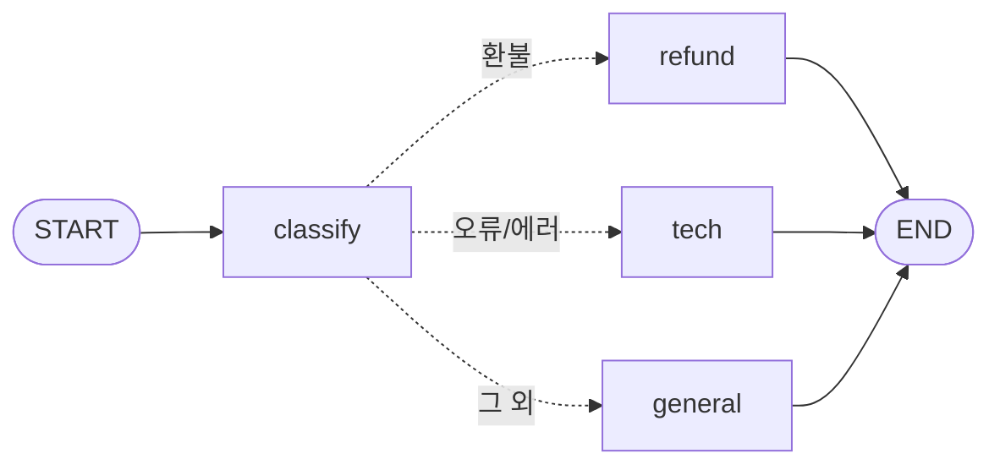
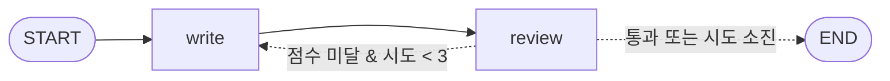

# 조건부 엣지: 라우팅, 루프, 종료 조건

지금까지 만든 그래프는 모두 정해진 길만 따라갔습니다. 하지만 에이전트가 "에이전트"인 이유는 **상황에 따라 다음 행동을 바꾸기** 때문입니다. 질문이 환불 문의면 환불 담당으로, 기술 문의면 기술 담당으로 보내야 하고, 답변 품질이 기준에 못 미치면 다시 쓰게 해야 합니다. 이번 강의에서는 이런 **분기(branch)** 와 **루프(loop)** 를 만드는 조건부 엣지(Conditional Edge)를 배웁니다. ReAct 에이전트의 "도구를 더 부를까, 끝낼까" 판단도 바로 이 조건부 엣지 하나입니다(→ 4.5).

## 1. 일반 엣지 vs 조건부 엣지

- **일반 엣지** `add_edge("a", "b")`: a가 끝나면 **항상** b로 갑니다.
- **조건부 엣지** `add_conditional_edges("a", route)`: a가 끝나면 `route(state)`를 호출하고, **그 반환값이 가리키는 노드**로 갑니다.

```python
from typing import Literal

def route_ticket(state: TicketState) -> Literal["refund", "tech", "general"]:
    """상태를 읽고 다음 노드 이름을 반환한다. 상태를 바꾸지는 않는다."""
    text = state["text"]
    if "환불" in text:
        return "refund"
    if "오류" in text or "에러" in text:
        return "tech"
    return "general"

builder.add_conditional_edges("classify", route_ticket)
```



라우팅 함수에는 중요한 규칙이 있습니다. **라우팅 함수는 상태를 읽기만 하고 업데이트하지 않습니다.** 반환값은 상태 업데이트가 아니라 "다음 목적지"입니다. 분류 결과를 상태에 기록하고 싶다면 그 일은 앞 노드(`classify`)가 하고, 라우터는 기록된 값을 읽어 길만 정합니다. 이렇게 역할을 나누면 라우팅 로직이 순수 함수가 되어 테스트하기 쉬워집니다.

> [!TIP]
> 라우팅 함수의 반환 타입을 `Literal["refund", "tech", "general"]`로 적어 두면 LangGraph가 **가능한 목적지 목록**을 알아냅니다. 그래서 `draw_mermaid()` 그림에 점선 화살표가 정확히 그려지고, 오타로 없는 노드 이름을 반환하는 실수를 타입 검사기가 잡아 줍니다.

## 2. path_map: 반환값과 노드 이름을 분리하기

라우팅 함수가 노드 이름을 직접 알 필요가 없도록 **매핑표**를 줄 수도 있습니다.

```python
def needs_human(state) -> bool:
    return state["confidence"] < 0.7

builder.add_conditional_edges(
    "answer",
    needs_human,
    {True: "escalate", False: END},   # path_map: 반환값 → 노드 이름
)
```

`path_map`의 장점은 세 가지입니다.

1. 라우팅 함수가 `True/False`, `"high"/"low"` 같은 **의미 있는 값**을 반환하고, 그 값이 어느 노드로 가는지는 그래프 조립 코드에서 결정합니다. 같은 라우팅 함수를 여러 그래프에서 재사용할 수 있습니다.
2. 반환 타입에 `Literal`이 없어도 가능한 목적지를 LangGraph가 알 수 있어서 시각화가 정확해집니다.
3. 리스트 형태 `["escalate", END]`로 목적지 목록만 알려 줄 수도 있습니다.

> [!WARNING]
> `Literal`도 `path_map`도 없으면 LangGraph는 라우터가 어디로 갈지 미리 알 수 없습니다. 실행은 정상적으로 되지만 `draw_mermaid()` 그림이 **실제와 다르게** 그려집니다(예: 라우터 노드에서 END로 가는 실선 하나만 보이고 분기 화살표가 사라짐). 그림을 믿고 리뷰하다가 구조를 오해하기 쉬우니, 둘 중 하나는 반드시 명시하세요.

## 3. 루프: 조건부 엣지가 뒤로 향할 때

조건부 엣지가 **이미 지나온 노드**를 가리키면 루프가 됩니다. "초안 작성 → 검토 → 기준 미달이면 다시 작성" 같은 **평가자-최적화자(Evaluator-Optimizer)** 패턴이 대표적입니다(→ 7.5).



```python
class DraftState(TypedDict):
    topic: str
    draft: str
    score: int
    attempts: int

def write(state: DraftState) -> dict:
    n = state.get("attempts", 0) + 1
    return {"draft": f"{state['topic']} 초안 v{n}", "attempts": n}

def review(state: DraftState) -> dict:
    return {"score": evaluate(state["draft"])}

def should_continue(state: DraftState) -> Literal["write", "__end__"]:
    if state["score"] >= 80:
        return END                       # 합격
    if state["attempts"] >= MAX_ATTEMPTS:
        return END                       # 상한 도달 → 포기하고 종료
    return "write"                       # 다시 작성
```

`END`의 실제 값은 문자열 `"__end__"`이므로 반환 타입에는 `Literal["write", "__end__"]`처럼 씁니다.

### 루프에는 반드시 브레이크가 두 개

LLM이 들어간 루프는 **영원히 끝나지 않을 수 있습니다.** LLM 평가자가 계속 70점만 주거나, 모델이 같은 도구를 반복 호출하는 일은 실제로 흔합니다. 그래서 현업 그래프는 두 겹의 안전장치를 둡니다.

1. **비즈니스 상한(soft limit)**: 상태의 `attempts` 같은 카운터로 "3번 시도하면 그만"이라는 규칙을 그래프 안에 명시합니다. 상한에 도달했을 때 **우아하게** 종료하고, 지금까지의 최선 결과를 돌려주거나 사람에게 넘깁니다.
2. **기술적 상한(hard limit)**: `recursion_limit`. 그래프 실행 전체의 **슈퍼스텝 수 상한**입니다. 설치된 langgraph 1.2.x의 기본값은 **10,007**(환경변수 `LANGGRAPH_DEFAULT_RECURSION_LIMIT`로 변경 가능)로 매우 넉넉합니다. 과거 버전의 기본값(25)을 기억하는 자료가 많지만, 지금은 기본값만 믿으면 무한 루프가 수천 번 LLM을 호출한 뒤에야 멈출 수 있습니다. 서비스 특성에 맞게 **직접 정해 주세요.**

```python
graph.invoke({"topic": "LangGraph"}, config={"recursion_limit": 10})
```

상한을 넘으면 `langgraph.errors.GraphRecursionError`가 발생합니다. 이것은 "버그가 있거나 예상 밖의 무한 루프"라는 신호이므로, 사용자에게 그대로 노출하지 말고 잡아서 처리합니다.

> [!IMPORTANT]
> `recursion_limit`은 **노드 실행 횟수가 아니라 슈퍼스텝 수**입니다. 병렬로 실행되는 노드 3개는 1스텝으로 셉니다. 또 이 값은 그래프의 `invoke`/`stream` 한 번에 적용되며, 체크포인터로 같은 스레드를 다시 호출하면 다시 0부터 셉니다.

▶ 오른쪽 IDE의 `examples/02_loop_and_limits.py`를 실행해 보세요. 카운터로 우아하게 끝나는 루프, `recursion_limit`에 걸려 에러가 나는 루프, `RemainingSteps`로 스스로 멈추는 루프를 차례로 봅니다.

### RemainingSteps: 그래프가 남은 스텝을 스스로 알기

`GraphRecursionError`가 터지면 그 실행의 결과는 예외로 끝나 버립니다. 더 나은 방법은 그래프가 **한도에 가까워졌음을 스스로 알고** 정리 단계로 가는 것입니다. 이를 위한 특수 상태 값이 `RemainingSteps`입니다.

```python
from langgraph.managed import RemainingSteps

class LoopState(TypedDict):
    n: int
    remaining_steps: RemainingSteps   # LangGraph가 매 스텝 자동으로 채워 주는 값

def route(state: LoopState):
    if state["remaining_steps"] <= 2:
        return "wrap_up"     # 한도 직전 → 정리 노드로
    return "work"
```

`RemainingSteps`는 **관리되는 값(managed value)** 이라서 노드가 쓰는 것이 아니라 런타임이 "recursion_limit까지 남은 스텝 수"를 계산해 넣어 줍니다. 입력으로 넣을 필요도 없습니다. 한도 직전에 "지금까지의 결과로 마무리하는" 정리 노드로 보내면, 사용자는 예외 대신 부분 결과라도 받게 됩니다.

## 4. 여러 갈래를 동시에: 리스트 반환

라우팅 함수가 노드 이름의 **리스트**를 반환하면, 그 노드들이 다음 스텝에서 **병렬로** 실행됩니다.

```python
def pick_checks(state) -> list[str]:
    checks = ["spell_check"]
    if state["has_code"]:
        checks.append("lint_code")
    if state["has_links"]:
        checks.append("verify_links")
    return checks
```

조건에 따라 실행할 노드 집합이 달라지는 경우 유용합니다. 같은 노드를 **서로 다른 입력으로 여러 번** 실행해야 한다면 `Send`를 씁니다(→ 4.4).

## 5. LLM을 라우터로 쓰기

규칙으로 분류하기 어려운 입력(자연어 의도 분류)은 LLM에게 맡깁니다. 이때 LLM의 자유 텍스트를 파싱하지 말고 **구조화 출력(→ 2.3)** 으로 선택지를 강제합니다.

```python
class Route(BaseModel):
    """고객 문의를 담당 부서로 분류한다."""
    department: Literal["refund", "tech", "general"]
    reason: str

router_llm = init_chat_model(MODEL).with_structured_output(Route)

def classify(state: TicketState) -> dict:
    decision = router_llm.invoke([SystemMessage(ROUTER_PROMPT), HumanMessage(state["text"])])
    return {"department": decision.department, "route_reason": decision.reason}

def route_by_department(state: TicketState) -> str:
    return state["department"]      # 노드가 기록한 값을 그대로 읽기만
```

패턴을 다시 보세요. **LLM 호출은 노드(`classify`)에서**, **길 찾기는 라우터(`route_by_department`)에서** 합니다. 라우터 안에서 LLM을 부르는 것도 문법적으로는 가능하지만, 그러면 분류 결과가 상태에 남지 않아 나중에 "왜 이쪽으로 갔지?"를 추적할 수 없고, 체크포인트·재시도·스트리밍에서도 그 호출이 보이지 않습니다.

▶ `examples/03_llm_router.py`는 이 구조의 고객 문의 라우터입니다. Mock 모드에서는 질문 속에 선택지 문자열(`refund`, `tech` 등)이 들어 있으면 그 값을 고르도록 되어 있어 흐름을 확인할 수 있습니다.

> [!CAUTION]
> LLM 라우터는 **틀릴 수 있습니다.** 분류 결과에 대한 폴백 경로(예: `general`)를 항상 두고, 금융·의료처럼 잘못 보내면 치명적인 경로는 규칙 기반 사전 필터나 사람 승인(→ 5.3)을 함께 쓰세요. 또 라우팅 정확도는 데이터셋으로 정기적으로 평가해야 합니다(→ 8.2).

## 6. 코드 해설: 결정적 라우터

▶ `examples/01_router.py`를 열어 보세요. 고객 문의를 규칙으로 분류해 세 담당 노드로 보냅니다. 주목할 부분은 다음과 같습니다.

- `classify` 노드는 분류 결과를 `category`에 **기록**하고, `route` 함수는 그 값을 **읽어** 경로를 고릅니다.
- `add_conditional_edges("classify", route, {...})`의 path_map 덕분에 출력된 Mermaid 그림에 세 갈래 점선이 정확히 보입니다.
- 각 담당 노드는 마지막에 `END`로 이어집니다. 조건부 엣지를 쓰더라도 **모든 경로가 END에 도달하는지** 그림으로 확인하는 습관을 들이세요.

## 7. 현업에서는

- **라우팅은 관측 대상이다.** 운영에서 가장 먼저 물어보는 질문은 "어떤 요청이 어느 경로로 갔나?"입니다. 분류 결과와 이유(`route_reason`)를 상태에 남기면 LangSmith 트레이스에서 바로 보이고, 경로별 비율·지연·비용을 대시보드로 만들 수 있습니다.
- **비용 최적화의 핵심 지점.** 쉬운 요청은 작은 모델 경로로, 어려운 요청만 큰 모델 경로로 보내는 **모델 라우팅**은 비용을 크게 줄입니다(→ 8.6). 라우터 자체는 작고 빠른 모델로 충분한 경우가 많습니다.
- **상한은 제품 결정이다.** "최대 3번 재작성"은 기술 설정이 아니라 비용·지연·품질의 균형에 대한 제품 결정입니다. 숫자를 상수로 빼서 설정으로 관리하고, 상한에 도달한 비율을 지표로 모니터링하세요. 그 비율이 높다면 프롬프트나 평가 기준에 문제가 있다는 뜻입니다.
- **GraphRecursionError는 알람.** 정상 흐름에서 이 에러가 나면 안 됩니다. 잡아서 사용자에게는 정중한 실패 메시지를, 운영자에게는 알람과 트레이스 링크를 보내세요.
- **라우터 단위 테스트.** 라우팅 함수는 순수 함수이므로 경계값(점수 79/80, 시도 2/3)을 표로 만들어 테스트하기 좋습니다.

## 8. 정리

- `add_conditional_edges(source, route_fn, path_map)`: 노드가 끝난 뒤 `route_fn(state)`의 반환값으로 다음 노드를 고릅니다.
- 라우팅 함수는 **읽기 전용**입니다. 기록은 노드가, 길 찾기는 라우터가.
- `Literal` 반환 타입이나 `path_map`으로 목적지를 명시하면 그림과 검증이 정확해집니다.
- 뒤로 향하는 조건부 엣지가 루프를 만듭니다. **카운터(소프트) + recursion_limit(하드)** 두 겹의 브레이크를 두고, `RemainingSteps`로 한도 직전에 우아하게 종료할 수 있습니다.
- 리스트를 반환하면 여러 노드가 병렬 실행됩니다.
- LLM 라우터는 구조화 출력 + 노드에서 호출 + 폴백 경로로 설계합니다.

다음 강의에서는 노드 **안에서** 상태 업데이트와 이동을 한꺼번에 결정하는 `Command`, 그리고 실행 시점에 분기 수가 정해지는 `Send`를 배웁니다.
