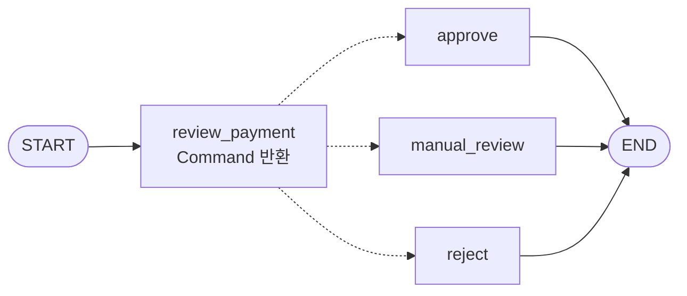
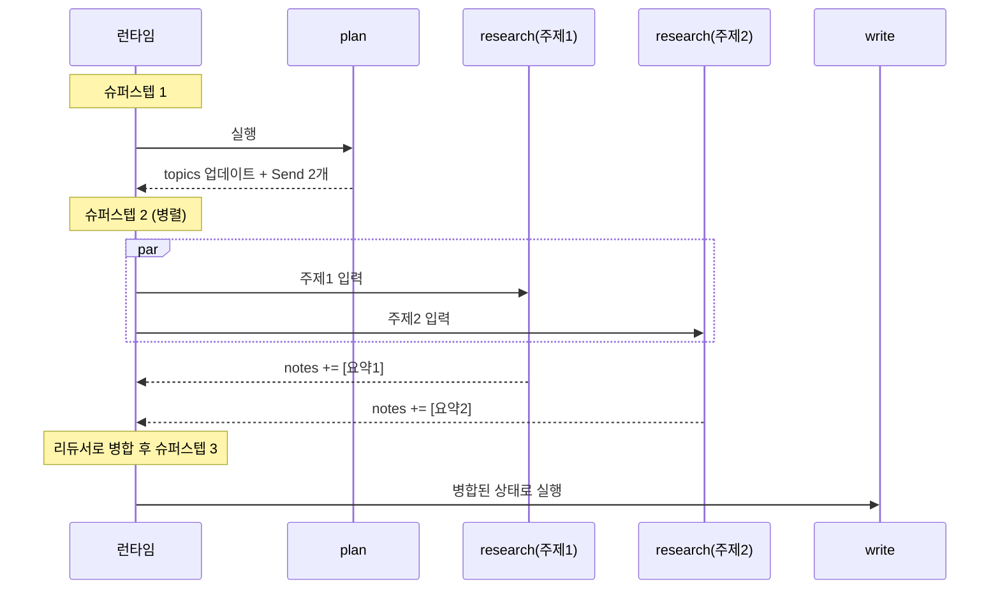
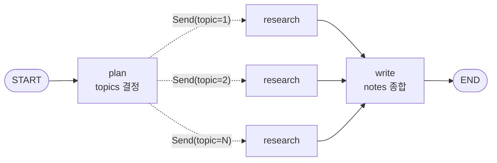

# Command와 Send: 동적 라우팅과 Map-Reduce

4.3의 조건부 엣지는 "노드가 끝난 **뒤에**, 별도의 라우팅 함수가 길을 고르는" 방식이었습니다. 그런데 실제로 코드를 짜다 보면 이런 상황을 자주 만납니다.

- 노드 안에서 이미 판단을 끝냈는데(예: 결제 승인 여부), 그 판단을 상태에 쓰고, 똑같은 판단을 라우팅 함수에서 **한 번 더** 해야 합니다.
- 리서치 주제가 3개일 수도 30개일 수도 있는데, 주제마다 같은 노드를 **병렬로** 돌리고 싶습니다. 노드 수는 실행해 봐야 압니다.

이 두 문제를 푸는 도구가 `Command`와 `Send`입니다. 둘 다 `langgraph.types`에 있습니다.

## 1. Command: "이렇게 바꾸고, 저기로 가라"

`Command`는 노드가 반환하는 특별한 객체로, **상태 업데이트와 다음 목적지를 한꺼번에** 담습니다.

```python
from typing import Literal
from langgraph.types import Command

def review_payment(state: PaymentState) -> Command[Literal["approve", "manual_review", "reject"]]:
    amount, risk = state["amount"], state["risk_score"]
    if risk > 0.8:
        return Command(update={"decision": "reject", "reason": "고위험"}, goto="reject")
    if amount > 1_000_000:
        return Command(update={"decision": "hold", "reason": "고액"}, goto="manual_review")
    return Command(update={"decision": "approve"}, goto="approve")
```

`Command`의 주요 필드는 다음과 같습니다.

| 필드 | 의미 |
| --- | --- |
| `update` | 일반 노드의 반환 dict와 같은 상태 업데이트 (리듀서 적용) |
| `goto` | 다음에 실행할 노드 이름, 이름 리스트, 또는 `Send` 객체(들) |
| `graph` | 어느 그래프 기준으로 이동할지. `Command.PARENT`면 부모 그래프 (→ 4.6, 7.3) |
| `resume` | `interrupt()`로 멈춘 그래프를 재개할 때 값 전달 (→ 5.3) |



이 그래프에는 `review_payment`에서 나가는 `add_edge`도 `add_conditional_edges`도 **없습니다.** 이동은 노드가 반환한 `Command`가 결정합니다. 그렇다면 그림의 점선은 어떻게 그려질까요? 반환 타입 힌트 `Command[Literal["approve", "manual_review", "reject"]]`를 보고 LangGraph가 가능한 목적지를 알아냅니다. 타입 힌트를 쓰기 어렵다면 `add_node("review_payment", fn, destinations=("approve", "manual_review", "reject"))`로 직접 알려 줄 수도 있습니다. 둘 다 없으면 실행은 되지만 그림이 실제 구조를 반영하지 못합니다.

> [!WARNING]
> `Command(goto=...)`는 기존 엣지를 **대체하지 않고 추가**됩니다. 노드에 `add_edge("review_payment", "audit")`가 걸려 있는 상태에서 `Command(goto="approve")`를 반환하면 `audit`와 `approve`가 **둘 다** 실행됩니다. Command로 라우팅하는 노드에는 보통 정적 엣지를 걸지 않습니다.

### 조건부 엣지 vs Command, 언제 무엇을?

| 상황 | 추천 |
| --- | --- |
| 라우팅 판단이 상태만 보고 간단히 가능하다 | 조건부 엣지 (노드와 라우팅의 관심사 분리) |
| 노드 안에서 판단하고 **그 결과를 상태에도 기록**해야 한다 | `Command` |
| 멀티 에이전트에서 에이전트가 **다른 에이전트에게 넘기기(handoff)** | `Command` (특히 `graph=Command.PARENT`) |
| 같은 라우팅 로직을 여러 그래프에서 재사용 | 조건부 엣지 + path_map |

정답이 하나는 아닙니다. 기준은 "판단 로직이 어디에 있는 게 가장 자연스러운가"입니다. 판단을 두 곳에 중복해서 쓰고 있다면 `Command`로 합칠 신호입니다.

> [!NOTE]
> `Command(graph=Command.PARENT, goto="other_agent")`는 **서브그래프 안의 노드**가 부모 그래프의 노드로 이동하게 합니다. 멀티 에이전트 핸드오프의 핵심 메커니즘으로, 서브그래프(→ 4.6)와 스웜 패턴(→ 7.3)에서 다시 다룹니다.

▶ 오른쪽 IDE의 `examples/01_command.py`를 실행해 보세요. 결제 심사 노드가 Command로 업데이트와 이동을 동시에 결정하고, 정적 엣지와 함께 쓰면 두 경로가 모두 실행되는 함정도 확인합니다.

## 2. 슈퍼스텝: 병렬 실행을 정확히 이해하기

`Send`를 배우기 전에 LangGraph가 병렬 실행을 어떻게 다루는지 정확히 알아야 합니다. 4.1에서 슈퍼스텝을 잠깐 언급했습니다. 이제 규칙을 정리합니다.

1. 한 슈퍼스텝에서는 **실행 대상이 된 모든 노드가 동시에** 실행됩니다.
2. 각 노드는 **슈퍼스텝이 시작될 때의 상태 스냅샷**을 읽습니다. 같은 스텝의 다른 노드가 쓴 값은 보이지 않습니다.
3. 모든 노드가 끝나면 업데이트들이 **리듀서를 통해 한꺼번에** 상태에 반영됩니다. (리듀서 없는 키에 두 값이 오면 `InvalidUpdateError`, → 4.2)
4. 반영 결과에 따라 다음 스텝에 실행할 노드가 정해집니다.
5. 한 스텝의 노드 중 **하나라도 예외를 던지면 그 스텝 전체가 실패**합니다. 체크포인터가 있다면 성공한 노드의 결과는 보존되어, 재개 시 실패한 노드만 다시 실행합니다(→ 5.5).



이 모델은 일종의 **트랜잭션**입니다. 한 스텝 안의 노드들은 서로의 중간 결과를 보지 않고, 스텝 경계에서만 상태가 바뀝니다. 그래서 병렬 실행이어도 결과가 결정적이고, 스텝 단위로 체크포인트를 남길 수 있습니다.

### 길이가 다른 병렬 가지와 defer

병렬 가지의 길이가 다르면 미묘한 문제가 생깁니다. `a → b1 → c → agg`와 `a → b2 → agg`처럼 한쪽은 두 단계, 다른 쪽은 한 단계라면 `agg`는 **두 번** 실행될 수 있습니다. 스텝 3에서 b2 쪽 가지가 먼저 도착해 한 번, 스텝 4에서 c 쪽 가지가 도착해 또 한 번 실행되는 것입니다. 해결책은 두 가지입니다.

- `add_edge(["c", "b2"], "agg")`: 합류 엣지로 "둘 다 끝나면"을 명시합니다.
- `add_node("agg", agg, defer=True)`: **지연 노드**로 지정하면, 그래프에 더 이상 실행할 다른 노드가 없을 때까지 실행을 미룹니다. 가지의 개수와 길이가 동적으로 정해질 때 특히 유용합니다.

▶ `examples/03_parallel_superstep.py`에서 `defer` 유무에 따라 집계 노드가 몇 번 실행되는지 비교해 보세요.

## 3. Send: 실행 시점에 정해지는 팬아웃

조건부 엣지가 리스트를 반환하면 여러 노드를 병렬 실행할 수 있다고 배웠습니다(→ 4.3). 하지만 그것은 **서로 다른 노드**를, **같은 상태**로 실행하는 것이었습니다. 다음 요구는 다릅니다.

> "사용자가 준 주제 N개 각각에 대해 **같은 `research` 노드**를 **주제별로 다른 입력**으로 실행하고, 결과를 모아 보고서를 쓰고 싶다."

N은 실행해 봐야 압니다. 이것이 고전적인 **Map-Reduce** 패턴이고, `Send`가 해결합니다.

```python
from langgraph.types import Send

def fan_out(state: ReportState) -> list[Send]:
    # 주제마다 research 노드를 하나씩, 각각 다른 입력으로 실행
    return [Send("research", {"topic": t}) for t in state["topics"]]

builder.add_conditional_edges("plan", fan_out, ["research"])
```

`Send(node, arg)`는 "`node`를 `arg`라는 입력으로 실행하라"는 메시지입니다. 핵심은 `arg`가 **그래프 전체 상태가 아니어도 된다**는 점입니다. `research` 노드는 `{"topic": ...}`만 받는 작은 입력 스키마를 가질 수 있습니다.

```python
class ResearchInput(TypedDict):
    topic: str

def research(state: ResearchInput) -> dict:
    summary = summarize(state["topic"])
    return {"notes": [summary]}          # 전체 상태의 notes 키로 '모으기'

class ReportState(TypedDict):
    topics: list[str]
    notes: Annotated[list[str], operator.add]   # reduce: 리듀서로 결과 수집
    report: str
```



그림에서 `research`가 여러 개처럼 보이지만 실제로는 **하나의 노드가 N번 병렬 실행**됩니다. 각 실행의 `{"notes": [...]}` 업데이트는 `operator.add` 리듀서로 모입니다. 이 리듀서가 없으면 N개의 병렬 쓰기가 충돌해 `InvalidUpdateError`가 납니다. **Send를 쓰는 곳에는 반드시 리듀서가 있다**고 기억하세요.

`Send`는 조건부 엣지의 라우팅 함수에서 반환할 수도 있고, `Command(goto=[Send(...), Send(...)])`처럼 노드에서 Command와 함께 반환할 수도 있습니다.

▶ `examples/02_send_map_reduce.py`는 주제 목록을 받아 주제별 리서치를 병렬로 돌리고 보고서를 쓰는 map-reduce 그래프입니다. 요약 단계에는 LLM 노드를 썼습니다. Mock 모드에서도 병렬 흐름 전체가 동작합니다.

> [!TIP]
> 병렬 결과의 **순서**는 `Send`를 만든 순서를 따르지만, 여기에 비즈니스 로직을 의존하지 마세요. 결과에 `topic` 같은 식별자를 함께 담아 두면 순서와 무관하게 다룰 수 있습니다.

## 4. 코드 해설: map-reduce 그래프의 핵심 세 줄

`02_send_map_reduce.py`에서 꼭 봐야 할 부분입니다.

1. `notes: Annotated[list[dict], operator.add]` — reduce 역할을 하는 리듀서입니다.
2. `return [Send("research", {"topic": t, "style": state["style"]}) for t in topics]` — map 역할. 필요한 값만 골라 각 작업에 넘깁니다.
3. `builder.add_edge("research", "write")` — 모든 `research` 실행이 **같은 슈퍼스텝**에서 끝나므로 `write`는 한 번만 실행됩니다.

또한 주제 수에 상한(`MAX_TOPICS`)을 둔 것을 확인하세요. LLM이 주제를 정하게 하면 가끔 50개를 내놓기도 합니다. 팬아웃 수는 곧 **동시 LLM 호출 수이자 비용**입니다.

## 5. 현업에서는

- **동시성 제한.** 100개의 `Send`는 100개의 동시 LLM 호출이 될 수 있고, 곧바로 제공자의 레이트 리밋(429)에 걸립니다. `config={"max_concurrency": 5}`로 한 스텝에서 동시에 실행할 작업 수를 제한하고, 팬아웃 수 자체에도 상한을 두세요.
- **부분 실패 전략.** 한 스텝 중 하나라도 실패하면 스텝 전체가 실패합니다. 20개 중 1개 실패로 전체 보고서를 버리고 싶지 않다면, 작업 노드 안에서 예외를 잡아 `{"notes": [{"topic": t, "error": "..."}]}`처럼 **실패를 데이터로** 기록하고, 집계 노드가 처리하게 하세요. 일시적 오류는 노드 재시도 정책(→ 5.5)으로 다룹니다.
- **비용과 지연의 트레이드오프.** 병렬화는 지연을 줄이지만 비용은 줄이지 않습니다. 오히려 "일단 다 돌려 보자"가 비용을 키웁니다. 팬아웃 전에 저렴한 필터 단계를 두는 것이 흔한 최적화입니다(→ 8.6).
- **관측성.** LangSmith 트레이스에서 같은 노드가 여러 번 실행된 것이 보이도록, 각 Send 입력에 식별자를 넣어 두면 디버깅이 쉬워집니다.
- **Command는 핸드오프의 표준.** 멀티 에이전트 시스템에서 "이 문의는 결제 에이전트가 맡아"를 구현하는 표준 방식이 `Command(goto=..., update=...)`입니다. 지금 익혀 두면 7장이 쉬워집니다.

> [!CAUTION]
> 안티패턴: `Send`로 보낸 작업 노드가 전체 상태를 기대하는 코드. `Send`의 두 번째 인자로 준 dict만 그 노드의 입력이 됩니다. 필요한 값(예: 사용자 언어 설정)이 있으면 Send 페이로드에 명시적으로 넣으세요.

## 6. 정리

- `Command(update=..., goto=...)`는 노드 안에서 상태 업데이트와 이동을 한 번에 결정합니다. 반환 타입 `Command[Literal[...]]` 또는 `destinations`로 목적지를 알려 주세요.
- `Command`의 `goto`는 정적 엣지에 **추가**됩니다.
- 한 슈퍼스텝의 노드들은 같은 스냅샷을 읽고, 업데이트는 스텝 끝에 리듀서로 병합됩니다.
- 길이가 다른 병렬 가지는 합류 엣지나 `defer=True`로 집계 시점을 맞춥니다.
- `Send(node, arg)`로 실행 시점에 개수가 정해지는 map을, 리듀서로 reduce를 구현합니다.
- 팬아웃 수 상한과 `max_concurrency`, 실패를 데이터로 다루는 습관이 현업 품질을 만듭니다.

다음 강의에서는 지금까지 배운 노드·조건부 엣지·리듀서를 조합해 **ReAct 에이전트를 직접 구성**하고, `create_agent`와 비교합니다.
