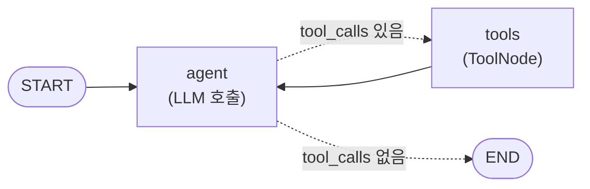
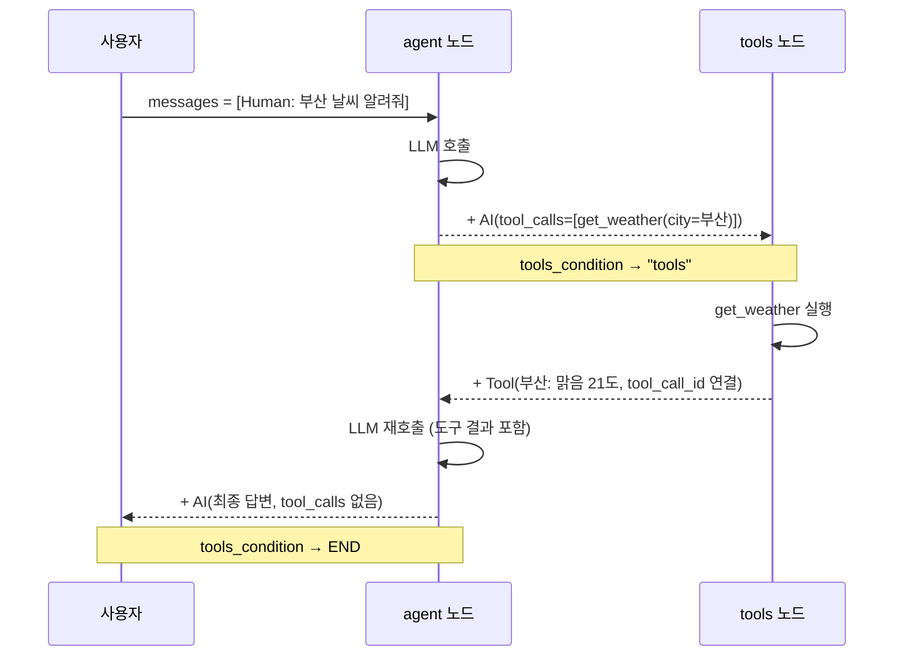
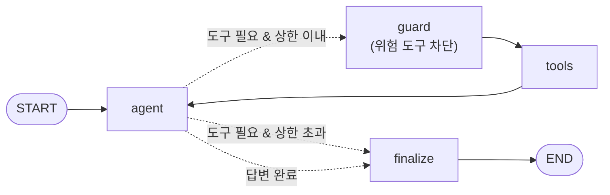

# LangGraph로 ReAct 에이전트 직접 만들기

3.1에서는 ReAct 루프를 `for` 문으로 직접 짰고, 3.2에서는 `create_agent` 한 줄로 만들었습니다. 이번 강의는 그 중간입니다. 지금까지 배운 LangGraph 부품, 즉 **상태(4.2) + 노드(4.1) + 조건부 엣지(4.3)** 로 ReAct 에이전트를 직접 조립합니다. 이걸 한 번 해 보면 `create_agent`가 더 이상 블랙박스가 아니게 되고, 프레임워크가 제공하지 않는 흐름이 필요할 때 망설이지 않고 그래프를 직접 짤 수 있게 됩니다.

## 1. ReAct 루프를 그래프로 옮기기

ReAct(Reason + Act)의 핵심은 단순합니다.

1. 모델에게 대화와 도구 목록을 주고 호출한다.
2. 모델이 **도구 호출(tool_calls)** 을 요청했으면 도구를 실행하고, 결과(ToolMessage)를 대화에 붙여 1로 돌아간다.
3. 도구 호출이 없으면 그것이 최종 답이다.

이것을 그래프로 옮기면 노드 두 개와 조건부 엣지 하나입니다.



| ReAct 개념 | LangGraph 부품 |
| --- | --- |
| 대화 기록 | `MessagesState` (`messages` + `add_messages` 리듀서) |
| Reason (생각하고 도구 고르기) | `agent` 노드: `llm.bind_tools(tools).invoke(messages)` |
| Act (도구 실행) | `ToolNode(tools)` |
| 계속할지 판단 | `tools_condition` 조건부 엣지 |
| 무한 루프 방지 | `recursion_limit` 또는 카운터 |

## 2. 코드로 조립하기

```python
from langchain.chat_models import init_chat_model
from langchain.tools import tool
from langgraph.graph import StateGraph, START, MessagesState
from langgraph.prebuilt import ToolNode, tools_condition

@tool
def get_weather(city: str) -> str:
    """도시의 현재 날씨를 조회합니다."""
    return WEATHER_DB.get(city, "정보 없음")

tools = [get_weather, calculate]
llm = init_chat_model(MODEL).bind_tools(tools)   # 모델에 도구 스키마를 알려 줌

def agent(state: MessagesState) -> dict:
    ai = llm.invoke([SystemMessage(SYSTEM_PROMPT), *state["messages"]])
    return {"messages": [ai]}                      # add_messages가 대화에 이어 붙임

builder = StateGraph(MessagesState)
builder.add_node("agent", agent)
builder.add_node("tools", ToolNode(tools))
builder.add_edge(START, "agent")
builder.add_conditional_edges("agent", tools_condition)   # "tools" 또는 END
builder.add_edge("tools", "agent")                          # 도구 실행 후 다시 생각
graph = builder.compile()
```

한 줄씩 의미를 짚어 봅시다.

- **`bind_tools(tools)`** 는 모델 호출에 도구의 JSON 스키마를 함께 보내도록 설정합니다(→ 2.4). 모델은 직접 도구를 실행하지 않고, "이 도구를 이 인자로 불러 달라"는 `tool_calls`만 응답에 담습니다.
- **시스템 프롬프트는 상태에 저장하지 않고** 호출할 때마다 앞에 붙였습니다. 상태에 넣으면 체크포인트마다 중복 저장되고, 프롬프트를 바꿔 배포해도 기존 스레드에는 옛 프롬프트가 남습니다.
- **`ToolNode`** 는 마지막 AIMessage의 `tool_calls`를 읽어 해당 도구들을 실행하고, 각 결과를 `tool_call_id`가 연결된 `ToolMessage`로 만들어 반환합니다. 도구 호출이 여러 개면 **병렬로** 실행합니다.
- **`tools_condition`** 은 마지막 메시지에 `tool_calls`가 있으면 `"tools"`, 없으면 `END`(`"__end__"`)를 반환하는 미리 만들어진 라우팅 함수입니다. 반환 타입이 `Literal["tools", "__end__"]`로 선언되어 있어 그림도 정확히 그려집니다. 그래서 도구 노드 이름은 관례대로 `"tools"`로 지어야 합니다.

> [!IMPORTANT]
> 실행할 때는 반드시 `config={"recursion_limit": N}`을 주세요. 모델이 같은 도구를 계속 부르는 일은 실제로 일어납니다. agent→tools 한 바퀴가 2 스텝이므로, 도구를 최대 5번 쓰게 하려면 대략 `recursion_limit=11` 정도가 됩니다.

▶ 오른쪽 IDE의 `examples/01_react_graph.py`를 실행해 보세요. 메시지가 Human → AI(tool_calls) → Tool → AI 순서로 쌓이는 과정이 `pretty_print()`로 출력됩니다. API 키가 없으면 Mock 모델이 질문과 단어가 겹치는 도구를 골라 호출합니다.

## 3. 실행 흐름을 메시지로 따라가기

"부산 날씨 알려줘"라는 질문의 상태 변화를 따라가 봅시다.



모든 단계가 `messages` 리스트 하나에 쌓인다는 점이 중요합니다. 모델은 매 호출마다 **전체 대화**를 다시 받습니다. 대화가 길어질수록 입력 토큰이 늘어나는 이유이고, 3.4에서 다룬 트리밍·요약이 필요한 이유입니다.

### ToolNode의 오류 처리

도구가 실패하면 어떻게 될까요? `ToolNode`의 `handle_tool_errors` 기본 동작은 다음과 같습니다.

- 모델이 **잘못된 인자**를 넘겨 도구 호출 자체가 성립하지 않으면(인자 검증 실패), 오류 메시지를 `ToolMessage`로 만들어 모델에게 돌려줍니다. 모델은 이를 보고 인자를 고쳐 다시 시도할 수 있습니다.
- 도구 **내부에서 발생한 예외**는 기본적으로 다시 던집니다. 그래프 실행이 실패합니다.

`ToolNode(tools, handle_tool_errors=True)`로 모든 예외를 ToolMessage로 바꿀 수도 있고, 문자열이나 함수를 넘겨 메시지를 직접 정할 수도 있습니다. "모든 오류를 모델에게 보여 줄지"는 보안 판단이기도 합니다. 내부 스택 트레이스나 DB 오류 메시지가 모델 컨텍스트와 사용자 응답으로 새어 나갈 수 있기 때문입니다.

## 4. create_agent와 비교하기

같은 도구로 `create_agent`를 만들어 구조를 비교해 봅시다.

```python
from langchain.agents import create_agent

agent = create_agent(MODEL, tools=tools, system_prompt=SYSTEM_PROMPT)
print(agent.get_graph().draw_mermaid())
```

출력되는 그래프는 `model`과 `tools` 두 노드가 우리가 만든 것과 같은 모양으로 연결되어 있습니다. (`tools → model`이 점선으로 그려지는 것은, `create_agent`가 `return_direct` 도구나 구조화 응답 처리를 위해 이 구간도 조건부로 라우팅하기 때문입니다.) 즉 `create_agent`는 **이번 강의에서 만든 그래프를 표준화한 것**입니다. 차이는 그 위에 얹힌 기능입니다.

| 항목 | 직접 만든 그래프 | `create_agent` |
| --- | --- | --- |
| 기본 ReAct 루프 | 직접 조립 | 내장 |
| 구조화 최종 응답 | 직접 노드 추가 | `response_format=` |
| 요약, 재시도, 호출 상한, HITL 등 | 직접 노드/엣지로 구현 | 미들웨어로 끼우기 (→ 3.3) |
| 흐름 자체를 바꾸기 (승인 단계, 병렬 하위 작업, 다단계 파이프라인) | 자유로움 | 미들웨어로 가능한 범위까지 |
| 코드량·유지보수 | 많음 | 적음 |

**선택 기준**은 이렇습니다. "모델이 도구를 골라 쓰는 루프"가 본질이고 변형이 미들웨어로 표현된다면 `create_agent`가 정답입니다. 검증된 기본값과 미들웨어 생태계를 공짜로 얻습니다. 반대로 에이전트 루프는 **전체 흐름의 일부**일 뿐이고, 그 앞뒤로 분류·검색·승인·병렬 처리 같은 단계가 필요하다면 LangGraph로 그래프를 짜고, 그 안의 한 노드로 `create_agent`가 만든 에이전트를 넣는 방식이 가장 흔합니다(서브그래프, → 4.6).

▶ `examples/03_vs_create_agent.py`에서 두 방식의 그래프 구조와 실행 결과를 나란히 비교해 보세요.

## 5. 그래프를 직접 짤 때만 쉬운 커스터마이징

그래프를 직접 소유하면 루프의 어느 지점에든 노드를 끼울 수 있습니다. `examples/02_custom_agent.py`에서 구현한 세 가지 커스터마이징을 봅시다.



1. **도구 호출 상한**: 상태에 `tool_rounds: Annotated[int, operator.add]` 카운터를 두고, `tools_condition` 대신 직접 만든 라우터가 상한을 넘으면 `finalize`로 보냅니다. `recursion_limit` 예외로 끝나는 대신 **우아하게** 끝납니다.
2. **가드 노드**: 도구 실행 직전에 `guard` 노드가 `tool_calls`를 검사해, 허용 목록에 없는 도구 호출을 실행하지 않고 "권한 없음" ToolMessage로 대체합니다. 실제 서비스에서는 이 자리에서 사람 승인(`interrupt`, → 5.3)을 받습니다.
3. **후처리 노드**: `finalize`가 최종 답변에 출처 꼬리말을 붙이고 통계(사용한 도구 수)를 상태에 남깁니다.

> [!TIP]
> 각 AIMessage에는 `tool_calls`마다 대응하는 `ToolMessage`가 **반드시** 있어야 합니다. 이 짝이 맞지 않으면 다음 LLM 호출에서 OpenAI API가 오류를 냅니다. 가드 노드가 도구 실행을 막을 때도 "거부됨" ToolMessage를 만들어 짝을 맞춰 주는 이유입니다.

## 6. 현업에서는

- **기본은 create_agent, 필요할 때 그래프.** 팀 내 에이전트 대부분은 `create_agent` + 미들웨어로 충분합니다. 직접 짠 ReAct 그래프는 유지보수 대상이 늘어난다는 뜻이므로, "미들웨어로 표현 못 하는 흐름"이 있을 때 선택하세요.
- **도구 호출 지표.** 운영에서는 턴당 도구 호출 수, 도구별 실패율, 도구 지연을 꼭 봅니다. 이 숫자가 갑자기 늘면 프롬프트 회귀나 모델 변경의 신호입니다. LangSmith 트레이스에서 노드별로 바로 확인할 수 있습니다(→ 8.2).
- **비용 구조 이해.** ReAct 한 턴의 비용은 대략 "LLM 호출 수 × 누적 대화 길이"입니다. 도구 결과가 길면(예: 검색 결과 원문) 이후 모든 호출의 입력 토큰이 커집니다. 도구 결과를 요약하거나 잘라서 반환하는 것이 가장 효과적인 비용 절감 중 하나입니다.
- **도구 권한 최소화.** 모델이 고를 수 있는 도구 목록이 곧 공격 표면입니다. 프롬프트 인젝션으로 위험한 도구가 호출될 수 있다는 전제로, 쓰기·삭제·결제 도구는 가드나 사람 승인 뒤에 두세요(→ 8.3).
- **Mock으로 그래프 테스트.** 모델 응답을 고정한 가짜 모델로 "도구가 호출되고, ToolMessage가 붙고, 루프가 끝나는지"를 테스트하면 LLM 비용 없이 흐름 회귀를 잡을 수 있습니다. 이 사이트의 Mock 모드가 바로 그런 원리입니다.

> [!CAUTION]
> 안티패턴: 시스템 프롬프트를 `messages` 상태에 매 턴 추가하는 코드. 대화가 이어질수록 같은 시스템 메시지가 여러 개 쌓여 토큰을 낭비하고 모델을 헷갈리게 합니다. 시스템 프롬프트는 모델 호출 직전에 붙이세요.

## 7. 정리

- ReAct 에이전트 = `MessagesState` + `agent` 노드 + `ToolNode` + `tools_condition` + `tools → agent` 엣지.
- `ToolNode`는 tool_calls를 병렬 실행해 ToolMessage를 만들고, `handle_tool_errors`로 오류 처리 방식을 정합니다.
- `create_agent`는 같은 구조를 표준화하고 미들웨어·구조화 응답을 얹은 것입니다.
- 흐름 자체를 바꿔야 하면 그래프를 직접 짜고, 상한·가드·후처리 노드를 루프에 끼웁니다.

다음 강의에서는 이렇게 만든 에이전트를 더 큰 그래프의 부품으로 쓰는 **서브그래프**를 배웁니다.
