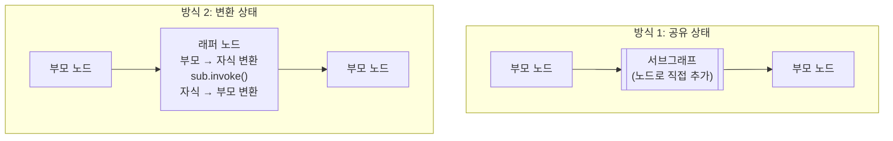
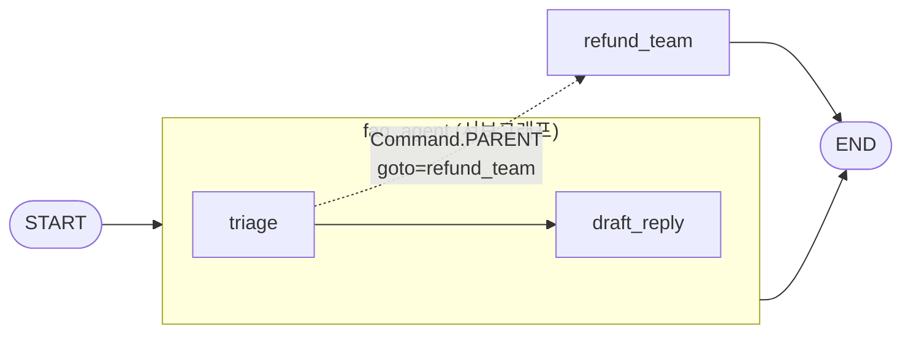

# 서브그래프: 그래프를 부품으로 조립하기

에이전트 시스템이 커지면 그래프 하나에 노드가 수십 개씩 생깁니다. "주문 처리", "환불 심사", "FAQ 검색", "상담원 연결"이 모두 한 그래프에 엉켜 있으면, 환불 로직을 고치려는 사람도 전체 그래프를 이해해야 하고, 테스트도 전체를 돌려야 합니다. 소프트웨어 공학이 이 문제를 푸는 방법은 언제나 같습니다. **모듈로 나누고, 인터페이스로 연결한다.** LangGraph에서 그 모듈이 **서브그래프(Subgraph)** 입니다.

## 1. 서브그래프란?

서브그래프는 **다른 그래프의 노드로 쓰이는 컴파일된 그래프**입니다. 컴파일된 그래프도 Runnable(`invoke`가 가능한 객체)이므로 노드 자리에 그대로 들어갈 수 있습니다. 함수 안에서 다른 함수를 호출하는 것과 같은 발상입니다.

서브그래프를 쓰는 대표적인 이유는 다음과 같습니다.

- **팀 단위 분업**: 환불팀은 환불 서브그래프만, 검색팀은 RAG 서브그래프만 소유하고 독립적으로 개발·테스트합니다.
- **재사용**: 같은 "문서 검색 → 재정렬" 서브그래프를 여러 에이전트에서 씁니다.
- **멀티 에이전트**: 각 에이전트를 자기만의 상태와 프롬프트를 가진 서브그래프로 만들고, 상위 그래프가 조율합니다(→ 7장).
- **컨텍스트 격리**: 하위 작업의 수많은 중간 메시지가 상위 대화를 오염시키지 않게 합니다.

서브그래프를 연결하는 방식은 상태를 어떻게 주고받느냐에 따라 두 가지입니다.



## 2. 방식 1: 공유 상태 — 그래프를 노드로 바로 추가

부모와 서브그래프가 **같은 키를 공유**한다면, 컴파일된 서브그래프를 `add_node`에 그대로 넣습니다.

```python
class ParentState(TypedDict):
    question: str
    docs: Annotated[list[str], operator.add]
    answer: str

class RetrievalState(TypedDict):       # 서브그래프 상태
    question: str                       # 부모와 공유하는 키
    docs: Annotated[list[str], operator.add]   # 부모와 공유하는 키
    expanded_queries: list[str]         # 서브그래프 내부 전용 키

retrieval = retrieval_builder.compile()      # 서브그래프 컴파일

parent = StateGraph(ParentState)
parent.add_node("retrieve", retrieval)      # 컴파일된 그래프를 노드로!
parent.add_node("answer", answer)
```

데이터는 이렇게 흐릅니다.

1. 부모의 상태가 서브그래프의 **입력**으로 들어갑니다. 서브그래프 스키마에 있는 키(`question`, `docs`)만 전달됩니다.
2. 서브그래프가 자기 노드들을 끝까지 실행합니다. `expanded_queries` 같은 내부 키는 서브그래프 안에서만 존재합니다.
3. 서브그래프의 **최종 상태 중 부모와 겹치는 키**가 부모 상태에 업데이트로 반영됩니다. 이때 부모의 리듀서가 적용됩니다.

> [!WARNING]
> 3번에서 주의할 점이 있습니다. 서브그래프가 돌려주는 것은 "변경분"이 아니라 서브그래프의 **최종 상태**(공유 키 전체)입니다. 부모의 `docs`에 `operator.add` 리듀서가 있고, 서브그래프도 입력으로 받은 `docs`를 그대로 들고 있다가 반환하면, 부모 쪽에서 **기존 문서가 한 번 더 이어 붙어 중복**될 수 있습니다. 누적 리듀서가 붙은 키를 공유할 때는 서브그래프의 `input_schema`에서 그 키를 **빼서** 서브그래프가 빈 상태로 시작하게 하면, 서브그래프는 **새로 찾은 값만** 돌려줍니다. 필요하면 `output_schema`로 돌려줄 키도 제한하세요. `examples/01_shared_state.py`에서 이 차이를 직접 확인할 수 있습니다.

## 3. 방식 2: 변환 상태 — 래퍼 노드에서 호출

서브그래프의 상태가 부모와 **전혀 다르다면**, 노드 함수 안에서 서브그래프를 `invoke`하고 입출력을 변환합니다.

```python
class TranslatorState(TypedDict):    # 부모와 공유하는 키가 없다
    text: str
    target_lang: str
    translated: str

translator = translator_builder.compile()

def translate_answer(state: ParentState) -> dict:
    # 부모 상태 → 서브그래프 입력 (변환)
    out = translator.invoke({"text": state["answer"], "target_lang": "en"})
    # 서브그래프 출력 → 부모 업데이트 (변환)
    return {"answer_en": out["translated"]}
```

이 방식은 함수 호출과 똑같습니다. 서브그래프는 부모 상태의 존재를 모르고, 부모도 서브그래프 내부 키를 모릅니다. **인터페이스가 가장 명확**합니다. 여러 에이전트가 각자의 `messages`를 가지는 멀티 에이전트 시스템에서 특히 유용합니다. 하위 에이전트가 도구를 20번 호출하며 쌓은 메시지는 하위 에이전트 안에 머물고, 부모에게는 최종 답변 한 줄만 돌아옵니다. 이것이 **컨텍스트 격리**입니다.

> [!TIP]
> `create_agent`가 만든 에이전트도 컴파일된 그래프입니다. 그래서 래퍼 노드 안에서 `agent.invoke({"messages": [...]})`로 호출하면 그대로 서브그래프가 됩니다. ▶ `examples/02_transformed_state.py`에서 리서치 에이전트(`create_agent`)를 부모 파이프라인의 한 단계로 넣어 보세요.

### 어떤 방식을 고를까?

| 기준 | 공유 상태 | 변환 상태 |
| --- | --- | --- |
| 스키마 | 부모와 키를 공유 | 완전히 독립 |
| 연결 코드 | `add_node("x", subgraph)` 한 줄 | 래퍼 함수 작성 |
| 결합도 | 높음 (키 이름이 계약) | 낮음 (함수 시그니처가 계약) |
| 대표 사례 | 같은 팀이 만든 파이프라인 단계 분리 | 독립 에이전트, 외부 팀 모듈, 재사용 라이브러리 |

## 4. 네임스페이스와 서브그래프 스트리밍

서브그래프 내부에서 무슨 일이 일어나는지 보려면 `stream`에 `subgraphs=True`를 줍니다. 그러면 각 청크가 `(namespace, data)` 튜플로 나옵니다.

```python
for namespace, chunk in graph.stream(inputs, stream_mode="updates", subgraphs=True):
    print(namespace, chunk)
```

```text
()                                {'plan': {...}}                  ← 부모 그래프
('retrieve:1f0a...',)             {'expand_query': {...}}           ← 서브그래프 내부
('retrieve:1f0a...',)             {'search': {...}}
()                                {'retrieve': {...}}               ← 서브그래프 결과가 부모에 반영
()                                {'answer': {...}}
```

**네임스페이스(namespace)** 는 "지금 이 이벤트가 어느 그래프의 어느 노드 안에서 나왔는가"를 나타내는 경로입니다. 빈 튜플 `()`은 최상위 그래프, `('retrieve:<task_id>',)`는 부모의 `retrieve` 노드로 실행된 서브그래프 내부라는 뜻입니다. 서브그래프가 또 서브그래프를 가지면 튜플이 길어집니다. 프론트엔드에서 "리서치 에이전트가 검색 중…" 같은 진행 상황을 보여 줄 때 이 네임스페이스로 이벤트를 구분합니다(→ 8.1).

구조를 그림으로 보고 싶다면 `graph.get_graph(xray=True).draw_mermaid()`를 씁니다. `xray=True`는 서브그래프의 내부 노드까지 펼쳐서 그립니다. 공유 상태 방식은 물론이고, 래퍼 노드 함수가 모듈 수준에서 참조하는 컴파일된 그래프(예: 전역 변수 `research_agent`)도 LangGraph가 찾아내 펼쳐 줍니다. 다만 함수 안에서 그때그때 그래프를 새로 만들어 호출하는 식이라면 구조를 알아낼 수 없으니, 서브그래프는 **모듈 수준에서 한 번 컴파일해 두고 재사용**하는 습관을 들이세요. 컴파일 비용도 아끼고 시각화·스트리밍도 정확해집니다.

> [!NOTE]
> 체크포인터는 **부모 그래프에만** 넘기면 됩니다. 서브그래프는 부모의 체크포인터를 자동으로 물려받아 자기 네임스페이스에 상태를 저장합니다. 서브그래프 내부에서 `interrupt()`로 멈추는 것도 가능합니다(→ 5.1, 5.3).

## 5. Command.PARENT: 서브그래프에서 부모로 점프

4.4에서 예고한 `Command(graph=Command.PARENT)`를 봅시다. 서브그래프 안의 노드가 "이 일은 내 담당이 아니니 부모 그래프의 다른 노드로 넘기겠다"고 결정할 때 씁니다.

```python
def triage(state: SupportState) -> Command:
    if "환불" in state["question"]:
        return Command(
            graph=Command.PARENT,           # 부모 그래프 기준으로
            goto="refund_team",             # 부모의 refund_team 노드로 이동
            update={"handoff_reason": "환불 문의"},   # 부모 상태에 반영할 업데이트
        )
    return {"draft": "..."}
```



멀티 에이전트의 **핸드오프(handoff)** 가 정확히 이 구조입니다(→ 7.3).

> [!IMPORTANT]
> `Command.PARENT`로 빠져나갈 때 부모 상태에 반영되는 것은 **그 Command의 `update`뿐**입니다. 서브그래프 안에서 앞선 노드들이 쓴 값은 부모로 전달되지 않습니다. 부모가 알아야 하는 정보(예: 수집한 주문번호, 지금까지의 요약)는 반드시 `update`에 담아 넘기세요. 또 `update`의 키는 **부모 상태 스키마**의 키여야 하고, 부모 쪽 리듀서가 적용됩니다.

▶ `examples/03_parent_command.py`에서 FAQ 서브그래프가 환불 문의를 부모의 환불팀 노드로 넘기는 과정을 `subgraphs=True` 스트림으로 확인해 보세요.

## 6. 현업에서는

- **경계는 팀과 책임을 따라 긋는다.** 서브그래프 경계는 기술적 편의보다 "누가 소유하고, 무엇을 독립적으로 테스트·배포하고 싶은가"를 기준으로 정합니다. 너무 잘게 쪼개면 상태 변환 코드만 늘어납니다.
- **인터페이스를 문서화한다.** 공유 상태 방식이라면 공유 키 목록이, 변환 상태 방식이라면 래퍼 함수의 입출력이 계약입니다. 입력/출력 스키마(→ 4.2)로 명시하면 계약이 코드에 남습니다.
- **서브그래프 단위 테스트.** 서브그래프는 독립적으로 `invoke`할 수 있으므로 부모 없이 테스트합니다. 부모 테스트에서는 서브그래프를 가짜 노드로 바꿔 끼워 빠르게 돌립니다.
- **관측성.** LangSmith 트레이스는 서브그래프를 중첩된 실행으로 보여 줍니다. 서브그래프 컴파일 시 `compile(name="refund_agent")`처럼 이름을 주면 트레이스에서 찾기 쉽습니다. (스트림 네임스페이스에는 부모 쪽 **노드 이름**이 찍힙니다.)
- **비용 격리.** 하위 에이전트의 긴 도구 호출 기록을 부모 대화에 그대로 붙이면 이후 모든 LLM 호출이 그 토큰을 다시 읽습니다. 변환 상태 방식으로 **요약만 돌려주는 것**이 비용과 품질 모두에 유리한 경우가 많습니다.

> [!CAUTION]
> 안티패턴: 변환 상태 방식이라면서 래퍼 노드가 부모 상태를 **통째로** 서브그래프에 넘기고, 결과도 **통째로** 부모에 돌려주는 코드. 결합도는 공유 상태 방식만큼 높아지고, 컨텍스트 격리 효과는 사라지며, 누적 리듀서 키는 중복됩니다. 래퍼는 "필요한 것만 넣고, 필요한 것만 꺼내는" 얇은 어댑터여야 합니다.

## 7. 정리

- 서브그래프 = 다른 그래프의 노드로 쓰이는 컴파일된 그래프.
- **공유 상태**: `add_node("x", compiled_subgraph)`. 겹치는 키로 소통하며, 누적 리듀서 키는 중복에 주의.
- **변환 상태**: 래퍼 노드에서 `sub.invoke()` 후 변환. 결합도가 낮고 컨텍스트 격리에 유리.
- `stream(..., subgraphs=True)`는 `(namespace, chunk)`를 내보내고, `get_graph(xray=True)`는 서브그래프 내부를 펼쳐 그립니다.
- `Command(graph=Command.PARENT, goto=..., update=...)`로 부모 그래프 노드로 이동하며, 부모에 반영되는 건 `update`뿐입니다.

다음 강의에서는 그래프를 명시적으로 그리지 않고 평범한 Python 함수처럼 워크플로를 쓰는 **Functional API**를 배웁니다.
