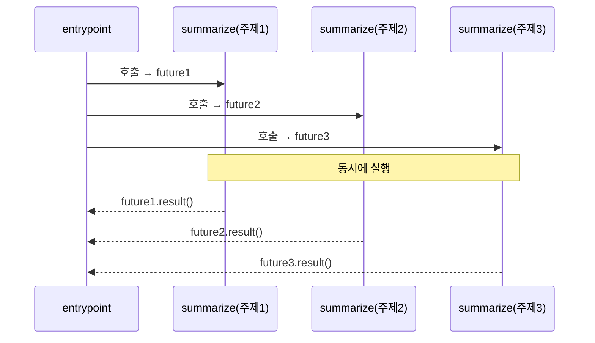
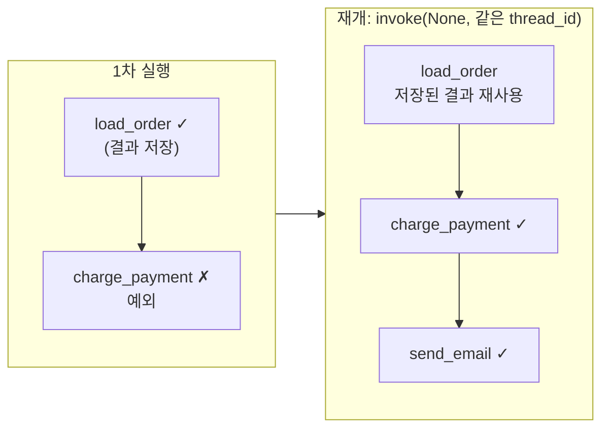

# Functional API: @entrypoint와 @task

지금까지 우리는 상태 스키마를 선언하고, 노드를 등록하고, 엣지를 그어 그래프를 만들었습니다. 이 방식(**Graph API**)은 흐름이 눈에 보이고 구조가 명시적이라는 큰 장점이 있습니다. 하지만 솔직히 말해 간단한 일에는 손이 많이 갑니다. "A를 하고, 결과가 이러면 B를, 아니면 C를 세 번 반복" 같은 흐름은 Python의 `if`와 `for`로 쓰면 다섯 줄인데, 그래프로 옮기면 상태 클래스, 노드 함수, 조건부 엣지, 라우팅 함수가 필요합니다.

**Functional API**는 이 간극을 메웁니다. 평범한 Python 함수와 제어 흐름을 그대로 쓰면서도, LangGraph 런타임의 핵심 기능인 **체크포인트(영속성), 중단/재개, 스트리밍, 병렬 실행**을 그대로 누릴 수 있게 해 줍니다. 두 API는 같은 런타임 위에서 동작하는 **두 가지 작성 방식**입니다.

## 1. 두 개의 데코레이터

| 데코레이터 | 역할 | Graph API에 비유하면 |
| --- | --- | --- |
| `@entrypoint` | 워크플로의 시작점. 전체 흐름을 Python 코드로 기술 | 그래프 전체 (`compile()` 결과) |
| `@task` | 독립된 작업 단위. 결과가 체크포인트에 저장됨 | 노드 |

```python
from langgraph.func import entrypoint, task

@task
def fetch_profile(user_id: str) -> dict:
    return DB[user_id]

@task
def write_greeting(profile: dict) -> str:
    return f"{profile['name']}님, 안녕하세요!"

@entrypoint()
def greet_workflow(user_id: str) -> str:
    profile = fetch_profile(user_id).result()     # task 호출 → 퓨처 → .result()로 값 받기
    return write_greeting(profile).result()

greet_workflow.invoke("u1")
```

몇 가지 규칙이 눈에 띕니다.

- `@entrypoint` 함수는 **인자를 하나만** 받습니다. 여러 값이 필요하면 dict로 묶어 넘깁니다.
- `@entrypoint`로 장식된 함수는 더 이상 평범한 함수가 아니라 **Pregel 객체**(컴파일된 그래프와 같은 종류)입니다. 그래서 `invoke`, `stream`, `get_state` 등을 그대로 씁니다.
- `@task` 함수를 호출하면 즉시 값이 아니라 **퓨처(future)** 가 돌아옵니다. `.result()`를 호출해야 값을 받습니다. 이것이 병렬 실행의 열쇠입니다.

## 2. 퓨처와 병렬 실행

task 호출이 퓨처를 돌려준다는 것은, **여러 task를 먼저 출발시키고 나중에 결과를 모을 수 있다**는 뜻입니다.

```python
@entrypoint()
def research(topics: list[str]) -> list[str]:
    futures = [summarize(t) for t in topics]     # 모두 '출발' (병렬 실행)
    return [f.result() for f in futures]          # 모두 '도착'을 기다림
```



Graph API에서 `Send`로 구현했던 map-reduce(→ 4.4)가 리스트 컴프리헨션 두 줄이 됐습니다. 리듀서도 필요 없습니다. 결과는 그냥 Python 리스트이기 때문입니다.

> [!WARNING]
> `[summarize(t).result() for t in topics]`처럼 호출하자마자 `.result()`를 붙이면 하나가 끝나야 다음이 출발하므로 **순차 실행**이 됩니다. 병렬로 돌리고 싶다면 퓨처를 먼저 모두 만든 뒤에 결과를 기다리세요.

▶ 오른쪽 IDE의 `examples/01_basics.py`를 실행해 보세요. 순차 실행과 병렬 실행의 소요 시간 차이를 직접 측정합니다.

## 3. 영속성: task 결과는 저장된다

Functional API의 진짜 힘은 체크포인터와 함께 쓸 때 드러납니다.

```python
from langgraph.checkpoint.memory import InMemorySaver

@entrypoint(checkpointer=InMemorySaver())
def pipeline(order_id: int) -> str:
    order = load_order(order_id).result()          # task 1: 성공 → 결과 저장
    receipt = charge_payment(order).result()       # task 2: 일시 장애로 실패!
    return send_email(receipt).result()
```

`charge_payment`가 실패하면 실행은 예외로 끝나지만, 이미 성공한 `load_order`의 결과는 체크포인트에 남아 있습니다. 같은 `thread_id`로 `pipeline.invoke(None, config)`를 호출하면 워크플로가 **재개**되는데, 이때 `load_order`는 다시 실행되지 않고 **저장된 결과를 재사용**합니다.



이것이 **내구성 있는 실행(durable execution)** 입니다(→ 5.5). 비싼 LLM 호출이나 외부 API 호출을 task로 감싸 두면, 뒤 단계가 실패해도 앞 단계를 다시 돈 내고 호출하지 않습니다. `interrupt()`로 사람 승인을 기다렸다가 재개할 때도 같은 원리로 앞 단계가 재실행되지 않습니다(→ 5.3).

> [!IMPORTANT]
> 재개할 때 entrypoint 함수 본문은 **처음부터 다시 실행**됩니다. 다만 task 호출은 저장된 결과로 즉시 대체될 뿐입니다. 그래서 다음 두 규칙이 중요합니다.
> 1. **부수 효과(side effect)는 반드시 task 안에서.** entrypoint 본문에서 직접 이메일을 보내거나 DB에 쓰면 재개할 때마다 또 실행됩니다.
> 2. **비결정적 코드도 task 안에서.** `random`, 현재 시각, LLM 호출을 entrypoint 본문에서 직접 하면 재개 때 다른 값이 나와 흐름이 달라질 수 있습니다. task로 감싸면 첫 실행의 결과가 저장되어 재개 시에도 같은 값이 쓰입니다.

## 4. previous와 entrypoint.final: 스레드 단위 상태

Graph API에서는 상태 객체가 실행 사이에 이어졌습니다. Functional API에서는 그 역할을 **`previous`** 가 합니다. entrypoint 함수가 `previous`라는 이름의 키워드 인자를 받으면, 같은 스레드에서 **지난번 실행의 반환값**이 주입됩니다(체크포인터 필요).

```python
@entrypoint(checkpointer=InMemorySaver())
def counter(event: str, *, previous: dict | None = None) -> dict:
    stats = previous or {"count": 0, "events": []}
    return {"count": stats["count"] + 1, "events": [*stats["events"], event]}
```

반환값과 저장할 값을 다르게 하고 싶을 때는 `entrypoint.final`을 씁니다.

```python
return entrypoint.final(value=reply, save=new_history)
#                       ↑ 호출자에게 반환     ↑ 다음 실행의 previous로 저장
```

예를 들어 챗봇이라면 호출자에게는 이번 답변 한 줄(`value`)만 돌려주고, 다음 턴을 위해서는 전체 대화 기록(`save`)을 저장하는 식입니다.

entrypoint는 `previous` 외에도 `config`(RunnableConfig), `runtime`(컨텍스트, 스토어, 스트림 writer 등을 담은 `Runtime` 객체)을 키워드 인자로 요청할 수 있습니다.

▶ `examples/02_durable_and_memory.py`에서 실패 후 재개(앞 task가 다시 실행되지 않는 것)와 `previous`/`entrypoint.final`을 이용한 LLM 챗봇의 대화 기억을 확인해 보세요.

## 5. task에도 정책을 붙일 수 있다

`@task`는 Graph API의 `add_node`와 비슷한 옵션을 받습니다.

```python
from langgraph.types import RetryPolicy

@task(retry_policy=RetryPolicy(max_attempts=3))
def call_flaky_api(query: str) -> dict:
    ...
```

재시도 정책, 캐시 정책, 타임아웃을 task 단위로 지정할 수 있습니다. 세부 설정과 멱등성 설계는 신뢰성 강의(→ 5.5)에서 다룹니다.

## 6. Graph API vs Functional API

같은 문제를 두 방식으로 풀어 보면 차이가 선명해집니다. ▶ `examples/03_graph_vs_functional.py`는 "초안 작성 → 평가 → 기준 미달이면 재작성(최대 3회)" 루프를 두 API로 각각 구현해 결과를 비교합니다.

| 관점 | Graph API | Functional API |
| --- | --- | --- |
| 흐름 표현 | 노드·엣지로 명시 | `if`/`for`/`while` 그대로 |
| 상태 | 공유 상태 스키마 + 리듀서 | 함수 지역 변수 + `previous` |
| 시각화 | `draw_mermaid()`로 전체 구조 | entrypoint 하나로만 보임 |
| 병렬 | 엣지 팬아웃, `Send` | 퓨처 여러 개 출발 |
| 체크포인트 단위 | 슈퍼스텝마다 상태 저장 | task 결과 + entrypoint 반환값 |
| 타임 트래블·상태 편집 | 세밀하게 가능 (→ 5.2) | 제한적 |
| 잘 맞는 곳 | 복잡한 분기, 멀티 에이전트, 팀 협업, 구조를 보여 줘야 할 때 | 기존 코드에 영속성/HITL 추가, 선형·단순 흐름, 빠른 프로토타입 |

**선택 기준**은 이렇습니다.

- 흐름 자체가 제품의 핵심이고 여러 사람이 함께 보고 고쳐야 한다면 **Graph API**. 그림이 문서 역할을 하고, 상태 단위로 디버깅과 타임 트래블이 쉽습니다.
- 이미 있는 Python 코드(배치 스크립트, 서비스 로직)에 체크포인트·재개·사람 승인을 **얹고 싶다면 Functional API**. 코드를 거의 그대로 두고 함수에 데코레이터만 붙이면 됩니다.
- 둘은 섞을 수 있습니다. entrypoint 안에서 컴파일된 그래프를 호출해도 되고, 그래프 노드 안에서 entrypoint를 호출해도 됩니다.

## 7. 현업에서는

- **"task 경계 = 비용 경계"**. 비싼 LLM 호출과 외부 API 호출은 각각 별도 task로 감싸세요. 실패 후 재개, 사람 승인 후 재개 시 이미 돈을 낸 호출이 반복되지 않습니다.
- **직렬화 가능한 값만.** task의 입력과 반환값은 체크포인트에 저장되므로 직렬화 가능해야 합니다. DB 커넥션, 파일 핸들, 거대한 객체를 반환하지 마세요.
- **관측성.** LangSmith 트레이스에서 각 task가 별도 실행으로 기록됩니다. task 이름을 의미 있게 지으면(`@task(name="charge_payment")` 또는 함수 이름) 트레이스 가독성이 좋아집니다.
- **테스트.** entrypoint는 일반 함수처럼 입력과 출력이 명확해 테스트하기 쉽습니다. 실패 주입(첫 호출에 예외) 테스트로 재개 동작을 검증해 두면 장애 시 안심할 수 있습니다.
- **시각화의 한계 인지.** Functional API 워크플로는 그림으로 내부 흐름이 보이지 않습니다. 운영 중 "지금 어디까지 진행됐나?"를 보여 줘야 한다면 `runtime.stream_writer` 등으로 진행 이벤트를 직접 내보내거나(→ 8.1), Graph API를 고려하세요.

> [!CAUTION]
> 안티패턴: entrypoint 본문에서 LLM을 직접 호출하고, 그 뒤 task에서 실패가 나는 코드. 재개할 때 본문이 다시 실행되므로 LLM이 또 호출되고(비용), 다른 답이 나와 이후 흐름이 바뀔 수 있습니다(비결정성). **LLM 호출은 task 안에서.**

## 8. 정리

- `@entrypoint`는 워크플로의 시작점(Pregel 객체), `@task`는 결과가 저장되는 작업 단위입니다.
- task 호출은 퓨처를 반환합니다. 여러 퓨처를 먼저 만들고 나중에 `.result()`로 모으면 병렬 실행됩니다.
- 체크포인터와 함께 쓰면 성공한 task 결과가 저장되어, `invoke(None, config)`로 재개할 때 재실행되지 않습니다.
- 부수 효과와 비결정적 코드는 반드시 task 안에 둡니다.
- `previous`로 지난 반환값을 받고, `entrypoint.final(value=..., save=...)`로 반환값과 저장값을 분리합니다.
- 구조가 핵심이면 Graph API, 기존 코드에 영속성을 얹을 땐 Functional API. 둘은 섞어 쓸 수 있습니다.

이것으로 LangGraph 핵심 모듈을 마칩니다. 다음 모듈에서는 체크포인터와 스레드, 타임 트래블, 사람 승인(Human-in-the-loop), 장기 메모리 등 **영속성**을 본격적으로 다룹니다.
