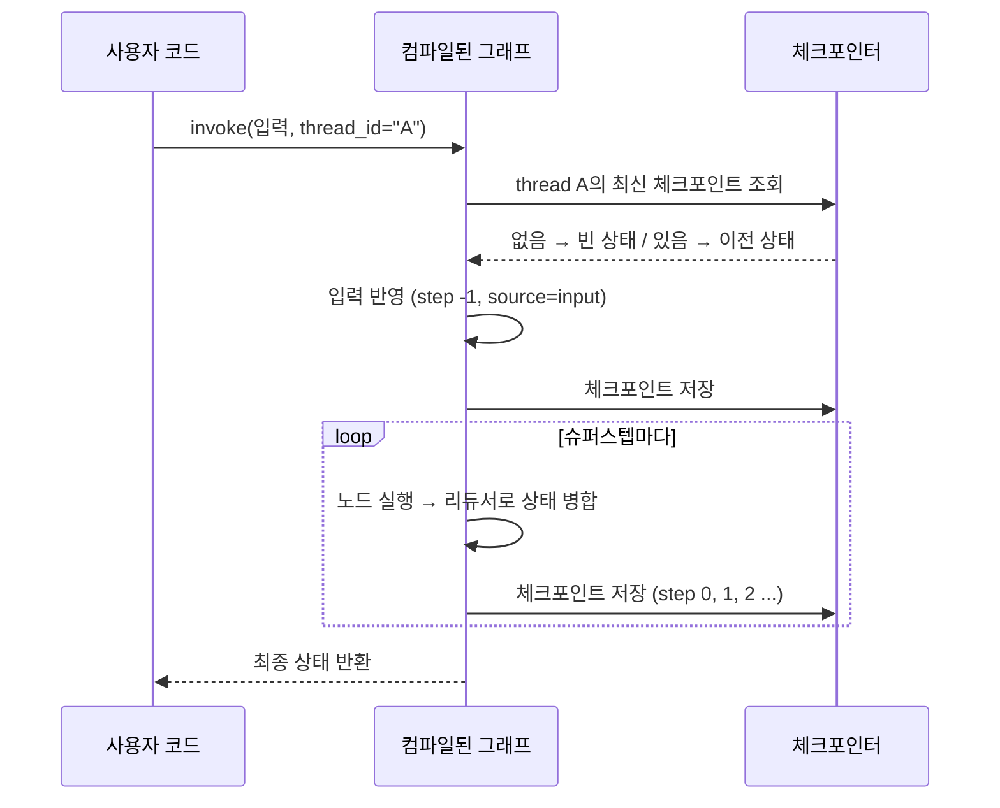
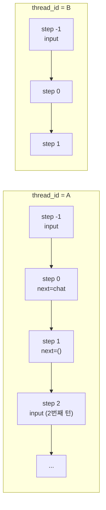
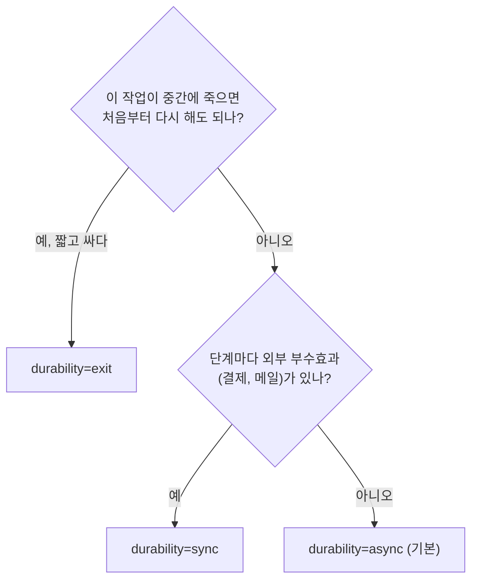

## 왜 필요한가: "방금 뭐라고 했죠?"를 묻는 에이전트

04 모듈에서 만든 그래프는 `invoke()`가 끝나는 순간 모든 것을 잊어버립니다. 상태(State)는 함수 호출이 끝나면 사라지는 파이썬 딕셔너리일 뿐이기 때문입니다. 하지만 현실의 에이전트는 다음을 해야 합니다.

- **여러 턴에 걸친 대화**: "내 이름은 민수야" → (다음 요청) "내 이름이 뭐였지?"
- **사람의 승인 기다리기**: 결제 직전에 멈췄다가, 30분 뒤 매니저가 승인 버튼을 누르면 *그 지점부터* 이어서 실행 (→ 5.3에서 자세히)
- **과거로 돌아가 디버깅하기**: "3단계 전에 다른 선택을 했다면?" (→ 5.2에서 자세히)
- **서버가 죽어도 이어서 실행하기**: 20분짜리 리서치 작업 도중 배포로 프로세스가 재시작돼도 처음부터 다시 하지 않기 (→ 5.5에서 자세히)

이 네 가지는 모두 **하나의 기능** 위에 서 있습니다. 바로 **체크포인터(Checkpointer)** 입니다. 게임에 비유하면 체크포인터는 "자동 저장" 기능이고, 체크포인트는 "세이브 파일", 스레드는 "세이브 슬롯"입니다. 슬롯 1에는 민수와의 대화가, 슬롯 2에는 지영과의 대화가 따로 저장되고, 각 슬롯 안에는 시간순으로 세이브 파일이 차곡차곡 쌓입니다.

> [!NOTE]
> 03 모듈 4강(memory-and-context)에서 `create_agent(..., checkpointer=InMemorySaver())`와 `thread_id`로 단기 메모리를 만들어 봤습니다. 이번 강의는 그 아래에서 **실제로 무슨 일이 일어나는지**를 LangGraph 수준에서 해부합니다. `create_agent`가 만든 에이전트도 결국 LangGraph 그래프이므로 오늘 배우는 내용이 그대로 적용됩니다.

## 핵심 개념

### 1. 체크포인트(Checkpoint) = 슈퍼스텝마다 찍는 상태 스냅샷

LangGraph는 그래프를 **슈퍼스텝(superstep)** 단위로 실행합니다(04 모듈 4강 참고). 체크포인터를 붙여 컴파일하면, LangGraph는 각 슈퍼스텝이 끝날 때마다 그 시점의 전체 상태를 하나의 **체크포인트**로 저장합니다. 체크포인트에는 다음이 들어 있습니다.

| 필드 | 의미 |
| --- | --- |
| `values` | 그 시점의 상태 값 (예: `{"messages": [...]}`) |
| `next` | 다음에 실행될 노드 이름 튜플. 비어 있으면 실행이 끝난 것 |
| `config` | 이 체크포인트를 가리키는 주소: `thread_id` + `checkpoint_id` |
| `metadata` | `step`(몇 번째 단계인지), `source`(`input`/`loop`/`update`/`fork`) 등 |
| `parent_config` | 바로 이전 체크포인트의 주소 → 체크포인트들이 연결 리스트를 이룸 |
| `tasks` / `interrupts` | 대기 중인 작업, 에러, interrupt 정보 |

파이썬에서는 이것을 `StateSnapshot`이라는 named tuple로 돌려받습니다.

### 2. 스레드(Thread) = 체크포인트들이 쌓이는 독립된 타임라인

**스레드**는 `thread_id`라는 문자열로 식별되는 하나의 대화(또는 작업) 단위입니다. 같은 `thread_id`로 다시 `invoke()`하면 LangGraph는 그 스레드의 **최신 체크포인트를 불러와서** 거기에 새 입력을 합칩니다. 다른 `thread_id`를 쓰면 완전히 빈 상태에서 시작합니다.

```python
config = {"configurable": {"thread_id": "user-42:session-7"}}
graph.invoke({"messages": [("user", "안녕")]}, config)
```

> [!IMPORTANT]
> 체크포인터를 붙인 그래프는 **반드시** `configurable.thread_id`를 받아야 합니다. 빠뜨리면 `ValueError: Checkpointer requires one or more of the following 'configurable' keys: thread_id, checkpoint_ns, checkpoint_id` 에러가 납니다. 현업에서는 `thread_id`를 "사용자 ID + 세션 ID" 처럼 **추측 불가능하고 테넌트가 구분되는** 값으로 만듭니다.

### 3. 동작 원리



체크포인트들은 `parent_config`로 이어진 사슬이 됩니다. 이 사슬을 거꾸로 따라가는 것이 `get_state_history()`이고, 사슬의 특정 지점에서 가지를 치는 것이 5.2의 타임 트래블입니다.



### 4. 체크포인터 구현체 고르기

| 구현체 | 패키지 | 용도 |
| --- | --- | --- |
| `InMemorySaver` | `langgraph` 기본 포함 | 학습, 단위 테스트. 프로세스가 끝나면 사라짐 |
| `SqliteSaver` / `AsyncSqliteSaver` | `langgraph-checkpoint-sqlite` | 로컬 앱, 실험, 단일 머신 데모 |
| `PostgresSaver` / `AsyncPostgresSaver` | `langgraph-checkpoint-postgres` | **프로덕션 표준**. 여러 서버가 같은 DB 공유 |
| Redis, MongoDB 등 | 커뮤니티/파트너 패키지 | 이미 해당 인프라가 있을 때 |

모든 구현체는 `BaseCheckpointSaver`라는 같은 인터페이스를 따르므로 **그래프 코드는 바꾸지 않고 `compile(checkpointer=...)` 한 줄만 바꾸면** 됩니다. 이것이 학습은 `InMemorySaver`로, 배포는 `PostgresSaver`로 하는 것이 자연스러운 이유입니다.

## 코드 해설

### 예제 1 — InMemorySaver와 스레드 분리

▶ 오른쪽 IDE의 `examples/01_threads.py`를 실행해 보세요.

핵심은 세 줄입니다.

```python
checkpointer = InMemorySaver()
graph = builder.compile(checkpointer=checkpointer)    # ① 컴파일할 때 붙인다
graph.invoke({"messages": [...]}, {"configurable": {"thread_id": "minsu"}})  # ② 스레드 지정
```

예제는 "민수" 스레드에 두 번 말을 걸고, "지영" 스레드에 한 번 말을 겁니다. 출력에서 민수 스레드의 메시지 수는 계속 늘어나지만 지영 스레드는 독립적으로 시작하는 것을 확인하세요. `add_messages` 리듀서가 이전 체크포인트의 메시지 목록에 새 메시지를 **이어 붙이기** 때문에 대화가 누적됩니다. 리듀서가 없는 필드라면 새 입력이 값을 덮어씁니다(04 모듈 2강).

### 예제 2 — SqliteSaver로 "프로세스 재시작" 견디기

▶ `examples/02_sqlite_history.py`를 실행해 보세요.

`InMemorySaver`는 파이썬 프로세스 메모리에 저장하므로 프로그램이 끝나면 사라집니다. 예제 2는 임시 폴더에 SQLite 파일을 만들고, **연결을 닫았다가 새 연결과 새 그래프 객체로 다시 여는** 방식으로 서버 재시작을 흉내 냅니다. 새 그래프가 같은 `thread_id`로 이전 대화를 그대로 이어 가는 것을 볼 수 있습니다.

```python
import sqlite3
from langgraph.checkpoint.sqlite import SqliteSaver

conn = sqlite3.connect(db_path, check_same_thread=False)
checkpointer = SqliteSaver(conn)       # 또는: with SqliteSaver.from_conn_string(path) as cp:
```

> [!TIP]
> `SqliteSaver.from_conn_string(...)`은 **컨텍스트 매니저**입니다. `with` 블록 안에서만 유효하므로, 그래프를 블록 밖에서 계속 쓰려면 예제처럼 `sqlite3.connect`로 연결을 직접 만들어 넘기세요. `check_same_thread=False`는 LangGraph가 내부적으로 다른 스레드에서 DB에 접근할 수 있기 때문에 필요합니다.

이어서 예제는 `get_state()`와 `get_state_history()`를 출력합니다.

```python
snapshot = graph.get_state(config)          # 최신 체크포인트 1개
snapshot.values["messages"]                 # 상태 값
snapshot.next                               # () 이면 완료
snapshot.metadata["step"], snapshot.metadata["source"]

for s in graph.get_state_history(config):   # 최신 → 과거 순서
    print(s.metadata["step"], s.next, s.config["configurable"]["checkpoint_id"])
```

히스토리는 **최신이 먼저** 나옵니다. `source`가 `input`인 체크포인트는 사용자의 입력이 들어온 시점, `loop`는 노드 실행이 끝난 시점입니다. `limit=`, `before=`, `filter=` 인자로 범위를 좁힐 수 있습니다.

### 예제 3 — 내구성 모드(durability)

▶ `examples/03_durability.py`를 실행해 보세요.

체크포인트를 매 단계 저장하는 것은 공짜가 아닙니다. 저장소가 원격 Postgres라면 매 슈퍼스텝마다 네트워크 왕복이 생깁니다. 그래서 LangGraph는 `invoke`/`stream`에 `durability` 인자를 제공합니다.

| 모드 | 동작 | 장점 | 단점 |
| --- | --- | --- | --- |
| `"exit"` | 그래프가 끝날 때(완료·에러·interrupt)만 저장 | 가장 빠름 | 실행 도중 프로세스가 죽으면 중간 진행이 사라짐, 중간 히스토리 없음 |
| `"async"` (기본) | 다음 단계를 실행하는 **동안** 비동기로 저장 | 성능과 안전성의 균형 | 저장이 끝나기 전에 프로세스가 죽으면 마지막 단계가 유실될 수 있음 |
| `"sync"` | 다음 단계로 넘어가기 **전에** 저장 완료를 기다림 | 가장 안전, 모든 단계 복구 가능 | 단계마다 저장 지연이 더해짐 |

```python
graph.invoke(inputs, config, durability="sync")
```

예제는 같은 3단계 그래프를 세 모드로 실행한 뒤 스레드별 히스토리 개수를 비교합니다. `"exit"` 모드는 중간 체크포인트가 남지 않아 히스토리가 훨씬 짧습니다. 이것은 곧 **5.2의 타임 트래블로 돌아갈 지점이 없다**는 뜻이기도 합니다.



## 현업에서는

### PostgresSaver로 프로덕션 구성

실행 예제에서는 네트워크가 필요한 DB를 쓰지 않지만, 실제 서비스는 거의 항상 Postgres를 씁니다. 여러 API 서버 인스턴스가 같은 DB를 공유하므로, 사용자가 1번 서버에서 시작한 대화를 3번 서버가 이어받을 수 있습니다.

```python
# pip install langgraph-checkpoint-postgres "psycopg[binary,pool]"
from langgraph.checkpoint.postgres import PostgresSaver
from langgraph.checkpoint.postgres.aio import AsyncPostgresSaver

DB_URI = "postgresql://agent:secret@db:5432/agent?sslmode=require"

# 동기 버전: 앱 시작 시 한 번
with PostgresSaver.from_conn_string(DB_URI) as checkpointer:
    checkpointer.setup()            # 최초 1회: 테이블/마이그레이션 생성
    graph = builder.compile(checkpointer=checkpointer)
    graph.invoke(inputs, {"configurable": {"thread_id": thread_id}})

# FastAPI 같은 비동기 서버: lifespan에서 열고 닫는다 (→ 8.5에서 자세히)
async with AsyncPostgresSaver.from_conn_string(DB_URI) as checkpointer:
    await checkpointer.setup()
    graph = builder.compile(checkpointer=checkpointer)
    await graph.ainvoke(inputs, config, durability="sync")
```

> [!WARNING]
> `setup()`은 **마이그레이션 단계에서 한 번만** 실행하세요. 요청마다 호출하면 불필요한 DDL이 실행됩니다. 연결은 커넥션 풀(`psycopg_pool.ConnectionPool`)로 관리하고, 풀로 연결을 직접 만들 때는 `autocommit=True`, `row_factory=dict_row` 설정이 필요합니다.

### 그 밖의 저장소

Redis(`langgraph-checkpoint-redis`), MongoDB(`langgraph-checkpoint-mongodb`) 같은 구현체도 있습니다. 공식/파트너 패키지의 버전과 지원 기능(TTL, 비동기)을 먼저 확인하고 고르세요. LangGraph Platform(Agent Server)에 배포하면 체크포인터를 플랫폼이 Postgres로 자동 구성해 주므로 `compile()`에 직접 넘기지 않습니다(→ 8.5).

### 운영 체크리스트

- **용량 관리**: 체크포인트는 매 단계 전체 상태를 저장합니다. 메시지가 수백 개인 스레드는 금방 커집니다. 오래된 스레드는 `checkpointer.delete_thread(thread_id)`로 지우거나 DB 레벨 TTL 정책을 두세요. 메시지 요약(03 모듈 4강)으로 상태 자체를 작게 유지하는 것도 효과적입니다.
- **직렬화**: 상태에는 JSON/msgpack으로 직렬화 가능한 값만 넣으세요. DB 연결, 파일 핸들, 클라이언트 객체를 상태에 넣으면 저장 단계에서 실패합니다. 이런 것은 `context`(Runtime)로 주입합니다.
- **보안**: 체크포인트에는 대화 원문, 도구 결과(개인정보 포함 가능)가 평문으로 들어갑니다. DB 암호화, 접근 통제, 필요하면 암호화 직렬화기(`EncryptedSerializer`)를 검토하세요(→ 8.3).
- **thread_id 설계**: `f"{tenant_id}:{user_id}:{session_id}"`처럼 구성하고, API에서는 요청자가 그 스레드의 소유자인지 반드시 확인합니다. 남의 `thread_id`를 넣으면 남의 대화가 이어지는 사고가 실제로 일어납니다.
- **관측성**: LangSmith 트레이스의 metadata에 `thread_id`가 함께 기록되므로, 사용자 문의가 오면 스레드 단위로 전체 대화를 추적할 수 있습니다(→ 8.2).
- **테스트**: 단위 테스트에서는 `InMemorySaver`를 쓰고, 통합 테스트에서만 실제 Postgres 컨테이너를 띄우는 것이 일반적입니다.

### 안티패턴

- 요청마다 `InMemorySaver()`를 새로 만들기 → 매번 빈 기억으로 시작합니다. 체크포인터는 **앱 수명 동안 하나**만 만듭니다.
- 모든 사용자에게 같은 `thread_id` 사용 → 대화가 섞입니다.
- 장기적으로 기억해야 할 사실(사용자 선호)을 체크포인트에만 두기 → 스레드가 바뀌면 사라집니다. 이것은 **Store**의 역할입니다(→ 5.4).

## 정리

- **체크포인터**는 슈퍼스텝마다 상태 스냅샷(**체크포인트**)을 저장합니다. `compile(checkpointer=...)`로 붙입니다.
- **스레드**(`thread_id`)는 체크포인트가 쌓이는 독립된 타임라인입니다. 같은 스레드로 호출하면 이전 상태에서 이어집니다.
- `get_state()`는 최신 스냅샷, `get_state_history()`는 최신→과거 순서의 전체 이력을 돌려줍니다. `next`가 비어 있으면 실행 완료입니다.
- `durability`는 `"exit"`(빠름) / `"async"`(기본, 균형) / `"sync"`(가장 안전) 중에서 고릅니다.
- 학습·테스트는 `InMemorySaver`/`SqliteSaver`, 프로덕션은 `PostgresSaver`. 그래프 코드는 그대로 두고 체크포인터만 교체합니다.

다음 강의에서는 이렇게 쌓인 체크포인트 사슬을 거슬러 올라가 **과거를 다시 실행하고 다른 미래로 가지를 치는** 타임 트래블을 배웁니다.
