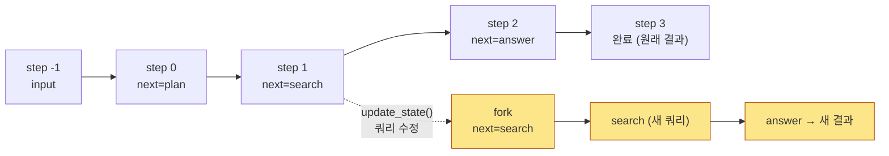
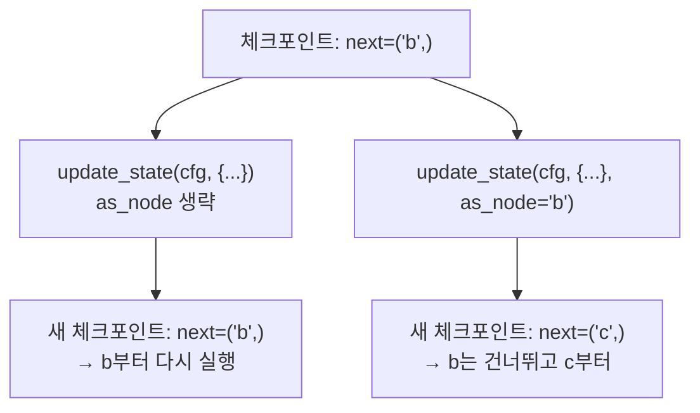

## 왜 필요한가: "그때 다른 도구를 골랐다면?"

에이전트를 운영하다 보면 이런 버그 리포트를 받습니다.

> "고객이 환불을 요청했는데, 에이전트가 3번째 단계에서 엉뚱한 주문번호로 조회를 했어요."

일반 프로그램이라면 디버거로 그 줄에 중단점을 걸고 다시 실행하면 됩니다. 하지만 에이전트는 다릅니다.

1. **비결정적(non-deterministic)** 입니다. 같은 입력으로 다시 돌려도 LLM이 다른 길로 갈 수 있어서 버그가 재현되지 않습니다.
2. **비쌉니다.** 10단계짜리 실행을 문제 지점까지 다시 돌리면 앞의 LLM 호출 비용과 시간을 그대로 다시 냅니다.
3. **부수효과가 있습니다.** 처음부터 다시 돌리면 이미 보낸 이메일을 또 보낼 수도 있습니다.

5.1에서 체크포인터가 **슈퍼스텝마다 상태를 저장**한다는 것을 배웠습니다. 그렇다면 "3번째 단계 직전"의 상태가 이미 DB에 그대로 있다는 뜻입니다. 거기서부터 다시 실행하거나, 그 상태를 살짝 고쳐서 다른 미래를 실험할 수 있다면? 이것이 **타임 트래블(Time Travel)** 입니다.

- **리플레이(Replay)**: 과거 체크포인트에서 실행을 *다시 시작*합니다. 그 이전 단계는 다시 실행하지 않습니다.
- **포크(Fork)**: 과거 체크포인트의 상태를 *수정*해서 새 가지를 만들고, 거기서 실행합니다. 원래 이력은 그대로 남습니다.

비유하자면 게임에서 보스전 직전 세이브 파일을 불러오는 것이 리플레이이고, 그 세이브 파일에서 장비를 바꿔 끼우고 "다른 이름으로 저장"한 뒤 다시 싸우는 것이 포크입니다.

## 핵심 개념

### 체크포인트는 트리다

5.1에서는 체크포인트를 일렬로 이어진 사슬로 그렸습니다. 정확히 말하면 체크포인트는 `parent_config`로 연결된 **트리**입니다. 평소에는 가지가 하나뿐이라 사슬처럼 보일 뿐입니다. 과거 체크포인트에서 다시 실행하거나 `update_state`를 호출하면 그 지점에서 **새 가지**가 자랍니다.



스레드의 "최신 상태"(`get_state(thread_config)`)는 **가장 최근에 만들어진 체크포인트**를 가리킵니다. 포크한 뒤 실행하면 그 포크 가지의 끝이 최신 상태가 됩니다. 원래 가지는 지워지지 않으므로 `get_state_history()`로 언제든 다시 찾을 수 있습니다.

### 시점 지정: checkpoint_id가 담긴 config

`get_state_history()`가 돌려주는 각 `StateSnapshot`의 `config`에는 `thread_id`와 함께 `checkpoint_id`가 들어 있습니다.

```python
{"configurable": {"thread_id": "t1", "checkpoint_ns": "", "checkpoint_id": "1f0...-8002-..."}}
```

이 config를 그래프 메서드에 넘기면 "최신"이 아니라 **그 시점**을 기준으로 동작합니다.

| 호출 | 의미 |
| --- | --- |
| `graph.get_state(snapshot.config)` | 그 시점의 상태 조회 |
| `graph.invoke(None, snapshot.config)` | 그 시점부터 **리플레이**. 입력이 `None`이면 "새 입력 없이 이어서 실행"이라는 뜻 |
| `graph.update_state(snapshot.config, values)` | 그 시점에서 상태를 고친 **새 체크포인트(포크)** 를 만들고 그 config를 반환 |
| `graph.invoke(None, new_config)` | 포크 지점부터 실행 |

### 원하는 체크포인트 찾기

실무에서 가장 많이 쓰는 방법은 `next`로 찾는 것입니다. "`search` 노드가 실행되기 직전"은 곧 "`next`에 `search`가 들어 있는 체크포인트"입니다.

```python
history = list(graph.get_state_history(config))          # 최신 → 과거
before_search = next(s for s in history if s.next == ("search",))
```

같은 노드가 루프에서 여러 번 실행되었다면 여러 개가 걸립니다. 이때는 `metadata["step"]`이나 상태 값(예: 메시지 수)으로 좁힙니다.

### update_state와 as_node

`update_state(config, values, as_node=None)`는 **마치 어떤 노드가 그 값을 반환한 것처럼** 상태를 갱신합니다. 두 가지를 기억하세요.

1. **리듀서가 적용됩니다.** `messages`처럼 `add_messages` 리듀서가 붙은 필드에 메시지를 넘기면 *덮어쓰기가 아니라 추가*됩니다. 기존 메시지를 바꾸고 싶다면 **같은 `id`를 가진 메시지**를 넘기면 `add_messages`가 그 메시지를 교체합니다.
2. **`as_node`가 다음 실행 지점을 결정합니다.** `as_node="b"`로 업데이트하면 LangGraph는 "b가 방금 끝났다"고 간주하고, 그래프의 엣지를 따라 b 다음 노드를 `next`로 잡습니다. 즉 **b를 사람이 직접 대신 실행**한 셈이 되어 b는 건너뛰게 됩니다. `as_node`를 생략하면 그 체크포인트를 마지막으로 갱신한 노드로 간주되므로, 원래 `next`가 유지됩니다.



## 코드 해설

### 예제 1 — 리플레이

▶ 오른쪽 IDE의 `examples/01_replay.py`를 실행해 보세요.

예제는 `plan → search → answer` 3단계 리서치 그래프를 만들고, 각 노드가 몇 번 실행되었는지 세는 카운터를 둡니다. 전체를 한 번 실행한 뒤, `search` 실행 직전 체크포인트를 찾아 `invoke(None, before_search.config)`로 리플레이합니다.

출력에서 확인할 점:

- 리플레이 후 `plan` 카운터는 **그대로 1**입니다. 그 이전 단계는 체크포인트에서 복원될 뿐 다시 실행되지 않습니다.
- `search`와 `answer`는 한 번 더 실행되어 2가 됩니다.
- 스레드의 체크포인트 개수가 늘어납니다. 리플레이도 **새 가지**를 만들며, 원래 이력은 남아 있습니다.

> [!NOTE]
> 실제 LLM 노드라면 리플레이 결과가 원래 결과와 다를 수 있습니다. 리플레이는 "같은 결과를 보여 주는 녹화 재생"이 아니라 "그 시점부터 **다시 실행**"입니다. 그래서 비결정적인 버그를 재현할 때 같은 체크포인트에서 여러 번 리플레이해 보는 기법이 유용합니다.

### 예제 2 — 상태를 고쳐 포크하기

▶ `examples/02_fork.py`를 실행해 보세요.

시나리오는 이렇습니다. `plan` 노드가 검색어를 `"랭그래프"`로 잘못 정했고, 그 때문에 엉뚱한 답이 나왔습니다. 우리는 `search` 직전 체크포인트로 돌아가 검색어만 `"LangGraph checkpointer"`로 고쳐서 다시 실행합니다.

```python
fork_config = graph.update_state(before_search.config, {"query": "LangGraph checkpointer"})
graph.invoke(None, fork_config)
```

이어서 예제는 `as_node="search"`로 **사람이 검색 결과를 직접 넣어 주는** 두 번째 포크도 만듭니다. 이 경우 `search` 노드는 실행되지 않고 바로 `answer`로 넘어갑니다. 테스트에서 외부 API를 부르지 않고 "검색 결과가 이랬다면 답은?"을 실험할 때 아주 유용합니다.

마지막으로 예제는 원래 결과·포크 1·포크 2를 나란히 출력하고, `get_state_history`에서 `metadata["source"]`가 `"update"`인 체크포인트(사람이 고친 지점)를 보여 줍니다.

### 에이전트(create_agent)에서의 타임 트래블

`create_agent`가 만든 에이전트도 LangGraph 그래프라서 똑같이 동작합니다. 예를 들어 모델이 도구를 잘못된 인자로 호출한 AIMessage를 고치고 싶다면, 그 메시지의 `id`를 유지한 채 `tool_calls`만 바꾼 새 AIMessage를 `update_state`로 넣으면 됩니다.

```python
snap = next(s for s in agent.get_state_history(cfg) if s.next == ("tools",))
bad = snap.values["messages"][-1]                       # 잘못된 tool_call을 가진 AIMessage
fixed = bad.model_copy(update={"tool_calls": [{**bad.tool_calls[0], "args": {"order_id": "A-1234"}}]})
new_cfg = agent.update_state(snap.config, {"messages": [fixed]})   # 같은 id → 교체
agent.invoke(None, new_cfg)
```

▶ `examples/03_agent_fix_tool_call.py`에서 이 과정을 직접 실행해 볼 수 있습니다. Mock 모드에서는 모델이 엉터리 주문번호로 도구를 호출하는데, 우리가 인자를 `A-1234`로 고쳐 포크하면 올바른 배송 상태가 조회됩니다. 고친 메시지가 **추가되지 않고 교체**되었다는 점(도구 호출 AIMessage가 여전히 1개)을 assert로 확인합니다.

이 패턴은 5.3의 Human-in-the-loop "편집(edit)" 결정과 원리가 같습니다. HITL은 실행 *도중* 멈춰서 고치고, 타임 트래블은 실행 *이후* 과거로 가서 고친다는 차이만 있습니다.

## 현업에서는

### 디버깅 워크플로

1. 사용자 신고 → LangSmith 트레이스에서 `thread_id` 확인 (→ 8.2)
2. 운영 DB의 체크포인터에 **읽기 전용**으로 붙어 `get_state_history`로 문제 단계 특정
3. 해당 체크포인트를 **스테이징 환경의 별도 thread로 복사**하거나, 도구를 Mock으로 바꾼 그래프로 리플레이
4. 프롬프트/도구 설명을 고친 새 그래프로 같은 체크포인트에서 리플레이 → 수정이 효과 있는지 확인
5. 그 체크포인트 상태를 **회귀 테스트 케이스**로 저장

> [!CAUTION]
> 운영 스레드에서 직접 리플레이하면 **도구의 부수효과(결제, 이메일 발송, DB 쓰기)가 다시 일어납니다.** 타임 트래블은 "되돌리기(undo)"가 아닙니다. 외부 세계에 이미 일어난 일은 되돌려지지 않습니다. 부수효과가 있는 도구는 멱등성 키를 쓰거나(→ 5.5), 리플레이용 그래프에서는 Mock 도구를 주입하세요.

### 체크포인트 상태를 테스트 픽스처로

```python
# 운영에서 문제를 일으킨 체크포인트를 테스트용으로 고정해 두기
snap = prod_graph.get_state({"configurable": {"thread_id": tid, "checkpoint_id": cid}})
fixture = {"messages": snap.values["messages"]}           # 직렬화해 tests/fixtures/에 저장

# 테스트: 새 버전 그래프가 이 상태에서 올바른 도구를 고르는지 검증 (InMemorySaver 사용)
test_graph = builder.compile(checkpointer=InMemorySaver())
cfg = {"configurable": {"thread_id": "regression-17"}}
test_graph.update_state(cfg, fixture, as_node="model")   # 빈 스레드에 상태 주입
```

빈 스레드에 `update_state`로 상태를 주입하는 기법은 "중간 단계부터 시작하는 테스트"를 만들 때 매우 강력합니다. 앞 단계의 LLM 호출 비용 없이 문제 지점만 반복 실험할 수 있습니다.

### 그 밖의 팁

- **`durability="exit"`로 실행한 스레드는 중간 체크포인트가 없어** 타임 트래블 지점이 없습니다(5.1). 디버깅이 중요한 환경에서는 기본값(`"async"`)을 유지하세요.
- 포크가 많아지면 스토리지가 늘어납니다. 실험용 포크는 별도 스레드에서 하고 끝나면 `delete_thread`로 정리합니다.
- UI에서 "이 답변 다시 생성"이나 "이 메시지 편집 후 다시 보내기"(ChatGPT의 메시지 편집 기능 같은 것)는 정확히 **포크**로 구현합니다. 사용자의 메시지 `id`를 유지한 채 내용을 바꿔 `update_state`하고 `invoke(None, ...)` 하면 됩니다.
- 체크포인트 config는 내부 식별자입니다. 클라이언트에 `checkpoint_id`를 노출한다면, 그 체크포인트가 요청자 소유 스레드에 속하는지 서버에서 반드시 검증하세요.

## 정리

- 체크포인트는 `parent_config`로 연결된 **트리**입니다. 과거 지점에서 실행하면 새 가지가 생기고 원래 이력은 보존됩니다.
- **리플레이**: `graph.invoke(None, past_snapshot.config)` — 그 이전 노드는 다시 실행되지 않습니다.
- **포크**: `new_cfg = graph.update_state(past_config, values, as_node=...)` → `graph.invoke(None, new_cfg)`.
- `update_state`에는 **리듀서가 적용**되고, `as_node`는 "어느 노드가 방금 실행된 것으로 볼지"를 정해 다음 실행 지점을 바꿉니다.
- 타임 트래블은 디버깅, 회귀 테스트, "메시지 편집 후 재생성" UX의 기반이지만 외부 부수효과를 되돌리지는 않습니다.

다음 강의에서는 실행 *도중*에 그래프를 멈추고 사람의 결정을 받아 이어 가는 **Human-in-the-loop**를 배웁니다.
