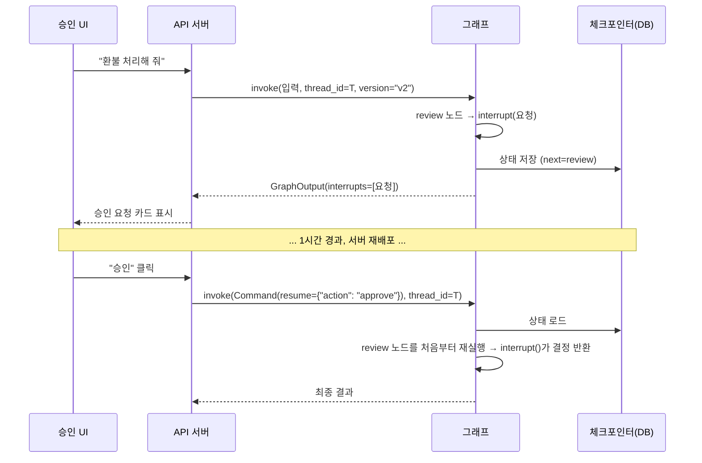
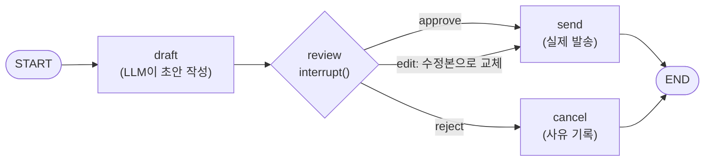

## 왜 필요한가: 자율성에는 브레이크가 필요하다

에이전트에게 이메일 발송, 환불 처리, 프로덕션 DB 수정 같은 **되돌릴 수 없는 행동**을 맡긴다고 생각해 보세요. LLM은 확률적으로 동작하므로 아무리 프롬프트를 잘 써도 가끔 틀립니다. 1,000건 중 1건만 엉뚱한 고객에게 100만 원을 환불해도 큰 사고입니다.

그래서 현업 에이전트는 대부분 **사람이 중간에 끼어드는 지점**을 둡니다. 이것을 Human-in-the-loop(HITL)라고 부릅니다.

- **승인(Approve)**: "이 메일 보내도 될까요?" → 예
- **편집(Edit)**: "수신자를 바꿔서 보내세요" → 수정된 인자로 실행
- **거절(Reject)**: "보내지 마세요, 이유는 ~" → 실행하지 않고 이유를 에이전트에게 전달
- **입력 요청(Ask)**: "배송지 주소를 알려 주세요" → 사람의 답을 받아 계속

어려운 점은 **사람은 느리다**는 것입니다. 승인 담당자가 점심을 먹고 1시간 뒤에 버튼을 누를 수도 있습니다. 그동안 파이썬 프로세스를 `input()`으로 붙잡아 둘 수는 없습니다. 서버는 그 사이 재배포될 수도 있습니다. 해결책은 5.1에서 배운 체크포인터입니다. **멈춘 시점의 상태를 저장해 두고 프로세스는 놓아 준 뒤, 사람의 답이 오면 저장된 지점부터 이어서 실행**합니다.

## 핵심 개념

### interrupt()와 Command(resume=...)

```python
from langgraph.types import interrupt, Command

def review(state):
    decision = interrupt({"question": "이 메일을 보낼까요?", "draft": state["draft"]})
    # ↑ 첫 실행: 여기서 그래프가 멈추고, 이 dict가 호출자에게 전달된다
    # ↑ 재개 시: interrupt()가 Command(resume=값)의 '값'을 반환한다
    ...
```

1. 노드 안에서 `interrupt(value)`를 호출하면 LangGraph는 특수 예외를 던져 실행을 멈추고, 현재 상태를 체크포인트로 저장하고, `value`를 호출자에게 돌려줍니다.
2. 호출자는 `value`를 UI에 보여 주고 사람의 결정을 받습니다(몇 초 후든, 며칠 후든).
3. 같은 `thread_id`로 `graph.invoke(Command(resume=결정), config)`를 호출하면, 멈춘 노드가 **다시 실행**되고 이번에는 `interrupt()`가 `결정`을 반환합니다.

> [!IMPORTANT]
> `interrupt`는 상태를 저장해야 하므로 **체크포인터가 반드시 필요**합니다. 그리고 `value`와 resume 값은 직렬화 가능한 값(dict, str, list 등)이어야 합니다.

### 멈춘 것을 어떻게 알까: version="v2"와 GraphOutput

`invoke(..., version="v2")`로 호출하면 결과가 `GraphOutput` 객체로 옵니다. `.value`에는 상태가, `.interrupts`에는 대기 중인 `Interrupt` 튜플이 들어 있습니다. 각 `Interrupt`는 `.value`(interrupt에 넘긴 값)와 `.id`(재개할 때 쓰는 고유 ID)를 가집니다.

```python
out = graph.invoke(inputs, config, version="v2")
if out.interrupts:
    for intr in out.interrupts:
        print(intr.id, intr.value)          # UI에 보여 줄 내용
else:
    print(out.value)                        # 최종 상태
```

기본값(`version="v1"`)에서는 결과 dict의 `"__interrupt__"` 키에 같은 정보가 들어 있습니다. `graph.get_state(config).interrupts`와 `.next`로도 멈춘 위치를 확인할 수 있으므로, 웹 서버에서는 "이 스레드가 지금 승인 대기 중인가?"를 이렇게 조회합니다.



### 가장 중요한 규칙: 재개하면 노드는 "처음부터" 다시 실행된다

LangGraph는 노드 함수의 *중간 줄*로 점프할 수 없습니다. 재개 시 멈췄던 **노드 전체를 처음부터 다시 실행**하고, `interrupt()` 호출을 만나면 저장된 resume 값을 돌려줄 뿐입니다. 여기서 세 가지 실무 규칙이 나옵니다.

1. **interrupt 앞에 부수효과를 두지 마세요.** `interrupt` 전에 이메일을 보내면 재개 시 한 번 더 보냅니다. 부수효과는 interrupt **뒤**나 **별도 노드**에 두거나, 멱등하게 만드세요(→ 5.5).
2. **`try/except Exception`으로 interrupt를 감싸지 마세요.** interrupt는 예외(`GraphInterrupt`)를 던지는 방식으로 멈춥니다. 넓은 except가 이것을 삼키면 그래프가 멈추지 않습니다.
3. **한 노드 안의 interrupt 순서를 바꾸지 마세요.** 한 노드에 interrupt가 여러 개면 LangGraph는 *호출 순서(인덱스)* 로 resume 값을 짝짓습니다. 조건에 따라 interrupt를 건너뛰거나 순서가 바뀌면 값이 엉뚱한 곳에 들어갑니다.

### 승인·편집·거절 패턴

`interrupt`의 반환값을 보고 `Command(goto=...)`로 경로를 정하는 것이 정석입니다(Command는 04 모듈 4강).



```python
def review(state) -> Command[Literal["send", "cancel"]]:
    decision = interrupt({"draft": state["draft"], "allowed": ["approve", "edit", "reject"]})
    if decision["action"] == "approve":
        return Command(goto="send")
    if decision["action"] == "edit":
        return Command(update={"draft": decision["draft"]}, goto="send")
    return Command(update={"reject_reason": decision.get("reason", "")}, goto="cancel")
```

반환 타입 힌트 `Command[Literal["send", "cancel"]]`는 그래프 시각화에 경로를 표시하는 용도입니다.

## 코드 해설

### 예제 1 — 이메일 승인 워크플로

▶ 오른쪽 IDE의 `examples/01_approve_edit_reject.py`를 실행해 보세요.

LLM이 초안을 쓰고, `review` 노드가 interrupt로 멈춥니다. 예제는 **세 개의 스레드**를 만들어 각각 승인·편집·거절로 재개합니다. 브라우저의 버튼 클릭 대신 스크립트 안에서 `Command(resume=...)`를 보내 사람의 입력을 흉내 냅니다.

출력에서 확인할 점:

- 첫 `invoke` 후 `out.interrupts[0].value`에 초안이 담겨 있고, `get_state(config).next`가 `('review',)`입니다.
- `review` 노드 맨 앞의 `print`가 **재개할 때 한 번 더** 찍힙니다. "노드는 처음부터 다시 실행된다"를 눈으로 확인하는 장치입니다.
- 실제 발송(`SENT_EMAILS`)은 승인·편집된 두 스레드에서만 일어납니다.

### 예제 2 — 여러 개의 interrupt

▶ `examples/02_multiple_interrupts.py`를 실행해 보세요. 두 가지 상황을 다룹니다.

**(1) 한 노드 안에서 반복 질문(입력 검증 루프)**: 나이를 물었는데 사람이 "스무살"이라고 답하면 다시 묻습니다. `while` 루프 안에서 `interrupt`를 여러 번 부르는 패턴인데, 재개할 때마다 노드가 처음부터 실행되면서 이전 답들은 저장된 순서대로 재사용되고 새 interrupt에서만 다시 멈춥니다. 루프에는 반드시 **최대 횟수**를 두세요.

**(2) 병렬 노드에서 동시에 interrupt**: 법무팀 검토와 보안팀 검토가 같은 슈퍼스텝에서 병렬로 실행되며 각각 interrupt를 겁니다. 이때 `out.interrupts`에 두 개가 함께 오고, **interrupt id → 값** 딕셔너리로 한 번에 재개합니다.

```python
answers = {intr.id: decide(intr.value) for intr in out.interrupts}
graph.invoke(Command(resume=answers), config, version="v2")
```

> [!TIP]
> interrupt가 하나뿐이면 `Command(resume=값)`으로 충분합니다. 여러 개가 동시에 대기 중이면 id 매핑을 쓰세요. 일부만 답하면 나머지는 계속 대기 상태로 남습니다.

### 예제 3 — create_agent + HumanInTheLoopMiddleware

▶ `examples/03_hitl_middleware.py`를 실행해 보세요.

`create_agent`로 만든 에이전트는 미들웨어 하나로 도구 실행 전 승인을 붙일 수 있습니다(미들웨어 구조는 03 모듈 3강).

```python
from langchain.agents.middleware import HumanInTheLoopMiddleware

agent = create_agent(
    MODEL,
    tools=[send_email, delete_file, search_docs],
    middleware=[
        HumanInTheLoopMiddleware(
            interrupt_on={
                "send_email": True,                                    # approve/edit/reject/respond 모두 허용
                "delete_file": {"allowed_decisions": ["approve", "reject"]},  # 편집 불가
                "search_docs": False,                                  # 승인 없이 자동 실행
            },
            interrupt_mode="batched",       # 기본값. "per_call"도 가능
        )
    ],
    checkpointer=InMemorySaver(),           # interrupt를 쓰므로 필수
)
```

`interrupt_on`에 없는 도구도 자동 실행됩니다. 결정 유형은 네 가지입니다.

| type | 형태 | 효과 |
| --- | --- | --- |
| `approve` | `{"type": "approve"}` | 원래 인자로 실행 |
| `edit` | `{"type": "edit", "edited_action": {"name": ..., "args": {...}}}` | 수정된 인자로 실행. 결과 앞에 "사람이 호출을 바꿨다"는 안내가 붙어 모델이 원래 호출을 반복하지 않게 함 |
| `reject` | `{"type": "reject", "message": "사유"}` | 실행하지 않고 사유를 ToolMessage로 모델에 전달 |
| `respond` | `{"type": "respond", "message": "답"}` | 실행하지 않고 사람의 답을 **도구 결과처럼** 전달 ("사용자에게 묻기" 도구에 유용) |

**interrupt_mode** 는 멈추는 단위를 정합니다.

- `"batched"`(기본): 모델이 한 턴에 여러 도구를 호출하면 **interrupt 하나**에 `action_requests` 목록으로 모아서 보냅니다. 재개는 `Command(resume={"decisions": [...]})`이고, decisions 순서는 action_requests 순서와 같아야 합니다.
- `"per_call"`: 승인이 필요한 도구 호출마다 **interrupt를 하나씩** 겁니다. 각 interrupt의 값은 `{"type": "tool_approval", "name", "args", ...}`이고, `response_schema`(허용 결정과 인자 스키마)가 함께 와서 LangGraph가 답을 저장하기 전에 검증합니다. 재개는 `Command(resume={interrupt_id: 결정, ...})`입니다. 라이브러리 문서에 따르면 다음 메이저 버전에서 기본값이 될 예정입니다.

`InterruptOnConfig`에는 `description`(승인 카드에 보여 줄 문구, 문자열 또는 함수)과 `when`(조건부 승인 술어)도 넣을 수 있습니다. 예를 들어 1만 원 이하 환불은 자동 승인하고 그 이상만 사람에게 묻는 식입니다. `when`은 재개 시 다시 호출되므로 **같은 호출에 항상 같은 답**을 내야 합니다.

## 현업에서는

### 서버 구조: 요청 두 번으로 나뉜 하나의 실행

```python
# FastAPI 스케치 (→ 8.5에서 자세히)
@app.post("/threads/{tid}/runs")
async def start(tid: str, body: Msg, user=Depends(auth)):
    check_owner(user, tid)
    out = await agent.ainvoke({"messages": [body.to_message()]},
                              {"configurable": {"thread_id": tid}}, version="v2")
    if out.interrupts:
        return {"status": "awaiting_approval",
                "interrupts": [{"id": i.id, "value": i.value} for i in out.interrupts]}
    return {"status": "done", "answer": out.value["messages"][-1].content}

@app.post("/threads/{tid}/resume")
async def resume(tid: str, body: Decisions, user=Depends(auth)):
    check_approver_role(user)                  # 승인 권한은 별도로 검사!
    out = await agent.ainvoke(Command(resume=body.decisions),
                              {"configurable": {"thread_id": tid}}, version="v2")
    ...
```

- 체크포인터는 반드시 **영구 저장소**(PostgresSaver)여야 합니다. `InMemorySaver`면 재배포 순간 대기 중인 승인이 모두 사라집니다.
- **승인 권한 검사**를 그래프 밖(API 계층)에서 하세요. 요청자와 승인자가 다른 경우가 많습니다.
- 대기 중인 스레드 목록, 승인까지 걸린 시간, 거절률을 지표로 남기세요. 거절률이 높은 도구는 프롬프트나 도구 설계를 고칠 신호입니다.
- 승인 요청에는 **사람이 판단할 수 있는 정보**를 담으세요. 원시 JSON 인자보다 "고객 홍길동(VIP)에게 120,000원 환불, 주문 A-1234, 사유: 파손"처럼 `description` 함수로 읽기 좋게 만드는 것이 거절·실수를 줄입니다.
- 오래 방치된 승인 요청은 타임아웃 정책(예: 24시간 후 자동 거절)을 별도 작업으로 처리합니다. LangGraph 자체가 대기 시간 제한을 걸지는 않습니다.

### 정적 중단점: interrupt_before / interrupt_after

`compile(interrupt_before=["send"])`처럼 특정 노드 앞뒤에 무조건 멈추는 **정적 중단점**도 있습니다. 재개는 `invoke(None, config)`입니다. 사람의 *값*을 받는 용도보다는 **디버깅용 브레이크포인트**에 적합합니다. 사람의 결정을 받는 프로덕션 승인 흐름에는 `interrupt()`를 쓰세요.

### 안티패턴

- interrupt 앞에서 결제 API 호출 → 재개 시 이중 결제
- `except Exception:`으로 노드 전체를 감싸기 → interrupt가 삼켜짐
- `if state["vip"]: interrupt(...)`처럼 재개 전후로 결과가 달라질 수 있는 조건 → resume 값이 엇갈림
- 모든 도구에 승인 걸기 → 승인 피로(alert fatigue)로 사람이 내용을 안 보고 승인 버튼만 누르게 됨. **위험한 도구만** 고르세요(→ 8.3 가드레일).

## 정리

- `interrupt(value)`는 상태를 저장하고 멈추며, `Command(resume=값)`으로 재개하면 그 값을 반환합니다. 체크포인터와 `thread_id`가 필수입니다.
- `invoke(..., version="v2")`의 `GraphOutput.interrupts`로 대기 중인 요청과 id를 확인합니다.
- 재개 시 노드는 **처음부터** 다시 실행됩니다 → 부수효과 위치, try/except, interrupt 순서에 주의하세요.
- 승인·편집·거절은 `interrupt` 반환값 + `Command(goto=..., update=...)`로 구현합니다.
- 여러 interrupt가 동시에 대기하면 `Command(resume={interrupt_id: 값})`으로 답합니다.
- `create_agent`에서는 `HumanInTheLoopMiddleware(interrupt_on=..., interrupt_mode=...)`로 도구 승인을 선언적으로 붙입니다.

다음 강의에서는 스레드를 넘어 사용자를 **오래 기억하는** 장기 메모리(Store)를 배웁니다.
