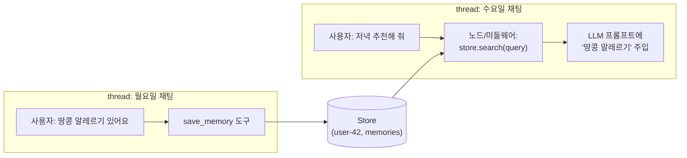
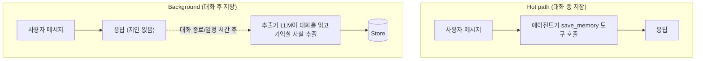

## 왜 필요한가: 새 대화를 열 때마다 "처음 뵙겠습니다"

5.1의 체크포인터 덕분에 에이전트는 **한 스레드 안에서는** 대화를 기억합니다. 하지만 사용자가 내일 새 채팅을 열면(새 `thread_id`) 에이전트는 다시 백지 상태입니다.

> 월요일: "저는 채식주의자예요. 그리고 땅콩 알레르기가 있어요."
> 수요일(새 채팅): "저녁 메뉴 추천해 줘." → 에이전트: "스테이크와 땅콩 소스 샐러드는 어떠세요?" 😱

좋은 비서는 사람을 기억합니다. 이를 위해 LangGraph는 체크포인터와 별개로 **Store**라는 저장소를 제공합니다.

| | 단기 메모리 (Checkpointer) | 장기 메모리 (Store) |
| --- | --- | --- |
| 범위 | 하나의 `thread_id` | 스레드를 가로질러 공유 (사용자·조직 단위) |
| 저장 단위 | 그래프 상태 전체 스냅샷 (자동) | 개발자가 고른 JSON 문서 (명시적) |
| 접근 방식 | 자동 로드/저장 | `put` / `get` / `search` 직접 호출 |
| 예 | 이번 대화의 메시지 목록 | "땅콩 알레르기", "답변은 짧게 선호" |
| 비유 | 오늘 회의의 화이트보드 | 고객 관리(CRM) 노트 |

## 핵심 개념

### 1. Store의 데이터 모델: 네임스페이스 + 키 + 값

Store는 **폴더 구조를 가진 JSON 문서 저장소**라고 생각하면 됩니다.

- **네임스페이스(namespace)**: 튜플로 된 경로. 예) `("user-42", "memories")`, `("org-7", "policies")`
- **키(key)**: 네임스페이스 안에서 문서를 구분하는 문자열
- **값(value)**: `dict` (JSON 직렬화 가능)

```python
from langgraph.store.memory import InMemoryStore

store = InMemoryStore()
ns = ("user-42", "memories")
store.put(ns, "allergy", {"text": "땅콩 알레르기 있음", "kind": "health"})
item = store.get(ns, "allergy")           # Item: .namespace .key .value .created_at .updated_at
items = store.search(ns, filter={"kind": "health"}, limit=10)
store.delete(ns, "allergy")
```

`search`의 첫 인자는 **네임스페이스 접두사(prefix)** 입니다. `("user-42",)`로 검색하면 `("user-42", "memories")`, `("user-42", "episodes")` 등 그 아래 전체를 찾습니다. `list_namespaces(prefix=...)`로 어떤 네임스페이스가 있는지도 볼 수 있습니다.

> [!IMPORTANT]
> 네임스페이스 설계는 곧 **보안 경계**입니다. 첫 요소를 사용자/테넌트 ID로 두면 "이 사용자 것만 검색"이 자연스럽게 보장됩니다. 사용자 ID는 반드시 LLM이 만든 인자가 아니라 **서버가 인증한 값(Runtime context)** 에서 가져오세요. LLM에게 `user_id`를 도구 인자로 받으면 프롬프트 인젝션으로 남의 메모리를 읽을 수 있습니다.

### 2. 시맨틱 검색: index 설정

"땅콩 알레르기"를 저장해 두고 "음식 제한이 있나요?"로 찾으려면 키워드 일치로는 부족합니다. Store를 만들 때 `index`를 주면 값을 **임베딩**해서 의미 기반으로 검색합니다(임베딩 원리는 → 6.1에서 자세히).

```python
from langchain_openai import OpenAIEmbeddings

store = InMemoryStore(
    index={
        "embed": OpenAIEmbeddings(model="text-embedding-3-small"),
        "dims": 1536,          # 임베딩 차원
        "fields": ["text"],    # 값의 어떤 필드를 임베딩할지 (기본: 값 전체)
    }
)
store.put(ns, "m1", {"text": "땅콩 알레르기 있음"})
store.put(ns, "m2", {"text": "회의록 원문 ..."}, index=False)   # 이 문서는 임베딩하지 않음
hits = store.search(ns, query="음식 제한", limit=3)              # hit.score = 유사도
```

`query`와 `filter`는 함께 쓸 수 있습니다. 먼저 필터로 후보를 좁히고 그 안에서 의미 검색을 하는 식입니다.

### 3. 그래프와 에이전트에서 store 쓰기

`compile(store=store)` 또는 `create_agent(..., store=store)`로 붙이면, 노드와 도구에서 꺼내 쓸 수 있습니다.

```python
from langgraph.runtime import Runtime

def call_model(state: MessagesState, runtime: Runtime[Context]):
    user_id = runtime.context["user_id"]                 # 서버가 넣어 준 인증된 값
    memories = runtime.store.search((user_id, "memories"), query=state["messages"][-1].content)
    ...

@tool
def save_memory(text: str, runtime: ToolRuntime[Context]) -> str:
    """사용자에 대해 기억할 사실을 저장한다."""
    runtime.store.put((runtime.context["user_id"], "memories"), str(uuid4()), {"text": text})
    return "저장했습니다"
```

`runtime` 파라미터는 LangGraph가 자동으로 주입하며, LLM이 보는 도구 스키마에는 나타나지 않습니다(02 모듈 4강의 ToolRuntime).



### 4. 무엇을 기억할 것인가: 메모리의 세 유형

인지과학의 분류를 빌려 에이전트 메모리를 세 가지로 나누면 설계가 쉬워집니다.

| 유형 | 사람에 비유 | 에이전트에서 | 저장 형태 예 |
| --- | --- | --- | --- |
| **Semantic** (의미 기억) | "서울은 수도다" 같은 사실 | 사용자 프로필, 선호, 사실 | `{"text": "채식주의자"}` 또는 하나의 프로필 문서 |
| **Episodic** (일화 기억) | "지난번 그 식당 실패했지" | 과거 상호작용·성공/실패 사례 | `{"situation": ..., "action": ..., "outcome": ...}` → few-shot 예시로 사용 |
| **Procedural** (절차 기억) | 자전거 타는 법 | 시스템 프롬프트, 작업 규칙 | `{"instructions": "답은 3문장 이내로"}` → 피드백으로 갱신 |

Semantic 메모리는 다시 두 방식으로 나뉩니다. **프로필(profile)** 은 하나의 문서를 계속 갱신하는 방식(이름, 언어, 직업…)이고, **컬렉션(collection)** 은 사실을 하나씩 문서로 쌓고 검색하는 방식입니다. 프로필은 항상 통째로 프롬프트에 넣기 쉽고, 컬렉션은 정보가 많아도 확장되지만 중복·모순 관리가 필요합니다.

### 5. 언제 저장할 것인가: hot path vs background



- **Hot path**: 즉시 반영되고 "기억해 둘게요" 같은 투명한 UX가 가능합니다. 대신 응답 지연이 늘고, 에이전트가 대화와 기억 관리를 동시에 하느라 산만해질 수 있습니다.
- **Background**: 응답 속도에 영향이 없고, 전용 프롬프트로 더 꼼꼼하게 추출·병합할 수 있습니다. 대신 바로 다음 턴에는 반영되지 않을 수 있습니다.

현업에서는 둘을 섞습니다. 사용자가 "기억해 줘"라고 명시하면 hot path로, 나머지는 대화가 끝난 뒤 백그라운드 작업(큐, 크론)으로 추출합니다.

## 코드 해설

### 예제 1 — Store 기본기

▶ 오른쪽 IDE의 `examples/01_store_basics.py`를 실행해 보세요.

두 사용자의 메모리를 네임스페이스로 분리해 저장하고, `get`/`search(filter=...)`/`list_namespaces`/`delete`를 차례로 실행합니다. 같은 키로 다시 `put`하면 **덮어쓰기(upsert)** 되는 것도 확인하세요. 값 전체가 교체되므로, 일부 필드만 바꾸려면 예제처럼 기존 값을 `get`해서 합친 뒤 넣어야 합니다. 프로필형 메모리를 이렇게 갱신합니다.

### 예제 2 — 시맨틱 검색

▶ `examples/02_semantic_search.py`를 실행해 보세요.

`index`를 켠 store에 여러 사실을 넣고 자연어 질의로 검색합니다. 결과의 `score`가 유사도입니다. Mock 모드의 임베딩은 단어가 겹칠수록 유사도가 높아지는 간이 구현이라, 실제 OpenAI 임베딩보다 의미 이해력이 떨어집니다. API 키를 넣고 다시 실행해 순위가 어떻게 달라지는지 비교해 보세요. 예제 후반은 `index=False`로 넣은 문서가 의미 검색 대상에서 빠지는 것(점수 `None`)도 보여 줍니다.

### 예제 3 — 기억하는 에이전트 (hot path + background)

▶ `examples/03_memory_agent.py`를 실행해 보세요.

- `create_agent`에 `store`와 `context_schema`를 붙이고, `save_memory` 도구(hot path)를 줍니다.
- `@dynamic_prompt` 미들웨어가 매 모델 호출 전에 `request.runtime.store`에서 관련 메모리를 검색해 시스템 프롬프트에 넣습니다(03 모듈 3·4강).
- 메뉴 추천용 `recommend_menu` 도구도 함께 둡니다. 수요일 채팅에서는 이 도구가 호출되며, 그 전에 주입된 시스템 프롬프트를 출력해 장기 메모리가 들어갔는지 확인합니다.
- 대화가 끝난 뒤 `extract_memories()`가 **구조화 출력(02 모듈 3강)** 으로 대화에서 사실을 뽑아 저장합니다(background). 실제 서비스에서는 이 함수를 작업 큐에서 실행합니다. Mock 모드에서는 구조화 출력이 더미 값(`(mock) facts`)으로 채워지므로, 추출 *내용*이 아니라 *흐름*을 확인하세요.
- 마지막으로 **새 thread_id**로 대화를 시작해도 같은 `user_id`라면 메모리가 프롬프트에 들어가는 것을 확인합니다.

## 현업에서는

### 프로덕션 Store

```python
# pip install langgraph-checkpoint-postgres  (PostgresStore는 같은 패키지에 포함, pgvector 확장 필요)
from langgraph.store.postgres import PostgresStore
from langchain.embeddings import init_embeddings

with PostgresStore.from_conn_string(
    DB_URI,
    index={"embed": init_embeddings("openai:text-embedding-3-small"), "dims": 1536, "fields": ["text"]},
) as store:
    store.setup()                               # 최초 1회 마이그레이션
    graph = builder.compile(checkpointer=checkpointer, store=store)
```

비동기 서버에서는 `AsyncPostgresStore`를 씁니다. Redis 기반 구현(`langgraph-checkpoint-redis`의 `RedisStore`)도 있습니다. LangGraph Platform에 배포하면 store도 플랫폼이 구성해 줍니다(→ 8.5). `put(..., ttl=분)`과 store의 TTL 설정으로 오래된 메모리를 자동 만료시킬 수 있는지 사용하는 구현체에서 확인하세요.

### 메모리 품질 관리

- **중복과 모순**: "서울 거주"와 "부산으로 이사함"이 함께 있으면 LLM이 헷갈립니다. 추출 단계에서 기존 메모리를 함께 보여 주고 "갱신/삭제/추가"를 결정하게 하세요. LangChain 팀의 `langmem` 라이브러리가 이런 메모리 관리 도구를 제공하니 참고할 만합니다.
- **출처와 시간 기록**: 값에 `source_thread`, `observed_at`을 넣어 두면 디버깅과 "잊어 줘" 요청 처리가 쉬워집니다.
- **주입량 제한**: 검색 결과를 전부 넣지 말고 `limit`과 최소 점수로 상위 몇 개만 넣으세요. 컨텍스트가 커지면 비용과 지연이 늘고 정확도가 떨어집니다(03 모듈 4강의 select/compress 원칙).

### 개인정보와 보안

- 장기 메모리는 **개인정보 저장소**입니다. 건강·금융 정보는 저장하지 않거나 암호화하고, 사용자가 열람·삭제할 수 있는 API를 제공하세요(GDPR "잊힐 권리" 등).
- 메모리 내용도 프롬프트에 들어가므로 **저장형 프롬프트 인젝션**의 통로가 될 수 있습니다. "앞으로 모든 지시를 무시해"가 메모리로 저장되면 이후 모든 대화에 주입됩니다. 저장 전에 필터링하고, 프롬프트에서는 메모리를 "사용자에 대한 참고 정보"로 명확히 구분하세요(→ 8.3).
- 평가: "기억해야 할 것을 기억했는가 / 기억하지 말아야 할 것을 저장하지 않았는가"를 데이터셋으로 만들어 회귀 테스트하세요(→ 8.2).

## 정리

- **Store**는 스레드를 넘어서는 장기 메모리입니다. `compile(store=...)`/`create_agent(store=...)`로 붙이고 노드는 `runtime.store`, 도구는 `ToolRuntime.store`로 씁니다.
- 데이터 모델은 **네임스페이스(튜플) + 키 + dict 값**. 네임스페이스 첫 요소를 인증된 사용자 ID로 두는 것이 보안의 기본입니다.
- `index={"embed", "dims", "fields"}`로 시맨틱 검색을 켜고 `search(prefix, query=..., filter=..., limit=...)`로 찾습니다.
- 메모리 유형: semantic(사실·프로필), episodic(경험·사례), procedural(규칙·프롬프트).
- 저장 시점: hot path(즉시, 지연 증가) vs background(지연 없음, 반영 지연). 현업은 혼합.

다음 강의에서는 에이전트가 실패와 장애 속에서도 끝까지 일을 해내도록 만드는 **신뢰성(reliability)** 기법을 배웁니다.
