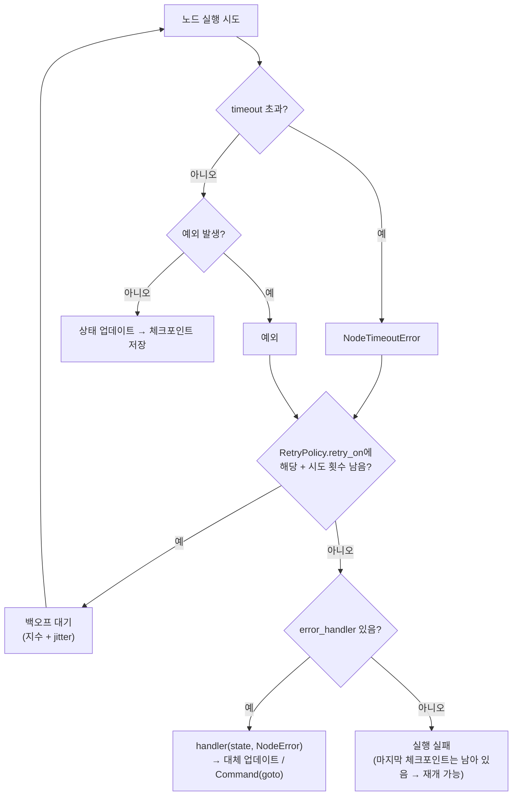
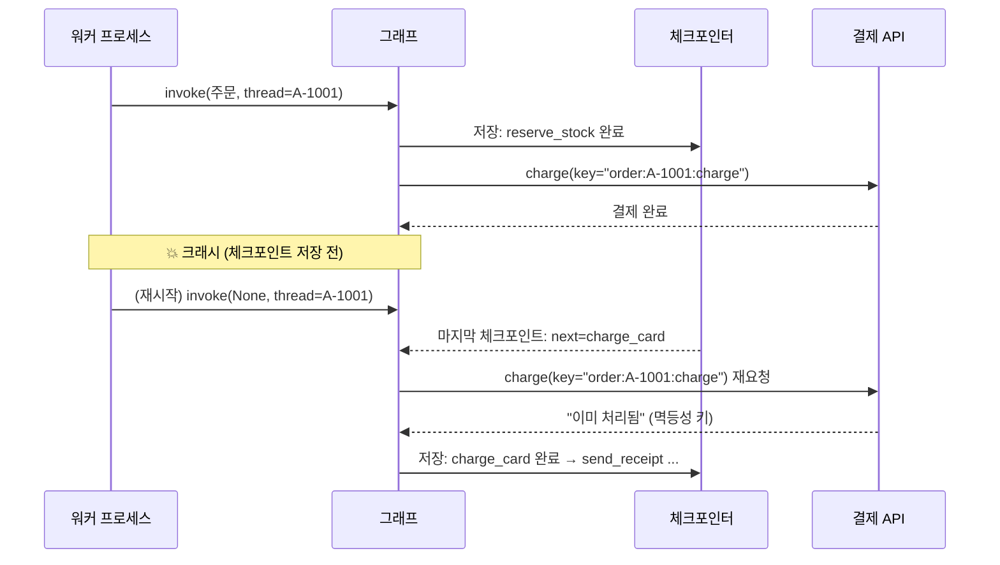

## 왜 필요한가: 데모와 프로덕션 사이의 99%

데모에서는 모든 API가 항상 응답합니다. 프로덕션에서는 다음이 **매일** 일어납니다.

- LLM 제공자가 `429 Too Many Requests`나 `503`을 돌려준다
- 검색 API가 30초 동안 응답 없이 멈춘다
- 배포나 메모리 부족(OOM)으로 프로세스가 작업 도중에 죽는다
- 같은 질문이 하루에 수천 번 들어와 같은 비싼 계산을 반복한다

에이전트는 여러 외부 호출을 **연쇄적으로** 합니다. 호출 하나의 성공률이 99%라도 20번 연속 호출하는 작업의 성공률은 0.99^20 ≈ 82%입니다. 다섯 번 중 한 번은 어딘가에서 실패한다는 뜻입니다. 그래서 신뢰성은 "있으면 좋은 것"이 아니라 **에이전트의 기본 요건**입니다.

LangGraph는 이것을 **노드 단위 정책**과 **체크포인트 기반 durable execution** 두 층으로 해결합니다.



## 핵심 개념 1: RetryPolicy — 일시적 오류만 다시 시도하라

```python
from langgraph.types import RetryPolicy

policy = RetryPolicy(
    max_attempts=3,          # 첫 시도 포함 최대 횟수
    initial_interval=0.5,    # 첫 재시도 전 대기(초)
    backoff_factor=2.0,      # 대기 시간 배수: 0.5 → 1 → 2 ...
    max_interval=128.0,      # 대기 상한
    jitter=True,             # 무작위 흔들기: 여러 요청이 동시에 재시도하는 '떼몰림' 방지
    retry_on=(ConnectionError, RateLimitError),   # 예외 클래스(들) 또는 bool 함수
)
builder.add_node("call_llm", call_llm, retry_policy=policy)
```

핵심은 `retry_on`입니다. 오류에는 두 종류가 있습니다.

| | 일시적(transient) 오류 | 영구적(permanent) 오류 |
| --- | --- | --- |
| 예 | 네트워크 끊김, 429, 502/503, 타임아웃 | 잘못된 입력, 코드 버그, 401 인증 실패, 400 |
| 재시도하면? | 성공할 가능성이 높음 | 똑같이 실패. 시간과 비용만 낭비 |
| 대응 | 백오프 재시도 | 빠르게 실패하거나 fallback |

`retry_on`을 생략하면 LangGraph의 기본 판별 함수가 쓰입니다. 소스를 보면 `ConnectionError`와 HTTP 5xx(httpx/requests)는 재시도하고, `ValueError`·`TypeError`·`RuntimeError`·`OSError` 등 "코드/입력 문제"로 보이는 내장 예외는 재시도하지 않으며, 그 밖의 예외(예: SDK의 커스텀 예외)는 재시도합니다. 의도를 분명히 하려면 **직접 지정**하는 것이 좋습니다.

> [!TIP]
> 노드 안에서 `runtime.execution_info.node_attempt`로 지금이 몇 번째 시도인지 알 수 있습니다. 재시도 시 더 싼 모델로 바꾸거나 로그에 시도 횟수를 남길 때 씁니다. `builder.set_node_defaults(retry_policy=...)`로 그래프 전체 기본값을 줄 수도 있습니다.

`create_agent`로 만든 에이전트에서는 같은 역할을 미들웨어가 합니다: `ModelRetryMiddleware`, `ToolRetryMiddleware`, `ModelFallbackMiddleware`(03 모듈 3강).

## 핵심 개념 2: error_handler — 우아하게 실패하기

재시도를 다 써도 실패하면 어떻게 할까요? 기본은 그래프 실행 전체가 예외로 끝나는 것입니다. 하지만 "뉴스 API가 죽었으면 뉴스 없이 보고서를 쓴다"처럼 **부분 실패를 허용**하는 편이 사용자 경험에 좋을 때가 많습니다.

```python
from langgraph.errors import NodeError
from langgraph.types import Command

def news_fallback(state: State, error: NodeError) -> Command:
    # error.node: 실패한 노드 이름, error.error: 실제 예외 객체
    return Command(update={"news": "(뉴스 없음)"}, goto="write")

builder.add_node("fetch_news", fetch_news, retry_policy=policy, error_handler=news_fallback)
```

핸들러는 `NodeError` 타입의 파라미터로 실패 정보를 주입받고, 일반 노드처럼 상태 업데이트나 `Command`를 반환합니다. 재시도 정책이 있으면 **재시도를 모두 소진한 뒤** 호출됩니다. 핸들러 자신이 실패하면 실행이 실패합니다(핸들러는 단순하게!).

노드 함수 안에서 `try/except`로 처리하는 방법도 여전히 유효합니다. 차이는 이렇습니다. `try/except`는 노드 로직과 에러 처리가 섞이고 재시도 정책과 조율이 어렵습니다. `error_handler`는 재시도 이후의 "최종 실패"만 깔끔하게 분리하고, 실패를 상태와 라우팅으로 표현할 수 있습니다.

> [!WARNING]
> 5.3에서 배웠듯 `interrupt()`는 예외로 동작합니다. 노드 안에서 `except Exception:`으로 넓게 잡으면 interrupt까지 삼킵니다. 잡을 예외는 구체적으로 지정하세요.

## 핵심 개념 3: CachePolicy — 같은 일을 두 번 하지 않기

```python
from langgraph.types import CachePolicy
from langgraph.cache.memory import InMemoryCache

builder.add_node("answer", expensive_node, cache_policy=CachePolicy(ttl=300, key_func=my_key))
graph = builder.compile(cache=InMemoryCache())
```

노드의 입력으로 캐시 키를 만들고, 같은 키의 결과가 있으면 노드를 실행하지 않고 저장된 업데이트를 씁니다. `stream_mode="updates"`로 보면 `__metadata__: {"cached": True}`가 붙어 있습니다.

**캐시 키 설계가 전부입니다.** 기본 키는 노드 입력 전체를 직렬화한 값이라, 요청 ID나 타임스탬프 같은 필드가 섞여 있으면 캐시가 절대 맞지 않습니다. 반대로 사용자 ID를 빼먹으면 **A 사용자의 답이 B 사용자에게** 나가는 심각한 사고가 납니다. `key_func`로 "결과를 결정하는 필드만" 정규화해서 넣으세요. `ttl`(초)로 오래된 결과를 만료시킵니다.

> [!NOTE]
> 이것은 **노드 결과 캐시**입니다. LLM 제공자의 **프롬프트 캐싱**(긴 시스템 프롬프트 접두사를 재사용해 비용을 줄이는 기능)과는 다른 층위입니다. 둘 다 → 8.6에서 비용 최적화 관점으로 다룹니다.

## 핵심 개념 4: timeout — 멈춘 호출을 끊어라

응답이 없는 API는 실패보다 나쁩니다. 사용자는 영원히 기다리고 서버의 연결과 메모리는 묶여 있습니다.

```python
from langgraph.types import TimeoutPolicy

builder.add_node("search", search, timeout=10)    # 시도 1회당 10초 하드 제한
builder.add_node(
    "ingest", ingest,
    timeout=TimeoutPolicy(idle_timeout=30, run_timeout=600),  # 30초간 진행이 없으면 중단, 최대 10분
)

async def ingest(state, runtime: Runtime):
    for chunk in chunks:
        await process(chunk)
        runtime.heartbeat()          # "진행 중" 신호 → idle_timeout 연장
```

- 숫자(또는 `timedelta`)는 **하드 벽시계 제한**입니다.
- `TimeoutPolicy(idle_timeout=...)`은 **진행이 멈춘 시간**을 잽니다. 오래 걸리지만 꾸준히 진행되는 작업에 적합합니다.
- 초과하면 `NodeTimeoutError`가 발생하고, 재시도 정책과 error_handler가 그대로 적용됩니다.

> [!IMPORTANT]
> 노드 timeout은 asyncio 취소를 이용하므로 **async 노드에서만** 동작합니다(소스의 docstring에 명시). 동기 노드에서는 HTTP 클라이언트 자체의 timeout(예: `httpx.Client(timeout=10)`, `init_chat_model(..., timeout=30)`)을 반드시 설정하세요. 사실 이 클라이언트 timeout은 async 여부와 상관없이 **항상** 설정해야 하는 첫 번째 방어선입니다.

## 핵심 개념 5: Durable execution과 멱등성

**Durable execution(내구성 있는 실행)** 은 "작업이 중간에 중단되어도 처음부터가 아니라 **중단된 지점부터** 이어서 완료되는 성질"입니다. LangGraph에서는 이미 배운 것들의 조합으로 얻어집니다.

1. **체크포인터** (5.1): 슈퍼스텝이 끝날 때마다 진행 상황이 저장됩니다.
2. **재개**: 같은 `thread_id`로 `graph.invoke(None, config)`를 호출하면 마지막 체크포인트의 `next` 노드부터 실행됩니다. 실패한 노드의 에러는 `get_state(config).tasks[i].error`에 기록됩니다.
3. **durability 모드** (5.1): `"sync"`는 다음 단계 전에 저장을 보장하므로 크래시 시 잃는 진행이 가장 적습니다.



그림에서 보이듯 **노드 실행과 체크포인트 저장 사이**에 죽으면 그 노드는 다시 실행됩니다. 이것은 피할 수 없는 분산 시스템의 성질("at-least-once" 실행)입니다. 그래서 부수효과가 있는 노드는 반드시 **멱등(idempotent)** 해야 합니다. 같은 요청을 여러 번 보내도 결과가 한 번 보낸 것과 같아야 한다는 뜻입니다.

멱등성 키 설계 원칙:

- **결정적이어야 합니다.** `uuid4()`나 현재 시각으로 만들면 재실행할 때마다 달라져 의미가 없습니다. `f"order:{order_id}:charge"`처럼 **업무적으로 그 행위를 유일하게 식별하는 값**으로 만드세요.
- 외부 API가 멱등성 키를 지원하면(대부분의 결제 API처럼) 그 헤더를 쓰고, 지원하지 않으면 자체 DB에 "처리 완료 키" 테이블을 두고 먼저 확인합니다.
- 부수효과는 **작고 독립된 노드**로 분리하세요. 한 노드에서 메일 발송과 결제를 함께 하면 한쪽만 성공한 상태에서 재실행될 때 복잡해집니다.

**Functional API**(04 모듈 7강)에서는 `@task`가 이 단위입니다. 완료된 task의 결과는 체크포인트에 저장되므로, `@entrypoint`를 재개하면 이미 끝난 task는 다시 실행하지 않고 저장된 결과를 돌려줍니다. 부수효과나 비결정적 연산(랜덤, 현재 시각, LLM 호출)은 `@task`로 감싸는 것이 원칙입니다.

## 코드 해설

▶ 오른쪽 IDE의 `examples/01_retry_and_fallback.py`를 실행해 보세요. 환율 API는 두 번 실패 후 세 번째 시도에서 성공하고(`node_attempt` 출력), 뉴스 API는 세 번 모두 실패해 `error_handler`가 대체 문구로 `write`까지 진행시킵니다. 후반부는 `ValueError`가 `retry_on`에 없어 **단 한 번만** 시도되는 것을 보여 줍니다.

▶ `examples/02_cache_and_timeout.py`는 대소문자·공백만 다른 질문이 `key_func` 정규화 덕분에 캐시에 맞는 것(0.2초 → 1ms 미만), 그리고 응답 없는 async 노드가 0.3초 만에 끊기고 error_handler로 대체 응답을 내는 것, heartbeat를 보내는 긴 작업은 `idle_timeout`보다 오래 걸려도 성공하는 것을 보여 줍니다.

▶ `examples/03_durable_execution.py`는 결제 직후 크래시를 흉내 냅니다. 재개 시 `reserve_stock`은 다시 실행되지 않고 `charge_card`만 다시 실행되며, 결제 API는 두 번 호출되지만 멱등성 키 덕분에 **실제 결제는 한 건**입니다. 마지막 부분은 `@task` 결과 재사용을 확인합니다.

## 현업에서는

### 계층별 방어선

| 계층 | 도구 | 예 |
| --- | --- | --- |
| HTTP 클라이언트 | 클라이언트 timeout, SDK 자체 재시도 | `init_chat_model(MODEL, timeout=30, max_retries=2)` |
| 노드 | `RetryPolicy`, `timeout`, `error_handler`, `CachePolicy` | 오늘 배운 것 |
| 에이전트 | `ModelFallbackMiddleware`, `ModelCallLimitMiddleware`, `recursion_limit` | 다른 모델로 대체, 무한 루프 차단 |
| 실행 | 체크포인터 + `durability="sync"` + 재개 워커 | 크래시 후 이어서 |
| 인프라 | 큐(재시도·DLQ), 헬스체크, 오토스케일 | → 8.5 |

> [!CAUTION]
> SDK 재시도(`max_retries`)와 노드 `RetryPolicy`를 **둘 다** 크게 잡으면 재시도가 곱해집니다. SDK 3회 × 노드 3회 = 최대 9번 호출되고, 장애 상황에서 제공자에게 부하를 더 얹는 "재시도 폭풍"이 됩니다. 한 계층에서만 넉넉히 재시도하세요.

### 재개 워커 패턴

```python
# 주기적으로 '실패한 채 멈춘 스레드'를 찾아 재개하는 워커 (스케치)
for thread_id in find_stuck_threads(db, older_than_minutes=5):   # 앱이 관리하는 실행 상태 테이블
    config = {"configurable": {"thread_id": thread_id}}
    snap = graph.get_state(config)
    if snap.next and not snap.interrupts:            # interrupt 대기(사람 승인)는 건드리지 않는다
        if any(t.error for t in snap.tasks):
            graph.invoke(None, config, durability="sync")
```

LangGraph Platform(Agent Server)은 실행을 작업 큐로 관리하고 워커가 죽으면 다른 워커가 이어받는 기능을 제공합니다(→ 8.5). 직접 운영한다면 위와 같은 워커와 "재개 횟수 상한"을 두세요. 같은 버그로 계속 실패하는 스레드를 무한히 재개하면 안 되므로 일정 횟수 후에는 사람에게 알리는 DLQ(dead-letter queue)로 보냅니다.

### 관측성과 테스트

- 재시도 횟수, fallback 발생률, 노드별 p95 지연, 캐시 적중률을 지표로 남기세요. LangSmith 트레이스에서 재시도된 노드 실행을 확인할 수 있습니다(→ 8.2).
- **카오스 테스트**: 예제처럼 일부러 예외를 던지는 Mock 도구를 주입해 "N번째 노드에서 죽으면 재개되는가", "결제가 중복되지 않는가"를 단위 테스트로 고정하세요. Mock 모델과 `InMemorySaver`면 빠르고 결정적으로 테스트할 수 있습니다.

## 정리

- **RetryPolicy**: 일시적 오류만(`retry_on`), 지수 백오프 + jitter, 시도 횟수 상한.
- **error_handler**: 재시도 소진 후 `NodeError`를 받아 대체 업데이트/경로로 우아하게 실패.
- **CachePolicy**: `compile(cache=...)` + 결과를 결정하는 필드만으로 만든 `key_func`, `ttl`.
- **timeout**: async 노드에 하드 제한 또는 `TimeoutPolicy(idle_timeout)` + `runtime.heartbeat()`. 클라이언트 timeout은 항상 기본.
- **Durable execution**: 체크포인터 + `invoke(None, config)` 재개. 실행은 at-least-once이므로 부수효과는 **결정적 멱등성 키**로 보호하고, Functional API에서는 `@task`로 감쌉니다.

이것으로 05 모듈을 마칩니다. 체크포인터, 타임 트래블, HITL, 장기 메모리, 신뢰성은 08 모듈의 프로덕션 배포(8.5)와 캡스톤(8.7)에서 모두 다시 만나게 됩니다.
