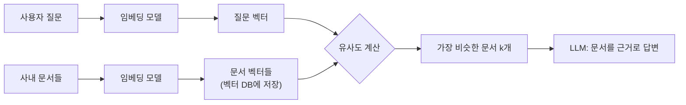
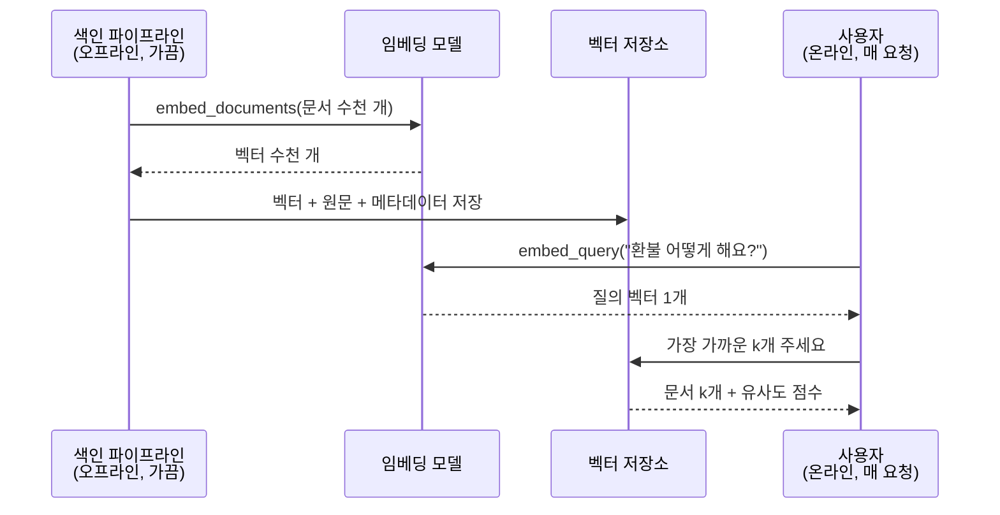

# 임베딩과 유사도: 의미를 숫자로 바꾸기

## 왜 필요한가: LLM은 '내 회사 문서'를 모른다

지금까지 만든 에이전트는 LLM이 학습한 지식과 도구 호출 결과만으로 답했습니다. 그런데 현업에서 받는 질문은 대부분 이런 것들입니다.

- "우리 회사 휴가 규정에서 반차는 몇 시간이야?"
- "지난 분기 장애 회고 문서에서 DB 커넥션 이슈 원인이 뭐였지?"
- "이 고객 계약서에 환불 조항이 있어?"

GPT-5든 무엇이든 **여러분 회사의 사내 문서로 학습되지 않았습니다.** 그래서 그럴듯하게 지어내는 환각(Hallucination)이 생깁니다. 해결책은 간단합니다. 질문과 관련된 문서를 **찾아서(Retrieve)** 프롬프트에 붙여 주고, 그걸 **근거로 생성(Generate)** 하게 하는 것. 이것이 **RAG(Retrieval-Augmented Generation, 검색 증강 생성)** 입니다.

문제는 "관련된 문서를 어떻게 찾느냐"입니다. 키워드 검색(Ctrl+F)은 "반차"를 검색하면 "오전 반일 휴가"라고 쓰인 문서를 놓칩니다. 단어는 다르지만 **의미가 같은** 문서를 찾으려면, 의미 자체를 비교할 수 있는 형태로 바꿔야 합니다. 그 변환이 바로 **임베딩(Embedding)** 입니다.



이번 모듈 전체가 이 그림을 하나씩 깊게 파고드는 과정입니다. 이번 강의는 가장 아래층, **"의미를 숫자로 바꾸고 비교하는 법"** 입니다.

## 핵심 개념 1: 임베딩은 '의미 지도 위의 좌표'

임베딩은 텍스트를 **고정 길이의 실수 벡터**로 바꾼 것입니다. 예를 들어 OpenAI `text-embedding-3-small`은 어떤 길이의 문장이 들어와도 1,536개의 숫자 목록을 돌려줍니다.

비유를 들어 보겠습니다. 서울 지도를 떠올려 보세요. 모든 장소는 (위도, 경도) 두 숫자로 표현되고, **가까운 좌표는 실제로도 가까운 장소**입니다. 임베딩 모델은 "의미 지도"를 만드는 모델입니다. 다만 2차원이 아니라 수백~수천 차원이고, 축 하나하나가 사람이 이해할 수 있는 뜻(예: "동물성")을 갖지는 않습니다. 그래도 원리는 같습니다.

> **비슷한 의미의 텍스트는 의미 지도에서 가까운 좌표에 놓인다.**

임베딩 모델은 엄청난 양의 텍스트 쌍(질문-답변, 같은 뜻의 문장 등)으로 "비슷한 것은 가깝게, 다른 것은 멀게" 배치하도록 학습(대조 학습, Contrastive Learning)됩니다. 그래서 "환불 신청 방법"과 "돈 돌려받으려면 어떻게 해요?"는 단어가 거의 겹치지 않아도 가까운 좌표를 받습니다.

> [!NOTE]
> 생성용 LLM(GPT-5 등)과 임베딩 모델은 **다른 모델**입니다. 임베딩 모델은 글을 쓰지 않고 벡터만 출력하며, 훨씬 싸고 빠릅니다. RAG는 보통 두 모델을 함께 씁니다.

## 핵심 개념 2: 가까움을 재는 세 가지 자

두 벡터가 "얼마나 가까운지" 재는 방법은 여러 가지입니다. 벡터 DB 설정 화면에서 반드시 마주치게 될 세 가지를 정리합니다.

| 척도 | 수식 | 의미 | 값의 범위 |
|---|---|---|---|
| 내적(Dot product) | `a·b = Σ aᵢbᵢ` | 방향과 길이를 모두 반영 | -∞ ~ +∞ (클수록 유사) |
| 코사인 유사도(Cosine) | `a·b / (‖a‖‖b‖)` | 두 벡터 사이 **각도**만 봄 | -1 ~ 1 (클수록 유사) |
| 유클리드 거리(L2) | `‖a - b‖` | 두 점 사이 직선 거리 | 0 ~ ∞ (**작을수록** 유사) |

왜 텍스트 검색에서는 **코사인**이 기본일까요? 길이(노름, Norm)에 휘둘리지 않기 때문입니다. 같은 주제의 짧은 문서와 긴 문서는 벡터의 **방향**은 비슷하지만 길이가 다를 수 있습니다. 유클리드 거리는 이 길이 차이를 "멀다"고 판단하지만, 코사인은 방향만 보므로 "같은 주제"라고 판단합니다.

▶ 오른쪽 IDE의 `examples/01_cosine_numpy.py`를 실행해 보세요. 방향은 같고 길이만 10배인 두 벡터의 코사인은 1.0인데, 유클리드 거리는 12가 넘게 나옵니다.

### 정규화(Normalization)의 마법

벡터를 길이 1로 맞추는 것을 **L2 정규화**라고 합니다. 정규화를 하고 나면 재미있는 일이 생깁니다.

1. 분모 `‖a‖‖b‖`가 1이 되므로 **내적 = 코사인 유사도**가 됩니다.
2. `‖a-b‖² = 2 - 2·cos(a,b)` 이므로 **유클리드 거리 순위 = 코사인 순위**가 됩니다.

즉 정규화된 벡터에서는 세 척도 중 무엇을 골라도 **검색 순위가 똑같습니다.** 그래서 많은 벡터 DB가 "정규화해서 넣고 내적으로 계산"합니다. 내적은 나눗셈이 없어 가장 빠르기 때문입니다. OpenAI 임베딩은 이미 길이 1로 정규화되어 나오지만, 오픈소스 모델 중에는 그렇지 않은 것도 있으므로 **직접 확인하는 습관**이 중요합니다.

```python
import numpy as np

def cosine_similarity(a: np.ndarray, b: np.ndarray) -> float:
    denom = np.linalg.norm(a) * np.linalg.norm(b)
    return 0.0 if denom == 0 else float(a @ b / denom)

# 문서 N개를 한 번에: (N, d) 행렬 @ (d,) 벡터 → (N,) 점수
scores = normalized_docs @ normalized_query
top_k = np.argsort(-scores)[:3]
```

마지막 두 줄이 핵심입니다. 질의 1개와 문서 N개의 유사도는 **행렬 곱 한 번**이면 끝납니다. 이것이 "전수 검색(Brute-force / Flat search)"이고, 문서가 수만 개 정도까지는 이것만으로 충분히 빠릅니다. 수백만 개가 넘어가면 다음다음 강의에서 배울 **근사 최근접 이웃(ANN) 인덱스**(HNSW 등)가 필요해집니다.

## 동작 원리: 임베딩 검색의 두 단계

RAG의 검색은 시간이 다른 두 단계로 나뉩니다. 이 구분을 머리에 넣어 두면 이후 모든 설계가 쉬워집니다.



- **색인(Indexing)**: 문서를 미리 임베딩해 저장합니다. 비용이 크지만 한 번만(문서가 바뀔 때만) 합니다.
- **질의(Query)**: 매 요청마다 질문 하나만 임베딩하고, 저장된 벡터와 비교합니다. 빠르고 쌉니다.

LangChain의 `Embeddings` 인터페이스도 이 구분을 따릅니다. `embed_documents(texts)`는 여러 개를 배치로, `embed_query(text)`는 하나를 처리합니다. 어떤 모델(예: E5, BGE 계열 일부)은 문서와 질의에 서로 다른 접두어(prefix)를 붙여야 성능이 나오기 때문에 두 메서드가 분리되어 있습니다.

## 코드 해설

▶ 오른쪽 IDE의 `examples/02_embedding_search.py`를 실행해 보세요.

```python
from langchain_openai import OpenAIEmbeddings

embeddings = OpenAIEmbeddings(model="text-embedding-3-small")
doc_vectors = np.array(embeddings.embed_documents(docs))   # (5, 1536)
q = np.array(embeddings.embed_query("환불 신청은 어디서 하나요?"))
scores = doc_vectors @ q
```

벡터 DB 없이 numpy만으로 "의미 검색"이 완성됐습니다. 벡터 DB가 하는 일의 본질은 이게 전부입니다. 나머지(인덱스, 필터, 영속성, 복제)는 **규모와 운영**을 위한 것입니다.

> [!IMPORTANT]
> API 키 없이 실행하면 **Mock 임베딩**이 쓰입니다. Mock은 단어를 해시해 만든 bag-of-words 벡터라서 "같은 단어(와 글자 조각)를 공유할수록" 유사도가 높습니다. 즉 키워드 검색에 가깝게 동작합니다. 실제 OpenAI 임베딩을 쓰면 "비밀번호 찾기"와 "로그인이 안 돼요"처럼 단어가 달라도 의미로 연결됩니다. 두 결과를 비교해 보면 **임베딩이 무엇을 해 주는지** 가장 잘 체감할 수 있습니다.

`examples/03_dimensions_and_cost.py`는 차원이 비용에 미치는 영향을 계산합니다. 1,000만 개 문서를 1,536차원 float32로 저장하면 벡터만으로 약 57GB입니다. 같은 문서를 256차원으로 줄이면 약 9.5GB가 됩니다. `text-embedding-3` 계열은 `dimensions` 인자로 출력 차원을 줄일 수 있도록 학습(Matryoshka Representation Learning)되어 있어 품질 손실이 상대적으로 작습니다.

```python
# 차원을 줄여서 받기 (실제 OpenAI 모델에서 동작)
small = OpenAIEmbeddings(model="text-embedding-3-large", dimensions=1024)
```

> [!WARNING]
> 벡터를 **직접 잘라서** 쓸 때는 반드시 다시 정규화해야 합니다. 그리고 **문서와 질의는 반드시 같은 모델, 같은 차원**으로 임베딩해야 합니다. 모델을 바꾸면 좌표계 자체가 바뀌므로 기존 벡터와 비교하는 것은 무의미합니다. 전체 재색인(re-indexing)이 필요합니다.

## 임베딩 모델은 어떻게 고르나

현업에서 임베딩 모델 선택은 "가장 성능 좋은 것"이 아니라 **제약 조건의 교집합**입니다.

1. **언어**: 한국어 문서라면 다국어 성능을 확인해야 합니다. 영어 전용 모델은 한국어에서 크게 떨어질 수 있습니다.
2. **도메인**: 법률, 의료, 코드처럼 전문 용어가 많으면 범용 모델이 약할 수 있습니다. 코드 검색 전용 모델도 있습니다.
3. **차원과 비용**: 차원이 클수록 저장/검색 비용이 커집니다. 문서 수가 많다면 차원 축소를 적극 검토합니다.
4. **최대 입력 길이**: 모델마다 한 번에 임베딩할 수 있는 토큰 수가 다릅니다. 넘으면 잘리거나 에러가 납니다. 이것이 다음 강의 **청킹(Chunking)** 이 필요한 이유 중 하나입니다.
5. **데이터 주권/보안**: 외부 API로 문서를 보낼 수 없는 환경(금융, 공공)이라면 자체 호스팅 오픈소스 모델(BGE-M3, multilingual-e5 등)을 씁니다.
6. **벤치마크는 참고만**: MTEB 같은 공개 리더보드는 출발점일 뿐입니다. **여러분의 실제 질문 50~100개로 만든 평가셋**에서 직접 비교해야 합니다(05강에서 다룹니다).

```python
# 참고: 다른 제공자의 임베딩도 같은 Embeddings 인터페이스를 따릅니다 (이 사이트 실습 환경에는 미설치).
# from langchain_huggingface import HuggingFaceEmbeddings
# emb = HuggingFaceEmbeddings(model_name="BAAI/bge-m3")
# 인터페이스가 같으므로, 벡터 저장소 코드를 바꾸지 않고 모델만 교체해 비교 실험할 수 있습니다.
```

## 현업에서는

- **비용**: 임베딩 비용은 색인 때 한꺼번에 발생합니다. 문서 전체를 매일 재임베딩하는 파이프라인은 돈을 태웁니다. 문서 내용의 해시를 저장해 두고 **바뀐 문서만** 다시 임베딩하세요(`langchain_core.indexing`의 `index()` + `RecordManager` 패턴).
- **배치와 레이트 리밋**: `embed_documents`는 내부적으로 묶어서 보내지만, 수십만 건이면 API 레이트 리밋에 걸립니다. 재시도(backoff)와 체크포인트(어디까지 했는지 기록)를 두세요.
- **캐싱**: 같은 질의가 자주 들어온다면(FAQ 봇) 질의 임베딩을 캐시하면 지연이 줄어듭니다. Redis 같은 캐시를 임베딩 앞에 두거나, `langchain-classic` 패키지의 `CacheBackedEmbeddings`를 씁니다(LangChain v1 본체에서는 분리되었습니다).
- **버전 관리**: 벡터와 함께 `embedding_model`, `dimensions` 같은 메타데이터를 저장하세요. 모델 교체 시 "어떤 벡터가 어떤 모델로 만들어졌는지" 모르면 사고가 납니다. 보통 새 컬렉션을 만들어 재색인한 뒤 트래픽을 전환(블루-그린)합니다.
- **관측성**: LangSmith 트레이스에서 검색 단계의 입력 질의, 반환 문서, 점수를 함께 보세요. "답변이 이상하다"의 원인 대부분은 생성이 아니라 **검색**에 있습니다.
- **보안**: 임베딩은 원문으로 일부 역변환(inversion)될 수 있다는 연구가 있습니다. 벡터도 원문과 같은 수준의 민감 데이터로 취급하세요.

> [!TIP]
> 유사도 점수의 **절대값**에 의미를 두지 마세요. 모델마다 점수 분포가 다릅니다. 어떤 모델은 관련 없는 문서도 0.7이 나오고, 어떤 모델은 관련 있는 문서가 0.4입니다. "0.8 이상만 쓴다" 같은 임계값은 반드시 여러분의 데이터로 분포를 본 뒤 정하세요.

## 안티패턴

- 문서는 모델 A, 질의는 모델 B로 임베딩한다 → 좌표계가 달라 검색이 무작위가 됩니다.
- 정규화되지 않은 벡터를 내적(dot) 거리로 저장한다 → 긴 문서가 부당하게 상위에 옵니다.
- 리더보드 1위 모델을 평가 없이 채택한다 → 한국어/도메인 데이터에서 기대 이하일 수 있습니다.
- 문서 전체(수십 페이지)를 통째로 임베딩한다 → 의미가 평균화되어 아무 질문과도 애매하게 비슷해집니다. 다음 강의의 주제입니다.

## 정리

- 임베딩은 텍스트를 **의미 지도 위의 좌표(고정 길이 벡터)** 로 바꾼 것입니다.
- 텍스트 검색의 기본 척도는 **코사인 유사도**이며, L2 정규화 후에는 내적·코사인·유클리드의 순위가 같아집니다.
- 검색의 본질은 `정규화된 문서 행렬 @ 질의 벡터` 한 줄입니다. 벡터 DB는 이것을 대규모로, 안정적으로 해 줍니다.
- 임베딩 모델은 언어, 도메인, 차원/비용, 입력 길이, 보안을 기준으로 고르고 **자체 평가셋으로 검증**합니다.

다음 강의에서는 긴 문서를 검색하기 좋은 크기로 자르는 **문서(Document)와 청킹(Chunking)** 을 배웁니다.

▶ `exercise.py`에서 `cosine_similarity`, `normalize_rows`, `top_k`를 직접 구현해 미니 벡터 검색기를 완성해 보세요.
