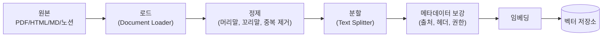
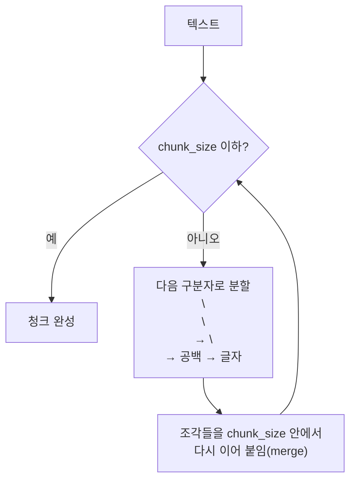

# Document와 청킹: 검색하기 좋은 크기로 자르기

## 왜 필요한가: 통째로 넣으면 왜 안 될까?

지난 강의에서 텍스트를 임베딩해 비교하는 방법을 배웠습니다. 그렇다면 100쪽짜리 취업규칙 PDF를 **통째로 하나의 벡터**로 만들면 어떨까요? 세 가지 문제가 생깁니다.

1. **의미가 평균화됩니다.** 휴가, 급여, 징계, 보안 이야기가 한 벡터에 섞이면 그 벡터는 "회사 규정 전반" 같은 흐릿한 좌표가 됩니다. "반차는 몇 시간?"이라는 날카로운 질문과는 애매하게만 비슷해집니다.
2. **모델 입력 한도를 넘습니다.** 임베딩 모델은 한 번에 받을 수 있는 토큰 수가 정해져 있습니다. 넘으면 잘리거나 에러가 납니다.
3. **LLM에 넘길 때 낭비입니다.** 질문 하나에 100쪽 전체를 컨텍스트로 넣으면 비용과 지연이 커지고, 긴 컨텍스트 중간의 정보를 놓치는 현상(Lost in the Middle)도 생깁니다.

반대로 너무 잘게(한 문장씩) 자르면 "연차는 반차 단위로 나누어 쓸 수 있다"처럼 **주어와 맥락이 사라진** 조각이 생깁니다. 이 조각만 보고는 무슨 회사의 무슨 규정인지 알 수 없습니다.

그래서 문서를 **검색 단위(청크, Chunk)** 로 적당히 자르는 **청킹(Chunking)** 이 필요합니다. 청킹은 RAG 품질에 가장 큰 영향을 주는 요소 중 하나이면서, 가장 과소평가되는 단계입니다.



## 핵심 개념 1: Document = 본문 + 메타데이터

LangChain에서 검색되는 모든 것은 `Document` 객체입니다.

```python
from langchain_core.documents import Document

doc = Document(
    page_content="입사 1년 이상 직원은 연 15일의 연차를 받는다.",
    metadata={"source": "hr/vacation-policy.md", "department": "HR",
              "updated_at": "2026-03-01", "access": "all-employees"},
    id="vacation-policy#2",   # 선택: 같은 id로 다시 넣으면 갱신(upsert)할 수 있음
)
```

`page_content`는 임베딩되고 LLM에 전달되는 텍스트입니다. `metadata`는 **임베딩되지 않지만** 검색 결과와 함께 따라다니는 정보입니다. 초보자는 메타데이터를 대충 넘기기 쉬운데, 현업에서는 메타데이터 설계가 곧 기능입니다.

| 메타데이터 | 쓰임새 |
|---|---|
| `source`, `page`, `url` | 답변에 **출처 인용(Citation)** 을 달 때. "근거 없는 답"을 막는 첫 번째 장치 |
| `department`, `product`, `lang` | **필터 검색**: "HR 문서 안에서만 찾기" |
| `updated_at`, `version` | 최신 문서 우선, 폐기된 문서 제외 |
| `access`, `tenant_id` | **권한 필터**: 다른 고객사/부서 문서가 섞여 나오는 보안 사고 방지 |
| `chunk_id`, `start_index` | 디버깅, 재색인 시 갱신/삭제, 앞뒤 청크 확장 |

> [!CAUTION]
> 멀티테넌트(여러 고객사) 서비스에서 `tenant_id` 필터를 빠뜨리면 A사 직원 질문에 B사 문서가 근거로 나옵니다. 이것은 버그가 아니라 **데이터 유출 사고**입니다. 권한 필터는 LLM 프롬프트가 아니라 **검색 쿼리 단계에서 강제**하세요.

## 핵심 개념 2: 분할 전략

### 1) RecursiveCharacterTextSplitter: 기본값으로 가장 많이 쓰는 분할기

이름 그대로 **재귀적으로** 자릅니다. 구분자 목록 `["\n\n", "\n", " ", ""]`(기본값)을 순서대로 시도해, 먼저 문단 경계로 자르고, 그래도 `chunk_size`보다 크면 줄바꿈으로, 그래도 크면 공백으로 자릅니다. 덕분에 **가능한 한 자연스러운 경계**를 지킵니다.



핵심 파라미터는 두 개입니다.

- `chunk_size`: 청크의 최대 길이. 기본 단위는 `len()` 즉 **글자 수**입니다.
- `chunk_overlap`: 이웃 청크끼리 겹치는 길이. 중요한 문장이 경계에 걸려 반으로 잘리는 것을 완화합니다. 보통 `chunk_size`의 10~20%로 시작합니다.

▶ 오른쪽 IDE의 `examples/01_documents_and_recursive.py`를 실행해 보세요. `split_documents()`는 원본의 메타데이터를 모든 청크에 복사하고, `add_start_index=True`는 원문에서의 시작 위치를 `metadata["start_index"]`에 기록합니다.

### 2) 구조 인식 분할: MarkdownHeaderTextSplitter

사내 위키, 기술 문서, README처럼 **구조가 있는 문서**는 그 구조를 따라 자르는 것이 가장 좋습니다. 저자가 이미 "여기서 주제가 바뀐다"고 헤더로 표시해 두었기 때문입니다.

```python
from langchain_text_splitters import MarkdownHeaderTextSplitter, RecursiveCharacterTextSplitter

header_splitter = MarkdownHeaderTextSplitter(
    headers_to_split_on=[("#", "h1"), ("##", "h2"), ("###", "h3")],
)
sections = header_splitter.split_text(markdown)          # 헤더 → 메타데이터
chunks = RecursiveCharacterTextSplitter(chunk_size=500, chunk_overlap=50).split_documents(sections)
```

이것이 현업에서 가장 흔한 **2단계 분할** 패턴입니다. 헤더로 의미 단위를 먼저 나누고, 그래도 긴 섹션만 길이 기준으로 한 번 더 자릅니다. 헤더 정보는 메타데이터(`{"h2": "요금제", "h3": "프로"}`)로 보존됩니다.

비슷한 구조 인식 분할기가 여러 형식에 있습니다. HTML은 `HTMLHeaderTextSplitter`, 소스 코드는 `RecursiveCharacterTextSplitter.from_language(Language.PYTHON, ...)`(함수/클래스 경계 우선), JSON은 `RecursiveJsonSplitter`를 씁니다.

### 3) 맥락 헤더(Contextual Chunk Header)

2단계 분할 뒤에도 문제가 남습니다. "연간 결제 시 2개월 무료 혜택이 있습니다"라는 청크만 보면 **무슨 제품의 무슨 요금제**인지 알 수 없습니다. 해결책은 간단합니다. 메타데이터의 헤더 경로를 **본문 앞에 붙여서 임베딩**합니다.

```text
[AgentLab 사용자 가이드 > 요금제 > 프로]
연간 결제 시 2개월 무료 혜택이 있습니다.
```

이제 "프로 요금제 할인 있어요?"라는 질문이 이 청크와 의미적으로(Mock에서는 단어로도) 연결됩니다. 더 나아가 LLM으로 "이 청크가 전체 문서에서 어떤 맥락인지" 한두 문장 요약을 생성해 붙이는 기법(Contextual Retrieval)도 있습니다. 색인 비용은 늘지만 검색 정확도가 크게 오르는 경우가 많습니다.

### 4) 토큰 기반 분할

LLM과 임베딩 모델의 한도, 그리고 비용은 모두 **토큰** 단위입니다. 한국어는 영어보다 같은 글자 수에 토큰이 더 많이 들 수 있으므로, 글자 수로 자르면 예상보다 긴 청크가 생길 수 있습니다. `length_function`만 바꾸면 됩니다.

```python
import tiktoken
enc = tiktoken.get_encoding("o200k_base")

splitter = RecursiveCharacterTextSplitter(
    chunk_size=400, chunk_overlap=40,
    length_function=lambda t: len(enc.encode(t)),   # 단위가 '토큰'이 됨
)
# 또는 편의 생성자: RecursiveCharacterTextSplitter.from_tiktoken_encoder(encoding_name="o200k_base", chunk_size=400)
```

▶ `examples/02_markdown_and_tokens.py`에서 헤더 분할, 2단계 분할, 맥락 헤더, 토큰 분할을 차례로 확인하세요.

> [!NOTE]
> `tiktoken`은 처음 사용할 때 인코딩 파일을 인터넷에서 내려받습니다. 예제는 오프라인이면 근사치 함수로 자동 대체하도록 작성했습니다. 현업 컨테이너에서는 빌드 시점에 인코딩 파일을 미리 받아 두고 `TIKTOKEN_CACHE_DIR`로 지정하세요.

### 5) 그 밖의 전략 (개념만)

- **시맨틱 청킹(Semantic Chunking)**: 문장마다 임베딩을 구해, 이웃 문장과 유사도가 뚝 떨어지는 지점에서 자릅니다. 구조 없는 긴 글에 유리하지만 색인 비용이 큽니다.
- **부모-자식(Parent Document) 검색**: 검색은 작은 청크(정확한 매칭)로 하고, LLM에는 그 청크가 속한 **큰 부모 청크**를 넘깁니다. "정확한 검색"과 "충분한 맥락"을 동시에 잡는 현업 단골 패턴입니다. 다음 강의의 메타데이터와 `chunk_id`가 이것을 가능하게 합니다.
- **문장 윈도우(Sentence Window)**: 문장 단위로 검색하고, 앞뒤 N문장을 붙여 넘깁니다.

## 동작 원리: chunk size/overlap 튜닝

"chunk_size는 몇이 정답인가요?"는 가장 자주 받는 질문이고, 정답은 **"데이터로 측정하세요"** 입니다. 일반적인 경향은 이렇습니다.

| 청크 크기 | 장점 | 단점 |
|---|---|---|
| 작다(수십~200 토큰) | 질문과 정확히 매칭, 컨텍스트 토큰 절약 | 맥락 손실, 답이 여러 청크에 쪼개짐 |
| 크다(800 토큰 이상) | 맥락 풍부, 답이 한 청크에 들어 있을 확률↑ | 의미 평균화로 검색 정밀도↓, 비용·잡음↑ |

측정 방법은 단순합니다. **질문과 "정답이 들어 있어야 하는 문구"** 쌍을 수십 개 만들고, 설정을 바꿔 가며 "top-k 검색 결과에 정답 문구가 있는 비율(Hit Rate@k)"을 비교합니다.

▶ `examples/03_chunk_tuning.py`를 실행해 보세요. 설정마다 새 `InMemoryVectorStore`에 색인하고 Hit Rate@2를 계산합니다.

```python
def hit_rate(chunk_size: int, chunk_overlap: int, k: int = 2) -> float:
    chunks = RecursiveCharacterTextSplitter(chunk_size=chunk_size, chunk_overlap=chunk_overlap).split_documents(docs)
    store = InMemoryVectorStore(embedding=embeddings)
    store.add_documents(chunks)
    hits = sum(any(ans in d.page_content for d in store.similarity_search(q, k=k)) for q, ans in eval_set)
    return hits / len(eval_set)
```

실행해 보면 청크를 아주 크게 하면 Hit Rate가 100%에 가까워집니다. 하지만 이것은 "문서 전체를 넘기면 답이 어딘가 있다"는 당연한 결과일 뿐입니다. 그래서 Hit Rate와 함께 **평균 컨텍스트 토큰 수**(비용·지연)를 같이 봐야 합니다. 같은 Hit Rate라면 작은 쪽이 낫습니다. 05강에서 이 평가를 Recall@k, MRR, LLM 판정까지 확장합니다.

## 코드 해설: 실습 과제 미리보기

`exercise.py`에서는 FAQ 마크다운을 받아 다음을 수행하는 `build_chunks()`를 만듭니다.

1. `##`, `###` 헤더로 1차 분할
2. 100자 기준 2차 분할
3. `source`, `chunk_id` 메타데이터 부여
4. `[h2 > h3]` 맥락 헤더 부착

그다음 `InMemoryVectorStore`에 넣고 "환불 기간은 며칠인가요?"로 검색해 환불 섹션 청크가 나오는지 확인합니다. 작은 함수지만 현업 색인 파이프라인의 뼈대와 같습니다.

## 현업에서는

- **로딩과 정제가 절반이다**: PDF의 머리말/꼬리말/페이지 번호, 표가 깨진 텍스트, HTML의 메뉴/광고는 검색 품질을 크게 해칩니다. 분할 전에 정제 단계를 두고, 표는 마크다운 표나 행 단위 문장으로 변환하세요. 복잡한 PDF는 레이아웃 인식 파서(Unstructured, Docling, LlamaParse 같은 도구)를 검토합니다.
- **결정적인 ID**: `chunk_id`를 `"{source}#{순번}"` 또는 내용 해시로 만들어 두면, 문서가 바뀌었을 때 해당 청크만 교체(upsert)하고 사라진 청크를 삭제할 수 있습니다. 무작위 UUID를 쓰면 재색인할 때마다 중복이 쌓입니다.
- **증분 색인**: 매번 전체를 다시 임베딩하지 말고, 변경된 문서만 처리하세요. `langchain_core.indexing`의 `index()`와 RecordManager가 해시 기반 증분 색인을 지원합니다.
- **청크와 함께 저장할 것**: 원문 위치(`start_index`, 페이지), 헤더 경로, 문서 버전, 권한. 사용자가 "근거 보기"를 누르면 원문의 해당 위치로 이동시키는 UI가 신뢰도를 크게 올립니다.
- **관측성**: LangSmith에서 "검색된 청크"를 보고 답이 엉뚱할 때, 청크가 잘못 잘렸는지(맥락 손실) 먼저 의심하세요. 실패 사례를 모아 청킹 규칙을 개선하는 것이 가장 효과적인 튜닝입니다.
- **테스트**: 청킹 함수는 순수 함수라 단위 테스트하기 좋습니다. "모든 청크 ≤ N 토큰", "모든 청크에 source 존재", "표가 중간에서 잘리지 않음" 같은 불변식(invariant)을 CI에서 검사하세요.

> [!TIP]
> 시작점이 필요하다면 이렇게 하세요. 구조가 있는 문서는 헤더 기준 분할 + 300~800토큰 Recursive 2차 분할 + 10~15% 오버랩 + 맥락 헤더. 그다음 평가셋으로 조정합니다. 이 값들은 출발점일 뿐, 정답이 아닙니다.

## 안티패턴

- 메타데이터 없이 텍스트만 색인한다 → 출처 인용, 필터, 갱신, 삭제가 모두 불가능해집니다.
- overlap을 chunk_size의 50% 이상으로 잡는다 → 거의 같은 청크가 중복으로 검색되어 top-k 자리를 낭비합니다.
- 문서 종류(코드, 표, 대화 로그, 법률 조항)가 다른데 하나의 설정으로 자른다 → 종류별로 분할기를 다르게 쓰세요.
- 튜닝 없이 블로그 글의 "chunk_size=1000"을 복사한다 → 여러분의 데이터, 여러분의 질문으로 측정하세요.

## 정리

- `Document`는 `page_content`(임베딩 대상) + `metadata`(출처·필터·권한·갱신용)입니다. 메타데이터 설계가 곧 RAG의 기능과 보안입니다.
- 기본은 `RecursiveCharacterTextSplitter`, 구조가 있으면 헤더 기준 1차 분할 후 2차 분할, 단위는 가능하면 토큰으로 맞춥니다.
- 청크만 보고 맥락을 알 수 없다면 맥락 헤더를 붙입니다.
- chunk_size/overlap은 Hit Rate와 컨텍스트 길이를 함께 측정해 결정합니다.

다음 강의에서는 이 청크들을 저장하고 빠르게 찾는 **벡터 저장소(Vector Store)** 를 InMemory, Qdrant, Chroma로 실습하고, 프로덕션 DB와 하이브리드 검색, 리랭킹까지 다룹니다.
