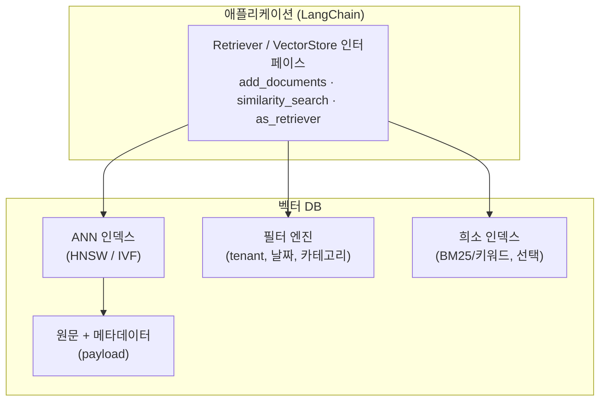
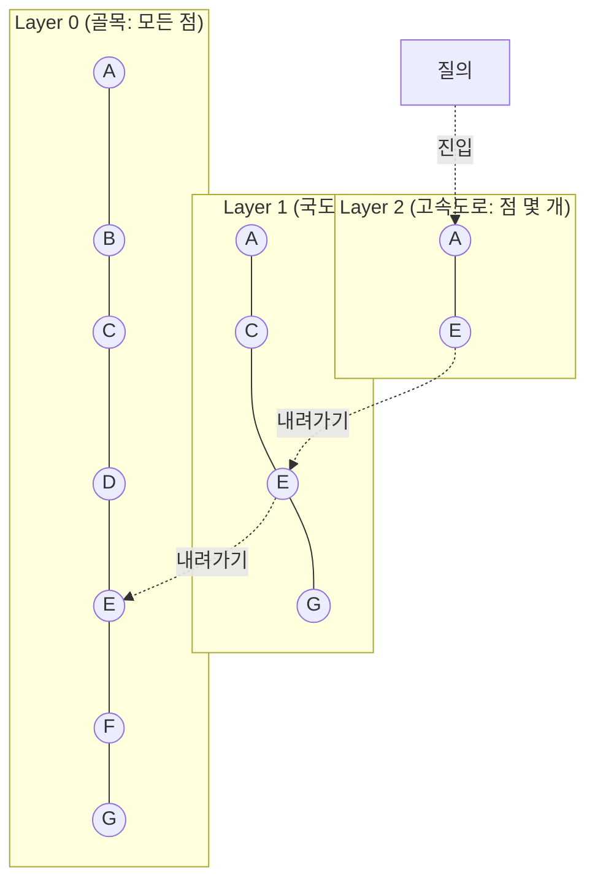
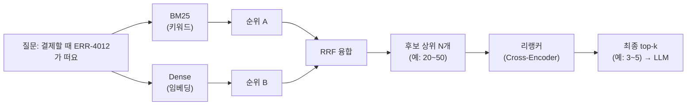

# 벡터 저장소: 인메모리부터 프로덕션 DB까지

## 왜 필요한가: numpy 행렬 곱으로는 부족한 순간

01강에서 `문서 행렬 @ 질의 벡터` 한 줄로 검색을 만들었습니다. 문서가 수천 개라면 이것으로 충분합니다. 하지만 서비스가 커지면 질문이 달라집니다.

- 문서가 **1,000만 개**라면? 매 질문마다 1,000만 번 내적을 계산하면 느립니다.
- 서버가 재시작되면 벡터가 **사라지면** 안 됩니다.
- "**우리 회사(tenant) 문서 중** 2026년 이후 것만" 같은 **필터**가 필요합니다.
- 문서가 **수정·삭제**되면 해당 벡터만 바꿔야 합니다.
- 여러 서버가 동시에 읽고 쓰고, 장애에도 버텨야 합니다.

이것을 해결해 주는 것이 **벡터 저장소(Vector Store) / 벡터 데이터베이스(Vector DB)** 입니다. 본질은 여전히 "가장 가까운 벡터 찾기"지만, 그 위에 **인덱스, 영속성, 필터, CRUD, 확장성**을 얹은 것입니다.



## 핵심 개념 1: LangChain VectorStore 공통 인터페이스

LangChain의 가장 큰 장점 중 하나는 **어떤 벡터 DB든 같은 메서드**로 다룬다는 점입니다. 개발은 `InMemoryVectorStore`로 하고, 운영은 Qdrant나 pgvector로 바꿔도 검색 코드는 거의 그대로입니다.

| 메서드 | 하는 일 |
|---|---|
| `add_documents(docs, ids=...)` | 임베딩 후 저장. 같은 id면 갱신(upsert) |
| `similarity_search(q, k, filter=...)` | 가장 가까운 k개 |
| `similarity_search_with_score(q, k)` | 점수와 함께 (점수 의미는 DB마다 다름!) |
| `max_marginal_relevance_search(q, k, fetch_k, lambda_mult)` | MMR: 관련성 + 다양성 |
| `delete(ids=[...])` | 삭제 |
| `as_retriever(search_type=..., search_kwargs=...)` | 에이전트·체인에 꽂는 **Retriever**(Runnable)로 변환 |

▶ 오른쪽 IDE의 `examples/01_inmemory_and_filters.py`를 실행해 보세요.

```python
from langchain_core.vectorstores import InMemoryVectorStore

store = InMemoryVectorStore(embedding=embeddings)
store.add_documents(docs)                     # Document(id="p1", ...) 처럼 id를 주면 그 id 사용
store.similarity_search("환불 신청 방법", k=3, filter=lambda d: d.metadata["year"] >= 2026)
retriever = store.as_retriever(search_type="mmr", search_kwargs={"k": 2, "fetch_k": 6})
retriever.invoke("환불 기간")                  # Retriever는 Runnable → .invoke()
```

### MMR(Maximal Marginal Relevance): 중복을 줄이는 검색

같은 내용을 조금씩 다르게 쓴 문서(복사된 FAQ, 버전만 다른 문서)가 있으면 top-k가 **같은 정보로 도배**됩니다. LLM에게 같은 말을 세 번 주는 것은 컨텍스트 낭비입니다. MMR은 후보 `fetch_k`개를 먼저 뽑고, 하나씩 고를 때마다 "질문과는 비슷하되 **이미 고른 문서와는 다른**" 것을 고릅니다.

```text
MMR 점수 = λ · sim(질문, 문서) − (1−λ) · max sim(문서, 이미 고른 문서들)
```

`lambda_mult`(λ)가 1이면 일반 유사도 검색, 0에 가까울수록 다양성을 중시합니다. 보통 0.5~0.7에서 시작합니다.

> [!WARNING]
> `InMemoryVectorStore`는 점수를 0~1 관련도로 변환하는 기능이 없어 `as_retriever(search_type="similarity_score_threshold")`를 쓰면 `NotImplementedError`가 납니다. 예제처럼 `similarity_search_with_score`로 받아 직접 거르거나, 이 기능을 지원하는 저장소(Qdrant, Chroma 등)를 쓰세요.

## 핵심 개념 2: 실전 DB를 인메모리로 — Qdrant와 Chroma

▶ `examples/02_qdrant_and_chroma.py`를 실행해 보세요. 두 DB 모두 **서버 없이 프로세스 안에서** 같은 API로 동작합니다. 프로덕션에서는 연결 부분만 바꾸면 됩니다.

```python
from qdrant_client import QdrantClient, models
from langchain_qdrant import QdrantVectorStore

client = QdrantClient(":memory:")      # 운영: QdrantClient(url="http://qdrant:6333", api_key=...)
client.create_collection("support_docs",
    vectors_config=models.VectorParams(size=DIM, distance=models.Distance.COSINE))
qdrant = QdrantVectorStore(client=client, collection_name="support_docs", embedding=embeddings)

acme_only = models.Filter(must=[
    models.FieldCondition(key="metadata.tenant", match=models.MatchValue(value="acme")),
    models.FieldCondition(key="metadata.year", range=models.Range(gte=2026)),
])
qdrant.similarity_search_with_score("환불 기간", k=3, filter=acme_only)
```

```python
import chromadb
from langchain_chroma import Chroma

chroma = Chroma(client=chromadb.EphemeralClient(), collection_name="support_docs",
                embedding_function=embeddings, collection_metadata={"hnsw:space": "cosine"})
chroma.similarity_search("환불 기간", k=3,
                         filter={"$and": [{"tenant": {"$eq": "acme"}}, {"year": {"$gte": 2026}}]})
```

세 가지 차이에 주목하세요.

1. **필터 문법이 DB마다 다릅니다.** InMemory는 파이썬 함수, Qdrant는 `models.Filter` 객체(메타데이터가 `metadata.` 아래에 저장됨), Chroma는 MongoDB 스타일 `where` 딕셔너리입니다. 그래서 필터 생성 로직은 한 함수로 감싸 두는 것이 좋습니다.
2. **점수의 의미가 다릅니다.** Qdrant(코사인)는 클수록 유사, Chroma의 `similarity_search_with_score`는 **거리**라 작을수록 유사합니다. `similarity_search_with_relevance_scores`를 쓰면 0~1(클수록 유사)로 변환된 값을 받을 수 있습니다. 임계값 코드를 DB 사이에서 복사하면 사고가 납니다.
3. **id 규칙이 다릅니다.** Qdrant의 포인트 id는 **UUID나 정수만** 허용합니다. `"faq#3"` 같은 문자열 id는 `uuid.uuid5(NAMESPACE_URL, "faq#3")`처럼 결정적으로 변환해서 넣으세요. Chroma 컬렉션 이름은 3자 이상이어야 합니다.

## 동작 원리: 근사 최근접 이웃(ANN) 인덱스

1,000만 개 벡터를 모두 비교하는 전수 검색(Flat)은 정확하지만 느립니다. 그래서 벡터 DB는 **약간의 정확도를 양보하고 속도를 크게 얻는** 근사 최근접 이웃(Approximate Nearest Neighbor, ANN) 인덱스를 씁니다. 대표적인 두 가지입니다.

### HNSW (Hierarchical Navigable Small World)

"고속도로 → 국도 → 골목길" 지도를 떠올리세요. 맨 위층에는 소수의 점만 긴 간선으로 연결되어 있고, 아래층으로 갈수록 점이 많아지고 간선이 짧아집니다. 검색은 위층에서 대략적인 방향을 잡고, 아래층으로 내려가며 정밀하게 찾아갑니다.



- **장점**: 검색이 빠르고 재현율(Recall)이 높습니다. 데이터를 하나씩 추가하기도 쉽습니다. Qdrant, Weaviate, pgvector(HNSW), Chroma, Elasticsearch 등 대부분이 지원하는 사실상 기본값입니다.
- **단점**: 그래프를 메모리에 올려야 해서 **메모리 사용량이 큽니다.** 삭제가 잦으면 그래프 품질이 떨어질 수 있습니다.
- **튜닝 파라미터**: `M`(점마다 연결 수, 클수록 정확·메모리↑), `ef_construction`(색인 시 탐색 폭), `ef`/`ef_search`(검색 시 탐색 폭, 클수록 정확·느림).

### IVF (Inverted File Index)

벡터들을 k-means로 수백~수천 개 **클러스터(동네)** 로 나눕니다. 검색할 때는 질의와 가까운 동네 몇 개(`nprobe`)만 뒤집니다. 우편번호로 먼저 동네를 고르고 그 안에서만 집을 찾는 것과 같습니다.

- **장점**: 메모리 효율이 좋고, **양자화(PQ, Product Quantization)** 와 결합(IVF-PQ)하면 수억 개 규모도 다룰 수 있습니다. Milvus, FAISS, pgvector(ivfflat)가 지원합니다.
- **단점**: 클러스터를 학습(train)해야 하고, 데이터 분포가 바뀌면 재학습이 필요합니다. `nprobe`가 작으면 경계 근처 벡터를 놓칩니다.

| 기준 | Flat(전수) | HNSW | IVF(+PQ) |
|---|---|---|---|
| 정확도 | 100% | 매우 높음 | 높음(nprobe에 따라) |
| 검색 속도 | 느림(O(N)) | 매우 빠름 | 빠름 |
| 메모리 | 벡터만 | 큼(그래프) | 작음(특히 PQ) |
| 적합 규모 | ~수만 | 수십만~수억 | 수백만~수십억 |

> [!TIP]
> **양자화(Quantization)** 는 float32 벡터를 int8이나 1비트(binary)로 압축해 메모리를 4~32배 줄이는 기법입니다. Qdrant, Milvus, Elasticsearch, pgvector(halfvec/bit) 등이 지원합니다. 보통 압축 벡터로 후보를 넉넉히 찾고 원본 벡터로 다시 점수를 매기는(rescoring) 방식으로 정확도를 보전합니다.

## 핵심 개념 3: 하이브리드 검색(BM25 + Dense)

임베딩(Dense) 검색은 "돈 돌려받기 = 환불" 같은 **의미**에 강하지만, 의외로 약한 곳이 있습니다.

- 에러 코드 `ERR-4012`, 상품 코드 `SKU-88A1`, 사람 이름, 법 조항 번호처럼 **정확한 문자열**
- 학습 데이터에 드문 신조어·사내 약어

이런 것은 고전적인 **키워드 검색 BM25**가 훨씬 잘합니다. BM25는 "질문의 단어가 문서에 얼마나 자주 나오는가(TF)"에 "그 단어가 전체에서 얼마나 드문가(IDF)"를 곱하고, 문서 길이로 보정합니다. `ERR-4012`처럼 드문 토큰은 IDF가 커서 강력한 신호가 됩니다.

**하이브리드 검색**은 두 검색을 모두 돌리고 결과를 합칩니다. 문제는 BM25 점수(0~수십)와 코사인 점수(-1~1)의 스케일이 전혀 다르다는 것입니다. 그래서 점수 대신 **순위만** 쓰는 **RRF(Reciprocal Rank Fusion)** 가 표준입니다.

```text
RRF(d) = Σ_검색기  1 / (k + rank_검색기(d))      (k는 보통 60)
```



▶ `examples/03_hybrid_and_rerank.py`를 실행해 보세요. BM25를 순수 파이썬으로 직접 구현하고, Dense 순위와 RRF로 합친 뒤, 리랭킹까지 합니다. 마지막에는 Qdrant의 **네이티브 하이브리드**(한 컬렉션에 dense 벡터와 sparse 벡터를 함께 저장하고 서버가 RRF로 융합)도 인메모리로 돌려 봅니다.

```python
from langchain_qdrant import QdrantVectorStore, RetrievalMode

client.create_collection("hybrid_docs",
    vectors_config={"dense": models.VectorParams(size=dim, distance=models.Distance.COSINE)},
    sparse_vectors_config={"sparse": models.SparseVectorParams(modifier=models.Modifier.IDF)})
hybrid = QdrantVectorStore(client=client, collection_name="hybrid_docs",
    embedding=embeddings, sparse_embedding=HashedTFSparse(),        # 운영: FastEmbedSparse(model_name="Qdrant/bm25")
    retrieval_mode=RetrievalMode.HYBRID, vector_name="dense", sparse_vector_name="sparse")
```

> [!NOTE]
> Mock 임베딩은 단어 해시 기반이라 Dense 순위와 BM25 순위가 비슷하게 나옵니다. 실제 OpenAI 임베딩으로 실행하면 두 순위가 갈라지는 경우가 많고, 그때 하이브리드의 가치가 드러납니다.

## 핵심 개념 4: 리랭킹(Reranking) — 2단계 검색

임베딩 검색은 질문과 문서를 **따로** 벡터로 만든 뒤 비교합니다(Bi-Encoder). 빠르지만, 질문과 문서의 단어가 서로 어떻게 연결되는지는 보지 못합니다. **Cross-Encoder 리랭커**는 (질문, 문서) **쌍을 한 번에** 모델에 넣어 관련도를 직접 예측합니다. 훨씬 정확하지만 후보마다 모델을 돌려야 하므로 느립니다.

그래서 현업 표준은 **2단계(Retrieve → Rerank)** 입니다. 1단계에서 하이브리드로 20~50개를 넉넉히 뽑고(높은 재현율), 2단계 리랭커로 3~5개만 골라 LLM에 넘깁니다(높은 정밀도). LLM 컨텍스트가 줄어 비용도 내려갑니다.

## 프로덕션 벡터 DB 비교

> [!IMPORTANT]
> 아래 코드는 **참고용**입니다. 실제 서버나 클라우드 계정, 별도 패키지(`langchain-postgres`, `langchain-pinecone` 등)가 필요해 이 사이트의 IDE에서는 실행되지 않습니다. 실습은 위의 인메모리 예제로 하고, 운영 환경에서 이 형태로 바꿔 끼우면 됩니다.

| DB | 유형 | 강점 | 고려할 점 |
|---|---|---|---|
| **pgvector** (Postgres) | 기존 RDB 확장 | 이미 Postgres를 쓴다면 운영 부담 최소, SQL 조인·트랜잭션·권한(RLS) | 초대규모에서는 전용 DB보다 튜닝 필요 |
| **Pinecone** | 완전 관리형 SaaS | 운영 없음, 서버리스 과금, 네임스페이스 | 벤더 종속, 데이터가 외부로 나감 |
| **Qdrant** | 전용 벡터 DB(OSS+클라우드) | 강력한 payload 필터, 하이브리드, 양자화 | 별도 클러스터 운영 |
| **Weaviate** | 전용 벡터 DB(OSS+클라우드) | 내장 하이브리드(BM25+벡터), 모듈 생태계 | 스키마 개념 학습 필요 |
| **Milvus / Zilliz** | 분산 벡터 DB | 수십억 규모, 다양한 인덱스(IVF-PQ, GPU) | 구성 요소가 많아 운영 복잡 |
| **Elasticsearch / OpenSearch** | 검색 엔진 + 벡터 | 성숙한 BM25 + kNN 하이브리드, 집계·로그 | 메모리 사용량, 클러스터 튜닝 |
| **MongoDB Atlas Vector Search** | 문서 DB + 벡터 | 운영 데이터와 같은 곳에 저장 | Atlas(관리형) 필요 |
| **Redis** | 인메모리 DB + 벡터 | 매우 낮은 지연, 캐시와 겸용 | 메모리 비용 |
| **Chroma** | 경량 임베디드/서버 | 프로토타입·로컬 개발이 쉬움 | 대규모 운영 사례는 상대적으로 적음 |

**선택 기준 요약**: 이미 Postgres가 있고 수백만 건 이하라면 pgvector부터. 운영 인력이 없으면 Pinecone 같은 관리형. 복잡한 필터와 하이브리드가 핵심이면 Qdrant/Weaviate/Elasticsearch. 수억~수십억 건이면 Milvus 계열을 검토합니다.

```python
# [참고] pgvector — langchain-postgres (PGVectorStore, 운영 권장 방식)
from langchain_postgres import PGEngine, PGVectorStore

engine = PGEngine.from_connection_string(url="postgresql+psycopg://app:secret@db:5432/rag")
engine.init_vectorstore_table(table_name="support_docs", vector_size=1536)   # 최초 1회
store = PGVectorStore.create_sync(engine=engine, table_name="support_docs", embedding_service=embeddings)
# 인덱스(SQL 예): CREATE INDEX ON support_docs USING hnsw (embedding vector_cosine_ops);
```

```python
# [참고] Pinecone — langchain-pinecone
from pinecone import Pinecone
from langchain_pinecone import PineconeVectorStore

index = Pinecone(api_key=os.environ["PINECONE_API_KEY"]).Index("support-docs")
store = PineconeVectorStore(index=index, embedding=embeddings, namespace="tenant-acme")  # 네임스페이스로 테넌트 격리
```

```python
# [참고] Weaviate — langchain-weaviate (하이브리드는 alpha로 키워드/벡터 비중 조절)
import weaviate
from langchain_weaviate import WeaviateVectorStore

client = weaviate.connect_to_local()
store = WeaviateVectorStore(client=client, index_name="SupportDocs", text_key="text", embedding=embeddings)
store.similarity_search("ERR-4012", k=5, alpha=0.5)
```

```python
# [참고] Milvus — langchain-milvus
from langchain_milvus import Milvus

store = Milvus(embedding_function=embeddings, collection_name="support_docs",
               connection_args={"uri": "http://milvus:19530"},
               index_params={"index_type": "HNSW", "metric_type": "COSINE"})
```

```python
# [참고] Elasticsearch — langchain-elasticsearch (BM25 + kNN 하이브리드, RRF)
from langchain_elasticsearch import ElasticsearchStore, DenseVectorStrategy

store = ElasticsearchStore(es_url="http://es:9200", index_name="support_docs", embedding=embeddings,
                           strategy=DenseVectorStrategy(hybrid=True))
```

```python
# [참고] 리랭커 — Cohere Rerank API 또는 오픈소스 Cross-Encoder
from langchain_cohere import CohereRerank
reranker = CohereRerank(model="rerank-v3.5", top_n=3)
top_docs = reranker.compress_documents(candidates, query="결제할 때 ERR-4012가 떠요")

from sentence_transformers import CrossEncoder
ce = CrossEncoder("BAAI/bge-reranker-v2-m3")
scores = ce.predict([(query, d.page_content) for d in candidates])
```

## 현업에서는

- **테넌트 격리는 검색 단계에서**: 모든 검색 호출이 테넌트 필터를 거치도록 retriever 생성 함수를 하나로 강제하세요. 규모가 크면 테넌트별 컬렉션/네임스페이스 분리, Postgres라면 행 수준 보안(RLS)을 검토합니다. 필터 필드에는 **payload 인덱스**를 꼭 만드세요. 없으면 필터가 느려지거나 HNSW 탐색 품질이 떨어질 수 있습니다.
- **지연 예산**: 질문 임베딩(수십 ms) + 벡터 검색(수~수십 ms) + 리랭킹(수십~수백 ms) + LLM 생성(수 초). 리랭커 후보 수를 늘리면 정확도는 오르지만 지연도 선형으로 늘어납니다. p95 지연을 측정하며 조절하세요.
- **재색인 전략**: 임베딩 모델 교체나 청킹 변경 시 새 컬렉션에 색인 → 평가 → 별칭(alias) 전환(Qdrant collection alias, Elasticsearch alias)으로 무중단 교체합니다.
- **백업과 일관성**: 원본 문서 저장소(S3, DB)가 **진실의 원천(Source of Truth)** 이고, 벡터 DB는 언제든 재생성 가능한 **파생 인덱스**로 취급하세요. 그래야 장애 시 복구가 쉽습니다.
- **관측성**: LangSmith에서 retriever 실행을 추적하면 질의, 반환 문서, 메타데이터가 함께 기록됩니다. "0건 반환", "같은 문서 반복", "다른 테넌트 문서 등장" 같은 이상 징후를 지표로 모니터링하세요.
- **테스트**: 단위 테스트에서는 `InMemoryVectorStore`나 `QdrantClient(":memory:")`로 실제 DB 없이 필터·권한 로직을 검증합니다. 이 강의의 실습이 바로 그 형태입니다.

## 안티패턴

- 테넌트/권한 필터를 프롬프트에 맡긴다 → 다른 고객 문서가 컨텍스트에 들어간 순간 이미 유출입니다.
- DB를 바꾸면서 점수 임계값을 그대로 쓴다 → 거리와 유사도의 방향이 반대일 수 있습니다.
- Dense 검색만 쓰고 에러 코드·상품 코드 질문에서 실패한다 → 하이브리드를 검토하세요.
- 리랭커 없이 top-20을 그대로 LLM에 넣는다 → 비용·지연이 커지고 잡음 때문에 답이 흐려집니다.
- "벡터 DB 벤치마크 1위"로 고른다 → 여러분의 데이터 규모, 필터 패턴, 운영 역량이 기준입니다.

## 정리

- LangChain VectorStore는 DB가 달라도 **같은 인터페이스**(add/search/filter/MMR/delete/as_retriever)를 제공합니다.
- 필터 문법, 점수 의미, id 규칙은 DB마다 다르므로 추상화 함수로 감싸세요.
- ANN 인덱스는 HNSW(빠르고 정확, 메모리↑)와 IVF(메모리 효율, 대규모)가 대표적입니다.
- 현업 검색 파이프라인의 표준형은 **하이브리드(BM25+Dense, RRF) → 리랭커 → top-k**입니다.

▶ `exercise.py`에서 RRF 함수, Qdrant 테넌트 필터, 하이브리드 검색기를 직접 완성해 보세요. 다음 강의에서는 이 검색기를 **에이전트의 도구**로 만들어 "언제 검색할지"를 LLM이 스스로 결정하는 **Agentic RAG**를 만듭니다.
