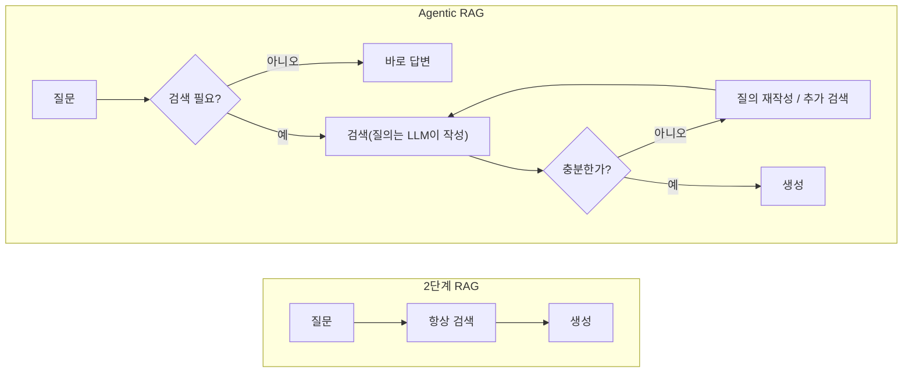
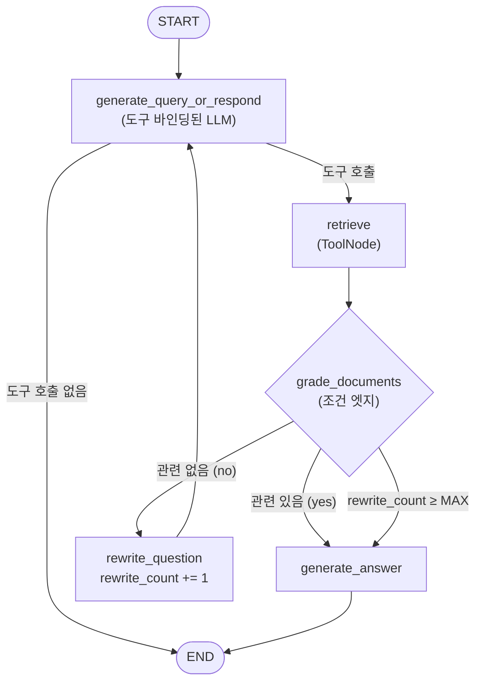

# Agentic RAG: 검색을 스스로 판단하는 에이전트

## 왜 필요한가: "항상 검색"의 한계

지금까지 만든 RAG는 이런 흐름이었습니다. 질문이 오면 **무조건** 검색하고, 결과를 프롬프트에 붙여 답합니다. 이것을 **2단계 RAG(Two-step RAG)** 라고 부릅니다. 단순하고, 빠르고, 예측 가능합니다. 많은 FAQ 봇이 이것으로 충분합니다.

그런데 실제 사용자 질문을 받아 보면 곧 한계가 드러납니다.

- "안녕하세요!" → 검색할 필요가 없는데 검색합니다. 비용과 지연 낭비입니다.
- "작년 대비 올해 연차 정책 바뀐 거 있어?" → 검색을 **두 번**(작년 문서, 올해 문서) 해야 합니다.
- "그거 신청은 어디서 해?" → "그거"가 무엇인지 대화 맥락으로 질의를 **다시 써야** 검색이 됩니다.
- 검색 결과가 엉뚱하면? 2단계 RAG는 그 엉뚱한 문서를 근거로 그대로 답합니다.

**Agentic RAG**는 검색을 **에이전트의 도구**로 바꿉니다. LLM이 "검색이 필요한가? 무엇으로 검색할까? 결과가 충분한가? 다시 찾아야 하나?"를 스스로 판단합니다. 이 모듈 이전에 배운 에이전트(도구 호출 루프)와 RAG가 만나는 지점입니다.



| 기준 | 2단계 RAG | Agentic RAG |
|---|---|---|
| LLM 호출 수 | 1회 | 2회 이상(가변) |
| 지연·비용 | 낮고 예측 가능 | 높고 변동 |
| 복잡한 질문(다중 검색, 대화 맥락) | 약함 | 강함 |
| 디버깅 | 쉬움 | 궤적(trajectory) 추적 필요 |
| 적합한 곳 | FAQ, 단일 문서군, 지연 민감 서비스 | 리서치 도우미, 여러 지식원, 복합 질문 |

> [!TIP]
> 현업에서는 "무조건 Agentic"이 정답이 아닙니다. 2단계 RAG로 시작해 **실패 사례를 모은 뒤**, 그 실패가 "검색 판단/재검색"으로 해결되는 유형일 때 Agentic으로 확장하는 것이 비용 대비 효과가 좋습니다.

## 핵심 개념 1: Retriever를 도구로 만들기

LangChain v1에서는 검색 함수를 `@tool`로 감싸면 그대로 에이전트 도구가 됩니다. 이때 도구의 **이름과 docstring이 곧 LLM에게 주는 사용 설명서**입니다. "언제 이 도구를 써야 하는지"를 구체적으로 적으세요.

```python
from langchain.tools import tool

@tool(response_format="content_and_artifact")
def search_hr_docs(query: str) -> tuple[str, list[Document]]:
    """사내 인사(HR) 규정 문서를 검색합니다. 연차, 반차, 재택 근무, 복지, 교육비 질문에 사용하세요.

    Args:
        query: 검색할 질문 또는 키워드
    """
    docs = store.similarity_search(query, k=2)
    return format_docs(docs), docs        # (LLM이 볼 문자열, 코드가 쓸 원본 객체)
```

`response_format="content_and_artifact"`가 중요한 포인트입니다. 도구가 `(content, artifact)` 튜플을 돌려주면,

- `content`(문자열)는 `ToolMessage.content`로 **LLM에게 전달**되고,
- `artifact`(원본 `Document` 리스트)는 `ToolMessage.artifact`에 **코드용으로 보관**됩니다. LLM 컨텍스트를 차지하지 않습니다.

덕분에 UI에서 "근거 문서 보기", 출처 링크, 평가 파이프라인(어떤 문서가 검색됐는지)을 깔끔하게 구현할 수 있습니다.

```python
from langchain.agents import create_agent

agent = create_agent(
    MODEL,
    tools=[search_hr_docs, get_today],
    system_prompt="회사 규정 질문은 반드시 search_hr_docs로 근거를 찾은 뒤 답하고, 답변 끝에 [출처: ...]를 붙이세요.",
)
result = agent.invoke({"messages": [{"role": "user", "content": "반차는 몇 시간 단위인가요?"}]})
```

▶ 오른쪽 IDE의 `examples/01_retriever_as_tool.py`를 실행해 보세요. Agentic 방식의 메시지 흐름(Human → AI 도구 호출 → Tool → AI 답변)과, `@dynamic_prompt` 미들웨어로 만든 2단계 RAG(Human → AI)를 나란히 비교합니다.

### 2단계 RAG를 create_agent로: @dynamic_prompt

2단계 RAG도 `create_agent`로 만들 수 있습니다. 도구 대신, **모델을 호출하기 직전에** 검색해서 시스템 프롬프트에 컨텍스트를 넣는 미들웨어를 씁니다.

```python
from langchain.agents.middleware import ModelRequest, dynamic_prompt

@dynamic_prompt
def inject_context(request: ModelRequest) -> str:
    last_user = next(m for m in reversed(request.state["messages"]) if m.type == "human")
    docs = store.similarity_search(last_user.text, k=2)
    return f"아래 컨텍스트만 근거로 답하세요.\n<context>\n{format_docs(docs)}\n</context>"

two_step = create_agent(MODEL, tools=[], middleware=[inject_context])
```

LLM 호출이 1회뿐이라 빠르고 쌉니다. 같은 `create_agent` 인터페이스이므로 나중에 도구를 추가해 Agentic으로 확장하기도 쉽습니다.

> [!NOTE]
> Mock 모드의 모델은 도구가 있으면 항상 도구를 호출합니다. 실제 모델은 "안녕하세요" 같은 질문에는 검색 없이 바로 답합니다. API 키를 넣고 인사말과 규정 질문을 번갈아 보내 비교해 보세요.

## 핵심 개념 2: LangGraph로 만드는 Agentic RAG

`create_agent`는 "모델 ↔ 도구" 루프를 자동으로 돌려 줍니다. 하지만 "검색 결과가 관련 없으면 질문을 다시 써서 재검색한다" 같은 **명시적 품질 관리 단계**를 넣고 싶다면, LangGraph로 흐름을 직접 설계하는 편이 명확합니다. 각 단계가 노드가 되어 LangSmith에서 하나씩 보이고, 단계별로 다른 모델을 쓰거나 재시도 정책을 걸 수도 있습니다.



노드별 역할을 살펴봅시다.

1. **generate_query_or_respond**: `llm.bind_tools(tools)`로 도구가 연결된 모델을 호출합니다. 모델이 도구를 부르면 검색으로, 아니면 그대로 끝납니다. 분기는 `langgraph.prebuilt`의 `tools_condition`이 처리합니다(마지막 메시지에 `tool_calls`가 있으면 `"tools"`, 없으면 `END`).
2. **retrieve**: `ToolNode(tools)`가 도구 호출을 실행해 `ToolMessage`를 만듭니다.
3. **grade_documents**: 노드가 아니라 **조건 엣지 함수**입니다. 구조화 출력(`with_structured_output`)으로 `"yes"`/`"no"`를 받아 다음 노드 이름을 반환합니다.
4. **rewrite_question**: 원래 질문을 검색에 유리한 형태로 다시 쓰고, 새 `HumanMessage`로 추가합니다. 그러면 1번 노드가 이 새 질문으로 다시 검색합니다.
5. **generate_answer**: 검색 컨텍스트만 근거로 최종 답변을 만듭니다.

### 관련성 평가: 구조화 출력 + 결정적 가드

```python
class GradeDocuments(BaseModel):
    binary_score: Literal["yes", "no"] = Field(description="관련 있으면 'yes', 아니면 'no'")

def grade_documents(state: RAGState) -> Literal["generate_answer", "rewrite_question"]:
    last = state["messages"][-1]
    if state.get("rewrite_count", 0) >= MAX_REWRITES:     # ① 상한: 무한 루프·비용 폭주 방지
        return "generate_answer"
    if not last.artifact:                                  # ② 결정적 가드: 0건이면 LLM을 부를 필요 없음
        return "rewrite_question"
    verdict = llm.with_structured_output(GradeDocuments).invoke([HumanMessage(prompt)])
    return "generate_answer" if verdict.binary_score == "yes" else "rewrite_question"
```

여기에는 현업 설계 원칙 세 가지가 들어 있습니다.

- **루프에는 반드시 상한을 둔다.** "관련 문서가 없는" 질문(예: 점심 메뉴 추천)은 아무리 재작성해도 문서가 안 나옵니다. 상한이 없으면 영원히 돌고 비용이 쌓입니다. 상태에 `rewrite_count`를 두고, `recursion_limit`으로 이중 안전장치를 겁니다.
- **값싼 규칙을 먼저, 비싼 LLM은 나중에.** 검색 결과가 0건이거나 점수가 임계값 미만이면 LLM 판정 없이 바로 분기합니다. LLM 호출 하나가 수백 ms~수 초입니다.
- **판정은 구조화 출력으로.** 자유 텍스트 "네, 관련 있는 것 같아요"를 파싱하지 말고, `Literal["yes", "no"]` 스키마로 받으세요. 분기 코드가 단순하고 안전해집니다.

▶ `examples/02_langgraph_agentic_rag.py`를 실행해 보세요. 관련 질문("interrupt는 무엇인가요?")은 바로 답변으로 가고, 무관한 질문("점심 메뉴 추천")은 0건 → 재작성 → 재검색 경로를 탑니다. `stream_mode=["updates", "values"]`로 노드별 진행 상황과 최종 상태를 동시에 받습니다.

> [!WARNING]
> 재작성된 질문으로 검색했더니 엉뚱한 문서가 나오고, LLM 판정이 "yes"를 주는 경우도 있습니다(Mock 실행 결과에서도 볼 수 있습니다). 그래서 최종 답변 프롬프트에 "컨텍스트에 답이 없으면 찾지 못했다고 답하라"는 지시를 넣고, 05강의 **faithfulness 평가**로 이런 실패를 측정합니다. 한 단계의 판정에 모든 품질을 맡기지 마세요.

### 그래프 조립

```python
builder = StateGraph(RAGState)              # MessagesState + rewrite_count
builder.add_node(generate_query_or_respond)
builder.add_node("retrieve", ToolNode(tools))
builder.add_node(rewrite_question)
builder.add_node(generate_answer)

builder.add_edge(START, "generate_query_or_respond")
builder.add_conditional_edges("generate_query_or_respond", tools_condition, {"tools": "retrieve", END: END})
builder.add_conditional_edges("retrieve", grade_documents)   # 반환 타입 Literal로 목적지 추론
builder.add_edge("rewrite_question", "generate_query_or_respond")
builder.add_edge("generate_answer", END)
graph = builder.compile()
```

조건 엣지 함수의 반환 타입을 `Literal["generate_answer", "rewrite_question"]`로 적으면 LangGraph가 가능한 목적지를 알아내 그래프 시각화(`draw_mermaid()`)에 반영합니다.

## 대화형 RAG: 후속 질문 처리

"그거 신청은 어디서 해?" 같은 후속 질문은 이전 대화 없이는 검색이 불가능합니다. Agentic RAG에서는 `generate_query_or_respond`가 **전체 메시지 히스토리**를 보고 도구 인자(`query`)를 직접 작성하므로, 모델이 "반차 신청 방법"처럼 **독립적인 질의(standalone query)** 로 바꿔 검색합니다. 체크포인터(`InMemorySaver`, 운영은 Postgres)를 붙이고 `thread_id`로 대화를 이어 가면 그대로 대화형 RAG가 됩니다.

```python
from langgraph.checkpoint.memory import InMemorySaver

graph = builder.compile(checkpointer=InMemorySaver())
cfg = {"configurable": {"thread_id": "user-42"}, "recursion_limit": 20}
graph.invoke({"messages": [HumanMessage("반차는 몇 시간이야?")], "rewrite_count": 0}, cfg)
graph.invoke({"messages": [HumanMessage("그거 신청은 어디서 해?")], "rewrite_count": 0}, cfg)
```

## 현업에서는

- **도구 설명이 라우팅 품질을 결정합니다.** 지식원이 여러 개라면(HR 문서, IT 문서, 상품 DB) 도구를 나누고 각 docstring에 "언제 쓰는지/쓰지 않는지"를 명확히 쓰세요. 도구가 10개를 넘으면 선택 정확도가 떨어지므로 `LLMToolSelectorMiddleware` 같은 도구 선별이나 라우터 노드를 검토합니다.
- **비용 상한**: Agentic RAG는 질문 하나에 LLM 호출이 3~7회가 될 수 있습니다. 재작성 상한, `ModelCallLimitMiddleware`/`ToolCallLimitMiddleware`, `recursion_limit`을 함께 거세요. 판정·재작성 같은 보조 단계에는 더 작은(싼) 모델을 쓰는 것이 일반적입니다.
- **지연**: 사용자는 첫 토큰을 기다립니다. `stream_mode="messages"`로 최종 답변 토큰을 스트리밍하고, "문서를 찾는 중..." 같은 진행 상태를 `updates`로 보여 주세요(08 모듈 스트리밍 강의).
- **관측성**: LangSmith에서 노드별 실행이 트리로 보입니다. "재작성 비율", "0건 검색 비율", "질문당 LLM 호출 수"를 지표로 만들면 검색 품질 저하를 조기에 발견할 수 있습니다.
- **보안**: 검색된 문서는 **신뢰할 수 없는 입력**입니다. 문서 안에 "이전 지시를 무시하고..." 같은 프롬프트 인젝션이 숨어 있을 수 있습니다. 컨텍스트를 `<context>` 태그로 감싸 지시와 구분하고, 도구 권한을 최소화하세요(08 모듈 가드레일 강의).
- **테스트**: Mock 모델로 그래프의 **경로**를 테스트할 수 있습니다. "0건이면 재작성으로 간다", "상한에 도달하면 답변으로 끝난다" 같은 분기 로직은 LLM 품질과 무관하게 단위 테스트로 고정하세요. 이번 실습의 assert가 바로 그런 테스트입니다.

## 안티패턴

- 재작성 루프에 상한이 없다 → 답이 없는 질문 하나가 비용 폭탄이 됩니다.
- 도구 docstring을 "문서를 검색합니다" 한 줄로 쓴다 → 모델이 언제 써야 할지 모릅니다.
- 검색 결과 원본을 버리고 문자열만 남긴다 → 출처 표시와 평가가 불가능해집니다. `content_and_artifact`를 쓰세요.
- 판정 결과를 자유 텍스트로 받아 `"yes" in text`로 파싱한다 → "yes가 아닙니다"도 yes로 판정됩니다.

## 정리

- **2단계 RAG**는 항상 검색(LLM 1회, 빠르고 예측 가능), **Agentic RAG**는 검색 여부·질의·재검색을 LLM이 결정(유연하지만 비용·지연↑)합니다.
- `@tool(response_format="content_and_artifact")`로 LLM용 텍스트와 코드용 원본 문서를 분리합니다.
- LangGraph로 **검색 결정 → 검색 → 관련성 평가 → 재작성 → 생성** 루프를 명시적으로 만들고, **상한과 결정적 가드**를 둡니다.

▶ `exercise.py`에서 라우팅 함수와 엣지를 완성해 재작성 상한이 있는 Agentic RAG 그래프를 만들어 보세요. 다음 강의에서는 이 루프를 확장한 **Corrective RAG, Self-RAG, Adaptive RAG**와 **RAG 평가**를 다룹니다.
