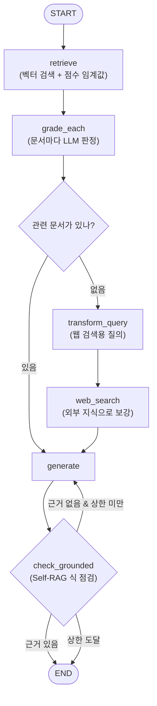
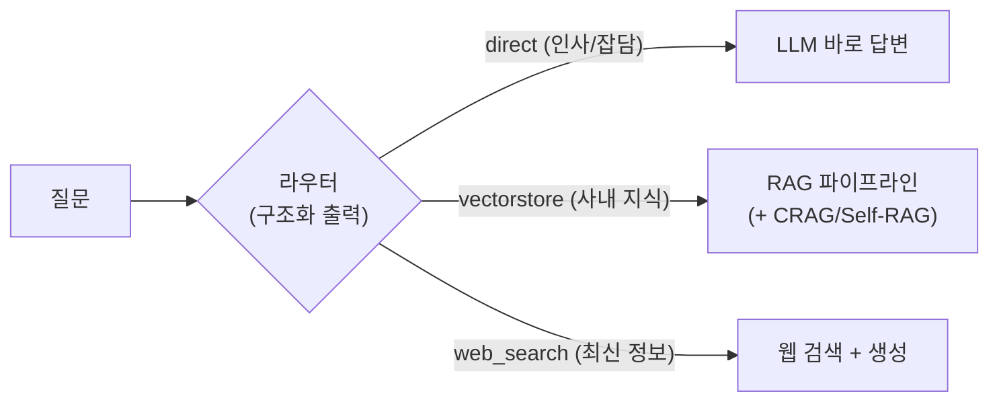
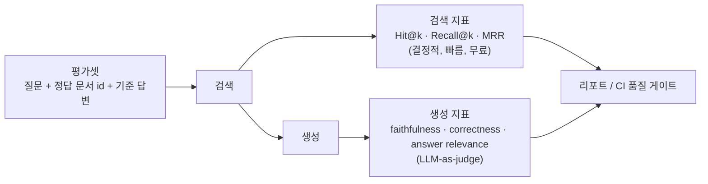
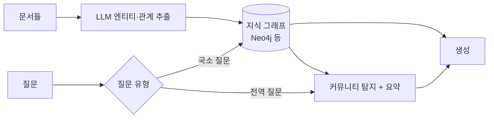

# 고급 RAG: 고치고, 점검하고, 측정하기

## 왜 필요한가: "기본 RAG"가 실패하는 방식들

지금까지 만든 RAG를 실제 사용자에게 열면 다양한 방식으로 실패합니다. 실패 유형을 먼저 분류해 두면 어떤 고급 기법이 필요한지 명확해집니다.

| 실패 유형 | 예 | 처방 |
|---|---|---|
| 검색 결과가 엉뚱함 | 지식 베이스에 없는 최신 정보 질문 | **Corrective RAG**: 평가 후 외부 검색으로 보강 |
| 답변이 문서와 다름(환각) | 문서엔 "15일"인데 "20일"이라고 답함 | **Self-RAG**: 생성 후 근거성 점검·재생성 |
| 질문 유형마다 최적 경로가 다름 | 잡담, 사내 규정, 최신 뉴스가 섞여 들어옴 | **Adaptive RAG**: 질문을 분류해 경로 선택 |
| 복합 질문 | "파이썬과 Go의 동시성 차이는?" | **쿼리 분해 / 멀티 쿼리** |
| 질문과 문서의 표현 차이 | 짧은 의문문 vs 긴 서술형 문서 | **HyDE** |
| "전체를 요약해 줘"류 질문 | "우리 회사 장애 원인의 공통 패턴은?" | **GraphRAG** |

그리고 무엇보다 중요한 것: **측정하지 않으면 개선했는지 알 수 없습니다.** 이 강의의 마지막 절반은 RAG 평가입니다.

## 핵심 개념 1: Corrective RAG (CRAG)

CRAG의 아이디어는 "검색 결과를 **믿기 전에 평가**하고, 부족하면 **고쳐서(Corrective)** 쓰자"입니다. 04강의 관련성 평가와 비슷하지만 두 가지가 다릅니다.

1. 문서를 **하나씩** 평가해 쓸모 있는 문서만 남깁니다(문서 단위 필터링).
2. 관련 문서가 부족하면 질의를 바꿔 **다른 지식원(웹 검색 등)** 으로 보강합니다.



▶ 오른쪽 IDE의 `examples/01_corrective_self_rag.py`를 실행해 보세요. "프로 요금제 가격" 질문은 내부 문서로 답하고, "다음 분기 신규 기능 출시 일정" 질문은 내부 문서 점수가 임계값 미만이라 질의 변환 → (가짜) 웹 검색 경로를 탑니다.

```python
def grade_each(state: CRAGState) -> dict:
    grader = llm.with_structured_output(DocGrade)
    kept = [d for d in state["documents"]
            if grader.invoke([HumanMessage(f"질문: {state['question']}\n문서: {d.page_content}")]).binary_score == "yes"]
    return {"documents": kept, "needs_web": len(kept) == 0}
```

> [!TIP]
> 문서마다 LLM을 호출하면 k=5일 때 판정만 5번입니다. 현업에서는 ① 점수 임계값으로 1차 필터 ② 판정 호출을 **병렬화**(LangGraph `Send` 또는 `batch()`) ③ 판정에는 작은 모델 사용, 이 세 가지로 비용과 지연을 줄입니다. 리랭커 점수를 판정 대신 쓰는 것도 좋은 대안입니다.

## 핵심 개념 2: Self-RAG — 생성 후 스스로 점검

Self-RAG(원 논문은 특별히 학습된 모델이 "검색이 필요한가, 문서가 관련 있나, 답이 근거가 있나"를 특수 토큰으로 스스로 표시)의 핵심 아이디어를 실무에서는 **판정 노드**로 구현합니다.

- **근거성(Grounded / Hallucination check)**: 답변의 주장이 컨텍스트에 있는가? 없으면 재생성.
- **유용성(Answer relevance)**: 답변이 질문에 실제로 답하는가? 아니면 질의 재작성 후 재검색.

```python
def check_grounded(state) -> Literal["generate", "__end__"]:
    if state["regenerate_count"] > MAX_REGENERATE:        # 반드시 상한
        return END
    verdict = llm.with_structured_output(Grounded).invoke([...])
    return END if verdict.binary_score == "yes" else "generate"
```

> [!WARNING]
> 같은 모델이 같은 입력으로 다시 생성하면 같은 실수를 반복하기 쉽습니다. 재생성할 때는 "이전 답변에서 근거 없는 부분: ..." 같은 **피드백을 프롬프트에 포함**하거나, 더 강한 모델로 바꾸는 것이 효과적입니다. 그리고 상한에 도달하면 "확실한 근거를 찾지 못했습니다"라고 **정직하게 답하는 것**이 틀린 답보다 낫습니다.

## 핵심 개념 3: Adaptive RAG — 질문에 맞는 경로 고르기

모든 질문에 같은 파이프라인을 쓰면 낭비거나 부족합니다. Adaptive RAG는 맨 앞에 **라우터**를 두고 질문 유형별로 경로를 나눕니다.



```python
class Route(BaseModel):
    datasource: Literal["vectorstore", "web_search", "direct"] = Field(
        description="사내 기술 문서로 답할 수 있으면 vectorstore, 최신 정보면 web_search, 잡담이면 direct")

route = llm.with_structured_output(Route).invoke([SystemMessage(ROUTER_SYSTEM), HumanMessage(q)])
```

라우터의 반환값을 LangGraph 조건 엣지에 연결하면 됩니다. 질문 복잡도(단순/복합)로 나눠 "단순 질문은 2단계 RAG, 복합 질문은 Agentic RAG"처럼 비용을 최적화하는 것도 Adaptive RAG의 흔한 형태입니다.

> [!NOTE]
> Mock 모델은 구조화 출력의 Literal을 정해진 규칙으로 고르므로 예제에서 모든 질문이 같은 경로로 갑니다. API 키를 넣으면 질문마다 다른 경로가 선택되는 것을 볼 수 있습니다.

## 핵심 개념 4: 질의 변환(Query Transformation)

검색이 실패하는 원인 중 상당수는 **질문 자체가 검색하기 나쁜 형태**라는 데 있습니다.

### 쿼리 분해(Decomposition)와 멀티 쿼리(Multi-query)

"파이썬과 Go의 동시성 모델 차이는?"을 한 번에 검색하면 한쪽 언어 문서만 상위를 차지할 수 있습니다. LLM으로 "파이썬 동시성 GIL asyncio", "Go 고루틴 채널"처럼 하위 질문으로 나눠 **각각 검색한 뒤 RRF로 합치면** 양쪽 문서가 고르게 들어옵니다. 같은 질문을 여러 표현으로 바꿔 검색하는 멀티 쿼리도 같은 방식으로 재현율을 올립니다.

```python
class SubQuestions(BaseModel):
    sub_questions: list[str] = Field(description="독립적으로 검색 가능한 하위 질문 2~4개", min_length=2)

subs = llm.with_structured_output(SubQuestions).invoke([...]).sub_questions
fused = rrf([[d.id for d in store.similarity_search(sq, k=3)] for sq in subs])
```

### HyDE (Hypothetical Document Embeddings)

질문은 짧은 의문문이고 문서는 긴 서술문입니다. 둘은 임베딩 공간에서 생각보다 멀 수 있습니다. HyDE는 LLM에게 **"이 질문에 답하는 문서를 그럴듯하게 써 봐"** 라고 시킨 뒤, 그 가상 문서의 임베딩으로 검색합니다. 가상 문서의 사실이 틀려도 괜찮습니다. **문서처럼 생긴 벡터**를 얻는 것이 목적이기 때문입니다.

```python
hypothetical = llm.invoke([HumanMessage(f"다음 질문에 답하는 기술 문서 한 문단을 작성하세요: {question}")]).text
vec = normalize(embed(question) + embed(hypothetical))          # 원 질문과 섞는 변형이 안전
docs = store.similarity_search_by_vector(vec.tolist(), k=3)
```

▶ `examples/02_query_transform_and_routing.py`에서 라우팅, 쿼리 분해 + RRF, HyDE를 차례로 실행해 보세요.

> [!CAUTION]
> 질의 변환은 모두 **LLM 호출을 하나 더** 추가합니다(지연 +수백 ms~수 초). HyDE는 모델이 도메인을 모르면 엉뚱한 가상 문서를 만들어 오히려 검색을 망칠 수 있습니다. 평가셋으로 효과를 확인한 뒤 도입하세요.

## 핵심 개념 5: RAG 평가

"이번에 청킹을 바꿨더니 좋아진 것 같다"는 느낌으로는 운영할 수 없습니다. RAG는 **검색**과 **생성** 두 단계라 평가도 둘로 나눕니다.



### 검색 지표 (LLM 불필요)

- **Hit Rate@k**: top-k 안에 정답 문서가 하나라도 있는 질문의 비율.
- **Recall@k (Context Recall)**: 정답 문서들 중 top-k에 들어온 비율. 정답이 여러 문서에 흩어진 질문에서 중요합니다.
- **MRR (Mean Reciprocal Rank)**: 첫 정답 문서 순위의 역수 평균. 1위면 1, 2위면 0.5. "얼마나 위에 나오나"를 봅니다. LLM은 앞쪽 컨텍스트를 더 잘 활용하는 경향이 있으므로 중요합니다.

이 지표들은 **결정적이고 공짜**라서 CI에서 매번 돌리기 좋습니다. 단, 질문마다 정답 문서 id를 라벨링해야 합니다. 처음에는 50~100개로 시작하고, 운영 중 실패 사례를 계속 추가해 키워 갑니다.

### 생성 지표 (LLM-as-judge)

- **Faithfulness(근거성)**: 답변의 주장들이 검색 컨텍스트에 근거하는가? 환각을 측정합니다. 정답 라벨 없이도 계산할 수 있습니다.
- **Correctness(정확성)**: 기준 답변(reference)과 의미가 일치하는가?
- **Answer relevance**: 답변이 질문에 실제로 답하는가?

```python
class JudgeResult(BaseModel):
    reasoning: str = Field(description="판정 근거")          # 근거를 먼저 쓰게 하면 판정 품질↑
    faithfulness_score: int = Field(ge=1, le=10)
    correctness_score: int = Field(ge=1, le=10)
```

▶ `examples/03_rag_evaluation.py`를 실행해 보세요. 세 가지 검색 설정(k=1, k=3, MMR)을 같은 평가셋으로 비교하고, LLM 판정자로 생성 품질을 채점합니다.

두 단계 지표를 함께 보면 원인을 좁힐 수 있습니다. **Recall이 낮으면** 검색 문제(청킹, 임베딩, k, 하이브리드), **Recall은 높은데 faithfulness가 낮으면** 생성 문제(프롬프트, 모델, 컨텍스트 순서)입니다.

> [!IMPORTANT]
> LLM 판정자도 틀립니다. 판정 프롬프트를 사람 라벨 수십 개와 비교해 **판정자 자체의 정확도를 먼저 검증**하세요. 판정 모델은 평가 대상 모델과 다르거나 더 강한 모델을 쓰는 것이 일반적입니다. LangSmith의 평가 기능(데이터셋, evaluator, 실험 비교)이나 RAGAS 같은 오픈소스 라이브러리가 이 과정을 체계화해 줍니다(08 모듈 관측성·평가 강의).

## GraphRAG 개요

벡터 검색은 "질문과 비슷한 **조각**"을 찾는 데 강하지만, 다음과 같은 질문에는 약합니다.

- "우리 회사 장애 회고 전체에서 **공통적으로** 나타나는 원인은?" (전체 요약)
- "A 프로젝트 담당자가 참여한 다른 프로젝트의 고객사는?" (다단계 관계 추적)

**GraphRAG**는 문서에서 LLM으로 **엔티티(사람, 조직, 시스템)와 관계**를 추출해 지식 그래프를 만듭니다. 질문이 오면 그래프를 탐색해 관련 엔티티와 연결 관계를 컨텍스트로 씁니다. Microsoft GraphRAG는 여기에 더해 그래프를 **커뮤니티(군집)** 로 나누고 각 커뮤니티 요약을 미리 만들어, "전체적으로 어떤 패턴이 있나" 같은 전역 질문(global query)에 답합니다.



**트레이드오프**: 색인 비용(문서 전체를 LLM으로 처리)이 벡터 RAG보다 훨씬 크고, 추출 품질 관리가 어렵습니다. 대부분의 서비스는 벡터/하이브리드 RAG로 시작하고, 관계 추적과 전역 요약이 핵심 요구사항일 때 GraphRAG를 **추가**합니다.

## 현업에서는

- **패턴 조합은 비용과 같이 설계**: CRAG + Self-RAG + 질의 변환을 모두 켜면 질문 하나에 LLM 호출이 10회를 넘을 수 있습니다. Adaptive 라우터로 "어려운 질문에만" 무거운 경로를 쓰세요. 판정·변환에는 작은 모델, 최종 생성에만 큰 모델을 쓰는 것이 일반적입니다.
- **품질 게이트**: 청킹, 임베딩 모델, 프롬프트, k 값 변경은 모두 PR마다 검색 지표 회귀 테스트를 통과해야 머지되도록 하세요. 생성 지표(LLM 판정)는 비용이 들므로 야간 배치나 릴리스 전에 돌립니다.
- **온라인 지표**: 사용자 피드백(👍/👎), "근거 보기" 클릭률, 재질문 비율, "모르겠습니다" 응답 비율을 대시보드로 봅니다. 👎 사례를 평가셋에 추가하는 루프가 RAG 품질 개선의 엔진입니다.
- **관측성**: LangSmith에서 노드별(판정, 변환, 검색, 생성) 지연과 토큰을 보면 어디에 비용이 드는지 바로 보입니다. 판정 노드 결과(yes/no 비율)도 메타데이터로 남기세요.
- **실패 처리**: 외부 웹 검색 API 장애, 타임아웃에 대비해 `RetryPolicy`와 폴백(웹 검색 실패 시 내부 문서만으로 답하되 그 사실을 명시)을 두세요.
- **보안**: 웹 검색 결과는 내부 문서보다 더 신뢰할 수 없는 입력입니다. 출처를 구분해 표시하고, 프롬프트 인젝션 방어를 적용하세요.

## 안티패턴

- 평가셋 없이 고급 기법을 쌓는다 → 복잡도와 비용만 늘고 효과는 모릅니다.
- 판정 루프에 상한이 없다 → 근거를 못 찾는 질문이 무한 재생성됩니다.
- 생성 지표만 본다 → 원인이 검색인지 생성인지 구분할 수 없습니다. 두 단계를 분리해 측정하세요.
- LLM 판정 점수를 검증 없이 믿는다 → 판정자의 편향(긴 답변 선호 등)이 그대로 지표가 됩니다.

## 정리

- **CRAG**는 검색 결과를 문서 단위로 평가하고 부족하면 외부 지식으로 보강합니다. **Self-RAG**는 생성 후 근거성을 점검해 재생성합니다. **Adaptive RAG**는 질문 유형별로 경로를 고릅니다. 모든 루프에는 상한을 둡니다.
- **쿼리 분해/멀티 쿼리**는 복합 질문의 재현율을, **HyDE**는 질문-문서 표현 차이를 해결합니다. 모두 추가 LLM 호출 비용이 있습니다.
- **평가**는 검색(Hit@k, Recall@k, MRR)과 생성(faithfulness, correctness)으로 나눠 측정하고, 검색 지표는 CI 품질 게이트로 자동화합니다.
- **GraphRAG**는 관계 추적·전역 요약 질문에 강하지만 색인 비용이 큽니다.

▶ `exercise.py`에서 Recall@k, MRR, 평가 함수, 품질 게이트를 직접 구현해 보세요. 이 모듈에서 만든 검색 기술은 07 모듈의 멀티 에이전트(리서치 에이전트)와 08 모듈 캡스톤의 고객지원 RAG에서 다시 쓰입니다.
