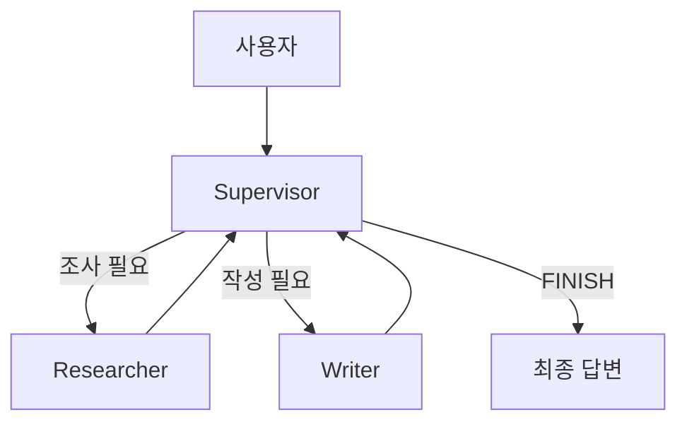
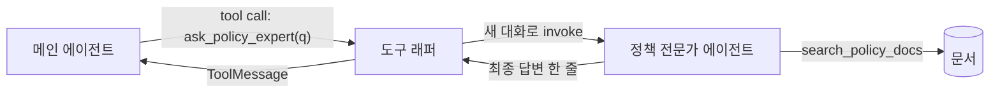
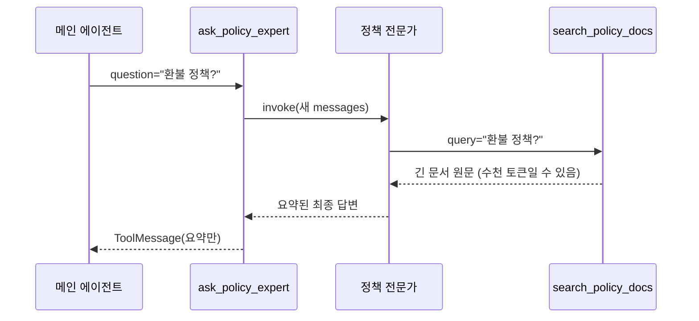

## 왜 필요한가: 에이전트 하나가 "만능 직원"이 될 때 생기는 일

지금까지 우리는 `create_agent` 하나에 도구를 붙여 문제를 풀었습니다. 도구가 3~5개일 때는 이 방식이 가장 단순하고 좋습니다. 그런데 서비스가 커지면 다음 일이 생깁니다.

작은 회사를 떠올려 봅시다. 처음에는 대표 혼자 영업, 회계, 개발, 고객 응대를 다 합니다. 일이 적을 때는 이게 가장 빠릅니다. 하지만 고객이 늘면 대표의 책상 위에 서류가 산더미처럼 쌓이고, 회계 서류를 보다가 개발 이슈를 놓치고, "지금 무슨 일을 하던 중이었지?"를 자주 묻게 됩니다. 그래서 회사는 팀을 나눕니다. 에이전트도 똑같습니다.

단일 에이전트가 커질 때 실제로 부딪히는 문제는 크게 세 가지입니다.

1. **도구 과부하(Tool overload)**: 도구가 20개, 30개로 늘면 모델이 비슷한 도구 사이에서 헷갈립니다. `search_orders`와 `search_order_history` 중 무엇을 불러야 할까요? 도구 설명(스키마)이 매번 프롬프트에 들어가므로 토큰 비용도 늘어납니다.
2. **컨텍스트 오염(Context pollution)**: 웹 검색 결과 5천 토큰, 데이터베이스 조회 결과 3천 토큰이 대화 기록에 계속 쌓입니다. 정작 중요한 사용자의 원래 요청은 긴 기록 속에 묻히고, 모델은 중간 정보를 놓치기 쉬워집니다.
3. **프롬프트 충돌(Instruction conflict)**: "법률 질문에는 매우 보수적으로", "마케팅 문구는 과감하게" 같은 서로 다른 성격의 지시가 하나의 시스템 프롬프트에 섞이면 모델이 둘 다 어중간하게 따릅니다.

멀티 에이전트 시스템(Multi-agent system)은 **일을 역할별로 나누고, 각 역할에 맞는 프롬프트·도구·컨텍스트만 주는 설계**입니다. 핵심은 "에이전트 수"가 아니라 **경계(boundary)를 어디에 긋느냐**입니다.

> [!IMPORTANT]
> 멀티 에이전트는 공짜가 아닙니다. 에이전트 사이를 오갈 때마다 LLM 호출이 늘어나므로 **비용과 지연이 증가**하고, 디버깅할 지점도 많아집니다. "단일 에이전트 + 좋은 도구"로 풀리면 그게 정답입니다. 나누는 것은 측정 가능한 문제(정확도 저하, 컨텍스트 초과, 팀별 소유권 분리)가 생겼을 때입니다.

## 핵심 개념: 다섯 가지 패턴

LangGraph 생태계에서 자주 쓰는 패턴은 다섯 가지입니다. 모두 "누가 다음 차례를 결정하는가"와 "누가 무엇을 볼 수 있는가"라는 두 질문에 대한 서로 다른 답입니다.

### 1) Supervisor (감독자)

중앙의 관리자 에이전트가 매 단계마다 "다음은 누가 일할까?"를 결정합니다. 작업자(worker)는 일을 끝내면 항상 관리자에게 돌아옵니다. 콜센터의 팀장과 상담원 관계와 같습니다.



- 장점: 흐름이 예측 가능하고, 관측(누가 언제 불렸는지)이 쉽습니다. 작업자를 추가하기도 쉽습니다.
- 단점: 관리자가 모든 단계에 끼므로 LLM 호출이 늘어나고, 관리자가 병목이 됩니다.

### 2) Hierarchical (계층형)

Supervisor를 여러 층으로 쌓은 것입니다. 최상위 관리자 밑에 "리서치 팀", "작성 팀"이 있고, 각 팀 안에 다시 팀장과 팀원이 있습니다. LangGraph에서는 **팀 하나를 서브그래프(subgraph)로 만들어 부모 그래프의 노드로 넣습니다.** 작업자가 10명을 넘어가 관리자 한 명이 감당하기 어려울 때 씁니다.

### 3) Network (네트워크, 다대다)

관리자 없이 각 에이전트가 **스스로 다음 에이전트를 지목**합니다. 모든 에이전트가 서로를 부를 수 있으니 유연하지만, 흐름이 그물처럼 얽혀 예측과 디버깅이 어렵습니다. 무한 핑퐁(A→B→A→B…)의 위험이 가장 큰 패턴이라 반드시 상한이 필요합니다.

### 4) Swarm / Handoff (스웜, 핸드오프)

Network의 실용적인 변형입니다. 에이전트가 "핸드오프 도구(handoff tool)"를 호출해 대화의 주도권을 다른 에이전트에게 넘깁니다. 고객센터에서 "결제 담당자에게 연결해 드릴게요"라고 전화를 돌리는 것과 같습니다. 중요한 차이는 **"현재 활성 에이전트(active agent)"를 기억한다**는 점입니다. 사용자가 다음 메시지를 보내면 관리자를 거치지 않고 마지막에 대화하던 에이전트가 바로 응답합니다. 03강에서 자세히 다룹니다.

### 5) Agents-as-tools (도구로서의 에이전트)

서브 에이전트를 **평범한 도구 함수로 감싸서** 메인 에이전트에게 줍니다. 메인 에이전트는 그것이 에이전트인지 모릅니다. 그냥 `ask_policy_expert(question)`이라는 도구를 부르고 문자열을 받을 뿐입니다. 구현이 가장 간단하고, 컨텍스트 격리 효과가 가장 확실해서 현업에서 가장 먼저 시도하는 패턴입니다. 06강의 Deep Agents가 쓰는 `task` 도구도 본질적으로 이 패턴입니다.



### 한눈에 비교

| 패턴 | 다음 차례 결정 | 장점 | 주의점 |
| --- | --- | --- | --- |
| Supervisor | 중앙 관리자 | 예측 가능, 관측 쉬움 | 관리자 호출 비용, 병목 |
| Hierarchical | 층별 관리자 | 대규모 팀 확장 | 깊이가 깊어지면 지연 증가 |
| Network | 각 에이전트 | 유연함 | 무한 루프, 디버깅 어려움 |
| Swarm/Handoff | 현재 활성 에이전트 | 자연스러운 대화 전환 | 넘길 대상 설명이 부정확하면 핑퐁 |
| Agents-as-tools | 메인 에이전트(도구 호출) | 구현 간단, 강한 격리 | 서브 에이전트가 사용자와 직접 대화 불가 |

## 동작 원리: 컨텍스트 격리(Context Isolation)

멀티 에이전트의 가장 큰 이득은 사실 "전문성"보다 **컨텍스트 격리**입니다. 아래 시퀀스를 봅시다.



서브 에이전트 안에서는 도구 호출, 긴 검색 결과, 중간 추론이 오갑니다. 하지만 메인 에이전트의 대화 기록에는 **요약된 결과 한 개**만 남습니다. 메인 에이전트는 깨끗한 컨텍스트로 다음 판단을 하고, 서브 에이전트는 자기 일에만 집중합니다. 마치 팀장이 팀원에게 "조사해서 결론만 보고해 줘"라고 하는 것과 같습니다.

반대로 Supervisor나 Swarm처럼 **메시지 목록을 공유**하는 패턴에서는 격리가 약합니다. 모든 에이전트의 메시지가 같은 `messages`에 쌓이기 때문입니다. 그래서 02강에서는 작업자의 "최종 메시지만" 공유 상태에 넣는 기법을, 03강에서는 핸드오프 시 무엇을 넘길지 고르는 기법을 배웁니다.

## 코드 해설

### 예제 1: Agents-as-tools와 컨텍스트 격리

▶ 오른쪽 IDE의 `examples/01_agents_as_tools.py`를 실행해 보세요.

핵심은 도구 함수 안에서 서브 에이전트를 **새 대화로** 호출하는 부분입니다.

```python
@tool
def ask_policy_expert(question: str) -> str:
    """환불, 배송 등 회사 정책 질문을 정책 전문가 에이전트에게 위임한다."""
    result = policy_agent.invoke(
        {"messages": [HumanMessage(question)]},   # 메인 대화 기록을 넘기지 않는다
        {"recursion_limit": 10},                   # 서브 에이전트에도 상한
    )
    return result["messages"][-1].text            # 최종 답변만 돌려준다
```

세 줄이 각각 설계 결정입니다.

- `{"messages": [HumanMessage(question)]}`: 서브 에이전트는 메인의 긴 대화를 모릅니다. 메인 에이전트가 도구 인자 `question`에 **필요한 맥락을 스스로 요약해 넣어야** 합니다. 그래서 도구 docstring에 "어떤 정보를 담아서 물어야 하는지" 쓰는 것이 중요합니다.
- `recursion_limit`: 서브 에이전트가 도구를 끝없이 부르면 메인 에이전트 전체가 멈춥니다. 바깥과 안쪽 모두 상한을 둡니다.
- `[-1].text`: 중간 과정을 버립니다. 필요하다면 출처 목록 같은 구조화된 결과를 돌려줄 수도 있습니다.

실행 결과의 마지막 줄을 보면 메인 대화에는 `search_policy_docs`의 흔적이 없습니다. 서브 에이전트 내부에는 4개의 메시지가 있었지만 메인은 그 결과 하나만 받았습니다.

> [!NOTE]
> Mock 모드에서는 답변 문장이 `[mock:...]`으로 시작하고 내용이 단순합니다. 여기서 볼 것은 "메시지가 어디에 쌓이는가"라는 **구조**입니다. API 키를 넣으면 같은 코드가 실제 답변을 만듭니다.

### 예제 2: 세 가지 토폴로지의 뼈대

▶ `examples/02_topologies.py`를 실행해 보세요. LLM 없이 규칙으로만 라우팅하는 세 개의 그래프를 만들고, 실행 순서와 Mermaid 그림을 출력합니다.

- **Supervisor**: 작업자 노드는 항상 `Command(goto="supervisor")`로 돌아옵니다. 다음 차례는 관리자만 정합니다.
- **Network**: 각 노드가 `Command(goto="writer")`처럼 다음 노드를 직접 정합니다. 출력된 Mermaid 그림을 보면 모든 노드가 서로 점선으로 연결되어 있습니다. 이 "가능한 경로의 수"가 곧 디버깅의 어려움입니다.
- **Hierarchical**: 팀 전체가 하나의 컴파일된 서브그래프입니다.

계층형 예제에는 현업에서 자주 만나는 함정이 숨어 있습니다. 컴파일된 서브그래프를 `add_node`에 그대로 넣으면 부모와 자식이 같은 상태 키를 공유합니다. 이때 `trace`처럼 `operator.add` 리듀서를 쓰는 키는 서브그래프가 돌려준 **전체 리스트**가 부모 리스트에 한 번 더 더해져 기록이 중복됩니다. 그래서 예제는 `call_research_team` 함수로 서브그래프를 감싸 **새 상태로 호출하고, 필요한 결과만 반환**합니다. 상태 경계를 명시적으로 긋는 이 습관은 Agents-as-tools의 격리 원리와 같습니다.

> [!WARNING]
> 모든 예제에 `MAX_STEPS`와 `recursion_limit`이 있습니다. 멀티 에이전트에서 가장 흔한 장애는 "에이전트끼리 서로 넘기기만 하다 끝나지 않는 것"입니다. 상한은 선택이 아니라 필수입니다.

## 현업에서는

**1. 먼저 단일 에이전트로 측정하라.** 평가 데이터셋(08 모듈)으로 단일 에이전트의 정확도를 먼저 잽니다. 특정 유형의 질문에서만 실패한다면 그 영역만 서브 에이전트로 분리합니다. "멋있어 보여서" 나누면 비용만 늘어납니다.

**2. 비용과 지연을 계산하라.** Supervisor 패턴은 작업자 호출 1번마다 관리자 호출이 1번 더 붙습니다. 작업자 3명을 거치면 LLM 호출이 최소 7번입니다(관리자 4번 + 작업자 3번, 작업자가 도구를 쓰면 더 많음). 관리자에는 작고 빠른 모델을, 작업자에는 필요한 만큼 큰 모델을 쓰는 모델 라우팅이 흔합니다.

**3. 관측성(Observability)을 처음부터 넣어라.** LangSmith 트레이스에서 에이전트별로 구분해 볼 수 있도록 `create_agent(..., name="policy_agent")`처럼 이름을 붙이고, 서브 에이전트 호출에 `{"tags": ["policy_agent"], "metadata": {...}}` 설정을 넘기세요. 장애가 났을 때 "어느 에이전트가, 어느 단계에서" 잘못했는지 바로 찾을 수 있어야 합니다.

**4. 경계는 조직 구조를 따른다.** 현업에서 에이전트를 나누는 가장 좋은 기준은 의외로 "팀 소유권"입니다. 결제팀이 결제 에이전트를, 검색팀이 검색 에이전트를 소유하면 각자 프롬프트와 평가를 독립적으로 개선할 수 있습니다.

**5. 보안 경계로 활용하라.** 환불 실행 도구처럼 위험한 도구는 특정 서브 에이전트에만 줍니다. 메인 에이전트가 프롬프트 인젝션을 당해도 위험한 도구에 직접 접근할 수 없습니다(최소 권한 원칙). 08 모듈의 가드레일 강의와 연결됩니다.

**6. 테스트는 "궤적"으로 한다.** 멀티 에이전트의 정답은 최종 문장보다 "어떤 에이전트가 어떤 순서로 불렸는가"에 있는 경우가 많습니다. 이 강의의 실습처럼 "서브 에이전트가 1번 호출되었는가", "내부 메시지가 새지 않았는가"를 단위 테스트로 검증하는 습관을 들이세요.

### 안티패턴

- **에이전트 남발**: 프롬프트 한 줄로 충분한 일을 별도 에이전트로 만들기. 대부분은 도구나 프롬프트 분기로 충분합니다.
- **전체 기록 공유**: 모든 에이전트가 모든 메시지를 보게 하기. 격리의 이점이 사라지고 토큰 비용이 폭증합니다.
- **상한 없는 네트워크**: 각 에이전트가 서로를 자유롭게 부르는데 반복 상한이 없는 구조.
- **모호한 역할 설명**: "도와주는 에이전트" 같은 설명은 라우팅을 망칩니다. 각 에이전트의 책임과 "하지 않는 일"을 명확히 씁니다.

## 정리

- 단일 에이전트의 한계는 도구 과부하, 컨텍스트 오염, 프롬프트 충돌입니다.
- 패턴은 "누가 다음 차례를 정하는가"로 구분합니다. 중앙(Supervisor), 층별(Hierarchical), 각자(Network), 활성 에이전트(Swarm), 메인의 도구 호출(Agents-as-tools)입니다.
- 가장 큰 이득은 컨텍스트 격리입니다. 서브 에이전트는 새 대화로 시작하고 결과만 돌려줍니다.
- 모든 루프에 상한을 두고, 에이전트에 이름을 붙여 관측 가능하게 만드세요.

다음 강의에서는 가장 널리 쓰이는 Supervisor 패턴을 구조화 출력 라우터와 `Command`로 직접 구현하고, `langgraph-supervisor` 라이브러리와 비교합니다.
