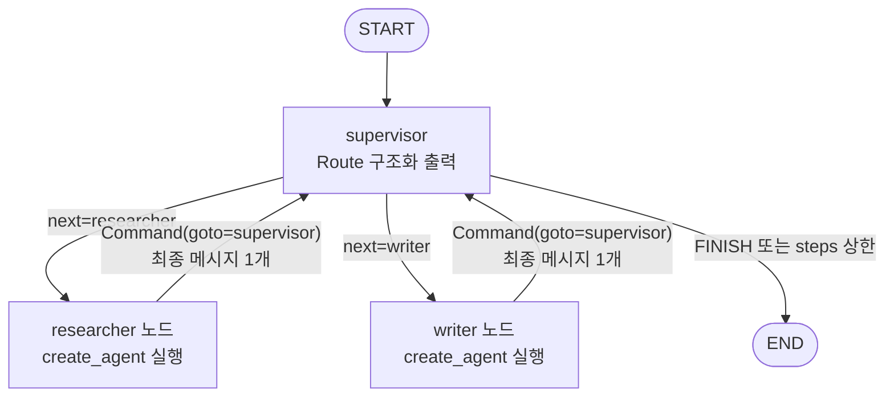
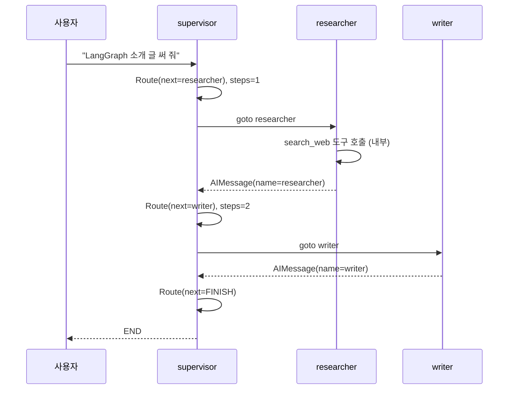

## 왜 필요한가: "누가 다음에 일할지"를 정하는 사람이 필요하다

01강에서 본 다섯 패턴 중 현업에서 가장 먼저 쓰이는 것은 **Supervisor(감독자)** 입니다. 이유는 단순합니다. **흐름이 예측 가능하기 때문**입니다.

식당 주방을 떠올려 보세요. 주문서가 들어오면 주방장(supervisor)이 "샐러드는 A, 스테이크는 B"라고 지시합니다. 요리사(worker)는 자기 요리를 끝내면 주방장에게 넘기고, 주방장이 모든 접시가 준비됐는지 확인한 뒤 내보냅니다. 요리사끼리 접시를 마음대로 주고받는 주방은 빠를 수도 있지만, 무언가 잘못됐을 때 원인을 찾기 어렵습니다.

Supervisor 패턴에서는 다음 세 가지가 보장됩니다.

1. **단일 결정 지점**: 다음 차례는 항상 관리자 한 곳에서 정해집니다. 로그를 보면 "왜 이 작업자가 불렸는가"가 관리자의 결정 기록에 다 남습니다.
2. **작업자의 단순함**: 작업자는 "내 일만 하고 돌아간다"만 알면 됩니다. 다른 작업자의 존재를 몰라도 됩니다.
3. **종료 통제**: 언제 끝낼지도 관리자가 정합니다. 그래서 상한(최대 단계 수)을 한 곳에서 강제할 수 있습니다.

## 핵심 개념

### 1) 라우터는 "구조화 출력"으로 만든다

관리자에게 "다음은 누구야?"라고 물으면 LLM은 "researcher에게 맡기는 것이 좋겠습니다. 왜냐하면…" 같은 자유 문장을 돌려줄 수 있습니다. 이걸 문자열 파싱으로 처리하면 언젠가 반드시 깨집니다. 대신 **선택지를 스키마로 닫습니다.**

```python
class Route(BaseModel):
    next: Literal["researcher", "writer", "FINISH"]
    reason: str
```

`with_structured_output(Route)`를 쓰면 모델은 이 세 값 중 하나만 고를 수 있습니다(OpenAI의 경우 내부적으로 도구 호출/JSON 스키마로 강제됩니다). `reason` 필드는 디버깅과 관측을 위한 것입니다. LangSmith 트레이스에서 "왜 writer로 갔는지"를 바로 읽을 수 있습니다.

### 2) Command로 "이동 + 상태 갱신"을 한 번에

04 모듈에서 배운 `Command`는 노드가 **상태를 갱신하면서 동시에 다음 노드를 지정**하게 해 줍니다. Supervisor 그래프에서는 조건부 엣지를 따로 그릴 필요 없이 이것 하나로 충분합니다.

```python
def supervisor(state) -> Command[Literal["researcher", "writer", "__end__"]]:
    ...
    return Command(goto=goto, update={"steps": steps + 1})
```

반환 타입 힌트 `Command[Literal[...]]`는 장식이 아닙니다. LangGraph는 이 힌트를 읽어 **그래프 그림에 가능한 경로(점선)를 그립니다.** 힌트를 빼면 그래프는 동작하지만 시각화와 정적 점검이 약해집니다.

### 3) 작업자는 "최종 메시지 하나만" 공유한다

작업자 에이전트는 내부적으로 도구를 부르고 결과를 받으며 여러 메시지를 만듭니다. 이걸 전부 공유 `messages`에 넣으면 관리자의 컨텍스트가 금방 지저분해집니다. 그래서 작업자 노드는 마지막 답변만 `AIMessage(content=..., name="researcher")`로 감싸 돌려줍니다. `name`을 붙여야 관리자와 사람이 "누가 한 말인지" 구분할 수 있습니다.

## 동작 원리



한 번의 요청이 처리되는 순서를 시퀀스로 보면 다음과 같습니다.



## 코드 해설

### 예제 1: 처음부터 구현하기

▶ 오른쪽 IDE의 `examples/01_supervisor_from_scratch.py`를 실행해 보세요.

**안전장치가 LLM 호출보다 먼저 온다.** `supervisor` 함수의 첫 줄은 상한 검사입니다.

```python
if steps >= MAX_STEPS:
    return Command(goto=END)
decision: Route = router_llm.invoke([SystemMessage(SUPERVISOR_PROMPT), *state["messages"]])
```

LLM이 FINISH를 고르는 것을 "믿되 검증"합니다. 모델이 같은 작업자를 계속 고르는 실수를 해도, 그래프는 `MAX_STEPS`에서 확실히 멈춥니다. `recursion_limit`은 그래프 전체의 마지막 방어선이고, `MAX_STEPS`는 비즈니스 로직 차원의 상한입니다. 두 개를 같이 두는 것이 좋습니다. `recursion_limit`에 걸리면 예외(`GraphRecursionError`)가 나지만, `MAX_STEPS`는 정상 종료 경로로 빠지므로 사용자에게 "지금까지의 결과"를 돌려줄 수 있습니다.

**작업자 노드 팩토리.** `make_worker_node(name, agent)`는 작업자마다 같은 모양의 노드 함수를 만들어 줍니다.

```python
result = agent.invoke({"messages": state["messages"]}, {"recursion_limit": 10})
final = result["messages"][-1]
return Command(goto="supervisor", update={"messages": [AIMessage(content=final.text, name=name)]})
```

작업자에게는 공유 기록 전체를 보여주지만(조사 결과를 작가가 봐야 하니까), 돌려받을 때는 하나만 받습니다. 출력의 "내부 메시지 3개 생성 → 1개만 공유" 줄이 그 효과를 보여줍니다.

**Mock 모드에서의 흐름.** Mock 모델은 `Literal` 선택지를 진행된 턴 수에 따라 순서대로 고르고, 모두 돈 뒤 FINISH를 고릅니다. 그래서 researcher → writer → FINISH 순서가 항상 재현됩니다. 실제 모델은 질문 내용에 따라 다르게 고를 수 있습니다. 작업자 메시지를 `HumanMessage`가 아니라 `AIMessage`로 넣은 것도 의도된 설계입니다. 작업자의 출력은 사용자의 말이 아니기 때문입니다.

> [!TIP]
> 관리자 프롬프트에는 작업자 목록과 각자의 책임, 그리고 **종료 조건**을 명확히 쓰세요. "사용자 요청이 충족되었으면 FINISH"처럼 끝내는 기준이 없으면 관리자는 불필요하게 작업자를 한 번 더 부르는 경향이 있습니다.

### 예제 2: langgraph-supervisor 라이브러리

▶ `examples/02_langgraph_supervisor.py`를 실행해 보세요.

```python
workflow = create_supervisor(
    [research_agent, math_agent],
    model=init_chat_model(MODEL),
    prompt="...",
    output_mode="last_message",
)
app = workflow.compile()
```

라이브러리는 **도구 호출 방식의 핸드오프**를 씁니다. 관리자에게 `transfer_to_research_expert`, `transfer_to_math_expert` 같은 도구가 자동으로 붙고, 관리자가 그 도구를 부르면 해당 작업자로 이동합니다. 작업자가 끝나면 라이브러리가 `transfer_back_to_supervisor` 메시지 쌍을 넣어 제어를 돌려줍니다. 스트리밍 출력에서 이 메시지들을 직접 확인해 보세요.

알아둘 점:

- 작업자 에이전트에는 반드시 `name`이 있어야 합니다. 핸드오프 도구 이름이 여기서 만들어집니다.
- `create_supervisor`는 컴파일 전 `StateGraph`를 돌려줍니다. 체크포인터나 스토어는 `compile(checkpointer=...)`에서 붙입니다.
- `output_mode="last_message"`는 작업자의 마지막 메시지만, `"full_history"`는 작업자의 전체 내부 기록을 관리자 기록에 남깁니다. 앞서 말한 컨텍스트 관리 원칙에 따라 기본값인 `last_message`가 대부분의 경우 맞습니다.
- `add_handoff_back_messages`, `handoff_tool_prefix`, `parallel_tool_calls` 같은 옵션으로 세부 동작을 조절할 수 있습니다. 설치된 버전(0.0.31)의 시그니처를 직접 확인해 보세요.
- 이 예제는 `GraphRecursionError`를 잡아 안전한 메시지를 출력합니다. 실제 모델이 작업자 사이를 끝없이 오가면 이 경로로 빠집니다.

> [!NOTE]
> Mock 모드에서는 작업자(math_expert)가 곱셈 도구를 부르지 않고 바로 답합니다. Mock 모델은 "마지막 사람 메시지 이후 도구 결과가 이미 있으면 답한다"는 규칙을 따르는데, 핸드오프 ToolMessage가 이미 기록에 있기 때문입니다. 흐름(관리자 → 작업자 → 관리자)을 관찰하는 데 집중하세요.

### 직접 구현 vs 라이브러리

| 관점 | 직접 구현 (구조화 출력) | langgraph-supervisor (핸드오프 도구) |
| --- | --- | --- |
| 라우팅 방식 | `Route` 스키마의 Literal | `transfer_to_*` 도구 호출 |
| 관리자가 직접 답하기 | 별도 노드 필요 | 도구를 안 부르면 그게 최종 답 |
| 상한 제어 | `steps` 카운터로 정밀 제어 | `recursion_limit` 위주 |
| 공유 메시지 통제 | 노드에서 자유롭게 가공 | `output_mode`로 선택 |
| 학습/디버깅 | 모든 줄이 내 코드 | 내부 동작을 알아야 함 |
| 속도 | 처음부터 작성 | 몇 줄로 시작 |

현업에서는 프로토타입을 라이브러리로 빠르게 만들고, 요구사항(감사 로그, 세밀한 상한, 병렬 실행, 특수한 상태)이 생기면 직접 구현으로 옮기는 경우가 많습니다. 직접 구현을 이해하고 있으면 라이브러리의 동작도 예측할 수 있습니다.

## 현업에서는

**비용과 지연.** 관리자는 매 단계 호출됩니다. 작업자가 N명이면 최소 N+1번의 관리자 호출이 있습니다. 관리자 라우팅은 비교적 쉬운 작업이므로 작고 빠른 모델(예: 설정 패널의 mini 계열)을 쓰고, 작업자에는 필요한 수준의 모델을 씁니다. 관리자 프롬프트는 매번 같으므로 프롬프트 캐싱의 효과도 큽니다(08 모듈).

**병렬화.** "조사 A와 조사 B는 서로 독립"이라면 관리자가 하나씩 순서대로 부를 이유가 없습니다. 이런 경우 04 모듈의 `Send`로 작업자를 병렬 실행하는 map-reduce 구조가 더 빠릅니다. Supervisor는 "다음 단계가 이전 결과에 의존할 때" 빛납니다.

**관측성.** `reason` 필드를 로그로 남기고, 노드 이름과 작업자 `name`을 일관되게 맞추세요. LangSmith에서 `stream_mode="updates"`나 트레이스를 보면 관리자의 결정 순서가 곧 시스템의 "궤적(trajectory)"이 됩니다. 궤적 평가(08 모듈)는 "researcher를 건너뛰고 writer로 가지 않았는가" 같은 규칙을 자동으로 검사합니다.

**장애 대응.** 작업자 하나가 외부 API 장애로 실패하면 어떻게 할까요? 작업자 노드에 `RetryPolicy`를 붙이거나, 실패를 메시지로 바꿔 관리자에게 돌려주면 관리자가 다른 작업자를 고르거나 부분 결과로 마무리할 수 있습니다. 예외를 그대로 터뜨리면 전체 요청이 실패합니다.

**보안.** 관리자에게는 위험한 도구를 주지 않습니다. 관리자는 "결정만" 하고, 실제 행동(환불, 메일 발송)은 권한이 있는 작업자만 합니다. 관리자가 프롬프트 인젝션에 속아도 직접 피해를 줄 수 없게 됩니다.

**테스트.** 이 강의의 실습처럼 "각 작업자가 한 번씩 호출되었는가", "결정 횟수가 상한 이하인가"를 Mock 모델로 검증하는 테스트는 CI에서 매번 돌릴 수 있습니다. 결정적인 가짜 모델로 그래프 구조를 테스트하는 방법은 08 모듈에서 더 다룹니다.

### 안티패턴

- 관리자의 출력을 정규식으로 파싱하기 → 구조화 출력을 쓰세요.
- 상한 없이 "FINISH를 고를 때까지" 돌리기 → `MAX_STEPS`와 `recursion_limit`을 둘 다 두세요.
- 작업자 내부 메시지를 전부 공유 기록에 넣기 → 최종 메시지만 넣으세요.
- 관리자에게 작업자 일까지 시키기(도구를 잔뜩 붙이기) → 결정과 실행을 분리하세요.

## 정리

- Supervisor는 "단일 결정 지점"을 둬서 흐름을 예측 가능하게 만듭니다.
- 라우팅은 `Literal` 구조화 출력으로 닫고, `Command(goto, update)`로 이동과 상태 갱신을 함께 합니다.
- 작업자는 최종 메시지 하나만 `name`과 함께 돌려줍니다.
- 상한은 두 겹으로: 비즈니스 상한(`MAX_STEPS`)과 그래프 상한(`recursion_limit`).
- `langgraph-supervisor`는 도구 호출 핸드오프로 같은 구조를 빠르게 만들어 줍니다.

다음 강의에서는 관리자 없이 에이전트끼리 직접 주도권을 넘기는 **핸드오프와 스웜** 패턴을 배웁니다.
