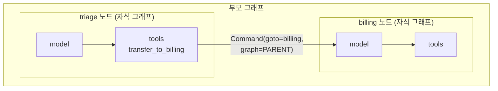
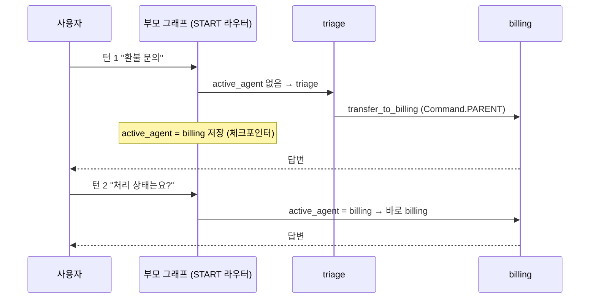

## 왜 필요한가: "담당자에게 연결해 드릴게요"

고객센터에 전화를 걸었다고 해 봅시다. 처음 받은 상담원이 "결제 문의시군요, 결제팀으로 연결해 드리겠습니다"라고 말하고 전화를 돌립니다. 이후 대화는 결제팀 상담원과 계속됩니다. 다시 전화를 걸어도(같은 상담 번호라면) 결제팀이 이어서 받습니다. 매번 접수 담당이 다시 끼어들지 않습니다.

02강의 Supervisor는 매 단계마다 관리자를 거쳤습니다. 이 방식은 예측 가능하지만, **사용자와 오래 대화하는 서비스**에서는 불편합니다.

- 관리자를 매번 거치므로 응답마다 LLM 호출이 한 번 더 붙습니다(지연, 비용).
- 사용자가 "그럼 그거 취소해 주세요"처럼 짧게 말하면, 관리자는 맥락 없이 다시 라우팅해야 합니다.
- 실제 대화 상대가 누구인지 사용자 입장에서 일관성이 떨어집니다.

**핸드오프(Handoff)** 는 에이전트가 스스로 "이 대화는 저쪽이 맡아야 한다"고 판단해 주도권을 넘기는 방식입니다. 여기에 "지금 대화를 맡은 에이전트"를 기억하는 기능을 더하면 **스웜(Swarm)** 이 됩니다.

## 핵심 개념

### 1) 핸드오프 = 특별한 도구

에이전트는 이미 도구를 부를 줄 압니다. 그래서 "다른 에이전트로 넘기기"도 도구로 만들면 됩니다. `transfer_to_billing` 같은 이름의 도구를 주고, 설명에 "결제·환불 요청은 이 도구로 넘겨라"라고 적습니다. 모델은 평소처럼 도구를 고르기만 하면 됩니다.

특별한 점은 이 도구가 문자열 대신 **`Command`를 반환**한다는 것입니다.

```python
return Command(
    goto="billing",            # 이동할 노드
    graph=Command.PARENT,      # 어느 그래프에서? → 나를 실행한 부모 그래프에서
    update={"messages": [...], "active_agent": "billing"},
)
```

### 2) 왜 `graph=Command.PARENT`인가

`create_agent`로 만든 에이전트는 그 자체로 하나의 그래프(model 노드 + tools 노드)입니다. 이 에이전트를 부모 그래프의 노드로 넣으면 **그래프 안의 그래프(서브그래프)** 가 됩니다. 도구는 자식 그래프의 `tools` 노드에서 실행됩니다. 여기서 그냥 `goto="billing"`이라고 하면 자식 그래프 안에서 billing 노드를 찾다가 실패합니다. `graph=Command.PARENT`는 "자식 그래프를 빠져나가 **부모 그래프**에서 billing 노드로 가라"는 뜻입니다.



### 3) 메시지를 함께 넘겨야 하는 이유

자식 그래프 안에서 만들어진 메시지(“transfer_to_billing을 부르겠다”는 AI 메시지)는 자식이 정상 종료될 때 부모 상태로 반영됩니다. 그런데 핸드오프는 자식을 **중간에 빠져나가므로** 그 메시지가 부모에 전달되지 않습니다. 그러면 부모 기록에는 "tool_call 없는 ToolMessage"가 생기거나 AI 메시지가 사라집니다. OpenAI API는 tool_call과 ToolMessage 짝이 맞지 않으면 다음 호출에서 오류를 냅니다.

그래서 핸드오프 도구는 **현재 자식 상태의 메시지 전체 + 도구 응답 메시지**를 `update`로 함께 보냅니다. `add_messages` 리듀서는 같은 id의 메시지를 덮어쓰고 새 메시지만 추가하므로 중복되지 않습니다. `langgraph-swarm`의 `create_handoff_tool`도 정확히 이렇게 구현되어 있습니다.

### 4) active_agent와 체크포인터 = 스웜

핸드오프할 때 `active_agent`를 상태에 기록하고, 그래프의 시작점에서 이 값을 보고 라우팅합니다. 체크포인터로 상태를 저장하면 다음 사용자 메시지가 와도 **마지막으로 대화하던 에이전트가 바로 받습니다.**



## 코드 해설

### 예제 1: 핸드오프를 처음부터

▶ 오른쪽 IDE의 `examples/01_handoff_from_scratch.py`를 실행해 보세요.

**핸드오프 도구 팩토리.** 도구 함수의 인자로 `runtime: ToolRuntime`을 받으면 LangChain이 실행 시점의 상태와 `tool_call_id`를 넣어 줍니다. 이 인자는 모델에게 보이는 도구 스키마에는 나타나지 않습니다. 즉 모델은 인자 없는 `transfer_to_billing()`을 부르기만 하면 됩니다.

```python
@tool(f"transfer_to_{agent_name}", description=description)
def handoff(runtime: ToolRuntime) -> Command | str:
    count = runtime.state.get("handoff_count", 0)
    if count >= MAX_HANDOFFS:
        return "핸드오프 한도를 넘었습니다. 현재 에이전트가 직접 답하세요."
    tool_msg = ToolMessage(content=..., name=..., tool_call_id=runtime.tool_call_id)
    return Command(goto=agent_name, graph=Command.PARENT, update={...})
```

**핑퐁 방지.** 네트워크형 구조에서 가장 흔한 장애는 A가 B에게, B가 다시 A에게 넘기는 무한 반복입니다. 예제는 `handoff_count`로 요청당 핸드오프 횟수를 세고, 상한을 넘으면 `Command` 대신 **일반 문자열**을 반환합니다. 문자열은 평범한 도구 결과가 되어 현재 에이전트가 계속 대화를 맡습니다. 실패를 "이동하지 않음"으로 부드럽게 처리하는 방식입니다. 카운터는 새 사용자 메시지마다 `reset` 노드에서 0으로 되돌립니다.

**자식 상태에 키 추가.** 도구가 `runtime.state["handoff_count"]`를 읽으려면 자식(에이전트) 상태에도 그 키가 있어야 합니다. 그래서 `AgentState`를 상속한 `AgentWithHandoffState`를 만들어 `create_agent(..., state_schema=...)`로 넘겼습니다. 부모와 자식이 **같은 이름의 키**를 가지면 서브그래프 호출 시 값이 자동으로 오갑니다.

**그래프 조립.** `add_node("triage", triage, destinations=("billing", "tech"))`의 `destinations`는 실행에는 영향이 없고, 그래프 그림에 핸드오프 경로를 표시하기 위한 정보입니다. `Command`로만 이동하는 노드는 정적 엣지가 없어서 이 힌트가 없으면 그림에 연결선이 보이지 않습니다.

실행 결과의 턴 2를 보면 triage를 거치지 않고 billing이 바로 응답합니다. 이것이 스웜의 핵심 동작입니다.

### 예제 2: langgraph-swarm

▶ `examples/02_langgraph_swarm.py`를 실행해 보세요.

```python
app = create_swarm([flight_agent, hotel_agent], default_active_agent="flight_agent").compile(
    checkpointer=checkpointer
)
```

`create_swarm`은 우리가 직접 만든 것을 그대로 묶어 줍니다. 각 에이전트를 노드로 넣고, `SwarmState`(MessagesState + `active_agent`)를 쓰고, `add_active_agent_router`로 START에서 활성 에이전트로 보냅니다. 핸드오프 도구는 `create_handoff_tool(agent_name=..., description=...)`으로 만들어 각 에이전트의 `tools`에 직접 넣습니다. 누가 누구에게 넘길 수 있는지는 **각 에이전트가 가진 핸드오프 도구로 결정**됩니다.

세 턴의 흐름을 확인해 보세요.

1. 첫 턴: 아직 `active_agent`가 없으므로 `default_active_agent`인 flight_agent가 받습니다.
2. 둘째 턴: flight_agent가 숙소 요청을 보고 `transfer_to_hotel_agent`를 호출합니다.
3. 셋째 턴: hotel_agent가 바로 받습니다.

> [!NOTE]
> 핸드오프 직후 hotel_agent는 숙소 검색 도구를 부르지 않고 답합니다. Mock 모델은 "마지막 사람 메시지 이후 도구 결과가 있으면 텍스트로 답한다"는 규칙을 따르기 때문입니다. 실제 모델은 보통 핸드오프 후 바로 검색 도구를 부릅니다.

> [!WARNING]
> `langgraph-swarm` 0.1.0에서 `create_handoff_tool`은 `agent_name`, `name`, `description` 세 인자만 받습니다. 넘길 메시지를 고르는 기능은 없으므로, 핸드오프 시 컨텍스트를 줄이고 싶다면 예제 1처럼 직접 구현해야 합니다.

## 핸드오프 vs Supervisor vs Agents-as-tools

| 질문 | Supervisor | Swarm/Handoff | Agents-as-tools |
| --- | --- | --- | --- |
| 다음 차례는 누가? | 관리자 | 현재 에이전트 | 메인 에이전트 |
| 사용자와 직접 대화? | 관리자를 통해 | 각 에이전트가 직접 | 메인만 |
| 멀티턴에서 맥락 유지 | 관리자가 매번 재판단 | `active_agent`로 이어짐 | 메인이 유지 |
| 턴당 LLM 호출 | 많음 | 적음 | 중간 |
| 무한 루프 위험 | 낮음 | 높음(핑퐁) | 낮음 |

## 현업에서는

**핸드오프 설명이 곧 라우팅 정책이다.** 모델이 핸드오프 도구를 고르는 기준은 오직 도구 이름과 설명입니다. "결제팀에 넘김"보다는 "결제 수단 변경, 환불, 청구서 문의일 때 사용. 배송 문의에는 사용하지 말 것"처럼 **포함/제외 조건**을 함께 씁니다. 라우팅 정확도를 평가 데이터셋(08 모듈)으로 측정하고 설명을 개선합니다.

**핸드오프 시 컨텍스트 요약.** 대화가 길어지면 모든 메시지를 넘기는 것은 비용입니다. 현업에서는 핸드오프 도구에 `reason`이나 `summary` 인자를 받아 "이전 담당자가 정리한 요약"을 받는 에이전트의 첫 메시지로 넣기도 합니다. 단, tool_call과 ToolMessage의 짝은 반드시 유지해야 합니다.

**체크포인터는 영속 저장소로.** 예제의 `InMemorySaver`는 프로세스가 끝나면 사라집니다. 프로덕션에서는 Postgres 체크포인터 등을 써야 사용자가 다음 날 돌아와도 같은 담당 에이전트가 이어받습니다(08 모듈 배포 강의).

```python
# 프로덕션 예시 (참고용, 실행 예제 아님)
from langgraph.checkpoint.postgres import PostgresSaver

with PostgresSaver.from_conn_string(DB_URI) as saver:
    app = create_swarm(agents, default_active_agent="triage").compile(checkpointer=saver)
```

**관측성.** 핸드오프 도구 이름은 `transfer_to_*`로 일관되게 짓고, LangSmith에서 이 도구 호출만 필터링하면 "어떤 대화가 어디로 넘어갔는가"를 통계로 볼 수 있습니다. 핸드오프 비율이 갑자기 늘면 프롬프트 변경이나 모델 변경의 부작용일 가능성이 큽니다.

**보안.** 핸드오프는 권한 상승의 통로가 될 수 있습니다. "나는 관리자니까 admin 에이전트로 넘겨줘" 같은 프롬프트 인젝션을 막으려면, 민감한 에이전트로 가는 핸드오프 도구는 정말 필요한 에이전트에게만 주고, 필요하면 HITL 승인(05 모듈)을 겁니다.

**탈출구 설계.** 모든 전문 에이전트에게 "접수로 되돌리기" 핸드오프를 주면, 엉뚱한 곳으로 넘어간 대화를 복구할 수 있습니다. 대신 이것이 핑퐁의 원인이 되므로 상한과 함께 둡니다.

### 안티패턴

- `tool_call_id` 없이 ToolMessage 만들기 → 다음 LLM 호출에서 API 오류.
- 핸드오프 시 메시지를 넘기지 않기 → 부모 기록에서 tool_call이 사라져 짝이 깨짐.
- 모든 에이전트가 모든 에이전트로 넘길 수 있게 하기 → 경로 폭발, 핑퐁.
- 체크포인터 없이 스웜 쓰기 → `active_agent`가 저장되지 않아 매 턴 기본 에이전트로 돌아감.

## 정리

- 핸드오프는 `Command(goto=에이전트, graph=Command.PARENT, update=...)`를 반환하는 도구입니다.
- 자식 그래프를 중간에 빠져나가므로, 현재 메시지와 ToolMessage를 함께 넘겨 tool_call 짝을 지킵니다.
- `active_agent` + 체크포인터 = 다음 턴을 마지막 에이전트가 받는 스웜.
- 핑퐁은 카운터 상한과 `recursion_limit`으로 막고, 핸드오프 설명에 포함/제외 조건을 명확히 씁니다.

다음 강의에서는 "먼저 계획을 세우고 단계별로 실행하는" Plan-and-Execute 패턴을 배웁니다.
