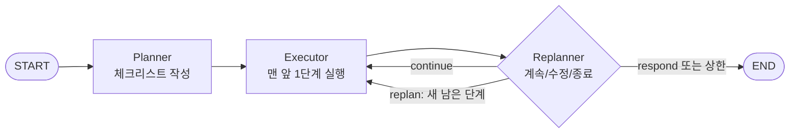
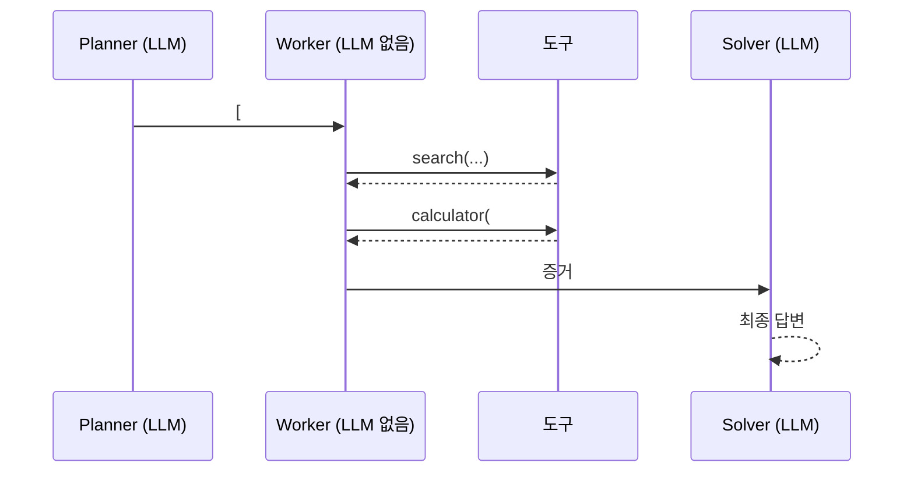

## 왜 필요한가: "한 걸음씩 생각하기"의 한계

지금까지 쓴 `create_agent`는 **ReAct** 방식입니다. 모델이 생각하고(Reason), 도구를 부르고(Act), 결과를 보고 다시 생각합니다. 짧은 작업에는 훌륭하지만 단계가 많아지면 문제가 생깁니다.

- **길을 잃는다**: 10단계짜리 작업 중 5단계쯤 오면 대화 기록이 길어져 원래 목표를 잊거나 같은 검색을 반복합니다.
- **비싸다**: 매 단계마다 "지금까지의 모든 기록"을 큰 모델이 다시 읽습니다. 단계가 늘면 입력 토큰이 계속 커집니다.
- **진행 상황이 안 보인다**: 사용자는 "지금 몇 단계 중 몇 단계인지" 알고 싶지만 ReAct에는 명시적인 계획이 없습니다.

사람은 이삿짐을 쌀 때 먼저 할 일 목록을 적습니다. "1) 박스 구하기 2) 부엌 정리 3) 책 포장 …" 그리고 하나씩 지워 나갑니다. 중간에 "냉장고는 업체가 옮겨 준대"라는 소식을 들으면 목록을 고칩니다. 이것이 **Plan-and-Execute** 입니다.

## 핵심 개념: 세 가지 역할



1. **Planner(계획자)**: 목표를 받아 순서 있는 단계 목록을 만듭니다. 한 번만 호출되므로 똑똑한(비싼) 모델을 써도 부담이 적습니다.
2. **Executor(실행자)**: 계획의 **맨 앞 한 단계**만 수행합니다. 도구를 가진 작은 에이전트면 충분합니다. 전체 목표와 현재 단계만 보므로 컨텍스트가 짧습니다.
3. **Replanner(재계획자)**: 지금까지의 결과를 보고 세 가지 중 하나를 고릅니다. 남은 계획대로 계속(continue), 계획 수정(replan), 최종 답변(respond).

이것도 멀티 에이전트입니다. 세 역할이 서로 다른 프롬프트, 다른 모델, 다른 도구를 가지고 상태(State)를 통해 협업합니다. 01강의 분류로 보면 **고정된 흐름을 가진 Supervisor의 변형**입니다. Replanner가 관리자 역할을 하고, 다음 작업자는 항상 Executor입니다.

### 상태 설계: 체크리스트 + 완료 기록

```python
class PlanExecuteState(TypedDict):
    input: str                                                   # 원래 목표 (절대 바뀌지 않음)
    plan: list[str]                                              # 남은 체크리스트
    past_steps: Annotated[list[tuple[str, str]], operator.add]  # (단계, 결과) 누적
    replans: int
    response: str
```

`plan`은 **덮어쓰는** 필드이고 `past_steps`는 **누적되는** 필드입니다. Executor는 `plan`에서 맨 앞을 빼고(`plan[1:]`), `past_steps`에 결과를 하나 더합니다. 이 두 필드만 봐도 진행률(완료 2 / 남은 3)을 바로 알 수 있습니다. 프론트엔드에 체크리스트 UI를 그리기도 쉽습니다.

## 동작 원리: 세 겹의 상한

Plan-and-Execute는 루프가 두 개 있습니다(실행 루프, 재계획 루프). 그래서 상한도 여러 개가 필요합니다.

| 상한 | 막는 문제 | 예제 값 |
| --- | --- | --- |
| `MAX_PLAN_STEPS` | 계획자가 50단계짜리 계획을 만드는 것 | 4 |
| `MAX_REPLANS` | 재계획만 반복하고 진행하지 않는 것 | 2 |
| `MAX_TOTAL_STEPS` | 전체 실행이 끝나지 않는 것 | 6 |
| `recursion_limit` | 위 로직에 버그가 있을 때의 최후 방어선 | 30 |

Replanner 코드에서 LLM의 결정을 **그대로 따르지 않고 규칙으로 보정**하는 부분을 눈여겨보세요.

```python
action = decision.action
if len(state["past_steps"]) >= MAX_TOTAL_STEPS:
    action = "respond"                 # 총 단계 상한 → 강제 답변
if action == "replan" and state["replans"] >= MAX_REPLANS:
    action = "continue"                # 재계획 상한 → 기존 계획 진행
if action == "continue" and not state["plan"]:
    action = "respond"                 # 할 일이 없으면 답변
```

LLM은 "제안"하고, 코드가 "결정"합니다. 이것이 현업 에이전트 설계의 기본 원칙입니다.

## 코드 해설

### 예제 1: Plan-and-Execute

▶ 오른쪽 IDE의 `examples/01_plan_and_execute.py`를 실행해 보세요.

**Planner**는 `with_structured_output(Plan)`으로 `list[str]`을 받습니다. 자유 텍스트로 "1. … 2. …"를 받아 파싱하는 것보다 훨씬 안전합니다.

**Executor**는 `create_agent`로 만든 작은 에이전트입니다. 매번 **새 대화**로 호출하고, 프롬프트에는 전체 목표와 지금 단계만 넣습니다. 01강의 컨텍스트 격리가 여기서도 쓰입니다. 앞 단계 결과가 필요하면 `past_steps`에서 골라 프롬프트에 넣어 주면 됩니다.

**Replanner**에게는 완료한 단계를 `AIMessage`로 나열해 보여줍니다. "내가 이미 한 일"이라는 의미를 메시지 역할로 표현한 것입니다. Mock 모델은 사람 메시지 이후의 AI 메시지 수에 따라 `Literal` 선택지를 순서대로 고르므로 이 예제에서는 replan → respond 순서로 진행됩니다. 덕분에 Mock 모드에서도 재계획 경로가 실제로 실행되는 것을 볼 수 있습니다.

**토큰 사용량 측정.** `UsageMetadataCallbackHandler`를 `callbacks`로 넘기면, 중첩된 Executor 에이전트를 포함한 모든 LLM 호출의 토큰이 모델별로 합산됩니다. 패턴을 바꿨을 때 비용이 어떻게 달라지는지 숫자로 비교하는 습관을 들이세요.

> [!NOTE]
> Mock 모드에서는 계획 항목이 `(mock) steps`처럼 나옵니다. 실제 모델을 쓰면 "1. 국내 전기차 판매량 검색", "2. 결과에 2를 곱하기"처럼 의미 있는 단계가 나옵니다. 그래프가 어떤 순서로 노드를 지나는지에 집중하세요.

### 예제 2: ReWOO

▶ `examples/02_rewoo.py`를 실행해 보세요.

**ReWOO(Reasoning WithOut Observation)** 는 Plan-and-Execute를 극단적으로 최적화한 변형입니다. 계획자가 처음부터 **도구와 입력까지** 모두 정하고, 앞 단계 결과는 변수로 참조합니다.

```text
#E1 = search("서울 지하철 하루 이용객 수")
#E2 = calculator("#E1 * 7")
```

Worker는 LLM 없이 도구만 순서대로 실행하면서 `#E1`을 실제 결과로 바꿔 넣습니다. 마지막에 Solver가 모든 증거를 보고 답을 씁니다. LLM 호출은 **계획 1번 + 정리 1번**, 총 2번으로 고정됩니다.



예제의 계산기는 `eval`을 쓰지 않고 `ast`로 사칙연산만 허용합니다. LLM이 만든 문자열을 그대로 `eval`하는 것은 원격 코드 실행 취약점입니다. 계획자가 만든 입력도 **신뢰할 수 없는 입력**으로 다뤄야 합니다.

### 언제 무엇을 쓰나

| 기준 | ReAct (`create_agent`) | Plan-and-Execute | ReWOO |
| --- | --- | --- | --- |
| LLM 호출 수 | 단계마다 | 계획 1 + 단계마다(작은 모델) + 재계획 | 2회 고정 |
| 중간 결과에 따른 수정 | 매 단계 가능 | Replanner에서 가능 | 불가 |
| 진행률 표시 | 어려움 | 체크리스트로 쉬움 | 쉬움 |
| 적합한 작업 | 짧고 탐색적인 작업 | 길고 구조화된 작업 | 단계가 예측 가능한 작업 |

## 현업에서는

**모델 라우팅으로 비용을 줄인다.** Planner와 Replanner에는 추론력이 좋은 모델을, Executor에는 빠르고 저렴한 모델을 씁니다. 모델 ID를 역할별 환경변수(예: `PLANNER_MODEL`, `EXECUTOR_MODEL`)로 분리해 두면 운영 중에 바꾸기 쉽습니다.

**독립 단계는 병렬로.** "A사 조사", "B사 조사", "C사 조사"처럼 서로 의존하지 않는 단계는 순서대로 할 필요가 없습니다. 04 모듈에서 배운 `Send` API로 Executor를 병렬 실행하면 지연이 크게 줄어듭니다. 계획 스키마에 `depends_on: list[int]` 같은 필드를 두어 의존성 그래프(DAG)로 실행하는 것이 LLMCompiler 계열 기법의 아이디어입니다.

**체크포인터로 재개 가능하게.** 긴 작업은 중간에 실패할 수 있습니다. 체크포인터를 붙여 두면 실패한 단계부터 다시 실행할 수 있고, 05 모듈의 `interrupt`로 "계획을 사람에게 승인받은 뒤 실행"하는 흐름도 쉽게 만들 수 있습니다. 계획 승인은 비용이 큰 작업이나 외부에 영향을 주는 작업에서 특히 유용합니다.

**진행 상황 스트리밍.** `stream_mode="updates"`로 `plan`과 `past_steps`의 변화를 프론트엔드에 보내면 사용자가 체크리스트가 지워지는 것을 실시간으로 볼 수 있습니다(08 모듈 스트리밍 강의).

**관측성과 평가.** LangSmith 트레이스에서 Planner 출력(계획)을 따로 평가할 수 있습니다. "계획이 목표를 빠짐없이 다루는가", "불필요한 단계가 없는가"를 LLM-as-judge로 채점하면, 최종 답변 품질 문제의 원인이 계획인지 실행인지 분리해서 볼 수 있습니다.

**보안.** 계획은 LLM이 만든 "실행할 명령 목록"입니다. 계획에 등장하는 도구 이름은 `Literal`로 제한하고, 도구 입력은 검증합니다. ReWOO처럼 실행 전에 계획이 모두 정해지는 구조는 오히려 **실행 전 검사(정책 위반 단계 차단)** 를 하기에 좋습니다.

### 안티패턴

- 계획 길이 상한 없음 → 모델이 30단계 계획을 만들고 비용이 폭발합니다.
- Executor에게 전체 대화 기록을 넘김 → 패턴을 쓰는 이유(짧은 컨텍스트)가 사라집니다.
- LLM의 respond 결정만 믿고 루프를 끝냄 → 모델이 계속 continue를 고르면 끝나지 않습니다.
- 계획자가 만든 문자열을 `eval`이나 셸로 바로 실행 → 보안 사고.

## 정리

- Plan-and-Execute는 Planner(목록 작성) → Executor(맨 앞 1단계) → Replanner(계속/수정/종료) 루프입니다.
- 상태는 덮어쓰는 `plan`과 누적되는 `past_steps`로 체크리스트처럼 설계합니다.
- 상한은 계획 길이, 재계획 횟수, 총 단계, `recursion_limit` 네 겹으로 둡니다. LLM은 제안하고 코드가 결정합니다.
- ReWOO는 도구 호출까지 미리 계획해 LLM 호출을 2번으로 줄이지만, 중간 결과로 계획을 고칠 수 없습니다.

다음 강의에서는 결과물의 품질을 스스로 평가하고 고쳐 나가는 Reflection과 Evaluator-Optimizer 패턴을 배웁니다.
