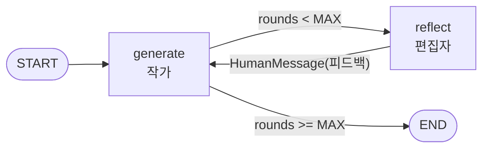
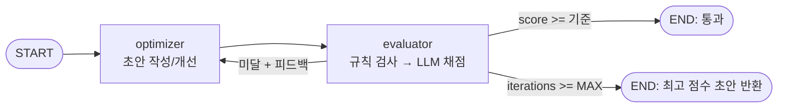

## 왜 필요한가: 첫 초안은 대개 최선이 아니다

글을 써 본 사람은 압니다. 첫 초안은 거칠고, 다시 읽어 보면 고칠 곳이 보입니다. LLM도 마찬가지입니다. 한 번에 쓴 답변보다 **스스로 검토하고 다시 쓴 답변**이 더 나은 경우가 많습니다. 특히 다음과 같은 작업에서 차이가 큽니다.

- 길이, 형식, 금지어 같은 **명확한 요구사항**이 있는 글(광고 문구, 요약, 이메일)
- 테스트로 확인할 수 있는 **코드 생성**(테스트 실패 메시지가 곧 피드백)
- 출처와 맞는지 확인해야 하는 **사실 기반 답변**(RAG 답변의 근거 검증)

여기서 두 역할이 등장합니다. 글을 쓰는 **생성자(Generator/Optimizer)** 와 글을 검토하는 **비평가/평가자(Reflector/Evaluator)** 입니다. 같은 모델이어도 프롬프트(역할)가 다르면 다른 관점으로 봅니다. 작가와 편집자가 같은 사람이어도, "편집자 모자"를 쓰면 다른 것이 보이는 것과 같습니다.

> [!CAUTION]
> 자기 검토 루프는 **공짜 품질 향상 장치가 아닙니다.** 반복할 때마다 LLM 호출 비용과 지연이 쌓이고, 평가 기준이 모호하면 오히려 글이 나빠지거나 끝없이 고치기만 합니다. 기준과 상한이 이 강의의 핵심입니다.

## 핵심 개념

### 1) Reflection: 조언을 주고받는다



비평가는 점수를 매기지 않고 **개선 조언만** 합니다. 종료 조건은 반복 횟수입니다. 구현이 간단하고, 대부분의 경우 1~2번의 개선만으로 품질이 눈에 띄게 좋아집니다.

핵심 트릭은 **역할 뒤집기**입니다. 비평가의 출력을 작가의 대화에 `HumanMessage`로 넣습니다. 작가 입장에서는 "사용자가 피드백을 준 것"처럼 보이므로 자연스럽게 피드백을 반영해 다시 씁니다. 반대로 비평가에게는 대화 기록 전체를 주지 않고 "원래 요청 + 최신 초안"만 줍니다. 비평가가 이전 비평에 끌려가지 않고 매번 새로운 눈으로 보게 하려는 것입니다.

### 2) Evaluator-Optimizer: 채점하고, 기준을 통과할 때까지



평가자는 **구조화 출력**으로 점수와 피드백을 냅니다. 그리고 "통과인가?"는 **코드가 판단**합니다. Anthropic의 에이전트 설계 가이드에서도 이 패턴을 "명확한 평가 기준이 있고, 반복 개선이 측정 가능한 가치를 줄 때" 쓰라고 권합니다.

| | Reflection | Evaluator-Optimizer |
| --- | --- | --- |
| 비평가 출력 | 자유 텍스트 조언 | 구조화된 점수 + 피드백 |
| 종료 조건 | 반복 횟수 | 기준 통과 또는 반복 상한 |
| 통과 판단 | 없음 | 코드가 점수로 판단 |
| 적합한 상황 | 기준이 주관적일 때 | 기준이 명확하고 측정 가능할 때 |

### 3) 좋은 평가 기준(rubric)의 조건

평가자의 품질은 기준의 품질을 넘지 못합니다. "좋은 글인가?"는 나쁜 기준입니다. 좋은 기준은 다음과 같습니다.

- **분해되어 있다**: 정확성, 명확성, 형식 준수처럼 항목별로 나눕니다. 예제는 `accuracy_score`, `clarity_score`를 따로 받고, **가장 낮은 점수**를 전체 점수로 씁니다. 한 기준이 아주 나쁘면 다른 기준이 좋아도 실패로 봐야 하기 때문입니다.
- **검증 가능한 것은 코드로 검사한다**: 글자 수, 필수 키워드, JSON 형식, 금지어는 LLM에게 물을 필요가 없습니다. 규칙 검사는 공짜이고 결정적(deterministic)입니다. LLM 채점은 규칙을 통과한 뒤에만 합니다.
- **구체적인 피드백을 요구한다**: 점수만 받으면 생성자가 무엇을 고쳐야 할지 모릅니다. "다음 초안에서 고칠 점"을 필드로 강제합니다.

## 코드 해설

### 예제 1: Reflection

▶ 오른쪽 IDE의 `examples/01_reflection.py`를 실행해 보세요.

```python
def reflect(state):
    request = state["messages"][0].text
    latest_draft = state["messages"][-1].text
    critique = llm.invoke([SystemMessage(CRITIC_PROMPT), HumanMessage(f"요청: {request}\n\n글:\n{latest_draft}")])
    return {"messages": [HumanMessage(f"편집자 피드백: {critique.text}", name="critic")]}
```

- 작가의 초안은 `AIMessage(name="writer")`, 편집자의 피드백은 `HumanMessage(name="critic")`으로 쌓입니다. 출력의 메시지 목록에서 user → writer → critic → writer … 순서를 확인하세요.
- 종료는 `should_continue`가 `rounds >= MAX_ROUNDS`일 때 END로 보내는 것뿐입니다. `recursion_limit`도 `2 * MAX_ROUNDS + 3`처럼 그래프 단계 수에서 계산해 설정했습니다. "넉넉하게 100"이 아니라 **설계상 최대 단계 + 약간의 여유**로 두면 버그가 났을 때 빨리 드러납니다.
- 편집자 프롬프트에 "글을 직접 고쳐 쓰지 마세요"라고 쓴 이유: 비평가가 초안을 통째로 다시 쓰면 역할 분리가 무너지고 토큰이 낭비됩니다.

### 예제 2: Evaluator-Optimizer

▶ `examples/02_evaluator_optimizer.py`를 실행해 보세요. 같은 그래프를 품질 기준 8점과 9점으로 두 번 실행합니다.

평가자는 두 단계로 일합니다.

```python
rule_issues = []
if len(draft) > MAX_CHARS:
    rule_issues.append(...)
if rule_issues:
    score, feedback = 1, " ".join(rule_issues)       # 규칙 위반: LLM 호출 없이 즉시 실패
else:
    ev = llm.with_structured_output(Evaluation).invoke(...)
    score = min(ev.accuracy_score, ev.clarity_score)   # 가장 약한 기준이 전체 품질
passed = score >= state["quality_bar"]                 # 통과 판단은 코드가
```

그리고 매 반복마다 **최고 점수 초안**을 따로 저장합니다. 반복 상한에 도달했을 때 마지막 초안이 아니라 가장 좋았던 초안을 돌려주기 위해서입니다. 개선 루프가 항상 단조 증가하지는 않습니다. 3번째 초안이 2번째보다 나빠지는 일은 실제로 자주 일어납니다.

> [!NOTE]
> Mock 모델은 `score`가 들어간 숫자 필드를 항상 8로 채웁니다. 그래서 기준 8점일 때는 첫 초안에서 통과하고, 기준 9점일 때는 3번 반복한 뒤 상한에서 멈춥니다. 두 경로(통과, 상한 도달)가 모두 실행되는 것을 확인하세요. 실제 모델에서는 점수가 반복마다 달라집니다.

결과 출력의 "⚠️ 기준 미달(최고 점수 초안 반환)"이 **graceful degradation(우아한 성능 저하)** 입니다. 기준을 못 넘었다고 에러를 내는 대신, 지금까지의 최선과 "품질 미달" 표시를 함께 돌려줍니다. 호출하는 쪽은 이 표시를 보고 사람 검토로 보내거나, 사용자에게 주의 문구를 붙일 수 있습니다.

## 현업에서는

**평가자 모델의 선택.** 평가자는 생성자와 **다른 모델(또는 더 강한 모델)** 을 쓰는 경우가 많습니다. 같은 모델은 자기 실수를 잘 못 보는 경향(자기 선호 편향)이 있기 때문입니다. 반대로 비용이 걱정되면 규칙 검사를 최대한 늘리고 LLM 채점은 작은 모델로 합니다.

**평가자도 평가해야 한다.** LLM 평가자(LLM-as-judge)가 사람의 판단과 얼마나 일치하는지 주기적으로 확인합니다. 사람이 채점한 샘플 50~100개를 만들어 두고 평가자 점수와 비교하세요. 이 데이터셋과 방법은 08 모듈의 관측성·평가 강의에서 자세히 다룹니다.

**비용 계산.** 반복 1회 = 생성 1회 + 평가 1회입니다. 상한 3이면 최악의 경우 LLM 호출 6번입니다. 트래픽이 많은 서비스라면 "첫 초안 통과율"을 지표로 모니터링하세요. 통과율이 낮으면 루프를 늘리기보다 **생성 프롬프트 자체를 고치는 것**이 훨씬 싸고 효과적입니다.

**지연 관리.** 사용자 대면 실시간 응답에서는 반복 루프가 체감 지연을 크게 늘립니다. 흔한 절충안은 (1) 첫 초안을 바로 스트리밍하고 백그라운드에서 검토하거나, (2) 루프를 1회로 제한하거나, (3) 규칙 검사만 동기적으로 하고 LLM 채점은 비동기 품질 모니터링으로 돌리는 것입니다.

**코드 생성에서는 실행 결과가 최고의 평가자다.** 코드 에이전트에서는 LLM 평가보다 **테스트 실행 결과, 린터 출력, 타입 체커 오류**가 훨씬 정확한 피드백입니다. 예제의 규칙 검사 자리에 "테스트 실행"을 넣는다고 생각하면 됩니다. 단, LLM이 만든 코드는 반드시 격리된 샌드박스에서 실행합니다(08 모듈 보안 강의).

**관측성.** 점수 이력(`scores`)과 통과 여부를 트레이스 메타데이터로 남기세요. "평균 몇 번 만에 통과하는가", "어떤 기준에서 자주 떨어지는가"를 보면 프롬프트를 어디서 고쳐야 하는지 알 수 있습니다.

### 안티패턴

- **상한 없는 "통과할 때까지"**: 기준이 너무 높거나 평가자가 일관성이 없으면 영원히 돕니다.
- **LLM에게 통과 여부(bool)를 직접 묻기**: 모델은 쉽게 "통과"라고 답하는 경향이 있습니다. 점수와 기준을 분리하고 판단은 코드로 합니다.
- **마지막 초안 반환**: 개선이 단조롭지 않으므로 최고 점수 초안을 추적합니다.
- **모호한 rubric**: "더 좋게"는 피드백이 아닙니다. 항목별 점수와 구체적 수정 지시를 요구합니다.
- **규칙으로 되는 검사를 LLM에게 맡기기**: 글자 수 세기는 LLM이 특히 못하는 일입니다.

## 정리

- Reflection은 비평가의 조언을 `HumanMessage`로 넣어 작가가 다시 쓰게 하는 루프이고, 종료는 반복 횟수로 합니다.
- Evaluator-Optimizer는 구조화된 점수로 평가하고, 통과 판단은 코드가 하며, 상한에 도달하면 최고 점수 초안을 돌려줍니다.
- 검증 가능한 기준은 규칙으로 먼저 검사하고, LLM 채점은 그다음에 합니다.
- 루프의 가치는 비용·지연과 비교해 측정해야 하며, 평가자 자체도 사람 판단과 비교해 검증합니다.

다음 강의에서는 지금까지의 패턴(계획, 서브 에이전트, 컨텍스트 관리)을 하나로 묶은 **Deep Agents**를 배웁니다.
