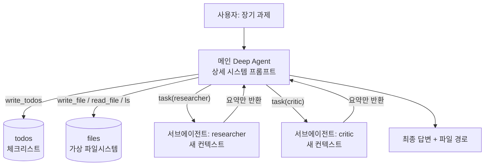
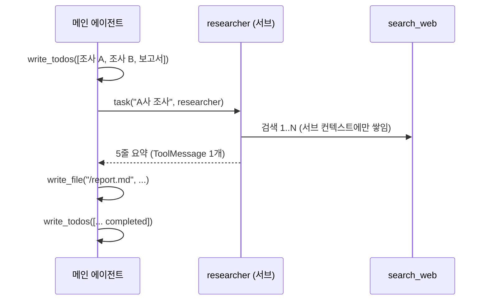

## 왜 필요한가: "얕은" 에이전트의 한계

`create_agent`로 만든 기본 에이전트는 모델이 도구를 부르고 결과를 보는 루프입니다. 날씨 조회나 주문 확인처럼 3~5단계로 끝나는 일에는 충분합니다. 그런데 "경쟁사 5곳을 조사해서 비교 보고서를 써 줘" 같은 **장기 과제(long-horizon task)** 를 맡기면 이런 일이 생깁니다.

- 검색 결과가 대화 기록에 계속 쌓여 수만 토큰이 되고, 모델이 앞부분 내용을 놓칩니다.
- 3번째 회사를 조사하다가 원래 무엇을 하던 중이었는지 잊어버립니다.
- 중간 결과를 둘 곳이 대화 기록밖에 없어서, 요약하다 정보를 잃습니다.

Claude Code, Manus, OpenAI Deep Research 같은 "깊은" 에이전트들은 이 문제를 비슷한 방식으로 풉니다. LangChain 팀은 이 공통 구조를 **Deep Agent** 라고 부르고, `deepagents` 라이브러리로 정리했습니다. 구조의 핵심은 네 가지입니다.

1. **상세한 시스템 프롬프트**: 도구를 언제, 어떻게 쓰는지 예시까지 포함한 긴 작업 지침
2. **계획 도구(`write_todos`)**: 체크리스트를 상태에 저장하고 진행하며 갱신
3. **가상 파일시스템(`ls`, `read_file`, `write_file`, `edit_file` …)**: 긴 중간 결과를 대화 대신 파일에 저장
4. **서브에이전트(`task`)**: 하위 작업을 새 컨텍스트에서 처리하고 요약만 받기

새로운 것은 하나도 없습니다. 04강의 체크리스트, 01강의 Agents-as-tools와 컨텍스트 격리를 **하나의 에이전트 안에 도구로** 묶은 것입니다. 이 강의는 이 모듈의 종합편입니다.



## 핵심 개념

### 1) 계획 도구: 생각을 "상태"로 꺼내 놓기

`write_todos`는 사실 아무 일도 하지 않는 도구입니다. 받은 목록을 상태에 저장할 뿐입니다. 그런데도 효과가 큰 이유는, 모델이 **계획을 명시적으로 쓰는 행위 자체**가 작업을 구조화하고, 저장된 목록이 매 턴 컨텍스트에 다시 등장해 "지금 어디까지 했는지"를 상기시키기 때문입니다. 사람이 할 일 목록을 적어 두면 덜 헤매는 것과 같습니다. 사용자에게 진행률을 보여주기에도 좋습니다.

### 2) 가상 파일시스템: 컨텍스트 밖의 메모장

검색 결과 4,000자를 대화 기록에 그대로 두면 이후 모든 LLM 호출이 그 4,000자를 다시 읽습니다. 대신 `write_file("/research/company_a.md", ...)`로 저장하고, 필요할 때만 `read_file`로 꺼내면 컨텍스트가 가벼워집니다. 이것을 **컨텍스트 오프로딩(context offloading)** 이라고 합니다.

"가상"이라는 말은 실제 디스크가 아니라 **그래프 상태(`files` 키)** 에 저장한다는 뜻입니다. 체크포인터가 상태를 저장하므로 파일도 함께 저장되고, 사용자별·스레드별로 자연스럽게 분리됩니다. 실제 디스크나 원격 저장소를 쓰고 싶으면 백엔드를 바꿉니다(뒤에서 설명).

### 3) 서브에이전트: 컨텍스트 격리의 완성

`task(description, subagent_type)` 도구는 01강의 Agents-as-tools 그대로입니다. 서브에이전트는 **새 대화**로 시작해 검색을 10번 하든 20번 하든 자기 컨텍스트에서 처리하고, 메인에게는 최종 요약만 돌려줍니다. 메인 에이전트는 "총괄 매니저"로서 깨끗한 컨텍스트를 유지합니다.



## 코드 해설

### 예제 1: 미니 Deep Agent를 처음부터

▶ 오른쪽 IDE의 `examples/01_mini_deep_agent.py`를 실행해 보세요.

**상태 확장.** `AgentState`를 상속해 `todos`와 `files`를 추가하고 `create_agent(..., state_schema=DeepState)`로 넘깁니다.

```python
def merge_files(left, right):
    return {**(left or {}), **(right or {})}

class DeepState(AgentState):
    todos: NotRequired[list[dict]]
    files: NotRequired[Annotated[dict[str, str], merge_files]]
```

`files`에 리듀서를 둔 이유가 중요합니다. 모델은 도구를 **병렬로** 여러 개 부를 수 있습니다. 두 `write_file` 호출이 같은 단계에서 `files`를 갱신하면, 리듀서가 없을 때 LangGraph는 "한 단계에서 같은 키를 여러 번 갱신했다"는 오류(`InvalidUpdateError`)를 냅니다. 리듀서가 있으면 두 결과를 합칩니다.

**상태를 바꾸는 도구.** 도구가 문자열 대신 `Command(update=...)`를 반환하면 상태를 직접 바꿀 수 있습니다. 이때 규칙이 하나 있습니다. **반드시 그 도구 호출에 대한 `ToolMessage`를 함께 넣어야** 합니다. 모델의 tool_call마다 응답이 짝지어져야 다음 LLM 호출이 정상 동작하기 때문입니다.

```python
@tool
def write_file(content: str, runtime: ToolRuntime, path: str = "/notes.md") -> Command:
    """report 나 메모를 가상 file 에 저장한다."""
    return Command(update={
        "files": {path: content},
        "messages": [ToolMessage(f"{path} 저장 완료", tool_call_id=runtime.tool_call_id)],
    })
```

`read_file`과 `ls`는 상태를 바꾸지 않으므로 그냥 문자열을 반환하고, `runtime.state`로 현재 파일을 읽습니다.

**task 도구.** `subagent_type`을 `Literal["researcher", "critic"]`로 선언해 존재하는 서브에이전트만 고를 수 있게 했습니다. 서브에이전트는 새 메시지로 실행하고, 최종 텍스트만 `ToolMessage`로 돌려줍니다. 실행 결과의 "서브에이전트 내부 메시지 수"와 메인이 받은 결과 수를 비교해 보세요.

> [!NOTE]
> Mock 모델은 질문의 단어와 도구 이름·설명의 단어가 겹치는 도구를 최대 3개까지 동시에 부릅니다. 그래서 예제 질문에 `todo list`, `task`, `file` 같은 단어를 넣었습니다. 실제 모델은 시스템 프롬프트의 작업 방식을 따라 계획 → 위임 → 저장 순서로 여러 턴에 걸쳐 진행합니다.

### 예제 2: deepagents 라이브러리

▶ `examples/02_deepagents_library.py`를 실행해 보세요.

```python
researcher: SubAgent = {
    "name": "researcher",
    "description": "하나의 주제를 깊이 조사해 요약 보고서를 돌려준다.",
    "system_prompt": "...",
    "tools": [search_web],
}
agent = create_deep_agent(
    model=MODEL,
    tools=[search_web],
    system_prompt="...",
    subagents=[researcher],
    middleware=[TodoListMiddleware()],
)
```

설치된 `deepagents` 0.7.32의 소스를 확인하면 다음과 같습니다.

- 기본 도구: `ls`, `read_file`, `write_file`, `edit_file`, `delete`, `glob`, `grep`, `execute`, `task`. 예제는 시작할 때 실제 도구 목록을 출력합니다.
- **`write_todos`는 0.7 기본 스택에 포함되어 있지 않습니다.** 예제처럼 LangChain의 `TodoListMiddleware()`를 `middleware`로 넘기면 추가됩니다. 인터넷의 예전 글에는 "기본 포함"이라고 쓰인 경우가 있으니, 버전에 따라 직접 확인하는 습관이 중요합니다.
- 기본 백엔드는 `StateBackend`입니다. 파일은 상태의 `files` 키에 `{"content": ..., "encoding": ..., "created_at": ..., "modified_at": ...}` 형태로 저장됩니다. 그래서 시작 파일을 넣을 때 `create_file_data("...")` 헬퍼를 씁니다.
- `execute`(셸 실행)는 샌드박스 백엔드일 때만 동작하고, 기본 백엔드에서는 오류 메시지를 돌려줍니다.
- `subagents`에 넘긴 것 외에 `general-purpose` 서브에이전트가 자동으로 추가됩니다. `SubAgent`에는 `model`(서브에이전트만 다른 모델), `middleware`, `interrupt_on`(HITL), `response_format` 등을 지정할 수 있고, 이미 만든 그래프를 쓰려면 `CompiledSubAgent(name, description, runnable)`를 씁니다.
- `model`에 `"openai:..."` 문자열을 넘기면 기본적으로 OpenAI Responses API를 쓴다고 docstring에 적혀 있습니다. Chat Completions를 원하면 `init_chat_model(..., use_responses_api=False)`로 만든 모델 객체를 넘깁니다.

두 번째 실행에서는 `task` 도구가 "그런 서브에이전트는 없다, 허용된 타입은 general-purpose, researcher"라는 결과를 돌려줍니다. Mock 모델이 `subagent_type`에 임의의 문자열을 넣었기 때문입니다. 눈여겨볼 점은 이것이 **예외로 그래프를 멈추지 않고 도구 결과로 돌아온다**는 것입니다. 실제 모델은 이 메시지를 보고 올바른 이름으로 다시 호출할 수 있습니다. 좋은 도구는 실패도 모델이 읽고 고칠 수 있는 형태로 돌려줍니다.

> [!TIP]
> `create_deep_agent`가 돌려주는 것은 평범한 컴파일된 LangGraph 그래프입니다. `checkpointer=`, `store=`를 넘길 수 있고, `stream`, `get_state`, LangSmith 트레이싱 등 지금까지 배운 모든 것을 그대로 쓸 수 있습니다.

## 현업에서는

**백엔드 선택이 곧 아키텍처 결정이다.** 기본 `StateBackend`는 파일이 스레드(대화) 안에서만 유지됩니다. 사용자가 다음 대화에서도 이전 보고서를 보길 원하면 LangGraph Store 기반 `StoreBackend`를, 실제 프로젝트 디렉터리를 다루는 코딩 에이전트라면 `FilesystemBackend`를, 경로별로 섞고 싶으면 `CompositeBackend`를 씁니다(모두 `deepagents.backends`에 있음).

```python
# 참고용: 장기 기억 디렉터리만 Store 에 저장하는 구성 (실행 예제 아님)
from deepagents.backends import CompositeBackend, StateBackend, StoreBackend

backend = CompositeBackend(
    default=StateBackend(),
    # 0.7.32 기준 StoreBackend 는 namespace(런타임 → 튜플) 키워드 인자가 필수다
    routes={"/memories/": StoreBackend(namespace=lambda rt: ("memories",))},
)
agent = create_deep_agent(model=MODEL, backend=backend, store=store, checkpointer=checkpointer)
```

생성자 인자는 버전마다 바뀔 수 있으니, 실제로 쓸 때는 설치된 버전의 시그니처를 확인하세요. 실제 서비스라면 namespace에 사용자 ID를 넣어 사용자별로 기억을 분리합니다.

**보안: 파일과 셸은 가장 위험한 도구다.** `FilesystemBackend`로 실제 디스크를 열면 에이전트가 무엇이든 읽고 쓸 수 있습니다. `permissions`로 경로 권한을 제한하고, `interrupt_on={"write_file": True, "execute": True}`처럼 위험한 도구에 사람 승인(HITL)을 걸고, 셸은 반드시 격리된 샌드박스 백엔드에서만 실행합니다(08 모듈 보안 강의).

**비용 관리.** Deep Agent는 한 요청에 수십 번의 LLM 호출을 할 수 있습니다. `recursion_limit`, 서브에이전트별 상한, 그리고 LangChain의 `ModelCallLimitMiddleware`·`ToolCallLimitMiddleware` 같은 호출 수 제한 미들웨어로 요청당 예산을 강제하세요. 서브에이전트에는 작은 모델을 지정(`"model": ...`)하는 것이 흔한 비용 최적화입니다. 긴 대화에서는 기본 스택의 요약(Summarization) 미들웨어가 컨텍스트를 압축합니다.

**관측성.** 메인 에이전트의 트레이스 안에 서브에이전트 실행이 중첩되어 기록됩니다. LangSmith에서 "어떤 서브에이전트가 가장 많은 토큰을 썼는가"를 보면 비용 최적화 지점이 바로 보입니다. `todos` 상태를 스트리밍(`stream_mode="updates"`)하면 사용자에게 진행 상황을 보여줄 수 있습니다.

**언제 쓰지 말아야 하나.** 질문 하나에 검색 한 번이면 끝나는 챗봇에 Deep Agent를 쓰면 기본 시스템 프롬프트와 도구 스키마만으로도 토큰이 크게 늘고 응답이 느려집니다. Deep Agent는 "사람이라면 30분 이상 걸릴 일"에 쓰는 도구입니다.

### 안티패턴

- `Command`로 상태를 바꾸면서 `ToolMessage`를 빠뜨리기 → tool_call 짝이 깨져 다음 호출에서 오류.
- 병렬 도구 호출이 같은 키를 갱신하는데 리듀서 없음 → `InvalidUpdateError`.
- 서브에이전트 결과로 원문 전체를 돌려주기 → 격리의 의미가 사라짐. 요약하거나 파일에 저장하고 경로만 반환하세요.
- 실제 파일시스템과 셸을 권한 제한 없이 열기.

## 정리

- Deep Agent = 상세 프롬프트 + 계획 도구 + 가상 파일시스템 + 서브에이전트. 모두 이 모듈에서 배운 패턴의 조합입니다.
- 상태를 바꾸는 도구는 `Command(update=...)`와 짝이 맞는 `ToolMessage`를 함께 반환하고, 병렬 갱신되는 키에는 리듀서를 둡니다.
- `create_deep_agent`는 파일 도구와 `task`를 기본 제공하며, 0.7에서 `write_todos`는 `TodoListMiddleware`로 추가합니다.
- 프로덕션에서는 백엔드, 권한, HITL, 호출 수 상한, 관측성을 함께 설계합니다.

이것으로 멀티 에이전트 모듈을 마칩니다. 다음 모듈에서는 이 시스템들을 스트리밍, 평가, 가드레일, 배포까지 갖춘 **프로덕션 서비스**로 만드는 방법을 배웁니다.
