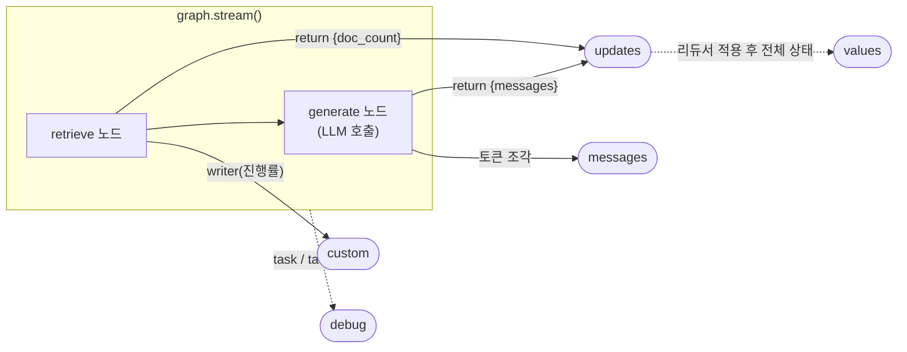
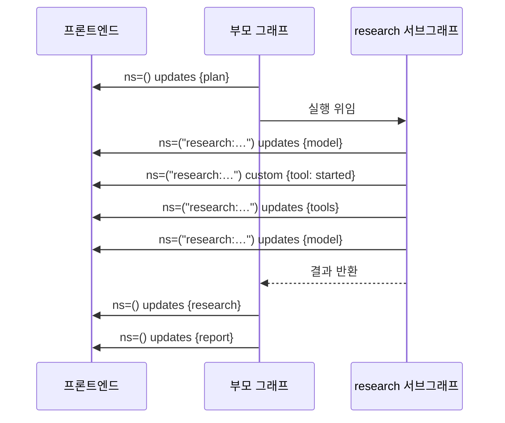
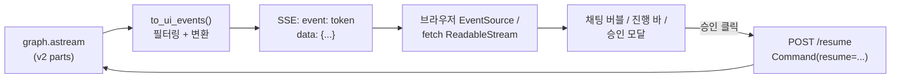

# 스트리밍 완전 정복

> **"사용자는 10초를 기다리지 않는다. 하지만 10초 동안 무언가 일어나는 걸 보면 기다린다."**

2.5강에서 `llm.stream()`으로 토큰을 하나씩 받아 보았습니다. 그런데 실제 에이전트는 LLM 한 번 호출로 끝나지 않습니다. 검색 노드가 돌고, 도구가 외부 API를 부르고, 서브 에이전트가 따로 생각하고, 중간에 사람 승인을 기다리기도 합니다. 이 강의에서는 **그래프 전체의 실행을 실시간으로 바깥에 중계하는 방법**을 다룹니다. 그리고 그 중계를 브라우저가 받기 좋은 형태로 바꾸는 방법까지 배웁니다.

## 1. 왜 스트리밍이 프로덕션의 필수 요건인가

GPT-5 같은 추론 모델은 답을 내기 전에 수 초에서 수십 초 동안 생각합니다. 에이전트가 도구를 세 번 부르면 전체 응답 시간은 쉽게 20~60초가 됩니다. 이 시간 동안 화면이 멈춰 있으면 사용자는 새로고침을 누르거나 떠납니다.

스트리밍은 세 가지 문제를 풉니다.

| 문제 | 스트리밍이 주는 해법 | 대응 stream_mode |
| --- | --- | --- |
| **체감 지연** — 첫 글자가 나오기까지 너무 김 | 첫 토큰 시간(TTFT, Time To First Token)을 줄여 답이 "써지는" 경험 제공 | `messages` |
| **블랙박스** — 에이전트가 지금 뭘 하는지 모름 | "문서 검색 중… 3/10", "환불 API 호출 중" 같은 진행 상황 표시 | `custom`, `updates` |
| **개입 불가** — 잘못된 방향으로 가도 끝날 때까지 기다려야 함 | 중간 상태를 보고 취소하거나, 승인 요청(interrupt)에 응답 | `updates`, `values` |

비유를 들면, 스트리밍이 없는 에이전트는 **주방이 보이지 않는 식당**과 같습니다. 주문하고 40분 뒤에 요리가 나옵니다. 스트리밍이 있는 에이전트는 **오픈 키친**입니다. 재료를 손질하고(검색) 불을 올리고(도구 실행) 접시에 담는(토큰 생성) 과정이 다 보입니다. 시간은 같아도 기다림은 훨씬 덜 지루합니다.

## 2. 다섯 가지 stream_mode 한눈에 보기

`graph.stream()` / `graph.astream()`의 `stream_mode` 인자는 **무엇을 중계할지**를 정합니다.

| 모드 | 무엇이 나오나 | 데이터 형태 | 주 용도 |
| --- | --- | --- | --- |
| `values` | 매 superstep이 끝난 뒤 **전체 상태** | `dict` (State 전체) | 상태 패널, 디버깅, 마지막 값 얻기 |
| `updates` | 각 노드가 반환한 **변경분** | `{노드이름: 업데이트}` | 단계별 진행 표시, interrupt 감지 |
| `messages` | 노드 안 LLM 호출의 **토큰 조각** | `(AIMessageChunk, metadata)` | 채팅 타자 효과 |
| `custom` | 노드/도구가 `get_stream_writer()`로 직접 보낸 값 | 아무 값 | 진행률, 중간 산출물 |
| `debug` | 태스크 시작·결과, 체크포인트 등 **엔진 내부 이벤트** | `{type, step, payload, ...}` | 개발 중 추적 |

이 밖에 `checkpoints`(체크포인트 저장 이벤트)와 `tasks`(태스크 시작/종료만) 모드도 있습니다. `debug`는 사실상 이 둘을 합친 것입니다.

▶ 오른쪽 IDE의 `examples/01_stream_modes.py`를 실행해 보세요. **같은 그래프**를 다섯 모드로 각각 돌리므로 차이가 한눈에 보입니다.



### values vs updates — 언제 무엇을?

- **`values`**는 매번 상태 전체를 보냅니다. 메시지가 100개 쌓인 대화라면 매 단계마다 100개를 다시 보냅니다. 편하지만 **무겁습니다**.
- **`updates`**는 바뀐 부분만 보냅니다. 프론트엔드가 자기 쪽 상태에 변경분을 합쳐야 하지만, 네트워크 비용이 작고 "어느 노드가 무엇을 했는지"가 분명합니다.

현업에서는 보통 **`updates` + `messages` + `custom`** 조합을 기본으로 씁니다. `values`는 화면이 처음 열릴 때나 재연결할 때 전체 상태를 한 번 받아오는 용도로 씁니다.

### messages 모드의 메타데이터

`messages` 모드의 각 조각은 `(chunk, metadata)` 튜플입니다. `metadata`에는 다음 값이 들어 있습니다.

- `langgraph_node`: 이 토큰을 만든 노드 이름
- `langgraph_step`: superstep 번호
- `tags`: LLM 호출 시 `config={"tags": [...]}`로 붙인 태그
- `ls_model_name`, `ls_provider` 등 모델 정보

이 메타데이터가 중요한 이유가 있습니다. 그래프 안에는 **사용자에게 보여 주면 안 되는 LLM 호출**이 많기 때문입니다. 라우터의 분류 호출, 관련성 평가(grader), 초안 작성 등이 그렇습니다. 이 호출들의 토큰이 채팅창에 섞이면 화면이 엉망이 됩니다. 그래서 노드 이름이나 태그로 걸러냅니다.

```python
reply = llm.invoke(state["messages"], config={"tags": ["final_answer"]})
...
for chunk, meta in graph.stream(inputs, stream_mode="messages"):
    if "final_answer" in (meta.get("tags") or []):
        print(chunk.content, end="")
```

> [!WARNING]
> `messages` 모드에서는 **도구 결과(`ToolMessage`)도** 함께 흘러나옵니다. `create_agent`를 쓸 때 "모델 노드에서 나온 `AIMessageChunk`만" 화면에 쓰려면 `meta["langgraph_node"] == "model"`과 `chunk.type == "AIMessageChunk"`를 함께 확인하세요.

## 3. 다중 모드와 version="v2"

`stream_mode`에 리스트를 넘기면 여러 모드를 동시에 구독합니다. 기본(`version="v1"`)에서는 출력 형태가 옵션 조합에 따라 달라집니다.

| 옵션 | v1 출력 형태 |
| --- | --- |
| 단일 모드 | `data` |
| 다중 모드 | `(mode, data)` |
| 단일 모드 + `subgraphs=True` | `(namespace, data)` |
| 다중 모드 + `subgraphs=True` | `(namespace, mode, data)` |

조합마다 언패킹 코드가 달라져서 버그가 잘 생깁니다. LangGraph 1.x는 `version="v2"`를 지원합니다. v2에서는 **모든 파트가 같은 모양의 딕셔너리**입니다.

```python
for part in graph.stream(inputs, stream_mode=["updates", "messages", "custom"],
                         subgraphs=True, version="v2"):
    part["type"]  # "updates" | "messages" | "custom" | ...
    part["ns"]    # () 이면 루트 그래프, ("research:<task_id>",) 이면 서브그래프 내부
    part["data"]  # 모드별 데이터
```

> [!TIP]
> 새로 작성하는 코드는 `version="v2"`를 기본으로 쓰세요. 옵션을 바꿔도 소비자 코드를 고칠 필요가 없습니다. `invoke(..., version="v2")`도 지원하며, 이때는 `.value`와 `.interrupts` 속성을 가진 `GraphOutput`을 돌려줍니다.

## 4. 서브그래프 스트리밍과 네임스페이스

4.6강에서 그래프를 서브그래프로 모듈화했습니다. 7강의 멀티 에이전트에서는 `create_agent`로 만든 에이전트를 다른 그래프의 노드로 넣었습니다. 기본 설정에서 서브그래프는 바깥에서 **하나의 노드처럼** 보입니다. 내부의 `model → tools → model` 진행은 보이지 않습니다.

`subgraphs=True`를 주면 내부 이벤트도 올라옵니다. 이때 `ns`(네임스페이스)로 출처를 구분합니다.



네임스페이스 문자열은 `"노드이름:태스크ID"` 형식입니다. 서브그래프가 중첩되면 튜플 길이가 늘어납니다. UI에서는 보통 `ns[-1].split(":")[0]`으로 **어느 에이전트가 말하고 있는지** 라벨을 붙입니다. 멀티 에이전트 UI에서 "🔍 리서치 에이전트가 검색 중…"을 띄우는 것이 바로 이 정보입니다.

▶ `examples/02_subgraphs_and_tools.py`를 실행해서 A(기본)와 B(`subgraphs=True`)의 출력 차이를 비교해 보세요.

## 5. custom 스트림: 노드와 도구가 직접 말하게 하기

LLM 토큰이 아닌 정보도 실시간으로 보내고 싶을 때가 많습니다.

- 대용량 문서 처리 진행률 ("12/50 페이지 분석 중")
- 외부 API 대기 상태 ("결제사 응답 대기 중")
- 중간 산출물 (검색 결과 카드 목록을 먼저 보여 주기)

**그래프 노드 안에서는** `get_stream_writer()`를 씁니다.

```python
from langgraph.config import get_stream_writer

def retrieve(state):
    writer = get_stream_writer()
    writer({"stage": "retrieve", "progress": "1/3"})
    ...
```

**`create_agent`의 도구 안에서는** `ToolRuntime`을 주입받아 `runtime.stream_writer`를 씁니다. `runtime` 파라미터는 LLM에게 보이는 도구 스키마에서 자동으로 빠집니다(2.4강 참고).

```python
from langchain.tools import tool, ToolRuntime

@tool
def search_papers(query: str, runtime: ToolRuntime) -> str:
    """논문을 검색한다."""
    runtime.stream_writer({"tool": "search_papers", "status": "started"})
    ...
```

> [!NOTE]
> `get_stream_writer()`는 그래프 실행 컨텍스트 밖(예: 단위 테스트에서 함수를 직접 호출)에서도 에러를 내지 않고 아무 일도 하지 않는 함수를 돌려줍니다. 그래서 노드 함수를 그래프 없이 테스트하기 쉽습니다. 이 강의 환경은 Python 3.13이라 async 노드에서도 그대로 동작합니다. Python 3.11 미만의 async 코드에서는 컨텍스트 전파 제약 때문에 노드 시그니처에 `writer: StreamWriter`를 받아야 했다는 점만 기억해 두세요.

## 6. 프론트엔드 연동: UI 이벤트 프로토콜 설계

이제 가장 중요한 질문입니다. **이 스트림을 브라우저에 어떻게 보낼까요?**

LangGraph 원시 이벤트를 그대로 JSON으로 직렬화해 보내는 것은 좋지 않습니다.

1. `AIMessageChunk` 같은 파이썬 객체는 직렬화 형태가 버전에 따라 바뀔 수 있습니다.
2. 내부 라우터·grader의 토큰, 내부 상태 키 등 **노출하면 안 되는 정보**가 섞입니다.
3. 프론트엔드가 LangGraph 내부 구조(노드 이름, 네임스페이스 규칙)에 강하게 묶입니다.

그래서 현업에서는 백엔드에 **변환 계층(adapter)**을 두고, 작고 안정적인 이벤트 스키마로 바꿔 보냅니다.



▶ `examples/03_ui_event_protocol.py`를 실행해 보세요. 이 예제는 다음 흐름을 이벤트로 보여 줍니다.

1. 사용자가 환불을 요청합니다. 모델이 `refund_order` 도구를 호출하려 합니다(`tool_call` 이벤트).
2. `HumanInTheLoopMiddleware`가 실행을 멈춥니다. `updates` 스트림에 `__interrupt__` 키가 나타나고, 이것을 `interrupt` 이벤트로 바꿉니다.
3. 프론트엔드는 승인 모달을 띄웁니다. 상담원이 승인하면 **같은 `thread_id`로** `Command(resume={"decisions": [{"type": "approve"}]})`를 보내 재개합니다.
4. 도구가 실행되며 `progress` 이벤트가 나가고, 이어서 `tool_result` 이벤트와 최종 답변 `token`들이 나옵니다.

코드의 핵심은 아래 부분입니다.

```python
elif kind == "updates":
    if "__interrupt__" in data:                     # 그래프가 사람을 기다리며 멈춤
        for intr in data["__interrupt__"]:
            yield {"event": "interrupt", "id": intr.id, "value": intr.value}
```

interrupt/resume의 자세한 원리는 5.3강에서 다뤘습니다. 여기서 기억할 점은 **interrupt도 스트림의 일부**라는 것입니다. 프론트엔드는 이벤트 하나로 "멈췄으니 사람의 응답이 필요하다"는 것을 알 수 있습니다.

### SSE vs WebSocket

| 기준 | SSE (Server-Sent Events) | WebSocket |
| --- | --- | --- |
| 방향 | 서버 → 클라이언트 단방향 | 양방향 |
| 프로토콜 | 평범한 HTTP. 프록시·로드밸런서 친화적 | 업그레이드 필요. 인프라 설정 추가 |
| 재연결 | 브라우저 `EventSource`가 자동 재연결, `Last-Event-ID` 지원 | 직접 구현 |
| 에이전트 적합도 | **대부분의 채팅/에이전트 UI에 충분** | 음성 에이전트, 실시간 협업처럼 양방향이 잦을 때 |

에이전트 UI의 흐름은 "요청 → 긴 스트림 응답 → (가끔) 승인 후 재요청"입니다. 그래서 **SSE가 사실상 표준**입니다. OpenAI·Anthropic API도 SSE로 스트리밍합니다. FastAPI로 SSE 엔드포인트를 만드는 방법은 8.5강에서 직접 구현합니다.

### LangGraph Server를 쓴다면: useStream

LangGraph Server(Agent Server)로 배포하면(8.5강) 위 변환 계층의 상당 부분을 플랫폼이 대신합니다. React에서는 `@langchain/langgraph-sdk/react`의 `useStream` 훅으로 메시지 스트리밍, interrupt, 브랜칭, 재연결을 한 번에 처리합니다.

```tsx
import { useStream } from "@langchain/langgraph-sdk/react";

export function Chat() {
  const thread = useStream({
    apiUrl: "http://localhost:2024",
    assistantId: "agent",
    messagesKey: "messages",
  });

  return (
    <div>
      {thread.messages.map((m) => <Bubble key={m.id} message={m} />)}
      {thread.interrupt && (
        <ApproveDialog
          value={thread.interrupt.value}
          onApprove={() => thread.submit(undefined, { command: { resume: { decisions: [{ type: "approve" }] } } })}
        />
      )}
      <Composer onSend={(text) => thread.submit({ messages: [{ type: "human", content: text }] })} />
    </div>
  );
}
```

직접 만든 FastAPI 서버를 쓰든 LangGraph Server를 쓰든, **스트림 모드·네임스페이스·interrupt의 개념은 똑같습니다**. 이 강의에서 익힌 내용이 어느 쪽에서든 그대로 쓰입니다.

## 7. 실습 안내

`exercise.py`에는 `outline → drafting(서브그래프) → polish` 구조의 글쓰기 그래프가 있습니다. 해야 할 일은 두 가지입니다.

1. `outline` 노드에서 진행 이벤트를 보냅니다.
2. `graph.stream()`을 **한 번만** 호출해서 최종 답변 토큰(태그 `final`), 초안 토큰 수(태그 `draft`), 진행 이벤트, 노드 실행 순서를 모두 모읍니다.

"한 번만"이라는 조건이 중요합니다. 실제 서비스에서 같은 요청을 모드별로 여러 번 실행하면 비용이 두 배가 되고, 결과도 서로 달라질 수 있습니다.

## 8. 현업에서는

**1) 인프라가 스트림을 망가뜨린다.** 로컬에서는 잘 되다가 배포하면 토큰이 한꺼번에 몰려오는 일이 흔합니다. 원인은 대개 중간 계층의 **버퍼링**입니다.
- Nginx: `proxy_buffering off;`를 설정하거나 응답 헤더에 `X-Accel-Buffering: no`를 넣습니다.
- 로드밸런서와 CDN의 idle timeout(보통 60초)에 걸려 연결이 끊깁니다. 15~30초마다 SSE 주석 라인(`: ping`)으로 **하트비트**를 보냅니다.
- gzip 압축 미들웨어가 스트림을 모아서 보내기도 합니다. `text/event-stream`은 압축 대상에서 빼세요.

**2) 끊김과 재연결을 설계하라.** 모바일 네트워크에서는 연결이 자주 끊깁니다. 이벤트마다 `id`를 붙이고, 재연결할 때 `Last-Event-ID` 이후부터 다시 보내거나 체크포인트(`values`)에서 상태를 복원합니다. LangGraph Server는 실행(run)을 백그라운드로 돌리고 클라이언트가 나중에 다시 붙는 **join stream** 기능을 제공합니다.

**3) 취소(cancel)는 반드시 구현한다.** 사용자가 "중지"를 누르거나 탭을 닫으면 서버도 실행을 멈춰야 합니다. 안 그러면 아무도 보지 않는 토큰에 비용을 냅니다. FastAPI에서는 클라이언트 연결이 끊기면 비동기 제너레이터가 취소됩니다. 이때 그래프 실행도 함께 정리되는지 확인하세요.

**4) 스트리밍과 출력 가드레일은 충돌한다.** 출력에 PII나 부적절한 내용이 있는지 검사하려면 답변 전체가 필요합니다. 하지만 스트리밍은 이미 토큰을 내보낸 뒤입니다. 해결책은 다음과 같습니다(8.3강).
- 문장 단위 버퍼링 후 검사하고 내보내기 (지연이 약간 늘어남)
- 고위험 도메인(금융·의료)에서는 최종 답변만 비스트리밍으로 검사 후 전송
- 일단 스트리밍하고, 위반이 감지되면 `retract` 이벤트로 화면에서 지우기

**5) 토큰 이벤트를 묶어서 보낸다.** 토큰마다 SSE 이벤트를 보내면 오버헤드가 커지고, React가 토큰마다 다시 렌더링해 화면이 버벅입니다. 서버에서 20~50ms 단위로 묶거나, 클라이언트에서 `requestAnimationFrame` 단위로 렌더링합니다.

**6) 관측성.** 스트리밍 응답도 LangSmith에 하나의 트레이스로 남습니다. 대시보드에서 **TTFT**와 **전체 지연**을 따로 추적하세요. 사용자 경험은 TTFT가 결정하고, 비용은 전체 토큰이 결정합니다.

> [!CAUTION]
> `debug` 모드에는 상태 전체와 내부 정보가 담깁니다. 운영 환경에서 클라이언트로 그대로 보내면 시스템 프롬프트나 다른 사용자의 정보가 새어 나갈 수 있습니다. `debug`는 서버 로그 전용으로만 쓰세요.

## 9. 정리

- `stream_mode`는 **무엇을 중계할지** 정합니다. 기본 조합은 `updates`(진행), `messages`(토큰), `custom`(진행률)입니다.
- `version="v2"`를 쓰면 모든 파트가 `{type, ns, data}`로 통일되어 다중 모드와 서브그래프를 같은 코드로 처리할 수 있습니다.
- `subgraphs=True`와 `ns`로 멀티 에이전트의 "누가 말하는지"를 구분합니다.
- `get_stream_writer()`(노드)와 `runtime.stream_writer`(도구)로 임의의 진행 정보를 보냅니다.
- 프론트엔드에는 원시 이벤트 대신 **작고 안정적인 UI 이벤트 프로토콜**을 보냅니다. interrupt도 그 프로토콜의 한 이벤트입니다.
- 다음 강의(8.2)에서는 이렇게 흘러가는 실행을 **기록하고 평가하는 방법**, 즉 관측성과 평가를 다룹니다.
