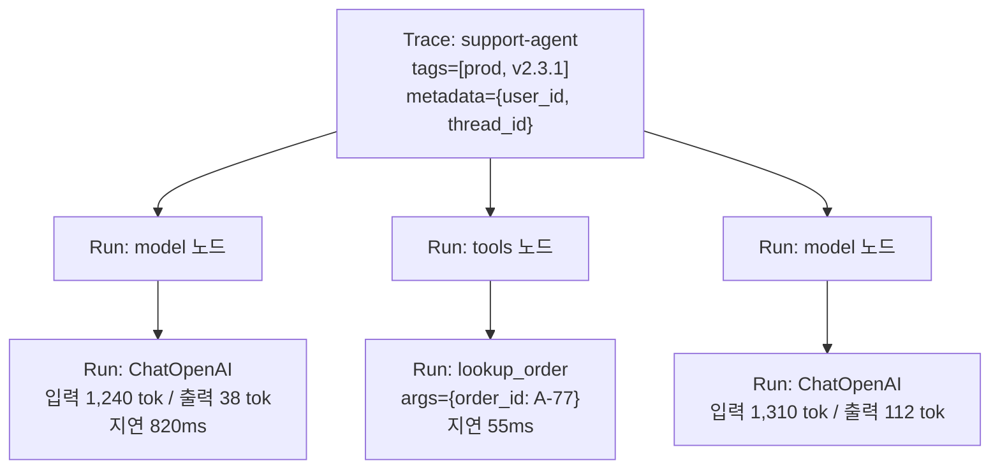
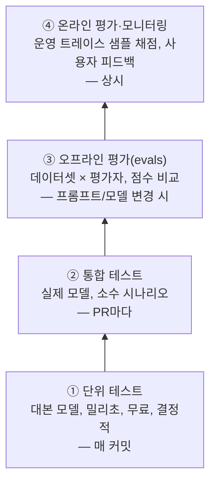
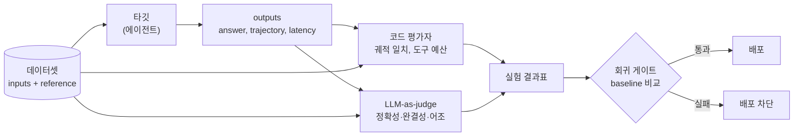

# 관측성과 평가

> **"측정할 수 없으면 개선할 수 없다." — 그리고 LLM 앱은 측정하기가 유난히 어렵다.**

전통적인 소프트웨어는 같은 입력에 같은 출력을 냅니다. 그래서 `assert add(2, 3) == 5` 한 줄로 품질을 지킬 수 있습니다. 에이전트는 다릅니다. 같은 질문에도 매번 조금씩 다른 답을 내고, 도구를 부르는 순서가 바뀌기도 합니다. 프롬프트 한 줄을 고쳤을 뿐인데 엉뚱한 곳에서 품질이 떨어지기도 합니다.

이 강의는 두 질문에 답합니다.

1. **관측성(Observability)**: 운영 중인 에이전트가 **지금 무엇을 하고 있는가?** 왜 이 답을 냈는가?
2. **평가(Evaluation)**: 이번 변경으로 에이전트가 **더 좋아졌는가, 나빠졌는가?**

## 1. 관측성: 에이전트의 블랙박스 열기

사용자가 "에이전트가 이상한 답을 했어요"라고 신고했다고 해 봅시다. 로그에 최종 답변만 남아 있으면 원인을 찾을 수 없습니다. 원인은 이런 것들일 수 있습니다.

- 라우터가 질문을 잘못 분류했다
- 검색 도구가 엉뚱한 문서를 가져왔다
- 도구는 맞게 불렀는데 인자가 틀렸다 (주문번호 오타)
- 대화가 길어져 요약 미들웨어가 핵심 정보를 잘라냈다
- 모델 제공자 쪽 장애로 폴백 모델이 대신 답했다

이것을 구분하려면 **실행의 모든 단계를 트리 구조로** 기록해야 합니다. 이것을 **트레이스(trace)**라고 합니다.

### 트레이스와 런(run)



- **런(run)**: 하나의 실행 단위입니다. 그래프, 노드, LLM 호출, 도구 호출이 각각 하나의 런입니다.
- **트레이스(trace)**: 최상위 런과 그 자식 런 전체로 이루어진 트리입니다.
- 각 런에는 입력, 출력, 시작·종료 시각, 에러, 토큰 사용량, 태그, 메타데이터가 기록됩니다.

LangChain과 LangGraph는 모든 실행 단계에서 **콜백(callback)** 이벤트를 발생시킵니다. LangSmith 트레이서는 이 이벤트를 받아 트리를 만드는 콜백 핸들러입니다. 그래서 코드를 고치지 않고 환경변수만 켜도 전체가 기록됩니다.

```bash
export LANGSMITH_TRACING=true
export LANGSMITH_API_KEY=lsv2_...
export LANGSMITH_PROJECT=support-agent-prod   # 프로젝트(=트레이스 묶음) 이름
```

▶ 오른쪽 IDE의 `examples/01_tracing_and_metadata.py`를 실행해 보세요. 네트워크 없이 같은 원리를 체험하도록 `MiniTracer` 콜백 핸들러가 실행 트리를 직접 모아서 출력합니다. LangSmith 화면에서 보게 될 구조와 똑같습니다.

### run_name, tags, metadata 설계

트레이스가 하루 수십만 개 쌓이면 **검색과 필터링**이 핵심이 됩니다. 이때 쓰는 것이 `config`의 세 필드입니다.

```python
config = {
    "run_name": "support-agent",                       # 트레이스 목록에 보일 이름
    "tags": ["prod", "support", "v2.3.1"],             # 짧은 라벨: 환경, 기능, 버전
    "metadata": {                                       # 키-값: 필터·그룹핑·비용 분석
        "user_id": "u-42", "tenant": "acme",
        "thread_id": "t-9f1", "prompt_version": "support-v7",
    },
}
agent.invoke(inputs, config)
```

| 필드 | 무엇을 넣나 | 실무 활용 |
| --- | --- | --- |
| `run_name` | 기능 단위 이름 | 대시보드에서 기능별 지연·에러율 비교 |
| `tags` | 환경(prod/staging), 실험군(A/B), 앱 버전 | "v2.3.1 배포 후 에러율" 필터 |
| `metadata` | 사용자/테넌트/스레드 ID, 프롬프트 버전, 모델 이름 | 특정 고객 문의 추적, 테넌트별 비용 집계 |

예제의 3번 출력처럼 **metadata와 tags는 자식 런으로 상속**됩니다. 최상위에 한 번만 넣으면 모든 LLM·도구 호출에서 같은 값으로 필터링할 수 있습니다.

> [!WARNING]
> metadata에 **개인정보 원문**(이메일, 전화번호, 주민번호)을 넣지 마세요. 내부 ID나 해시를 넣습니다. 트레이스에는 입력과 출력 원문도 그대로 남으므로, 민감한 도메인에서는 LangSmith의 입력/출력 마스킹(`hide_inputs`/`hide_outputs`) 옵션이나 PII 미들웨어(8.3강)를 함께 씁니다.

### 비 LangChain 코드도 트레이스에 넣기: @traceable

전처리 함수나 사내 API 호출처럼 LangChain 밖의 코드도 같은 트레이스 안에 넣고 싶다면 `@traceable` 데코레이터를 씁니다.

```python
from langsmith import traceable

@traceable(run_type="retriever", name="vector_search")
def search(query: str) -> list[dict]:
    ...  # 이 함수의 입력/출력/지연이 부모 트레이스의 자식 런으로 기록된다
```

LangSmith는 OpenTelemetry(OTel) 형식의 트레이스도 받을 수 있습니다. 이미 Datadog이나 Grafana 같은 사내 APM이 있다면 OTel로 두 곳에 함께 보내는 구성도 흔합니다.

## 2. 테스트 피라미드: 에이전트를 어떻게 테스트하나

에이전트 품질 관리는 네 층으로 나눕니다.



아래층일수록 빠르고 싸고 많이 돌립니다. 위층일수록 실제에 가깝지만 비싸고 결과가 흔들립니다.

### ① 단위 테스트: 모델 출력을 "대본"으로 고정하라

핵심 아이디어는 이렇습니다. **"모델이 X라고 답하면, 우리 시스템은 Y를 해야 한다."** 모델이 X를 고를 만큼 똑똑한지는 여기서 테스트하지 않습니다. 그건 evals가 할 일입니다. 여기서는 **우리가 짠 코드**(라우팅, 도구 실행, 상태 업데이트, 승인 절차)가 올바른지만 봅니다.

이 강의 폴더의 `testing_utils.py`에 있는 `ScriptedChatModel`은 미리 정해 둔 `AIMessage`를 순서대로 돌려주는 모델입니다. `bind_tools()`를 지원하므로 `create_agent`에 그대로 꽂을 수 있습니다.

```python
model = ScriptedChatModel(responses=[
    tool_call("lookup_order", {"order_id": "A-1"}),   # 1번째 호출: 도구를 부른다
    AIMessage("주문 A-1은 배송 중입니다."),               # 2번째 호출: 최종 답변
])
result = build_agent(model).invoke({"messages": [HumanMessage("A-1 어디쯤?")]})

calls = [tc for m in result["messages"] if isinstance(m, AIMessage) for tc in m.tool_calls]
assert [(c["name"], c["args"]) for c in calls] == [("lookup_order", {"order_id": "A-1"})]
assert len(model.calls) == 2
```

▶ `examples/02_unit_testing_graphs.py`를 실행해 보세요. 여섯 가지 테스트 패턴이 들어 있습니다.

| 테스트 | 무엇을 지키나 |
| --- | --- |
| 노드 함수 직접 호출 | 노드는 `state → dict` 순수 함수다. 그래프 없이 테스트한다 |
| 라우팅 함수 테스트 | 조건부 엣지의 분기 로직 |
| 방문 노드 순서 | `stream_mode="updates"`로 실제 실행 경로 확인 |
| 도구 호출 궤적 | 어떤 도구를 어떤 인자로 몇 번 불렀나 |
| 모델 입력 검증 | 시스템 프롬프트와 도구 결과가 제대로 전달되었나 (`model.calls`) |
| HITL 보장 | 위험한 도구가 승인 없이 실행되지 않는가 |

> [!TIP]
> 테스트하기 좋은 에이전트의 조건은 **의존성 주입**입니다. `build_agent(model, checkpointer=...)`처럼 모델과 체크포인터를 인자로 받는 팩토리 함수를 만드세요. 모듈 최상단에서 `create_agent("openai:...")`를 바로 호출해 두면 테스트에서 모델을 바꿔 끼울 수 없습니다.

LangChain에는 `GenericFakeChatModel` 같은 테스트용 모델도 있습니다. 다만 `bind_tools`를 지원하지 않기 때문에, 도구를 쓰는 에이전트를 테스트하려면 이 강의처럼 얇은 래퍼를 만드는 것이 일반적입니다. 이 학습 사이트의 Mock 모드도 같은 원리(결정적 모의 모델 주입)로 동작합니다.

## 3. 평가(Evals): 모델의 "지능"을 숫자로

단위 테스트는 모델을 대본으로 바꿉니다. 평가는 **진짜 모델**을 돌려서 **얼마나 잘하는지** 점수를 냅니다. 평가는 다음 요소로 구성됩니다.



▶ `examples/03_eval_harness.py`를 실행해 보세요. LangSmith `evaluate()`와 같은 구조를 로컬에서 구현한 하네스입니다.

### 데이터셋: 평가의 80%는 데이터다

좋은 데이터셋이 없으면 아무리 정교한 평가자도 소용없습니다. 데이터셋은 이렇게 키워 갑니다.

1. **시작**: 핵심 시나리오 20~50개를 손으로 작성합니다. 정상 경로, 경계 사례, 거절해야 할 요청을 섞습니다.
2. **성장**: 운영 트레이스에서 실패 사례(사용자 불만, 낮은 피드백 점수)를 찾아 데이터셋에 추가합니다. 버그 하나를 고칠 때마다 회귀 테스트 케이스가 하나 늘어나는 셈입니다.
3. **분할**: "골든 셋(절대 깨지면 안 됨)"과 "도전 셋(개선 목표)"을 나눠 관리합니다.

예제 데이터셋의 `chitchat` 케이스("안녕하세요")는 **도구를 쓰지 않아야 하는** 경우입니다. Mock 모델은 이 경우에도 도구를 호출하기 때문에 실패로 기록됩니다. 실제 서비스에서도 불필요한 도구 호출은 비용과 지연을 늘리는 흔한 문제입니다.

### 궤적(trajectory) 평가

에이전트는 **답이 맞아도 과정이 틀릴 수 있습니다.** 주문 상태를 물었는데 환불 도구를 먼저 불렀다가 결과를 무시하고 답했다면, 우연히 맞은 답입니다. 그래서 도구 호출 순서, 즉 궤적을 따로 평가합니다.

| 모드 | 의미 | 쓰는 상황 |
| --- | --- | --- |
| `strict` | 순서·개수까지 완전히 같음 | 절차가 규정된 워크플로 (본인확인 → 조회 → 처리) |
| `unordered` | 순서 무관, 같은 도구 집합 | 병렬 호출이 가능한 독립 조회 |
| `subset` | 실제 ⊆ 기대 | "이 도구들 **밖으로는** 나가지 마라" (권한·비용) |
| `superset` | 실제 ⊇ 기대 | "이 도구는 **반드시** 불러라" (필수 검증 단계) |

이 네 모드는 LangChain의 `agentevals` 패키지가 제공하는 trajectory match 평가자의 모드와 같은 의미입니다. 실습에서 직접 구현해 봅니다.

### LLM-as-judge

"답변이 공손한가?", "질문에 빠짐없이 답했는가?"는 코드로 판정하기 어렵습니다. 이럴 때 **다른 LLM에게 채점**을 맡깁니다.

```python
class Grade(BaseModel):
    reasoning: str = Field(description="채점 근거를 먼저 서술")
    score: int = Field(ge=1, le=10)

judge_llm = init_chat_model(JUDGE_MODEL).with_structured_output(Grade)
grade = judge_llm.invoke(JUDGE_PROMPT.format(question=q, answer=a))
```

LLM 심판은 편리하지만 **편향**이 있습니다. 다음 원칙을 지키세요.

- **근거 먼저, 점수 나중**: 스키마 필드 순서를 `reasoning → score`로 둡니다. 생각한 뒤에 점수를 매기게 하면 일관성이 올라갑니다.
- **척도는 좁게**: 1~10점보다 pass/fail이나 1~3점이 더 안정적입니다. 세밀한 척도는 심판끼리도 합의가 안 됩니다.
- **기준을 구체적으로**: "좋은 답변인가?" 대신 "도구 결과와 모순되는 수치가 있는가?"처럼 판정 가능한 질문을 줍니다.
- **알려진 편향**: 긴 답을 선호(verbosity bias), 두 답 비교 시 먼저 나온 쪽을 선호(position bias), 자기 모델 계열의 답을 선호(self-preference). 쌍대 비교라면 순서를 바꿔 두 번 채점합니다.
- **사람과 보정(calibration)**: 사람이 라벨링한 50~100개 샘플로 심판과 사람의 일치율을 먼저 확인합니다. 일치율이 낮은 심판의 점수는 믿지 않습니다.

> [!NOTE]
> Mock 모드에서는 심판이 항상 `score=8`을 반환합니다. 구조와 흐름을 확인하는 용도로만 보세요. 실제 키를 넣으면 답변마다 다른 점수와 근거가 나옵니다.

### 회귀 게이트

평가의 목적은 **배포 결정**입니다. 예제의 `regression_gate()`는 현재 점수를 기준선(지난 릴리스 점수)과 비교합니다. LLM은 비결정적이라 같은 코드도 점수가 조금씩 흔들리므로 허용 오차(tolerance)를 둡니다. 흔들림이 크다면 같은 데이터셋을 여러 번(예: 3회) 돌려 평균을 냅니다. LangSmith `evaluate()`의 `num_repetitions` 인자가 이 용도입니다.

## 4. LangSmith로 옮기기 (참고 코드)

로컬 하네스의 각 부분은 LangSmith 기능에 그대로 대응합니다. 아래 코드는 네트워크와 API 키가 필요하므로 참고용으로만 보세요.

```python
from langsmith import Client, evaluate

client = Client()

# 1) 데이터셋 생성 (한 번만)
ds = client.create_dataset("support-agent-golden", description="고객지원 골든 셋")
client.create_examples(
    dataset_id=ds.id,
    examples=[
        {"inputs": {"question": "주문 A-1 배송 어디쯤?"},
         "outputs": {"trajectory": ["lookup_order"]}},
        {"inputs": {"question": "안녕하세요"}, "outputs": {"trajectory": []}},
    ],
)

# 2) 평가자: 인자 이름(inputs/outputs/reference_outputs)으로 필요한 값을 받는다
def trajectory_unordered(outputs: dict, reference_outputs: dict) -> bool:
    return sorted(outputs["trajectory"]) == sorted(reference_outputs["trajectory"])

# 3) 실험 실행 — 결과는 LangSmith UI 에서 실험끼리 나란히 비교
results = evaluate(
    target,                                   # inputs dict → outputs dict 함수
    data="support-agent-golden",
    evaluators=[trajectory_unordered],
    experiment_prefix="support-v8-gpt-5-mini",
    max_concurrency=4,
    num_repetitions=3,                        # 비결정성 완화
)
```

미리 만들어진 평가자 패키지도 있습니다.

```python
# pip install openevals agentevals
from openevals.llm import create_llm_as_judge
from openevals.prompts import CORRECTNESS_PROMPT
from agentevals.trajectory.match import create_trajectory_match_evaluator

correctness = create_llm_as_judge(prompt=CORRECTNESS_PROMPT, model="openai:gpt-5-mini",
                                  feedback_key="correctness")
trajectory = create_trajectory_match_evaluator(trajectory_match_mode="superset")
```

pytest를 그대로 쓰고 싶다면 LangSmith의 pytest 통합을 씁니다. 테스트 결과가 실험으로 기록됩니다.

```python
import pytest
from langsmith import testing as t

@pytest.mark.langsmith
def test_order_lookup_trajectory():
    out = target({"question": "주문 A-1 배송 어디쯤?"})
    t.log_outputs(out)
    assert "lookup_order" in out["trajectory"]
```

**온라인 평가**도 구성할 수 있습니다. 운영 트레이스의 일부(예: 5%)를 샘플링해 LLM 심판으로 자동 채점하고, 점수가 떨어지면 알림을 받습니다. 사용자의 👍/👎 피드백은 `client.create_feedback(run_id, key="user_score", score=1)`로 해당 트레이스에 연결합니다.

## 5. 실습 안내

`exercise.py`에서 세 가지를 구현합니다.

1. `trajectory_match` — 네 가지 모드
2. `extract_trajectory` — 메시지 목록에서 도구 호출 이름 추출
3. `evaluate` — 데이터셋 × 평가자 실행 후 key별 평균

자가 채점 코드는 `ScriptedChatModel`로 만든 결정적 에이전트를 씁니다. 그래서 Mock 모드와 실제 키 모드에서 모두 같은 결과가 나옵니다.

## 6. 현업에서는

**비용**: LLM-as-judge는 평가 비용을 두 배 이상으로 만듭니다. 데이터셋 500개 × 반복 3회 × 심판 3종이면 4,500번 이상의 추가 호출입니다. 매 커밋에는 단위 테스트와 코드 평가자만 돌립니다. LLM 심판이 포함된 전체 평가는 프롬프트·모델·도구가 바뀌는 PR에서만 돌립니다.

**지연과 안정성 지표**: 품질 점수만 보지 마세요. 같은 실험표에 p50/p95 지연, 평균 토큰, 도구 호출 수, 에러율을 함께 기록합니다. 품질이 1% 오르고 비용이 40% 오르는 변경은 대개 좋은 변경이 아닙니다.

**장애 분석**: 장애가 나면 트레이스에서 `error` 필터로 실패한 런을 찾습니다. 같은 입력으로 로컬에서 재현합니다(LangSmith에서 런을 열어 Playground로 보내거나, 체크포인트로 타임 트래블). 원인을 고친 뒤에는 그 입력을 **데이터셋에 추가**합니다. 이 루프가 돌아가야 같은 장애가 반복되지 않습니다.

**보안**: 트레이스 저장소는 사실상 "모든 대화의 원문 보관소"입니다. 접근 권한을 최소화하고, 보존 기간(retention)을 정하고, 민감 필드는 마스킹합니다. 규제 산업에서는 셀프 호스팅 LangSmith나 사내 OTel 백엔드를 고려합니다.

**흔한 안티패턴**
- ❌ "몇 개 질문 손으로 돌려 보고 괜찮아서 배포" — 일명 vibe check. 어떤 케이스가 깨졌는지 알 수 없습니다.
- ❌ 최종 답변 문자열을 `==`로 비교 — LLM 출력은 매번 다릅니다. 구조(궤적, 필드)를 비교하거나 심판을 쓰세요.
- ❌ 평가 데이터셋을 프롬프트 튜닝에도 사용 — 과적합됩니다. 튜닝용과 평가용 셋을 분리하세요.
- ❌ 운영 트레이스를 보지 않음 — 실제 사용자는 개발자가 상상하지 못한 질문을 합니다. 데이터셋의 가장 좋은 공급원은 운영 트레이스입니다.

## 7. 정리

- 트레이스는 실행을 **런 트리**로 기록합니다. `run_name`/`tags`/`metadata`는 수십만 트레이스 속에서 원하는 것을 찾는 열쇠이며, 자식 런으로 상속됩니다.
- 단위 테스트는 **대본 모델로 LLM을 고정**하고, 우리 코드(라우팅·도구·HITL)를 결정적으로 검증합니다.
- 평가는 **데이터셋 × 타깃 × 평가자**입니다. 궤적 평가는 4가지 모드로, 정성 평가는 LLM-as-judge로 합니다.
- 회귀 게이트로 "더 나빠지지 않았음"을 확인한 뒤에 배포합니다.
- 다음 강의(8.3)에서는 에이전트가 **해서는 안 되는 일**을 막는 가드레일과 보안을 다룹니다.
