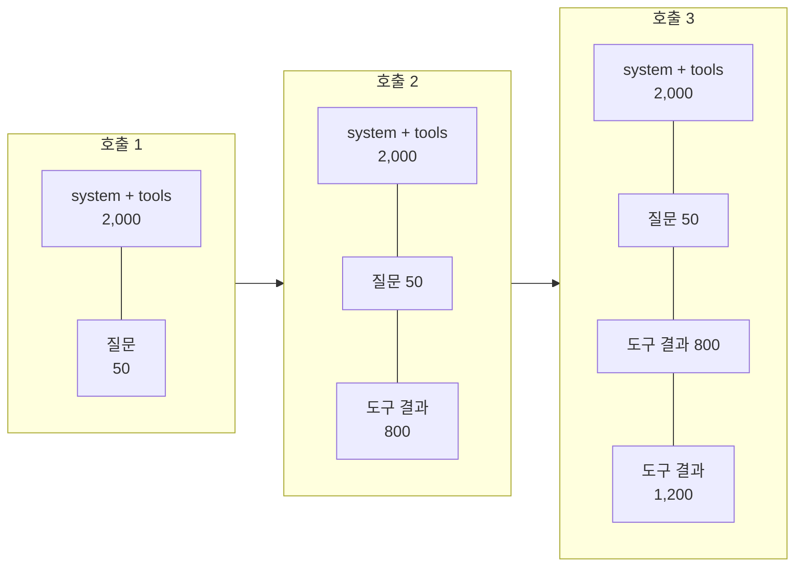
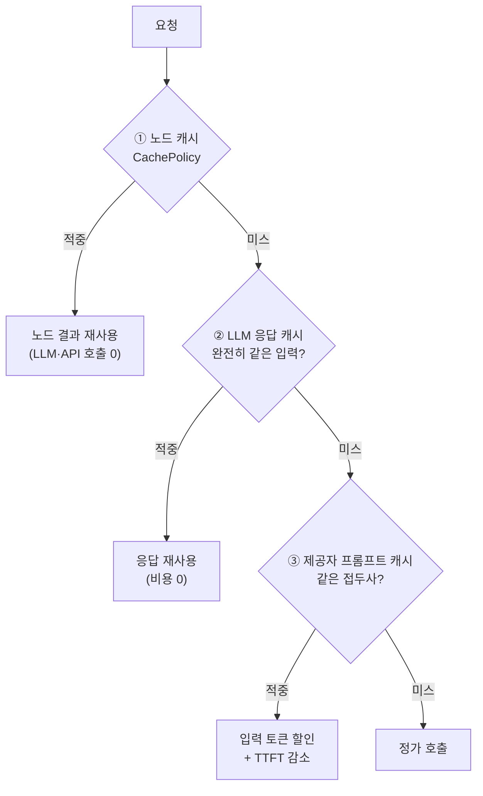

# 비용과 성능

> **"가장 싼 토큰은 보내지 않은 토큰이고, 가장 빠른 LLM 호출은 하지 않은 호출이다."**

에이전트가 잘 동작하기 시작하면 곧 두 가지 청구서가 날아옵니다. 하나는 **돈**(LLM API 비용)이고, 다른 하나는 **시간**(사용자가 기다리는 지연)입니다. 데모에서는 질문 하나에 0.01달러, 8초면 괜찮아 보입니다. 하루 10만 건이 되면 하루 1,000달러가 되고, 8초 대기는 이탈률로 돌아옵니다.

이 강의의 목표는 **품질을 유지하면서** 비용과 지연을 줄이는 것입니다. 최적화를 하기 전에 기준선(8.2강의 평가 점수)을 먼저 정해 두세요. 비용을 30% 줄였는데 정확도가 10% 떨어졌다면 그것은 최적화가 아닙니다.

## 1. 비용과 지연은 어디서 생기나

### 비용의 구조

```text
요청 비용 = Σ (LLM 호출마다)  입력 토큰 × 입력 단가
                              + 캐시 적중 입력 토큰 × 캐시 단가 (보통 입력 단가보다 훨씬 쌈)
                              + 출력 토큰(추론 토큰 포함) × 출력 단가
```

에이전트에서 특히 중요한 사실이 있습니다. **에이전트 루프는 매번 전체 대화를 다시 보냅니다.** 도구를 5번 호출하는 ReAct 루프라면 모델이 6번 호출되고, 시스템 프롬프트·도구 스키마·이전 메시지가 매번 입력으로 다시 들어갑니다. 그래서 에이전트 비용은 대개 **입력 토큰이 지배**합니다.



위 예에서 출력은 몇백 토큰인데 입력은 2,050 + 2,850 + 4,050 = 약 9,000 토큰입니다. 여기서 최적화 방향이 나옵니다.

- **고정 접두사(system + tools)**는 프롬프트 캐시로 싸게 만든다
- **도구 결과**는 필요한 만큼만 잘라서 넣는다 (8.4강: 결과 크기 제한)
- **불필요한 호출**을 줄인다 (라우팅, 캐시, 상한)
- **긴 대화**는 요약·트리밍한다 (3.4강 `SummarizationMiddleware`)

GPT-5 계열 추론 모델은 **보이지 않는 추론 토큰**도 출력 토큰으로 과금합니다. 그래서 같은 답이라도 추론 강도(`reasoning_effort`)에 따라 비용과 지연이 크게 달라집니다. 단순한 분류나 추출에는 낮은 추론 강도로 충분한 경우가 많습니다.

### 지연의 구조

```text
사용자 체감 지연 ≈ 큐 대기 + Σ(순차 LLM 호출의 TTFT + 출력 시간) + Σ(순차 도구 I/O)
```

여기서 핵심 단어는 **순차**입니다. 독립적인 작업을 병렬로 바꾸면 지연은 합이 아니라 최댓값이 됩니다. 스트리밍(8.1강)은 전체 지연을 줄이지는 않지만 **체감 지연(TTFT)**을 줄입니다.

### 최적화 지렛대 한눈에 보기

| 지렛대 | 비용 | 지연 | 품질 위험 | 이 강의 |
| --- | --- | --- | --- | --- |
| 모델 라우팅 (작은 모델 우선) | ↓↓ | ↓ | 중 (평가 필수) | 예제 1 |
| 토큰 예산·호출 상한 | ↓ (상한) | – | 낮음 | 예제 1 |
| 노드 캐시 / 응답 캐시 | ↓↓ | ↓↓ | 낮음 (신선도 주의) | 예제 2 |
| 프롬프트 캐시 (접두사 고정) | ↓ | ↓ | 없음 | 예제 2 |
| 병렬화 (fan-out, batch) | – | ↓↓ | 없음 | 예제 3 |
| 재시도·폴백 | – | 꼬리 지연 ↓ | 폴백 모델 품질 | 예제 3 |
| 컨텍스트 압축 (요약·트리밍) | ↓↓ | ↓ | 중 | 3.4강 |

## 2. 모델 라우팅

모든 질문을 가장 비싼 모델로 처리하는 것이 가장 흔한 낭비입니다. "배송비 얼마예요?"와 "두 요금제를 우리 회사 상황에 맞게 비교 분석해 줘"는 필요한 지능이 다릅니다.

▶ 오른쪽 IDE의 `examples/01_model_routing_and_budget.py`를 실행해 보세요.

```python
class ModelRouter(AgentMiddleware):
    def __init__(self):
        super().__init__()
        self.small = init_chat_model("openai:gpt-5-nano")   # 한 번만 생성
        self.large = init_chat_model("openai:gpt-5-mini")

    def wrap_model_call(self, request: ModelRequest, handler) -> ModelResponse:
        tier = self.choose(request)                          # 규칙/분류기
        return handler(request.override(model=self.small if tier == "small" else self.large))
```

`request.override(model=...)`로 **이번 호출에서만** 모델을 바꿉니다. 도구 바인딩은 에이전트가 알아서 다시 해 줍니다. 출력에서 첫 질문은 두 호출 모두 nano로, 두 번째 질문은 첫 호출(계획)만 mini로, 도구 결과 정리는 nano로 처리되는 것을 확인하세요.

라우팅 기준은 여러 가지가 있습니다.

| 방식 | 설명 | 장단점 |
| --- | --- | --- |
| **규칙 기반** | 길이, 키워드, 단계(도구 결과 정리 턴) | 공짜·즉시. 정확도 한계 |
| **분류기 라우팅** | 작은 모델이 난이도를 먼저 분류 | 정확. 호출 하나 추가 |
| **캐스케이드** | 작은 모델로 먼저 답하고, 자신감·검증 실패 시 큰 모델로 재시도 | 평균 비용 최소. 최악 지연 증가 |
| **단계별 고정** | 계획은 큰 모델, 실행·요약은 작은 모델 (7.4강 Plan-and-Execute) | 단순하고 예측 가능 |

> [!IMPORTANT]
> 라우팅은 **품질 회귀의 대표적인 원인**입니다. 라우터를 바꾸면 반드시 8.2강의 평가를 돌리고, "어떤 유형의 질문이 작은 모델로 가서 실패했는지"를 분석하세요. 트레이스 metadata에 라우팅 결정(`tier`)을 남겨 두면 분석이 쉽습니다.

## 3. 토큰 예산

같은 예제 2번은 **대화(스레드)당 토큰 예산**을 강제합니다.

```python
class BudgetState(AgentState):
    tokens_used: NotRequired[int]

class TokenBudget(AgentMiddleware[BudgetState]):
    state_schema = BudgetState

    def after_model(self, state, runtime):                  # 호출마다 사용량 누적
        usage = state["messages"][-1].usage_metadata or {}
        return {"tokens_used": state.get("tokens_used", 0) + usage.get("total_tokens", 0)}

    @hook_config(can_jump_to=["end"])
    def before_model(self, state, runtime):                 # 넘었으면 호출 전에 종료
        if state.get("tokens_used", 0) >= self.max_tokens:
            return {"messages": [AIMessage("처리 한도에 도달했습니다…")], "jump_to": "end"}
```

미들웨어가 **자기 상태 필드(`state_schema`)**를 추가할 수 있다는 점이 핵심입니다. `tokens_used`는 체크포인터에 함께 저장되므로 대화가 이어져도 누적됩니다. 같은 원리로 **비용(USD) 예산**, **사용자별 일일 한도**(이때는 Store나 외부 DB 사용)를 만들 수 있습니다.

`ModelCallLimitMiddleware`(8.3강)는 **호출 횟수**를 제한합니다. 토큰 예산은 **양**을 제한합니다. 도구 결과가 거대할 때는 호출 수가 적어도 토큰이 폭증하므로 둘 다 필요합니다.

## 4. 캐싱: 세 개의 층

▶ `examples/02_caching.py`를 실행해 보세요.



### ① 노드 캐시 (LangGraph CachePolicy)

```python
builder.add_node("retrieve", retrieve, cache_policy=CachePolicy(ttl=300, key_func=cache_key))
graph = builder.compile(cache=InMemoryCache())
```

노드의 **입력 상태**로 캐시 키를 만들고, 같은 키면 노드를 실행하지 않고 저장된 결과를 씁니다. `key_func`로 키를 정규화할 수 있습니다. 예제에서는 공백·대소문자 차이를 무시해서 `"환불 정책"`과 `"환불   정책"`이 같은 캐시를 씁니다. 임베딩 계산, 검색, 외부 API 조회처럼 **결정적이고 비싼** 노드에 씁니다. `ttl`로 신선도를 관리합니다.

### ② LLM 응답 캐시

```python
from langchain_core.globals import set_llm_cache
set_llm_cache(InMemoryCache())          # 전역, 또는 init_chat_model(..., cache=...)로 모델별
```

메시지·모델·파라미터가 **완전히 같을 때만** 적중합니다. 예제에서 공백 하나만 달라도 새 항목이 생기는 것을 확인하세요. 대화형 에이전트에서는 적중률이 낮습니다. 대신 **FAQ 봇, 분류·추출 배치 작업, 평가 데이터셋 재실행, 개발 중 반복 실행**에서 효과가 큽니다. 운영에서는 Redis 같은 공유 캐시를 씁니다.

> [!WARNING]
> 응답 캐시의 키에 **사용자별 정보가 빠지면** A 사용자의 답이 B에게 갈 수 있습니다. 개인화된 응답이나 권한에 따라 달라지는 응답은 캐시하지 않거나, 키에 사용자·테넌트를 포함하세요.

### ③ 제공자 프롬프트 캐시

OpenAI는 긴 프롬프트의 **앞부분(접두사)**이 최근 요청과 같으면 자동으로 캐시해서 입력 토큰 단가를 크게 낮추고 TTFT도 줄여 줍니다. 코드 변경이 아니라 **프롬프트 구조**로 얻는 최적화입니다.

- **고정된 것은 앞에, 바뀌는 것은 뒤에**: 시스템 프롬프트 → 도구 정의 → few-shot 예시 → 대화 기록 → 새 질문
- 시스템 프롬프트 **맨 앞에 현재 시각, 사용자 이름, 요청 ID**를 넣는 순간 접두사가 매번 달라져 캐시가 깨집니다. 꼭 필요하면 뒤쪽 메시지로 옮기세요.
- 도구 목록의 **순서**도 접두사입니다. 요청마다 도구 순서가 바뀌면 캐시가 깨집니다.
- 적중 여부는 `usage_metadata["input_token_details"]["cache_read"]`로 확인합니다.

```python
llm = init_chat_model("openai:gpt-5-mini")
resp = llm.invoke(messages, prompt_cache_key="tenant:acme:support-v7")  # 같은 키끼리 캐시 공유를 돕는 라우팅 힌트
print(resp.usage_metadata["input_token_details"].get("cache_read", 0))
```

## 5. 병렬화와 배치

▶ `examples/03_parallel_and_fallback.py`의 1·2번을 보세요.

고객 정보, 주문 내역, 상담 이력처럼 **서로 의존하지 않는 조회**는 같은 superstep에서 동시에 실행합니다(4.4강). 0.3초짜리 조회 3개가 순차로는 0.9초, 병렬로는 0.3초입니다. 결과를 합칠 때는 리듀서(`operator.add`)를 씁니다.

```python
for n in ["profile", "orders", "tickets"]:
    g.add_edge(START, n)     # fan-out
    g.add_edge(n, END)       # fan-in
```

LLM 쪽에서는 다음과 같은 병렬화가 가능합니다.
- 여러 입력을 `abatch(inputs, config={"max_concurrency": N})`로 동시 처리합니다. `max_concurrency`로 제공자 레이트 리밋을 넘지 않게 합니다.
- 모델이 한 턴에 여러 도구를 호출하면(병렬 도구 호출) `create_agent`의 도구 노드가 동시에 실행합니다. async 도구로 만들어야 효과가 있습니다.
- 가드레일 분류기와 본 답변 생성을 동시에 시작하고, 가드레일이 실패하면 답변을 버리는 **추측 실행(speculative execution)**도 있습니다.

전체 처리량을 제어하려면 모델에 `rate_limiter`(예: `InMemoryRateLimiter(requests_per_second=...)`)를 붙이거나, 8.5강처럼 서버 차원의 동시성 상한을 둡니다.

## 6. 재시도와 폴백

LLM API는 생각보다 자주 실패합니다. 레이트 리밋(429), 일시적 서버 오류(5xx), 타임아웃이 대표적입니다. 장애를 대비한 설계는 비용 최적화이기도 합니다. 실패한 요청은 이미 쓴 토큰을 버리기 때문입니다.

```python
agent = create_agent(
    primary_model,
    middleware=[
        ModelFallbackMiddleware("openai:gpt-5-mini"),             # 바깥: 다른 모델로 폴백
        ModelRetryMiddleware(max_retries=2, initial_delay=0.5,     # 안쪽: 같은 모델 재시도
                             backoff_factor=2.0, on_failure="error"),
    ],
)
```

미들웨어는 **먼저 등록한 것이 바깥쪽**을 감쌉니다. 위 순서라면 "주 모델을 지수 백오프로 재시도 → 그래도 실패하면 폴백 모델"이 됩니다. 예제에서 주 모델이 3번(1회 + 재시도 2회) 시도된 뒤 폴백 모델이 답하는 것을 확인하세요.

- **재시도는 일시적 오류에만** 합니다. 400(잘못된 요청)이나 컨텍스트 길이 초과는 재시도해도 실패합니다(`retry_on`으로 지정).
- **지터(jitter)**를 켜서 여러 워커가 동시에 재시도하는 "thundering herd"를 막습니다.
- 폴백 모델은 **다른 제공자나 다른 리전**이어야 의미가 있습니다. 같은 제공자의 다른 모델은 같은 장애에 함께 걸리기 쉽습니다.
- 폴백 모델도 평가 데이터셋으로 미리 품질을 확인해 둡니다. 장애 상황에서 처음 써 보는 모델이면 안 됩니다.
- 도구 쪽에는 `ToolRetryMiddleware`, 그래프 노드에는 `RetryPolicy`(5.5강)를 씁니다.

## 7. 실습 안내

`exercise.py`에서 다음 세 가지를 구현합니다.

1. `estimate_cost` — 캐시 적중 토큰을 구분하는 비용 계산기
2. `pick_model` — 규칙 기반 라우터
3. `build_graph` — `CachePolicy`와 `InMemoryCache`로 비싼 노드 캐싱

비용 계산기는 실무에서 바로 쓸 수 있습니다. LangSmith도 트레이스마다 비용을 계산해 주지만, 사용자별·기능별 비용 대시보드를 직접 만들 때 같은 로직이 필요합니다.

## 8. 현업에서는

**측정이 먼저다.** 최적화 전에 LangSmith 대시보드에서 기능별·노드별 토큰과 지연 분포를 보세요. 대개 비용의 80%는 소수의 경로(예: 긴 도구 결과를 그대로 넣는 검색 노드)에서 나옵니다. 감으로 최적화하면 엉뚱한 곳을 고칩니다.

**단위 경제(unit economics)를 정의하라.** "요청당 비용"보다 "해결된 문의당 비용", "전환당 비용"이 의미 있습니다. 싼 모델로 바꿔서 재문의가 늘면 총비용은 오히려 늘어납니다.

**비용 알림은 여러 층으로.** 요청 단위(미들웨어 예산) → 사용자 단위(일일 한도) → 서비스 단위(시간당 지출 이상 탐지 알림) → 조직 단위(제공자 대시보드 월 한도). 무한 루프 하나가 하룻밤에 한 달 예산을 쓰는 사고는 실제로 자주 일어납니다.

**지연 SLO와 타임아웃 예산.** 전체 요청에 10초 예산이 있다면, 각 단계(검색 1초, 계획 2초, 도구 3초, 답변 4초)에 예산을 나누고 단계별 타임아웃을 겁니다. 예산을 넘으면 "부분 결과 + 후속 안내"로 우아하게 저하합니다.

**배치·오프라인 처리는 따로.** 실시간 응답이 필요 없는 작업(야간 요약, 대량 분류, 평가)은 제공자의 Batch API나 저우선순위 처리 등급(예: OpenAI의 `service_tier="flex"`)을 쓰면 단가를 크게 낮출 수 있습니다.

**안티패턴**
- ❌ 모든 단계에 가장 큰 모델 + 최고 추론 강도
- ❌ 도구가 반환한 5만 토큰짜리 JSON을 그대로 컨텍스트에 넣기
- ❌ 시스템 프롬프트 맨 앞의 타임스탬프 (프롬프트 캐시 파괴)
- ❌ 재시도 상한 없는 재시도 루프 (장애 시 비용 폭증 + 장애 확산)
- ❌ 평가 없이 "더 싼 모델로 교체"

## 9. 정리

- 에이전트 비용은 루프마다 반복되는 **입력 토큰**이 지배하고, 지연은 **순차 LLM 호출 수**가 지배합니다.
- `wrap_model_call` + `request.override(model=...)`로 요청마다 충분히 좋은 가장 싼 모델을 고릅니다.
- 미들웨어 `state_schema`로 토큰·비용 예산을 상태에 누적하고 `before_model`에서 강제합니다.
- 캐시는 세 층입니다. 노드 캐시(`CachePolicy`), 응답 캐시(`set_llm_cache`), 프롬프트 캐시(고정 접두사)입니다.
- 독립 작업은 병렬로, 일시적 오류는 재시도로, 지속 장애는 다른 제공자로 폴백합니다.
- 다음 강의(8.7)에서는 지금까지 배운 모든 것을 합쳐 **고객지원 멀티 에이전트**를 완성합니다.
