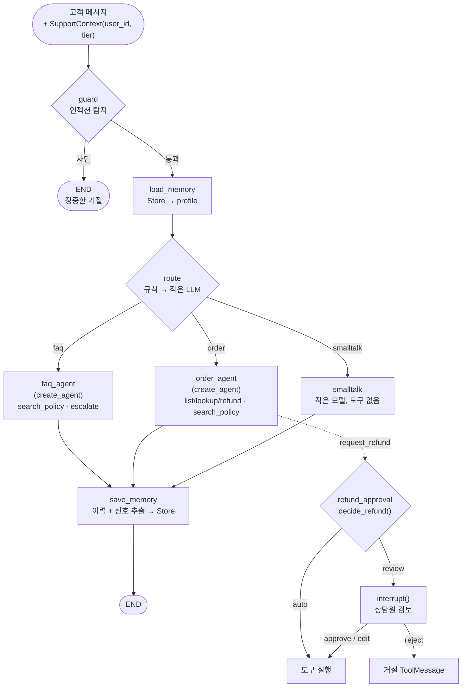

# 캡스톤: 고객지원 멀티 에이전트

지금까지 배운 내용을 하나의 시스템으로 묶습니다. 만들 것은 **ACME 쇼핑몰의 고객지원 에이전트**입니다. 이 강의는 코드를 처음부터 따라 치는 강의가 아닙니다. **설계 결정을 읽고, 실행해 보고, 확장하는** 강의입니다. 강의 폴더의 `support_desk/` 패키지가 완성된 구현이고, 오른쪽 IDE의 예제 3개로 동작을 확인합니다. 실습에서는 새 비즈니스 요구사항을 반영해 시스템을 직접 조립합니다.

## 1. 요구사항

제품팀이 다음 요구사항을 전달했다고 합시다.

**기능 요구사항**
1. 정책 질문(환불·교환·배송·멤버십)에 **사내 정책 문서를 근거로** 답한다. 출처를 밝힌다.
2. 로그인한 고객의 **본인 주문만** 조회한다.
3. 환불을 처리한다. **정책 범위 안이면 자동, 밖이면 상담원 검토** 후 처리한다. 상담원은 승인·금액 조정·거절을 할 수 있다.
4. 인사·감사 같은 잡담에는 짧게 응대한다.
5. 고객의 선호("짧게 답해 줘")와 최근 문의 이력을 **다음 대화에서도** 기억한다.
6. 답변이 **실시간으로** 표시되고, 어떤 담당이 처리 중인지, 도구가 무엇을 하는지 보인다.

**비기능 요구사항**
- 프롬프트 인젝션 차단, 개인정보(이메일·카드·전화번호) 마스킹
- 요청당 모델 호출 상한, 쉬운 일은 작은 모델로 처리(비용)
- 결정적 단위 테스트와 평가로 회귀를 막는다
- 운영 환경에서는 Postgres 체크포인터/스토어와 Agent Server 또는 FastAPI로 배포한다

## 2. 아키텍처



### 모듈 지도

| 파일 | 책임 | 관련 강의 |
| --- | --- | --- |
| `support_desk/config.py` | 모델, 정책 한도, 안전장치 설정 | 8.6 |
| `support_desk/data.py` | 가짜 고객·주문·정책 문서 | – |
| `support_desk/knowledge.py` | 정책 문서 색인과 검색, 출처 표기, 신뢰 경계 | 6.3, 6.4 |
| `support_desk/tools.py` | 상담 도구, `SupportContext` | 2.4, 8.3 |
| `support_desk/policies.py` | 인젝션 가드, 환불 정책 함수, 승인 미들웨어, PII | 8.3, 5.3 |
| `support_desk/memory.py` | Store 네임스페이스, 프로필·이력·선호 추출 | 5.4 |
| `support_desk/router.py` | 규칙 라우터 + 구조화 출력 LLM 라우터 | 7.2, 2.3 |
| `support_desk/agents.py` | 전문가 에이전트와 미들웨어 스택 | 3.2, 3.3 |
| `support_desk/graph.py` | 최상위 `StateGraph` 조립(의존성 주입 팩토리) | 4.4, 4.6 |
| `support_desk/ui.py` | v2 스트림 → UI 이벤트 프로토콜 | 8.1 |
| `support_desk/testing.py` | 대본 모델 | 8.2 |

모듈 경계를 나눈 기준은 **변경 이유**입니다. 환불 한도가 바뀌면 `config.py`와 `policies.py`만, 새 정책 문서가 생기면 `data.py`(실제로는 CMS)와 색인만, 프론트엔드 이벤트 형식이 바뀌면 `ui.py`만 고칩니다. 한 파일에 모든 것을 넣은 "God 에이전트"는 데모에서는 빠르지만, 세 번째 요구사항 변경부터 무너집니다.

## 3. 핵심 설계 결정

### 결정 1: 왜 "라우터 + 전문가" 구조인가

하나의 에이전트에 도구 5개와 모든 지시를 넣을 수도 있습니다. 그런데도 나눈 이유는 다음과 같습니다(7.1강).

- **컨텍스트 격리**: FAQ 담당은 환불 도구를 모르므로 정책 질문에 실수로 환불을 실행할 수 없습니다(최소 권한).
- **프롬프트 단순화**: 전문가마다 짧고 구체적인 지시를 줍니다. 지시가 짧을수록 모델이 잘 따릅니다.
- **비용**: 잡담은 도구 없는 작은 모델로 처리합니다.
- **평가 단위**: 라우터 정확도, 전문가별 품질을 따로 측정하고 개선할 수 있습니다.

반대로 나누지 **않은** 것도 있습니다. 주문 조회와 환불은 같은 에이전트에 있습니다. 환불하려면 대개 주문 조회가 먼저 필요해서, 둘을 나누면 핸드오프만 늘어납니다. **에이전트 경계는 도구가 아니라 업무 흐름**을 기준으로 정합니다.

### 결정 2: 라우터는 규칙 먼저, LLM은 나중에

```python
def route(state) -> Command[Literal["faq_agent", "order_agent", "smalltalk"]]:
    text = _last_human_text(state)
    by_rule = rule_route(text)                      # 0ms, 무료, 결정적
    decision, source = (by_rule, "rule") if by_rule else (llm_route(text).route, "llm")
    return Command(update={"route": decision, "route_source": source}, goto=TARGETS[decision])
```

주문 번호(`A-1001`)가 있으면 무조건 주문 업무입니다. 이런 명백한 경우까지 LLM에 묻는 것은 낭비입니다. 규칙이 처리하지 못한 애매한 문장만 작은 모델의 구조화 출력으로 분류합니다. `route_source`를 상태에 남겨 두면 트레이스에서 "LLM 라우터로 간 비율"과 "그중 오분류율"을 분석할 수 있습니다. 운영 데이터가 쌓이면 자주 나오는 패턴을 규칙으로 옮겨 비용을 더 줄입니다.

`guard`와 `route`는 `Command(goto=...)`로 다음 노드를 직접 고릅니다(4.4강). 반환 타입 힌트 `Command[Literal[...]]`는 그래프 시각화와 검증에 쓰입니다. 그래서 `graph.py`의 고정 엣지는 4종류뿐입니다.

### 결정 3: 정책은 순수 함수, 집행은 미들웨어

환불 규칙은 비즈니스 팀이 자주 바꿉니다. 그래서 **판정**과 **집행**을 분리했습니다.

```python
def decide_refund(order_id, amount, user_id, tier, reason="") -> tuple["auto" | "review", str]:
    ...   # 본인 주문? 배송 완료 후 7일 이내? 등급별 한도 이내?

@wrap_tool_call
def refund_approval(request, handler):
    decision, why = decide_refund(...)
    if decision == "auto":
        return handler(request)
    answer = interrupt({"type": "refund_review", "reason": why, "request": args, ...})
    ...   # approve / edit / reject
```

- `decide_refund`는 **순수 함수**라서 표 형태의 단위 테스트로 모든 경계 조건을 검증할 수 있습니다(예제 2 Part 1).
- 집행은 `wrap_tool_call`에서 합니다. 모델이 어떤 인자로 호출하든, 실행 직전에 결정적 코드가 판단합니다. 프롬프트로 "5만 원 넘으면 승인 요청해"라고 쓰는 방식과 달리 **우회할 수 없습니다**.
- `interrupt` payload에는 상담원이 판단하는 데 필요한 정보(사유, 고객 등급, 요청 원문)를 담습니다. 이 payload가 그대로 **감사 로그**가 됩니다.
- `interrupt` 앞에는 부수효과가 없습니다. 재개되면 미들웨어가 처음부터 다시 실행되기 때문입니다(5.5강).

### 결정 4: 권한은 컨텍스트에서, 검사는 도구 안에서

```python
@tool
def lookup_order(order_id: str, runtime: ToolRuntime[SupportContext]) -> str:
    order = ORDERS.get(order_id)
    if order is None or order["customer"] != runtime.context.user_id:
        return f"주문 {order_id} 을(를) 찾을 수 없습니다. ..."
```

도구는 `user_id`를 인자로 받지 않습니다. 인자로 받으면 모델이(또는 인젝션 공격이) 다른 사용자 ID를 넣을 수 있습니다. `runtime.context`는 서버가 인증 정보로 채우므로 모델이 바꿀 수 없습니다. 남의 주문에는 "없음"과 "권한 없음"을 구분하지 않고 같은 메시지를 돌려줍니다. 응답 차이로 남의 주문 번호가 실제로 있는지 알아내는 탐색을 막기 위해서입니다.

### 결정 5: 메모리는 두 층

| 층 | 저장소 | 수명 | 내용 |
| --- | --- | --- | --- |
| 단기(대화) | 체크포인터, `thread_id` | 대화 한 개 | 메시지, route, interrupt 상태 |
| 장기(사용자) | Store, `("users", user_id)` | 사용자 평생 | 프로필, 선호(`prefers_concise`), 최근 문의 이력 |

`load_memory` 노드가 대화 시작 시 프로필을 불러오고, 전문가의 `dynamic_prompt` 미들웨어가 그것으로 시스템 프롬프트를 개인화합니다. 프롬프트는 **고정 지시를 앞에, 고객 정보를 뒤에** 둡니다. 그래야 8.6강의 프롬프트 캐시가 깨지지 않습니다. `save_memory`는 규칙 기반으로 선호를 추출합니다. 실무에서는 대화가 끝난 뒤 백그라운드 작업에서 LLM이 구조화 출력으로 "기억할 사실"을 뽑아 저장합니다(5.4강).

### 결정 6: 스트리밍은 프로토콜로

`ui.py`는 `subgraphs=True` + `version="v2"` 스트림을 UI 이벤트로 바꿉니다(8.1강). `ns`의 첫 요소로 **어느 전문가가 말하는지**(`agent` 이벤트)를 알리고, 라우터 같은 내부 LLM 호출의 토큰은 내보내지 않습니다. 전문가의 `model` 노드 토큰과 `final_answer` 태그가 붙은 토큰만 답변으로 내보냅니다. 서브그래프와 부모에서 같은 interrupt가 두 번 올라오므로 `id`로 중복을 제거합니다. 이것은 실제로 구현하면서 발견한 함정입니다.

## 4. 실행해 보기

▶ **`examples/01_end_to_end_chat.py`** — 한 고객이 한 스레드에서 다섯 턴을 진행합니다. 정책 질문(faq) → 주문 목록(order) → "짧게 답해 줘" + 교환 정책(faq, 선호 저장) → 인사(smalltalk) → 인젝션(차단) 순서입니다. 턴마다 담당 에이전트, 도구 호출, 진행 상황, 답변 토큰이 이벤트로 출력됩니다. 마지막에 Store에 저장된 프로필(`prefers_concise: True`)과 이력을 확인합니다.

▶ **`examples/02_refund_hitl.py`** — Part 1은 `decide_refund` 판정표입니다. Part 2는 운영 흐름입니다. VIP 고객의 15만 원 환불 요청이 한도 초과로 멈추면, "상담원 콘솔"이 `graph.get_state(cfg, subgraphs=True).interrupts`로 대기 건을 조회합니다. 상담원은 결제 금액 8.9만 원으로 **조정(edit)**해서 승인합니다. 기간이 지난 주문은 **거절(reject)**하고, 에이전트가 고객에게 사유를 안내합니다.

▶ **`examples/03_eval_and_review.py`** — 출시 전 품질 게이트입니다.
- **A) 라우팅 평가**: 라벨링된 문장으로 규칙 라우터 정확도와 LLM 경로 비율을 봅니다.
- **B) 안전성 평가**: 인젝션 세트가 모두 차단되는지, 그리고 **전문가 모델이 한 번도 호출되지 않았는지** 검증합니다. 비어 있는 대본 모델을 주입했기 때문에, 호출되면 즉시 실패합니다.
- **C) 궤적 단위 테스트**: 대본 모델로 본인 주문 조회, 타인 주문 차단, 고액 환불 검토 대기, VIP 소액 자동 환불을 검증합니다.
- **D) 아키텍처 리뷰**: 체크리스트 중 코드로 확인 가능한 항목(가드 노드, 체크포인터, Store, 호출 상한, 요약, PII)을 그래프 구조에서 자동 점검합니다.

> [!NOTE]
> Mock 모드에서는 모델이 도구 인자를 대충 채우므로 주문 번호가 틀리는 등 "어설픈 상담원"처럼 보입니다. 그래도 **라우팅, 권한 검사, 승인 정책, 메모리, 스트리밍의 흐름은 실제와 똑같이** 동작합니다. 정책 판정과 궤적은 대본 모델로 결정적으로 검증하므로 Mock 여부와 관계없이 같은 결과가 나옵니다. API 키를 넣으면 실제 상담 품질을 확인할 수 있습니다.

## 5. 실습: 새 요구사항 반영하기

비즈니스 팀의 새 요구사항입니다. **"불량으로 인한 환불은 고객 경험을 위해 자동 승인 한도를 2배로 올려 주세요."**

`exercise.py`에서 세 가지를 구현합니다.

1. `decide_refund_v2` — 사유에 "불량"이 있으면 한도 2배. 나머지 규칙은 유지합니다.
2. `build_graph` — `support_desk`의 노드와 빌더로 최상위 그래프를 직접 조립합니다. `Command`로 라우팅하는 노드가 있으므로 고정 엣지는 4종류만 필요합니다.
3. `handle_turn` — 한 턴을 실행하고, interrupt가 생기면 승인자 함수의 결정으로 재개하기를 반복합니다. 무한 루프를 막기 위해 `max_reviews` 상한을 둡니다.

자가 채점은 새 정책을 운영 미들웨어에 연결한 뒤(`policies.decide_refund = decide_refund_v2`), 대본 모델로 두 시나리오를 돌립니다. "제품 불량" 사유는 자동 환불되고, "단순 변심" 사유는 상담원 검토를 거쳐 5만 원으로 조정됩니다.

## 6. 아키텍처 리뷰 체크리스트

실제 팀에서 에이전트를 출시하기 전에 쓰는 리뷰 항목입니다. 이 캡스톤이 어디까지 충족하는지 함께 표시했습니다.

| 영역 | 점검 항목 | 캡스톤 |
| --- | --- | --- |
| **설계** | 에이전트 경계가 업무 흐름 기준인가 / 결정적 로직은 코드로 뺐는가 | ✅ 라우터 규칙·정책 함수 |
| **상태** | 체크포인터·Store가 운영용인가 / thread_id가 사용자별로 격리되는가 | ⚠️ 인메모리 (8.5강 Postgres로 교체) |
| **루프 안전** | 모델·도구 호출 상한, recursion_limit, 타임아웃 | ✅ ModelCallLimit / ⚠️ 노드 타임아웃 미설정 |
| **보안** | 입력 가드, PII, 최소 권한 도구, 컨텍스트 기반 권한, 외부 데이터 경계 표시 | ✅ |
| **HITL** | 쓰기 작업 승인 정책, interrupt 앞 부수효과 없음, 감사 로그 | ✅ / ⚠️ 감사 로그 저장소 없음 |
| **비용** | 작은 모델 라우팅, 프롬프트 캐시 친화 구조, 컨텍스트 요약 | ✅ |
| **신뢰성** | 재시도·폴백, 멱등성(환불 중복 방지 키) | ⚠️ 폴백·멱등 키 미구현 |
| **관측성** | 트레이스 metadata(user_id, route, route_source), 비용 대시보드 | ⚠️ route_source만 기록 |
| **테스트** | 대본 모델 단위 테스트, 라우팅·안전성·궤적 평가, 회귀 게이트 | ✅ (CI 연결은 과제) |
| **UX** | 스트리밍 이벤트 프로토콜, 담당자 표시, 승인 대기 안내 | ✅ |

⚠️ 항목이 다음 단계의 과제입니다.

## 7. 확장 과제

1. **멱등성**: 같은 환불이 두 번 실행되지 않도록 `request_refund`에 멱등 키(`thread_id + tool_call_id`)를 도입하세요. 재시도·재개 상황을 테스트로 재현해 보세요.
2. **폴백·재시도**: 전문가 에이전트에 `ModelRetryMiddleware`와 다른 제공자의 `ModelFallbackMiddleware`를 추가하세요(8.6강).
3. **핸드오프**: FAQ 에이전트가 대화 도중 주문 업무가 필요하다고 판단하면 `Command(goto="order_agent", graph=Command.PARENT)`로 넘기게 하세요(7.3강).
4. **배포**: `graph.py`에 체크포인터·스토어 없이 컴파일하는 `make_graph()` 팩토리를 추가하고, `langgraph.json`에 `"support": "./support_desk/graph.py:make_graph"`로 등록하세요(영속성은 플랫폼이 붙입니다). 또는 8.5강의 FastAPI 서버에 연결하세요.
5. **MCP**: 주문 시스템을 MCP 서버로 분리하고, 주문 에이전트가 `MCPAdapter`로 도구를 가져오게 하세요(8.4강). 도구 주석 기반 승인 정책도 함께 적용해 보세요.
6. **온라인 평가**: LangSmith에 트레이스를 보내고, 5% 샘플을 LLM 심판으로 채점하는 온라인 평가를 구성하세요(8.2강).

## 8. 현업에서는

**첫 출시는 좁게.** 실제 고객지원 에이전트는 "모든 문의 자동 처리"로 시작하지 않습니다. 정책 FAQ처럼 **읽기 전용·저위험** 업무부터 시작하고, 상담원 보조(초안 작성, 상담원이 검토 후 전송) 모드를 거쳐, 데이터로 품질이 확인된 업무만 자동화 범위를 넓힙니다. 환불처럼 돈이 오가는 업무는 처음에는 100% 사람 승인으로 운영하고, 자동 승인 한도를 데이터를 보며 천천히 올립니다.

**지표를 정의하라.** 자동 해결률, 상담원 이관률, 재문의율, 고객 만족도(CSAT), 문의당 비용, 승인 대기 시간을 대시보드에 올립니다. 에이전트 품질은 오프라인 평가 점수가 아니라 **이 지표들**로 최종 판단합니다.

**사람이 루프 안에 있다는 것의 의미.** 상담원 콘솔(승인 대기 목록, 고객 정보, 대화 요약, 승인·조정·거절 버튼)은 에이전트만큼 중요한 제품입니다. 승인이 느리면 고객은 기다리고, 승인 UI가 불편하면 상담원은 대충 승인합니다. 이렇게 되면 HITL이 형식적인 절차로 전락합니다.

**장애 시나리오를 리허설하라.** LLM 제공자 장애, 벡터 DB 장애, 주문 API 장애 때 각각 어떻게 동작해야 하는지 정하고(폴백 모델, "정책 문서 검색 불가 — 상담원 연결", 읽기 전용 모드), 장애 주입 테스트로 확인합니다.

## 9. 마치며

축하합니다. 여러분은 LLM 호출 한 줄에서 시작해 다음을 모두 갖춘 시스템을 설계하고 검증했습니다.

- 그래프 기반 오케스트레이션과 멀티 에이전트 구조
- RAG와 도구, 사람의 승인을 결합한 업무 자동화
- 단기·장기 메모리
- 실시간 스트리밍 UX
- 보안 가드레일과 비용 통제
- 테스트·평가·리뷰라는 엔지니어링 규율

이것이 2026년 현업 AI Agent 엔지니어가 매일 하는 일입니다. 다음 단계는 여러분의 도메인 문제를 골라, 이 강의의 아키텍처 리뷰 체크리스트를 들고 **작게 출시하고, 측정하고, 개선하는 것**입니다.
